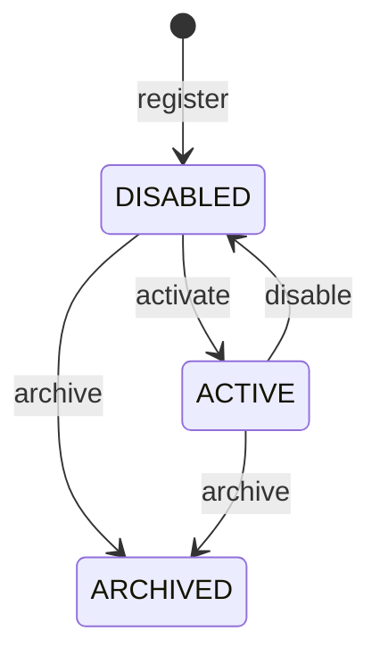

# T04 — Agent Registry API

T08 verifies these HTTP contracts, persistence and access boundaries together with Task/lifecycle/audit modules; see the [acceptance report](phase-1-acceptance.md). Registration and activation remain administrative only. Production authentication is not implemented; local-development gating remains mandatory.

Status: **IMPLEMENTED**, local-development access only. Backend: `apps/api/src/agents/`; PostgreSQL/Drizzle and the two T03 migrations are reused unchanged. The city in root `dist/` remains independent and has no API integration. No provider, orchestrator runtime, worker, task API, or AI execution is enabled by registration or activation.

## Access and local setup

Real authentication/membership authorization is **NOT IMPLEMENTED**. T04 follows the explicitly permitted local-development exception: registry routes are disabled by default, startup rejects enabling them in production, and enabled operation requires a literal loopback bind, an existing database owner scope, and a random bearer credential. This is a single local operator credential, not a user identity, JWT system, or production access-control solution.

1. Follow [PostgreSQL setup, role provisioning and migrations](database-foundation.md). Run `npm run db:migrate` explicitly; application startup never migrates. Do not expose the Compose bootstrap superuser through an API deployment.
2. Identify your actual workspace owner and intended registered orchestration route using an authorized SQL administrator. T03 seeded neither. If starting a **new local development workspace**, explicitly register its actual owner and intended route with parameterized SQL or interactive `psql`, using the existing `owners` and `orchestrators` schema. Required values are owner name and orchestrator owner/name/type (for example `native` for the intended native route). Retain the returned UUIDs. Leave connectivity `UNKNOWN` and registration `DISABLED` until later orchestration work actually establishes availability. These are logical registrations, not evidence of an executing runtime. No API/bootstrap script silently creates them, and tests create fixtures only in isolated databases.
3. Copy `apps/api/.env.example` to ignored `apps/api/.env` and configure the database. Generate a local credential: `node -e "console.log(require('node:crypto').randomBytes(32).toString('hex'))"`. Store it only in the ignored environment file or process environment, never source control or browser storage.
4. Set the following, replacing placeholders with your existing owner UUID and generated credential:

```dotenv
NODE_ENV=development
API_HOST=127.0.0.1
API_PORT=3001
CORS_ORIGINS=http://localhost:5173,http://127.0.0.1:5173
AGENT_REGISTRY_ENABLED=true
AGENT_REGISTRY_OWNER_ID=<existing-owner-uuid>
AGENT_REGISTRY_TOKEN=<random-credential>
```

5. Run `npm run dev:api` independently of `npm run dev:web`. All registry requests require `Authorization: Bearer <random-credential>`. Process environment overrides `apps/api/.env`, which overrides defaults. `GET /health` stays public and proves liveness only.

Configuration rules: `AGENT_REGISTRY_ENABLED` is `true` or `false`, default absent/disabled; enabled requires `NODE_ENV=development` or `test`, `API_HOST=127.0.0.1` or `::1`, configured database, UUID owner, and a 32–128 character ASCII alphanumeric/underscore/hyphen credential. Generate randomness; length validation alone cannot establish entropy. `localhost` is deliberately not accepted as a bind for this mode, avoiding DNS ambiguity. An absent owner fails startup. Invalid environment errors include field names only.

Requests also require an actual loopback socket, a loopback/localhost Host header, and either no Origin (CLI client) or an exact configured origin. Forwarded headers never grant access. Invalid credentials return 401; disallowed host/origin/socket returns 403. Disabled registry returns 404, including in production. Existing safe response/body limits, CORS, structured redacted logs, request IDs and shutdown remain active. No endpoint accepts a client-selected owner. Every query and association is scoped to the configured owner; cross-owner agent lookups return 404, and cross-owner orchestrator IDs are indistinguishable from nonexistent ones.

Do not publish this development API through a tunnel, reverse proxy, port forwarding or public container mapping. Local bearer access does not provide multiuser identity, roles, membership, revocation lists, TLS or per-user audit attribution. Production must keep it disabled until real authentication/authorization replaces this guard. No complete auth system was added in T04.

## Routes and response contract

The T01 proposed versioned prefix is adopted: `/api/v1/agents`, rather than the unversioned example `/api/agents`. Health remains `/health`.

| Method | Route | Behavior |
| --- | --- | --- |
| POST | `/api/v1/agents` | Register a logical agent; 201; always initially DISABLED |
| GET | `/api/v1/agents/:id` | Retrieve owner-scoped metadata; 200 or 404 |
| GET | `/api/v1/agents` | Bounded filtered list; 200 |
| PATCH | `/api/v1/agents/:id` | Update metadata with quoted integer `If-Match`; 200 |
| POST | `/api/v1/agents/:id/activate` | Administratively mark ACTIVE; 200 |
| POST | `/api/v1/agents/:id/disable` | Administratively mark DISABLED; 200 |
| POST | `/api/v1/agents/:id/archive` | Permanently archive registration; 200 |

There is no delete/deactivate endpoint: INACTIVE is not a T03 status. No Orchestrator Registry API exists. All path IDs must be UUIDs. Unsupported query fields are rejected; only the list route accepts query parameters. Lifecycle bodies must be empty objects or absent. Unsupported body fields, including raw constructor/prototype keys, are rejected rather than silently removed.

Registration example (substitute an existing same-owner orchestrator UUID):

```http
POST /api/v1/agents
Authorization: Bearer <local-credential>
Content-Type: application/json

{
  "name": "Research Agent",
  "description": "Researches and summarizes information",
  "type": "LLM",
  "orchestratorId": "84e642f1-2408-4aaa-8ca7-97f72ee493b4",
  "capabilities": ["research", "summarization"],
  "configuration": {"category": "research", "color": "#35bdea"}
}
```

Representative 201 response; server-generated IDs/timestamps are illustrative:

```json
{
  "id": "5c355c08-102a-4c33-969b-3d8b0338354e",
  "name": "Research Agent",
  "description": "Researches and summarizes information",
  "type": "LLM",
  "orchestratorId": "84e642f1-2408-4aaa-8ca7-97f72ee493b4",
  "lifecycleStatus": "DISABLED",
  "capabilities": ["research", "summarization"],
  "version": 1,
  "createdAt": "2026-10-21T00:00:00.000Z",
  "updatedAt": "2026-10-21T00:00:00.000Z"
}
```

Registration rules:

- Name is trimmed and whitespace runs collapse to one space; normalized length 1–160; remaining control characters rejected. Display names are **not unique**, per T03. Repeating POST creates a distinct logical agent; there is no registration idempotency key or duplicate-name conflict. UUID is identity.
- Description is optional, nullable, maximum 4,000 characters. It is public metadata: never put secrets in names/descriptions/capabilities.
- Type is exactly `RULE_BASED`, `LLM`, or `EXTERNAL`; type is immutable through this API. LLM/EXTERNAL labels do not imply runnable support or require a provider.
- Orchestrator UUID is **required and non-null**, following T03. It must belong to the same owner. Its connectivity/administrative state does not prevent logical registration; there is no external call. No default or fake connected orchestrator is created.
- Capabilities default to `[]`, maximum 32 unique strings matching `[a-z][a-z0-9_.-]{0,63}`. They describe metadata and grant no tool permissions.
- Configuration defaults to `{}` and accepts **only** optional `category` (`general`, `research`, `design`, `build`, `test`) and hexadecimal `color`. Nested structures, arbitrary metadata, provider IDs/settings, credentials, API keys, tokens and unknown fields are rejected. Null is not accepted. Future runtime configuration needs a separate reviewed/versioned schema.
- IDs, scope, lifecycle, versions, timestamps and execution data are server controlled. No mass assignment.

Responses intentionally omit **all configuration**, including legacy arbitrary JSON allowed by T03. They also omit owner IDs, orchestrator configuration/credentials, internal connection state, and execution history. Safe metadata DTOs are returned, not ORM records. Configuration is currently write-only; an authorized read contract can be added later. Existing database records are not retroactively rewritten by the serializer.

## Listing

```http
GET /api/v1/agents?status=DISABLED&type=LLM&limit=20&offset=0&search=Research
Authorization: Bearer <local-credential>
```

Optional filters: `status` (ACTIVE/DISABLED/ARCHIVED), `type`, `orchestratorId`, literal case-insensitive substring `search` (1–160 characters). `%`, `_` and backslash are escaped in substring searches. All SQL values use Drizzle parameters. Default limit 20, range 1–100; offset 0–10,000. A single query fetches limit+1 records without N+1 orchestrator loading or unbounded totals. Ordering is `(createdAt ASC, id ASC)` with a UUID tie breaker.

```json
{
  "items": [],
  "pagination": {"limit": 20, "offset": 0, "hasMore": false}
}
```

Advance offset by limit while hasMore is true. Each page has deterministic order, but offset pagination is not a cross-request snapshot: concurrent changes affecting filters can shift pages. No total count or snapshot cursor is promised. Existing owner/lifecycle and owner/orchestrator indexes are reused; no speculative search index or schema migration is added at this scale.

## Metadata updates and lifecycle

```http
PATCH /api/v1/agents/5c355c08-102a-4c33-969b-3d8b0338354e
Authorization: Bearer <local-credential>
Content-Type: application/json
If-Match: "1"

{"description": null, "capabilities": ["research"]}
```

Only name, description, capabilities and safe configuration are updateable. Omitted fields are preserved. Description null clears it; empty capabilities/configuration clear their contents. Configuration replacement is permitted only through the same narrow validated schema. An empty patch is 400. Type/orchestrator reassignment is explicitly disallowed in T04: route migration policy and historical execution implications belong to future orchestration work. Generic PATCH cannot change lifecycle or archived records.

PATCH and lifecycle requests require `If-Match: "<current version>"`, taken from the response `version` field (no ETag header is supplied). Missing/malformed versions are 400, stale changes 409. Re-fetch before resolving a real conflict. Row locking and PostgreSQL-triggered versions prevent lost updates. Timestamps/versions are never accepted from the body.

```http
POST /api/v1/agents/5c355c08-102a-4c33-969b-3d8b0338354e/activate
Authorization: Bearer <local-credential>
Content-Type: application/json
If-Match: "2"

{}
```



Repeating the currently effective status returns the current representation without updating version/time or appending another event, including retries using the original version. A different desired status with a stale version still conflicts. ARCHIVED cannot reactivate or update metadata and remains readable; archive never deletes history. No task/execution is changed or cancelled.

**Clarification to the original T01 proposal:** T04 activation means administrative enablement only. It does not verify an enabled/compatible executing orchestrator or a rule handler, because neither runtime integration nor handler configuration exists yet. Future task acceptance must independently check lifecycle, route enablement, capabilities and runtime readiness; ACTIVE never proves a process is running. This uses existing statuses without schema changes.

## Transactions, errors and events

Controllers validate/serialize HTTP inputs and delegate; `AgentsService` owns scope/rules and explicit Drizzle transactions through existing `DatabaseService`. A second repository interface/ORM is unnecessary for this single module. Future T05 services can use the same boundary without querying controllers or accepting raw client owner IDs.

Registration, metadata changes and actual lifecycle transitions atomically write the agent, an `agent_events` row and an ACCEPTED `command_audit` row. Existing T03 triggers assign commit-safe owner stream positions and append an outbox row in the transaction. Audit failure rolls back all changes. Event payloads contain only lifecycle status/version, no names/descriptions/configuration or credentials. The local audit actor is explicitly `local-development-operator`, an operational label rather than a fabricated authenticated person. Correlation UUIDs link each event and audit entry; HTTP request IDs remain a separate logging identifier.

Events currently emitted with schemaVersion 1: `agent.registered`, `agent.updated`, `agent.active`, `agent.disabled`, `agent.archived`. Aggregate sequence is allocated under the agent row lock; resource version is separate (direct historical SQL writes may advance it). No event delivery, replay API or outbox publisher is implemented. T07 must consolidate public event contracts before consumers depend on this initial history. Failed/rejected command attempts are represented by safe HTTP logs; they are not yet persisted in command_audit. Read operations and idempotent no-ops do not append history.

| HTTP status | Meaning |
| --- | --- |
| 400 | Invalid ID/body/query/If-Match, unavailable same-owner orchestrator reference, or database FK/CHECK violation |
| 401 | Missing/invalid local development credential |
| 403 | Disallowed request socket/host/origin |
| 404 | Disabled registry, absent or out-of-scope agent, unsupported route |
| 409 | Stale resource version, invalid archived transition/update, uniqueness/serialization/deadlock conflict |
| 413 | Existing 64 KiB request-body limit exceeded |
| 503 | Recognized database connectivity/query availability failure |
| 500 | Unexpected internal failure; details remain hidden |

Errors retain the existing safe shape; raw driver/query details and stack traces are never exposed or logged by the registry:

```json
{"statusCode":409,"message":"Request conflicts with current state.","requestId":"request-correlation-id"}
```

## Verification and limitations

Run from repository root (use `npm.cmd` on PowerShell where necessary):

```sh
npm run lint
npm run build
npm run test:all
npm run db:check
npm run test:db
```

The existing lint command performs city syntax checks and strict TypeScript checks, not ESLint. The frontend is buildless; no separate frontend build exists. Database tests require Docker and reuse only their own randomly named/labeled container, isolated database and named volume, ignoring developer DATABASE_URL. They retain the original fresh/repeated migrations, constraints and actual PostgreSQL restart checks, then run registry HTTP tests against the real Nest server/database. No developer database is reset or seeded.

Coverage includes normalized/invalid DTOs, safe serializer, empty patch, lifecycle/version rules, default/production fail-closed, guard boundaries; HTTP registration/retrieval across Nest restart, duplicate display names, ownership, orchestrator references, raw forbidden fields, secret rejection/log redaction, deterministic tied-time pagination, persisted updates, concurrent version conflicts, lifecycle idempotence/archive, absent owner startup, legacy JSON redaction and transactional audit failure rollback.

Known limits: local operator mode only; no multiuser authorization, production deployment verification, rate-limit subsystem or request-idempotent registration; bounded offset pagination and no total; write-only configuration; no route reassignment or orchestrator registration API; rejected-command persistent audit and public event normalization remain later work. The city has no new API dependency. Existing stored metadata still requires appropriate data handling/retention and least-privilege database access.

No packages, schema, SQL migrations, frontend files, deployment configuration, or AI integration are added/changed in T04. No actual developer owner/orchestrator/agent is provisioned by this implementation. Next: **Phase 1 T05 — Task & Execution Persistence**; not started automatically.

## Change inventory

Created: `apps/api/src/agents/agents.module.ts`, `agents.controller.ts`, `agents.service.ts`, `registry.guard.ts`, `registry-configuration.ts`, `dto/agent.dto.ts`; `apps/api/test/agents.test.cjs`, `agents.integration.cjs`; this guide.

Modified: `apps/api/src/app.module.ts`, `config/configuration.ts`, `common/http-foundation.ts` (allows If-Match in CORS); `apps/api/.env.example`; `apps/api/test/database.integration.cjs` (registers registry tests after existing persistence checks); root `README.md`, `WORKSPACE.md`; documentation index, architecture, domain-model, security-and-reliability and phase-1-implementation-plan (current implementation notes). Removed: none. API-local `dist/` output is ignored generated output, separate from the unchanged city `dist/` source.

## Executed T04 verification

- `npm.cmd run test:all`: passed 51 unchanged city tests and 25 backend/unit/HTTP tests. After the final raw-key guard change, `npm.cmd run test:api` was rerun and passed all 25 tests.
- `npm.cmd run test:db`: final run passed 23 real PostgreSQL tests, including 8 registry HTTP/security/transaction tests. Fresh/repeated migrations, the actual root migration command, schema constraints, process/container restart persistence and safe cleanup passed. Test fixtures did not use or alter a developer database.
- `npm.cmd run lint`: passed city syntax verification and strict API TypeScript checks after the final code changes. `npm.cmd run build` and the subsequent test-command builds passed.
- `npm.cmd run db:check`: passed outside the restricted sandbox. The first sandboxed attempt failed in Windows account lookup (`uv_os_get_passwd`, ENOMEM); the same tool succeeded with the required filesystem access. No migration or schema modification was needed.
- SHA-256 comparison: all 148 protected city source/asset/test/hosting/reference files unchanged. No browser/FPS or production deployment validation was performed. This export has no Git metadata; no Git diff/commit is claimed.
- During development, tests caught an empty PATCH becoming a Drizzle empty update, and a test-registration ordering error affecting the fresh-database assertion; both were corrected and verified in the final runs. One existing unreachable-database child-process test initially hit its unchanged 10-second timeout while Docker was starting, then passed targeted and subsequent complete backend runs without weakening its assertions or timeout.
