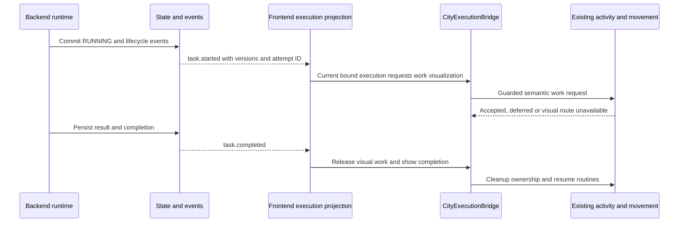

# City and agent integration strategy

Status: **FUTURE (Phase 2)**. Phase 1 only establishes backend contracts and preserves the current city. No frontend/network/NPC code is changed by T01.

## Preserve existing ownership

The [audit](existing-system-audit.md) locates shared mutable NPC state in Simulation, movement, ActivityController and Renderer. A real execution must not be modeled by starting the existing fake mission: that advances by walking and elapsed work seconds and can reset/fail independently of backend state.

Introduce a separate execution read model and one small bridge when city integration is authorized. Keep city simulation, UI/camera and execution status separate:

| State | Owner | Examples |
| --- | --- | --- |
| Simulation | Existing city modules | Coordinates, paths, poses, cosmetic needs, homes, cafe/park/social activities, environment, traffic, clock |
| Execution truth | Backend/external authority | Task/attempt status, configuration, availability, results, tool activity, errors |
| Execution projection | Future frontend store/client | Latest authorized snapshot, aggregate versions, current attempts, connection freshness |
| Visual requests | Future CityExecutionBridge | Binding resolution, activity priority, work badges, bounded queues, cleanup |
| UI state | Existing app plus future platform panels | Selection, filters and explicit command intent; never task execution authority |

Transport callbacks validate DTOs and update the projection outside requestAnimationFrame. Coalesce visual requests; the bridge drains bounded work at a safe simulation update boundary. No network request, JSON replay, SQL notion or provider SDK enters renderer/movement.

Walking/arrival acknowledgements never determine execution start/completion. If the task finishes before the NPC reaches work, release its visual request safely; preserve durable success. A visual route failure means unavailable visualization, not failed execution.

## Safe bridge contract

Candidate semantic requests: `requestWork(npcKey, executionId, workplaceId)`, `releaseWork(npcKey, executionId)`, `setBadge(npcKey, summary)`, `resolveBinding(binding)`. They return accepted/deferred/unavailable with safe reasons. They do not accept arbitrary backend coordinates, path arrays or new visual states.

No such facade exists today. Build it over `ActivityController.cancel(a,'task')`, existing `navigate`, movement and cleanup only after tests. Work requests must release seat leases, bilateral sessions, temporary props and hidden activity state using the existing cancellation path; never merely assign `a.state='WORKING'` or call navigate in isolation. Existing `Simulation.arrived` only recognizes its current simulated agent; real visual arrivals therefore need an explicit guarded dispatch seam, not fabricated demo task/currentAgent fields. This small future change needs targeted regression coverage, not a simulation rewrite.

Arbitrate movement ownership: decorative activity < real work visualization, while a currently active demo mission retains its existing behavior. A bound NPC participating in a demo is visual-busy; defer real visual motion and show backend status in the execution view. Do not stop backend work or preempt the demo silently. At demo completion, reconcile latest real state rather than play obsolete requests. No second movement loop or per-NPC LLM decision loop.

## Identity and binding

Persist a logical `agentId` independently of `npcKey` and the current session's numeric NPC ID. Existing IDs are generated from 1 and are not stable across reload/user edits; the decorative ID ranges can collide eventually. Future bindings need a stable city NPC key with session resolution, introduced additively. Do not guess bindings by name, array index or role. The four seeded residents can get explicit stable keys later; newly added residents need a durable key/binding procedure. This is a Phase 2 decision and test gate.

Initially permit one active binding per agent and per NPC within a city. Not every agent needs a visible NPC; unbound agents remain fully executable/inspectable. Decorative visitors/barista stay unbound by default. Missing/stale binding produces an unresolved presentation record and visible status, not auto-spawn/delete or reassignment. Removing a city NPC only detaches/deactivates visualization; unregistering a real agent requires an explicit authorized backend action. Likewise add-resident remains a demo action until an explicit platform registration flow is added.

## Mapping and failure behavior

| Event/condition | Execution view | Simulation response |
| --- | --- | --- |
| No backend/no agents | Disconnected/empty, clear mode label | Existing residents, routines, controls and demo continue |
| task.queued | Show queue/current attempt | Optional passive badge; no forced movement |
| task.started | RUNNING from backend | Request semantic work activity if binding and movement ownership permit |
| execution.progress | Update current attempt progress if newer | Optional coalesced badge; no new path or inference |
| task.completed | Fetch/display authorized persisted result | Release only matching execution's visual request; short completion cue, resume routines |
| task.failed/cancelled | Show safe reason | Cleanup visual lease, optional existing error cue; keep NPC alive and mobile |
| Agent disabled/unavailable | Show lifecycle/freshness separately | Detach/release visual work when appropriate; no disappearing NPC |
| Orchestrator disconnected | Show stale observation, reconcile | No task failure inference; preserve ambient life |
| WebSocket loss | Mark stale, reconnect/poll snapshot | Retain last-known execution view; finish/release visual lease after bounded grace and resume decorative life; no execution cancellation |
| City pause/speed/reset | No backend state change | Existing simulation controls retain meaning; reconcile newest visual state after resume/reset |

One logical agent may queue many tasks. Phase 1 backend runs one per agent; FUTURE concurrent agents need an aggregate display (running count, queued count, focused task). One NPC can show only one dominant visual work request: choose deterministically among active executions by start time then ID; show other active work as counts in UI. A completed task cannot clear another execution's current animation. Do not stack paths, freeze activities indefinitely or issue a coordinate for every event.

## Staleness and replay

Track eventId, aggregateVersion, current executionId/attempt and binding version. Apply only newer aggregate facts. Execution-terminal facts for an older attempt update that attempt's history, never overwrite current task state. Do not use receivedAt/occurredAt as a last-write-wins authority. Reconcile task and execution projections from transactional snapshots when cross-aggregate event ordering is incomplete; derive running counts from current records, not increment/decrement counters.

Replay rebuilds projections, then derives the latest desired visual state once. Historical starts/handoffs must not trigger a parade of old animations. Ignore stale requests from a previous binding generation after unbind/rebind. Visual activity has a bounded local lease renewed from fresh state; on expiry release safely while labeling execution observation stale. This lease is not a backend execution deadline.

Future acceptance must exercise offline startup, disconnection during work, reordering/duplicates, old-attempt completion, multiple tasks, indoor NPC interruption, paired-session cleanup, binding loss/reload, missing NPC, simultaneous demo and real task, pause/resume/reset and no FPS regression. Icy White identity, world/layout, roads/bridges/rail/Station, water/environment, controls, routes/panels and ambient routines remain preservation gates.
