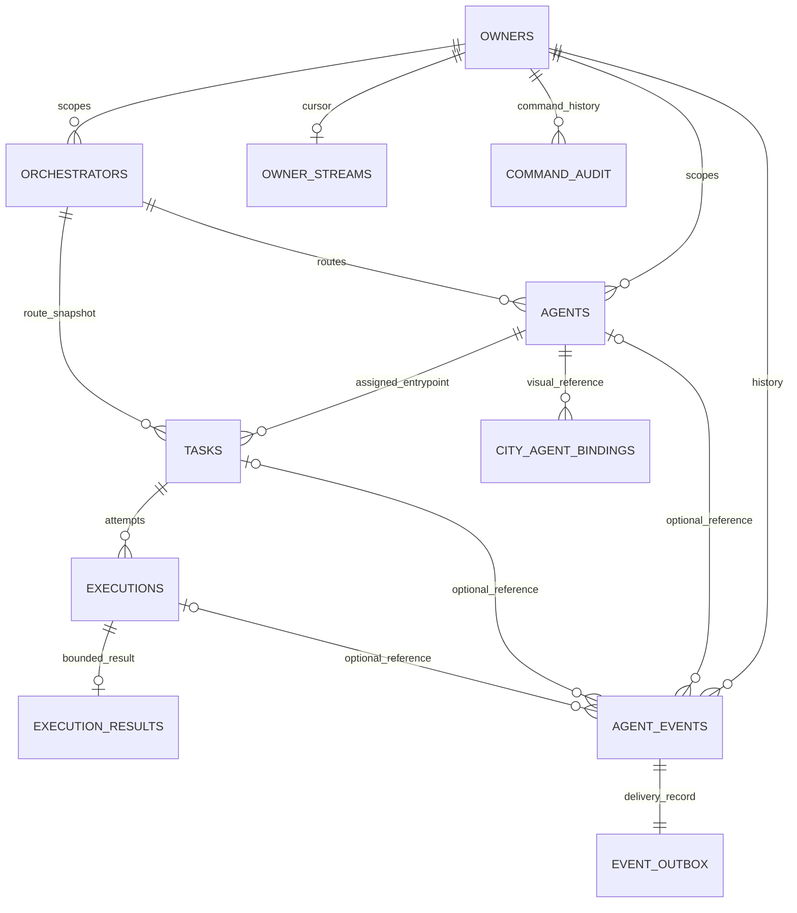

# T03 — PostgreSQL schema and migrations

This is the historical T03 implementation record. The current canonical workspace is the parent Elyqreth root; there are now four migrations, including additive T05/T07 indexes. The [T08 acceptance report](phase-1-acceptance.md) records fresh migration, populated-upgrade, real container restart, concurrency and cleanup results. T08 adds no schema changes; `npm run db:migrate` remains explicit and `npm run test:db` never targets developer database URLs.

Implementation record dated **2026-10-21 (Asia/Bangkok)**. Status: **IMPLEMENTED persistence foundation only**. There are no business APIs, agent executions, orchestrator connections, event publishers or NPC synchronization.

## Preflight and ORM decision

The existing application root is `C:\Users\user\Desktop\Project\Elyqreth-source\elyqreth`. T02's NestJS 11 backend exists in apps/api; the city remains vanilla JavaScript/Canvas under dist. npm workspaces, Node 24, strict TypeScript, existing validation/logging and root scripts were inspected and retained. No ORM, database, Compose service or CI configuration existed. T01 domain, lifecycle/event contracts and T02 implementation notes were reviewed. No applicable AGENTS.md was found. The export still has no .git: no branch, tracked-change baseline or commit can be claimed. A SHA-256 inventory of 185 existing source/config/documentation files was captured before T03.

**Selected: Drizzle ORM with node-postgres (`pg`)**, one ORM only. Its typed PostgreSQL schema and generated reviewable SQL fit the existing TypeScript application and the required composite/partial constraints. [Drizzle PostgreSQL support](https://orm.drizzle.team/docs/get-started-postgresql), [migration workflow](https://orm.drizzle.team/docs/migrations).

| Alternative | Evaluation |
| --- | --- |
| Prisma | Viable generated-client/schema workflow, but would introduce a different client-generation layer; this design favors direct PostgreSQL constraints and explicit SQL guards. No Prisma dependency added |
| TypeORM | Viable Nest/DI-oriented entity/migration approach; not selected because a second decorator/entity metadata model adds little value over the chosen SQL-oriented schema |
| Drizzle | Selected for typed SQL access, explicit transactions and migration SQL inspection; PostgreSQL-specific guards remain a separate custom migration |

Versions are pinned in manifests/lockfile: Drizzle ORM 0.45.4, pg 8.23.1, drizzle-kit 0.31.11. The migration generator is root development tooling; API runtime dependencies remain API-owned. A targeted root override replaces the generator's legacy esbuild-kit dependency's esbuild with 0.25.12. It avoids its development-server advisory without changing the ORM version or adding another ORM. The final dependency audit result is recorded below.

Drizzle's shipped declarations include incompatible/optional other-driver types. `skipLibCheck` now skips third-party declaration checking; application `strict`, `noUncheckedIndexedAccess`, `exactOptionalPropertyTypes` and `noEmitOnError` remain enabled. No unused database drivers were installed to silence vendor declarations.

## Implemented structure

```text
docker-compose.yml                          PostgreSQL only; loopback published port
.env.example                                Compose placeholders, not API configuration
apps/api/.env.example                       optional validated database settings
apps/api/drizzle.config.ts                  offline generation/check configuration
apps/api/src/database/
  schema.ts                                typed tables, indexes, checks and FKs
  database-configuration.ts                 URL/pool/TLS validation
  pool.ts                                  pg pool and safe connectivity error
  database.module.ts                       injectable DatabaseService and lifecycle
  migrate.ts                               explicit migration command, lock/hash checks
apps/api/migrations/
  0000_initial_platform.sql                 generated schema migration
  0001_persistence_guards.sql               SQL triggers and append-only guards
  meta/                                    snapshots and ordered migration journal
apps/api/test/
  database-config.test.cjs                  validation/startup tests without PostgreSQL
  database.integration.cjs                  real isolated Docker/PostgreSQL suite
```

No frontend files, tests, Vite configuration or hosting settings were changed. No contract placeholder package or additional service was introduced. The SQL files and metadata are versioned source deliverables ready for the real repository; this Git-less export cannot provide a Git commit.

## Entities and relationships



All main records use PostgreSQL-generated UUIDs and timestamptz timestamps. owner_streams uses owner_id as its primary key. Owners are durable scopes, not an authentication/user system, and no owners/agents/orchestrators are seeded.

| Table | Stored responsibility |
| --- | --- |
| owners | Stable scope UUID/name and creation time; no users, passwords or membership implementation |
| orchestrators | Scoped unique name, extensible type token, separate administrative/connectivity statuses, bounded JSON capability descriptor, opaque non-secret configuration reference, version/timestamps |
| agents | Logical identity, required scoped orchestrator, display/type/lifecycle, capability array, non-secret JSON configuration and version/timestamps; provider/model optional by design |
| tasks | Stable request/owner/agent/orchestrator snapshot, bounded input, status/reason, idempotency key/hash, retry-policy metadata, deadlines/cancel/completion times and version |
| executions | One attempt: task/route/owner snapshot, positive attempt number, status, authority/submission key, optional external ID, configuration snapshot, timestamps/errors/result reference, lease/recovery metadata and version |
| execution_results | One bounded JSON result per execution, owner-scoped and append-only; no arbitrary filesystem/object-store access |
| agent_events | UUID, type/schema version, optional related identities, correlation/causation, aggregate identity/version/sequence, owner stream position, source deduplication, bounded payload, occurred/recorded time |
| city_agent_bindings | Owner/city/agent to external npc_id string, presentation mode, enabled flag and timestamps; no NPC table/coordinates |
| owner_streams | Transactionally serialized per-owner event cursor; not an unsafe global serial |
| event_outbox | One durable delivery record per event, attempts/next eligibility/published time; no delivery worker |
| command_audit | Append-only safe command/actor/resource/correlation/outcome metadata; no authentication implementation |

Execution agentId/orchestratorId/ownerId intentionally duplicate the task route. A composite FK enforces the exact task snapshot. Task routing references the agent and orchestrator independently so later agent rebinding cannot invalidate historical tasks. T05 must validate the selected route at acceptance; it must not foreign-key historical tasks to the agent's mutable current orchestrator relationship.

T01 selected one logical agent entrypoint per task initially: agents/tasks/executions require orchestrator/agent routing IDs. Disabled draft agents still need a registered orchestrator row. This does not claim an external run has only one internal participant: delegated/multi-agent runtime graphs are not represented yet. Future participant/step tables can extend this without replacing task identity. No mandatory framework or LLM provider field exists.

Results belong to execution attempts. Task intentionally has no duplicate resultReference column: a future task read model derives its successful attempt/result instead of maintaining conflicting pointers. resultReference is a bounded opaque local/external reference, not a public URL to load blindly; resultAvailability separates execution success from later result retrieval. Local execution_results ownership is enforced by FK; resolving a resultReference requires a future authorized service.

## Status and structural invariants

Statuses are **text with explicit CHECK constraints**, plus TypeScript literal types. This keeps database enforcement while allowing reviewed additive migrations without PostgreSQL enum replacement. Framework type names remain extensible validated tokens, not a closed orchestration enum.

| Concern | Values and meaning |
| --- | --- |
| Agent lifecycle | DISABLED (default), ACTIVE, ARCHIVED; follows T01. A row is registered by existing, so no duplicate REGISTERED state; INACTIVE is not an ambiguous alias for disable |
| Orchestrator administration | DISABLED (default), ENABLED; permission to dispatch is separate from observed connectivity |
| Orchestrator connectivity | UNKNOWN (default), CONNECTED, DEGRADED, DISCONNECTED, UNAVAILABLE; no connections are performed by T03 |
| Task | CREATED (default), QUEUED, RUNNING, COMPLETED, FAILED, CANCELLED; last three are terminal |
| Execution | PENDING (default), RUNNING, SUCCEEDED, FAILED, CANCELLED, TIMED_OUT; last four are terminal |
| Authority / result | NATIVE or EXTERNAL; NONE/PENDING/AVAILABLE/UNAVAILABLE result availability |
| Binding mode | PASSIVE (default) or WORK_ACTIVITY; metadata only, no animation effect |

Critical constraints/guards:

- All relationships use explicit RESTRICT actions; no cascade deletes of history. Composite scoped FKs prevent cross-owner relationships and inconsistent task/execution/event routing. Nullable event references cannot bypass route consistency: execution implies task; task implies agent/orchestrator. Orchestrator-only events may omit agent/task/execution.
- Names are trimmed/nonempty; orchestrator names are **case-sensitive unique within an owner**. Agent names are display labels and need not be unique.
- Task idempotency key uniqueness is `(owner_id, idempotency_key)`; many null keys are allowed. A nonnull key requires a nonnull lowercase SHA-256 request hash. Canonical hashing/return-original-versus-conflict semantics are T05 business behavior, not implemented here.
- Execution attempt numbers are positive and unique per task. Partial unique indexes permit at most one PENDING/RUNNING attempt and one SUCCEEDED attempt per task, plus one NATIVE/RUNNING attempt per owner/agent. External execution IDs are unique within an orchestrator; submission keys are globally unique UUIDs.
- Terminal task status is equivalent to a nonnull completedAt. Terminal execution status requires finishedAt; RUNNING/SUCCEEDED require startedAt; PENDING has no startedAt. End/completion/deadline/cancel times cannot precede creation; finish cannot precede start. Pre-start failed/cancelled/timed-out attempts are allowed.
- Direct updates advance updatedAt monotonically and resource version automatically. IDs/owners/creation timestamps, task input/route/idempotency and execution-attempt snapshots are immutable. Terminal statuses cannot reopen; terminal timing/error history cannot be overwritten. Result availability/reference may be added after external success.
- Tasks and executions reject DELETE. Events, results and command audit reject UPDATE/DELETE. A privileged future retention/redaction migration is a separate operation; these are not a tamper-proof defense against database administrators or TRUNCATE privileges.
- JSON object/array shapes and serialized size bounds are checked. Input/result/config/event bodies are limited to 64 KiB where applicable. Agent configuration rejects common top-level credential keys. This cannot detect secrets hidden in arbitrary nested data; future DTO/schema allowlists, redaction and access control remain mandatory.

T03 does not validate every allowed business transition or atomically make task status agree with all attempt statuses. Those are T06 transaction/service responsibilities. Database structural guards protect critical history without introducing execution coordination.

## Ordering, event history and outbox

Every event insert locks its owner's owner_streams row, increments the cursor and assigns stream_position before insertion. That lock lasts through commit. A concurrent same-owner insert waits, so a later committed cursor cannot overtake an uncommitted earlier event. Rollback reverts both event and cursor increment. An AFTER INSERT trigger writes its outbox record in the same transaction. Failed insert/transaction leaves neither event nor outbox.

Ordering/replay should use `(owner_id, stream_position)`, returned as a bigint/string at transport boundaries. occurredAt can describe an older remote fact and is not an ordering key. `(owner, aggregateType, aggregateId, aggregateSequence)` is unique/positive; T04–T07 must allocate aggregate sequence/version under the resource transaction. Source-event deduplication is owner/source/sourceEventId scoped. No global order across owners is promised, and owner-wide serialization is a deliberate small-scale throughput tradeoff.

No lifecycle events are emitted from current simulated NPC behavior. No normalized event API, WebSocket stream, replay endpoint or dispatcher was added. T07 remains responsible for public event schemas/redaction, delivery/reconnect and outbox consumption. Runtime database roles must not expose direct counter/table mutation to clients.

## Index rationale

| Index family | Query/invariant |
| --- | --- |
| Agent owner/orchestrator and owner/lifecycle | Registry filtering |
| Task owner/status/created/id, owner/agent, owner/orchestrator | Stable paginated task lists and routing lookup |
| Execution task/attempt unique | Attempt history/order |
| Partial active/success/native-running and external/submission identity | Duplicate/concurrent execution prevention at storage level |
| Execution status/next eligibility and running lease expiry | Future bounded worker claims/recovery |
| Event owner/position and aggregate/sequence unique | Replay and duplicate aggregate facts |
| Event owner/task/position, owner/correlation/position, owner/execution | Task history, correlation tracing and attempt inspection |
| Binding active agent and active NPC unique; owner/city/NPC lookup | One enabled agent-to-NPC mapping per owner/city plus disabled history |
| Unpublished outbox eligibility and audit owner/created | Future delivery scan and command history |

UUID primary keys and composite unique route/scope keys also support FK checks. No speculative JSON/GIN/full-text indexes were added. Query-plan tuning awaits actual T04/T05 query workloads.

## Configuration and startup

[Phase 6 T02](phase-6/configuration-contracts.md) additionally requires explicit production configuration and rejects known default/test database identities. Production business access stays closed pending identity/session decisions.

Existing precedence remains **process environment > apps/api/.env > defaults**; no process.env mutation. Root .env is Compose-only and is not automatically read by the API.

| Variable | Rule |
| --- | --- |
| DATABASE_URL | Optional for development/test liveness-only API startup; required in production and for persistence/migrations. postgres/postgresql URL with host, explicit user/password and conventional database identifier; no query/fragment options |
| DATABASE_SSL_MODE | disable locally; verify-full by default and required in production. TLS validates a trusted server certificate chain |
| DATABASE_POOL_MAX | 5 default, integer 1–20 |
| DATABASE_CONNECTION_TIMEOUT_MS | 5000 default, 100–30000 |
| DATABASE_IDLE_TIMEOUT_MS | 10000 default, 1000–60000 |
| DATABASE_STATEMENT_TIMEOUT_MS | 30000 default, 100–120000 |

If any DATABASE_* setting is supplied without DATABASE_URL, configuration fails clearly. Malformed values report field names only, not credentials. URL percent-encoded credentials are decoded explicitly; query options such as sslmode are refused so they cannot override centralized TLS policy. Connections use a fixed public search path, bounded query/idle-transaction timeouts and an error listener; no raw connection/driver error is printed to clients/logs.

In development/test with no database settings, the existing liveness-only API remains usable and DatabaseService.db rejects persistence access. With DATABASE_URL configured, Nest initialization verifies a connection (`SELECT 1`) before listening; an unreachable DB fails startup safely and closes the pool. Shutdown closes configured pools. Startup **never applies migrations** and does not claim the schema is current. /health is still lightweight HTTP liveness, not DB readiness, and never queries a database per request. Future business modules must require configured/migrated persistence rather than fall back to memory.

## Local PostgreSQL setup

Docker Compose now defines only PostgreSQL, using the verified official **17.11-bookworm image pinned by digest**. It has a persistent named volume, pg_isready health check, unless-stopped restart policy and a configurable host port published on **127.0.0.1 only**. No frontend service was moved/replaced. PostgreSQL 17 uses /var/lib/postgresql/data for the mounted volume. [Official image documentation](https://hub.docker.com/_/postgres).

1. Copy root .env.example to root .env; replace the placeholder password. POSTGRES_USER/DB default to elyqreth, POSTGRES_PORT to 5432.
2. Run `docker compose up -d postgres`, then `docker compose ps`.
3. Set DATABASE_URL for the migration/schema-owner role in the shell (or API-local env for a local-only initial migration); run `npm run db:migrate`.
4. Provision a separate restricted application role before using the API with real data; set apps/api/.env to its URL. Remove any migration-role URL from the API process environment before starting it.
5. Run `npm run dev:api` or build/start as in T02. The city remains independently usable without these steps.

The Compose POSTGRES_USER is a **local bootstrap/schema-owner account**, not a suitable production application role. A local administrator can use `docker compose exec postgres psql -U elyqreth -d elyqreth` and execute the following, adapting names as needed:

```sql
CREATE ROLE elyqreth_app LOGIN;
-- In psql, set the password interactively with: \password elyqreth_app
GRANT CONNECT ON DATABASE elyqreth TO elyqreth_app;
GRANT USAGE ON SCHEMA public TO elyqreth_app;
GRANT SELECT, INSERT, UPDATE ON ALL TABLES IN SCHEMA public TO elyqreth_app;
REVOKE UPDATE ON agent_events, command_audit, execution_results FROM elyqreth_app;
```

Do not grant schema creation, table ownership, migration-journal access, TRUNCATE or general DELETE to the runtime account. Update grants deliberately for future tables. The stream/outbox triggers execute with the inserting role's privileges, so required stream/outbox writes must remain granted; future privilege separation may further constrain them. Owner foreign keys enforce consistency, **not authorization/RLS**; T04 must enforce authenticated ownership before any public CRUD. No authentication system was added here.

For an API running on the host, use 127.0.0.1 and POSTGRES_PORT. A future containerized API on the Compose network would use postgres:5432, not its own localhost. The API has not been containerized. Credentials changing in .env do not rotate users in an already initialized volume; rotate explicitly with SQL. Normal `docker compose down` preserves the named volume. Do not run down -v against valuable data; a volume is not a backup.

## Migration workflow and recovery

```sh
npm ci
npm run db:generate
npm run db:check
npm run db:migrate
```

Generation/checking are offline and require no credentials. Review and retain SQL, snapshots and journal together. Custom PostgreSQL functions/triggers live in the second migration; generation reporting no table changes does not inspect/verify function bodies against a live DB. Do not use drizzle-kit push, reset/synchronize, or production auto-migration.

db:migrate first builds the API, validates its centralized configuration, opens one migration client, takes a bounded session advisory lock, verifies applied journal hashes/timestamps against local files, then applies pending migrations through Drizzle. Concurrent migrators serialize within the same database. The lock/client/pool are released on completion/failure. Reapplying an unchanged set is a no-op and does not erase data. Connection/permission/SQL failures exit nonzero with safe messages. SQL failures roll back the migration transaction; the migration bookkeeping schema may already exist.

There is **no automatic down/reset command**. Before a migration on valuable data, create and verify a backup, inspect the SQL, stop incompatible writers and plan a forward fix or restore. After an applied migration, never edit/delete/reorder its source or journal: add a new reviewed migration. Hash mismatch refuses further application. Restoring the database requires matching application/migration versions. Documented backup workflow: use pg_dump with a protected password source and custom format, test pg_restore into a newly provisioned isolated database, verify schema/data, then perform an explicit reviewed cutover. No existing user database was dropped or reset by this task.

## Database access and future services

Inject DatabaseService from DatabaseModule; `service.db` is a schema-typed Drizzle handle. Use `db.transaction(async tx => ...)` for future state/journal operations, and parameterized SQL/typed predicates. No controller accesses the DB today. No AgentRepository or task service/CRUD was created.

T04 should introduce owner-scoped Agent/Orchestrator application services and repository boundaries with validated configuration/authorization. T05 should implement canonical idempotency, routing/config snapshots, durable task/attempt/result operations and atomic transactions. T06 owns permitted transitions/claims/retry/cancel/recovery. T07 owns normalized event contracts and delivery over the storage established here. Do not base execution truth on city status or NPC coordinates.

Binding npc_id is an opaque stable external identifier, not a PostgreSQL FK or a promise that current session-local numeric NPC IDs are durable. No binding is auto-created or resolved by name/index. Missing/deleted NPC references remain unresolved metadata; they do not delete agents, stop tasks or spawn/modify NPCs. A future UI can disable/rebind explicitly. Binding storage was brought forward from T01's FUTURE label because T03 explicitly requests it; synchronization remains deferred.

## Testing and verification

```sh
npm run test:db
npm run test:all
npm run lint
npm run build
```

test:db requires Docker and starts a uniquely named/labeled disposable container and named volume from the pinned Compose image. It creates a random test database, uses a random temporary credential, and **ignores DATABASE_URL and any existing development/test URL**. Cleanup verifies exact container/volume labels and names before removal. Only this run's database/container/volume and generated temporary directory are removed; there is no global prune or developer-volume reset. If Docker is unavailable, the suite fails clearly instead of replacing PostgreSQL with a mock or silently reporting success.

The suite verifies real connectivity, fresh/repeated migrations, no fake seeds, FKs/scope/route constraints, defaults/required and nullable fields, statuses/timestamps, idempotency/attempt/active-success uniqueness, immutable history, binding uniqueness, event ordering/deduplication/rollback/outbox atomicity, Nest lifecycle/transaction rollback, no startup schema migration, hash drift refusal and persistence across an actual PostgreSQL restart. Docker may reassign a random test port after restart; the harness re-resolves it and confirms reconnection to the same database/volume.

Final executed commands/results and preservation evidence are recorded below. API tests remain Node's built-in test runner; root lint is syntax/type checking, not an ESLint-style analysis. Frontend is buildless, so there is no frontend compilation step to invent.

## Known limitations and next task

- No authentication/authorization/RLS, CRUD endpoints, worker, execution coordination, model/tool/provider, external adapter, event delivery or NPC sync. Test fixtures exist only inside disposable databases, not as application seed data.
- JSON size/shape/common-key checks do not replace semantic secret redaction, owner authorization, tool permissions or safe retention policies. Inputs/results can contain sensitive business data and require restricted access, backups and future retention/encryption review.
- Real production TLS, managed PostgreSQL, multi-instance deployment, restore/cutover and Unix signal behavior were not exercised by local tests. The local suite uses disabled TLS on loopback. Custom CA/client-certificate configuration is not provided.
- Public schema is assumed. Existing table-name collisions fail rather than silently adopting/modifying unrelated tables. No schema drift repair or database reset is automatic.
- The coarse per-owner event lock is appropriate for initial scale; future throughput may justify a committed-log dispatcher. No exactly-once side effects are claimed.
- Git commits and fresh browser/FPS verification are unavailable/not performed; preservation is verified with original file hashes and existing simulation tests.
- The pinned migration generator still has deprecated esbuild-kit transitive packages; its esbuild advisory is resolved by the targeted override. Monitor a future stable generator upgrade rather than adding a second ORM or taking an unreviewed major upgrade.

Next implementation: **Elyqreth Phase 1 T04 — Agent Registry API**. It has not begun; real authentication/ownership controls remain required before protected registry endpoints are exposed.

## Executed verification record

- `npm.cmd ci`: passed, 175 packages installed/177 audited, zero reported vulnerabilities. `npm.cmd audit --json` separately reported zero vulnerabilities after the targeted root-tooling override.
- `npm.cmd run db:generate`: passed and reported **no schema changes** after the initial generated schema/custom guard migrations were finalized. `npm.cmd run db:check`: passed migration-journal consistency checks.
- `npm.cmd run test:db`: **15 real PostgreSQL integration tests passed**, zero failures/skips, in the final run. This includes fresh/repeated migrations and successful invocation of the actual root `npm run db:migrate` command within the isolated test database, hash drift refusal, constraints, owner commit ordering/rollback, absence of startup migration, pool shutdown and an actual container restart with committed data preserved.
- `npm.cmd run test:all`: **51 original city tests and 15 backend/configuration tests passed**, zero failures/skips. The final post-install backend suite was also run separately with `npm.cmd run test:api` and passed all 15 tests.
- `npm.cmd run build`, builds within db:migrate/test commands, `npm.cmd run check:api` through `npm.cmd run lint`, and city syntax checks all passed. No frontend compilation command exists for this buildless application; none was invented.
- `docker compose --env-file .env.example config --quiet`: passed for the exact local PostgreSQL service definition. Compose was not used to initialize a developer database; real DB verification used isolated test resources only.
- Test-run container and volume inventories were checked after cleanup. No labeled T03 test resources remained; no developer/user database or volume was dropped/reset.
- Original-file SHA-256 comparison: **172 of 185 pre-existing files unchanged**. The 13 changed originals are listed below. Every original city/rendering/NPC/camera/environment/style/asset/interaction file, existing test, Vite configuration, hosting metadata, historical city document and retained T01/T02 record remains unchanged except the explicitly appended architecture/index/domain/roadmap notes.
- Documentation links/fences and migration SQL/metadata inventory were checked after writing. No original source file was removed. No new API controller or business execution module was added.

### Change inventory

Created:

- `.env.example`, `docker-compose.yml`
- `apps/api/drizzle.config.ts`
- `apps/api/src/database/schema.ts`, `database-configuration.ts`, `pool.ts`, `database.module.ts`, `migrate.ts`
- `apps/api/migrations/0000_initial_platform.sql`, `0001_persistence_guards.sql`
- `apps/api/migrations/meta/0000_snapshot.json`, `0001_snapshot.json`, `_journal.json`
- `apps/api/test/database-config.test.cjs`, `database.integration.cjs`
- `docs/ai-agent-platform/database-foundation.md`

Modified:

- Root `package.json`, `package-lock.json`, `README.md`
- `apps/api/package.json`, `tsconfig.json`, `.env.example`
- `apps/api/src/app.module.ts`, `main.ts`, `config/configuration.ts`
- `docs/ai-agent-platform/README.md`, `architecture.md`, `domain-model.md`, `phase-1-implementation-plan.md` (appended implementation status; original T01 decisions retained)

Removed: **none**. node_modules and apps/api/dist are ignored install/build artifacts, not application source changes. Temporary staging/test artifacts were removed. Git status/diff cannot be supplied because this source export has no Git metadata.
