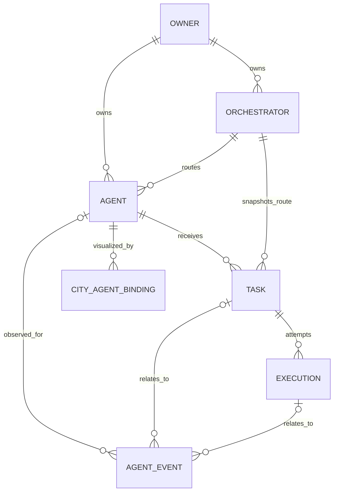

# Initial domain model

Status: **T01 historical model proposal**. The implemented schema is documented in [Database foundation](database-foundation.md); [T08 acceptance](phase-1-acceptance.md) verifies its relationships, constraints and migration compatibility. Current numeric NPC IDs and mutable Simulation objects remain separate, as described in the [audit](existing-system-audit.md). Proposed runtime fields do not imply an active worker. The T01 proposal below is preserved.

## Identity, relationships and scope

Use server-generated UUIDs for logical Agent, Orchestrator, Task, Execution, Event and future Binding. UUIDs persist in PostgreSQL across restarts; names and framework IDs are not primary keys. Execution IDs identify attempts, not new agents. External IDs are namespaced by registered orchestrator. Every protected entity has an owner/scope; enforce same-scope relationships, including event/result lookups.

Events can have no agent (for example orchestrator connectivity). OWNER denotes an authenticated scope, initially provisioned locally rather than a user-management product.

| Entity / phase | Candidate fields and semantics |
| --- | --- |
| Agent / Phase 1 | id, ownerId, name, description, type (`RULE_BASED`, future `LLM`/`EXTERNAL`), capabilities[], configuration (validated/versioned, no secrets), orchestratorId, lifecycleStatus (`ACTIVE`, `DISABLED`, `ARCHIVED`), version, createdAt, updatedAt |
| Orchestrator / Phase 1 minimal native registration | id, ownerId, name, type, capabilities descriptor/version, configurationReference, registrationStatus (`ENABLED`, `DISABLED`), observedStatus (`UNKNOWN`, `CONNECTED`, `DEGRADED`, `DISCONNECTED`), lastObservedAt, version, timestamps; connectivity is separate from permission to dispatch |
| Task / Phase 1 | id, ownerId, agentId, orchestratorId snapshot, input (bounded JSON), status, statusReason, version, idempotencyKey/requestHash, retryPolicy snapshot, deadlineAt, cancelRequestedAt, createdAt, updatedAt, completedAt; request identity/input remain stable across attempts; results belong to attempts |
| Execution / Phase 1 | id, taskId, attempt (positive integer), status, version, adapterKey/configVersion, agentConfigSnapshot/reference, authority (`NATIVE`, future `EXTERNAL`), externalExecutionId, submissionKey, startedAt, finishedAt, error (safe code/message/retryable), resultReference, resultAvailability (`NONE`, `PENDING`, `AVAILABLE`, `UNAVAILABLE`), deadlineAt, nextEligibleAt, leaseOwner/leaseToken/leaseExpiresAt, lastHeartbeatAt, reconciliationState |
| Agent Event / Phase 1 | id/eventId (one identifier), ownerId, eventType, schemaVersion, aggregateType/id/version, aggregateSequence, streamPosition, optional agentId/taskId/executionId/orchestratorId, correlationId, causationId, occurredAt/recordedAt, payload (redacted/bounded), source/sourceEventId |
| City Agent Binding / FUTURE | id, ownerId, cityId, agentId, npcKey, visualizationMode, enabled, timestamps; npcKey is durable city identity, not raw session counter |

Native configuration initially identifies an allowlisted rule handler and bounded inputs. No model/provider is mandatory. Proposed capabilities do not grant tool permissions: grants are independently authorized. Registration can accept DISABLED draft agents; ACTIVE requires a compatible enabled orchestrator and configured handler. Disabled/archived agents reject new tasks; in-flight work follows explicit cancel/drain policy, never disappears on registry removal.

## Cardinality and constraints

- Agent routes to one orchestrator at a time; orchestrator serves many agents. Each task snapshots the route; attempts for that task remain pinned in Phase 1. Rebinding affects only future tasks. External migration/reassignment requires explicit future policy.
- Task has one assigned logical agent initially and zero or more attempts. Multi-agent coordination is FUTURE: add participant/step records without overloading agentId or cloning the task for retries.
- One task may have many failed attempts and one successful attempt. At most one PENDING/RUNNING attempt per task. Phase 1 limits native agent concurrency to one running attempt through a transactional claim; future per-agent concurrency must be explicit.
- Task `(id, ownerId)` relationships and validation prevent cross-owner agent/orchestrator references. Event agent/task/execution references must describe the same task/attempt; orchestrator-only events allow nullable references.
- `UNIQUE(taskId, attempt)`; partial unique active-attempt constraint on taskId for PENDING/RUNNING; `UNIQUE(orchestratorId, externalExecutionId)` when external ID exists. `UNIQUE(ownerId, idempotencyKey)` on task creation scope with canonical request hash. Submission keys are immutable per attempt.
- Terminal attempts require finishedAt; RUNNING requires startedAt. Task completedAt denotes any terminal outcome. Database checks cover structural invariants; transition service covers history-dependent rules.
- Result reference belongs to execution and owner. Phase 1 may keep small bounded JSON results in a DB result record referenced by execution; large blob/object storage is FUTURE. Fetch through authorized API, never arbitrary filesystem URLs. Future external success can persist an authorized remote result reference or explicit unavailable marker independently of retrieval availability; an unavailable result never authorizes reexecution of successful work.
- Archive instead of hard-delete agents/orchestrators with task history. Retention/redaction must preserve audit referential integrity; purging input/results follows policy, not frontend reset.
- FUTURE bindings: one enabled binding per `(cityId, agentId)` and per `(cityId, npcKey)` initially; multiple-city views allowed. Missing local NPC leaves binding unresolved without creating/deleting agents. Store legacy NPC numeric ID only as session resolution data.

## Index proposal and ownership

Candidate indexes: Agent(ownerId,lifecycleStatus,id), Agent(ownerId,orchestratorId); Orchestrator(ownerId,registrationStatus), Orchestrator(ownerId,observedStatus); Task(ownerId,status,createdAt,id), Task(agentId,status), Task(orchestratorId,status); Execution(status,nextEligibleAt), Execution(leaseExpiresAt) for active work; Event(ownerId,streamPosition), Event(aggregateType,aggregateId,aggregateSequence) unique, Event(taskId,recordedAt), Event(executionId,recordedAt); outbox(publishedAt,nextAttemptAt). Use actual query plans in T03/T08 before adding redundant JSON indexes.

Registry service owns Agent lifecycle/configuration. Orchestrator registration service owns configuration/capabilities; connectivity observer owns freshness. Task transition service owns task/attempt status under transaction; runtime reports facts, not arbitrary SQL updates. External observations pass adapter/reconciliation validation. Event service appends history; frontend is a projection only. Neither NPC state nor simulated `workStatus` is persisted as execution truth.

Required operational records beyond the six requested entities: owner scope, task idempotency, result storage, transactional lifecycle journal/outbox, command audit. Define these in T03; T07 completes public event normalization/replay. Provider profiles, tool grants/approvals, usage/cost ledger, external subscriptions, multi-agent graphs and City Agent Binding storage/API are FUTURE, not silently included in Phase 1.

## T03 applied schema

The preceding proposal is retained as T01 history. The actual implemented schema is documented in [Database foundation](database-foundation.md) and `apps/api/src/database/schema.ts`. It implements the domain/operational tables with required initial agent/orchestrator routing, owner-scoped keys, attempt-owned results, text/CHECK status constraints and per-owner event ordering. T03 explicitly brings City Agent Binding metadata forward; no binding API or NPC synchronization exists. No native orchestrator or real agent is seeded. Business authorization, canonical idempotent command handling, full state transitions and event publication remain unimplemented.

## T04 implemented registry policy

See [Agent Registry API](agent-registry.md). Existing T03 schema is reused unchanged: required same-owner orchestrator; non-unique display names; initial DISABLED; types RULE_BASED/LLM/EXTERNAL; lifecycle ACTIVE/DISABLED/ARCHIVED. Metadata PATCH cannot reassign type/orchestrator or status, archived agents are immutable through the API, and quoted integer If-Match prevents lost changes. Configuration is narrowed to category/color metadata and omitted from all responses, including legacy JSON. Activation is administrative enablement only in T04, clarifying the earlier planned handler/readiness requirement: future task admission must validate actual route/runtime readiness. Archive retains history. Each real mutation commits event/audit/outbox atomically; full public event normalization remains T07. No NPC/runtime identity is introduced.

## T05 implemented persistence policy

[Task & Execution Persistence](task-execution-persistence.md) reuses the required owner/agent/orchestrator route, existing statuses, immutable task input and independent attempt identities. Task POST creates CREATED only, with bounded instruction/context input; result ownership stays on executions. Owner-scoped idempotency fingerprints the original request, and replay preserves the saved route despite later registry edits. New intent requires ACTIVE agent and ENABLED same-owner route, without claiming actual runtime readiness. Attempts are allocated internally with max+1 under a parent lock; each snapshots current safe agent metadata/configVersion at allocation. Existing attempts remain immutable history. Input, hashes, raw errors and result references are omitted from public DTOs. New tasks_owner_created_idx supports owner/date ordering; no table/field/status changes are made. T06 must define atomic transition/dispatch/retry policy.

## T06 implemented lifecycle policy

[Internal lifecycle services](lifecycle-service.md) now own allowed Task/Execution transitions and atomic paired updates. Queue creates/adopts a PENDING record only on an explicit internal command; HTTP creation still stores CREATED alone. Start pairs QUEUED/PENDING to RUNNING; success pairs COMPLETED/SUCCEEDED; failure/timeout terminalize the Task without allocating retries. Cancellation records a decision, with CANCELLATION_UNCONFIRMED for a running attempt. Result references are restricted to existing same-owner/same-attempt execution_results UUIDs, errors to a safe fixed code/message catalog. Task completion timestamps and attempt finish timestamps use the same PostgreSQL microsecond instant. Expected versions, parent locks and latest-attempt checks fence stale writers. No schema or existing data changes are required.

## T07 implemented event contract

See [the authoritative T07 guide](event-audit-foundation.md). Existing event fields and append-only triggers are reused; no new entities/statuses/columns are added. v1 payloads contain only status/lifecycleStatus, resource version and optional historical attemptNumber (always present in new execution facts). Events are projected from actual scoped locked rows, not arbitrary input. Aggregate sequences and owner stream positions are distinct decimal-string counters. Registry metadata no-ops now preserve version/time and emit no change fact. New partial uniqueness enforces one fact per resource version for source elyqreth.contracts.v1, excluding retained older sources. Agent/Execution stream-order indexes support actual read routes. History is observational; no event sourcing or execution replay is implemented.
