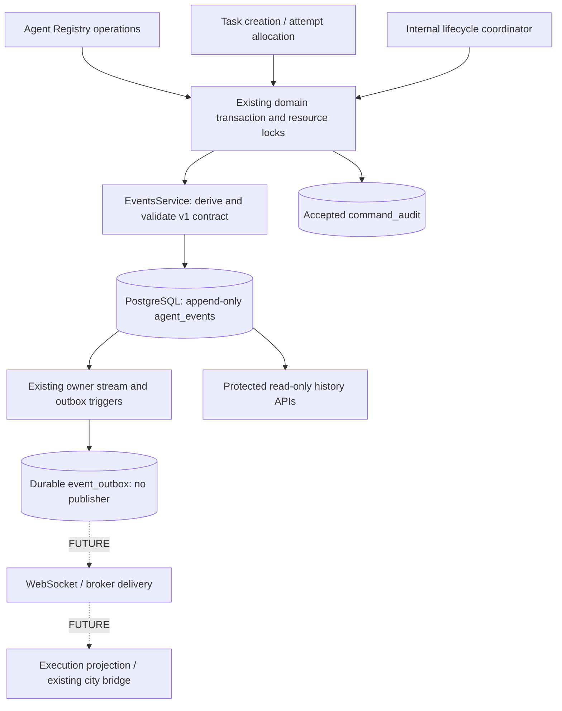

# T07 — Event Contracts & Audit History

The [T08 acceptance report](phase-1-acceptance.md) provides the current cross-module verification, atomicity/order/security evidence and release decision. The contracts, migrations and read-only routes below are unchanged. No event transport, outbox relay or NPC synchronization was added.

Status: **IMPLEMENTED**, 2026-10-21 (Asia/Bangkok). Reuses the existing `apps/api` NestJS backend, Drizzle/PostgreSQL, T03 event/outbox/audit tables and T04–T06 domain transactions. Earlier [T01 event concepts](event-contracts.md) remain historical/FUTURE where they discuss transports, external observations, process control or broader event vocabulary.

## Architecture



`EventsModule` contains contracts, a transactional writer/read service, history controller, query DTO and access guard. It is imported by existing domain modules; no duplicate backend/client/ORM or generic event bus is added. PostgreSQL remains the state authority. This is durable lifecycle history, **not full event sourcing** or execution replay.

## Supported event types and operation mapping

Existing emitted names are deliberately retained; historical rows are not renamed. `agent.active` maps to activation, and `execution.completed` maps to SUCCEEDED. Neither event names nor transport naming are database status enums.

| Event | Committed operation / payload status |
| --- | --- |
| agent.registered | New logical agent, lifecycleStatus DISABLED |
| agent.updated | Actual metadata change; current lifecycleStatus |
| agent.active | Administrative activation; ACTIVE |
| agent.disabled | Administrative disable; DISABLED |
| agent.archived | Administrative archive; ARCHIVED |
| task.created | T05 HTTP/internal creation; CREATED, no execution implied |
| task.queued | Explicit internal queue; QUEUED with a new/adopted pending attempt |
| task.started | Paired internal start decision; RUNNING |
| task.completed | Paired success; COMPLETED |
| task.failed | Failure or timeout; FAILED |
| task.cancelled | T06 cancellation decision; CANCELLED |
| execution.created | Explicit pending allocation; PENDING |
| execution.started | Paired start decision; RUNNING |
| execution.completed | Paired success; SUCCEEDED |
| execution.failed | Running or pre-start failure; FAILED |
| execution.cancelled | T06 cancellation decision; CANCELLED |
| execution.timed_out | Explicit running/pre-start timeout decision; TIMED_OUT |

There are exactly **17 supported types**. No deactivation, handoff, progress, connectivity, tool or model event is fabricated. Activation is not process startup; cancellation/timeout are persisted decisions under [T06 policy](lifecycle-service.md), not confirmation that external work stopped. No actual AI/runtime is connected.

## Contract and payload versioning

TypeScript `EventType`, mapped `EventPayloads`, distributed `EventEnvelope<T>` and runtime `assertEnvelope` are implemented in `src/events/contracts/event-contracts.ts`. Each event type has a literal aggregate/status mapping. Schema version 1 means this explicit contract; HTTP prefix remains `/api/v1`. Version is not inferred from status or event type alone.

Payloads are closed allowlists:

- Agent events: `{lifecycleStatus,version}`. Registration/activation/disable/archive require their exact status; metadata update accepts an established lifecycle status.
- Task events: `{status,version}` with exact type-specific status.
- Execution events: `{status,version,attemptNumber?}`. Every new T07 execution fact includes its positive attempt number; optionality preserves older T06 v1 facts that omitted it.

Payload version must equal aggregateVersion. Positive versions/attempt numbers are bounded to PostgreSQL int. Payloads are at most 1,024 UTF-8 bytes; permitted primitive fields are much smaller. Unknown/nested fields, configuration, names/descriptions, prompts/input, raw errors, credentials, environment values, result bodies and references are rejected/omitted. Results remain authorized attempt-owned records, not copied into history.

The writer accepts only a trusted operation descriptor (eventType, ownerId, aggregateId, correlationId, optional related executionId), **not arbitrary payloads or envelopes**. It locks/reads the real scoped entity, derives identifiers/current version/status/timestamp/attempt, validates the envelope, inserts it in the caller's transaction and validates the returned persisted envelope. Foreign/mismatched identities and impossible event/status pairs fail the transaction. There is no external event-ingestion interface in T07.

Compatible optional fields can be introduced deliberately within v1 when both reader and writer are updated. Required/meaning/status changes need a new schema version and explicit reader handling. Strict consumers should be upgraded before adding fields: this implementation rejects unknown payload keys rather than silently trusting them. No schema registry service or new validation dependency is introduced.

### Envelope

Representative history item; UUIDs/timestamps are illustrative:

```json
{
  "eventId": "a2314c57-83fb-4b5c-aecd-7a8e620b8209",
  "eventType": "task.started",
  "schemaVersion": 1,
  "aggregateType": "task",
  "aggregateId": "3833816f-a714-4df2-ae11-fce38bfbdcb9",
  "aggregateVersion": 3,
  "aggregateSequence": "3",
  "streamPosition": "7",
  "agentId": "5c355c08-102a-4c33-969b-3d8b0338354e",
  "taskId": "3833816f-a714-4df2-ae11-fce38bfbdcb9",
  "executionId": "2d32bdd1-cc71-4cb6-a2ca-1c6352b8bb75",
  "orchestratorId": "84e642f1-2408-4aaa-8ca7-97f72ee493b4",
  "correlationId": "96c3f644-a072-4d90-84b7-e557f6927c67",
  "causationId": null,
  "occurredAt": "2026-10-21T10:00:00.010Z",
  "recordedAt": "2026-10-21T10:00:00.020Z",
  "payload": {"status": "RUNNING", "version": 3},
  "contractStatus": "VALID"
}
```

eventId is generated once and persists across restarts. All identity/correlation fields are UUIDs; nullable relationships use explicit null. Aggregate identity must match its agent/task/execution ID. Execution references require a Task ID. Agent ID and orchestrator ID are required for supported current contracts. Owner/source fields are internal and not exposed.

occurredAt comes from the real aggregate's persisted updatedAt; recordedAt maps the event's createdAt, explicitly set to PostgreSQL clock_timestamp at insertion for new writes. Both serialize as UTC ISO strings. recordedAt is an insertion timestamp, **not commit time**; legacy createdAt defaults may represent transaction start and precede occurrence. JavaScript serialization exposes milliseconds. Neither timestamp determines ordering.

aggregateSequence and streamPosition are decimal **strings**, avoiding browser integer precision loss. aggregateVersion is the resource version; sequence is the event count for that aggregate and can differ after historical direct SQL changes or missing legacy facts. correlationId groups one operation; causationId is retained as nullable metadata, not invented retroactively. HTTP X-Request-Id remains a separate logging identifier.

## Historical compatibility and safe reads

Existing rows are never rewritten or backfilled. Known v1 rows that satisfy the strict contract return contractStatus VALID, including old execution payloads without attemptNumber. This means the **shape** is valid; it is not a cryptographic authenticity assertion.

Known v1 rows with incompatible/missing/extra payload fields return contractStatus INVALID and `payload:{}`. Unknown schema versions return UNSUPPORTED and empty payload. Unknown event types are exposed as `eventType:"unsupported"`, with UNSUPPORTED and empty payload. Stable event/resource identity, original schema number, ordering and timestamps remain visible for diagnosis; unknown stored source/event-name strings and raw payload values are not echoed. Non-finite legacy timestamps become null and make the contract invalid instead of crashing a history page. Do not apply INVALID/UNSUPPORTED rows as projection deltas.

Supported schema is validated on both writes and reads. Administrative SQL can still create malformed historical data; history reads protect users without silently deleting that evidence. No fake previousStatus, attempt, actor or missing historical event is inferred from current state.

## Atomicity, correlation and no-op behavior

Agent creation/update/lifecycle, Task creation, pending allocation and T06 transitions all call the shared EventsService **inside their existing transaction**. The writer never commits, nests a transaction or publishes. Resource locks and version checks remain in the original services. Event failure rolls back state/version/timestamps plus command audit and trigger-created outbox rows; state never commits first with a later best-effort event write.

Task/Execution start and terminal facts share a correlation UUID. Newly created execution.created and its task.queued fact now share the queue command's correlation UUID too. Task facts that refer to the selected attempt include its executionId, allowing execution history to show the paired Task facts. Adopting a T05 pending attempt does not rewrite its historical creation correlation; it records the new queue command separately.

Agent repeated lifecycle operations remain T04 idempotent no-ops. Metadata PATCH now also returns the unchanged representation without a write/event/audit if validated supplied values equal current persisted values; its expected-version requirement remains enforced. Empty PATCH is still invalid, and stale metadata edits still conflict. Actual metadata changes increment version and append one fact. Task idempotent POST replays do not create another event. T06 repeated/rejected transitions remain conflicts and append nothing.

Accepted command_audit rows remain the responsibility of the existing domain transaction and share the operation correlation. These history APIs expose **lifecycle events**, not a new administrative command_audit listing API. The actor remains T04's explicit local-development-operator label, not an authenticated human. Durable rejected-command audit is not implemented.

## Ordering and duplicate protection

Per-aggregate sequences are max+1 under that aggregate's row lock. New T07 event writes use internal source `elyqreth.contracts.v1`; a partial unique index allows at most one fact per owner/aggregate type/aggregate ID/resource version for this source. Accidental repeated writer calls conflict rather than duplicate committed events. Domain versions prevent racing commands from both changing the same version.

Existing PostgreSQL owner_streams trigger allocates streamPosition under an owner counter lock held to commit. Within **one owner**, later visible positions cannot overtake an uncommitted earlier transaction, and rollback removes the increment/event/outbox. Multiple facts in one transaction have deterministic insertion order. This is the stable ordering for histories that mix Task and Execution aggregates. Owner/position is unique, so timestamp ties need no extra ordering key. Old occurrence timestamps cannot reorder newer facts.

There is **no cross-owner/global commit-order claim**. A filtered Task/agent/execution history naturally has gaps where other events occupy owner positions; gaps do not imply lost history. No distributed lock or raw serial-as-commit-cursor shortcut is introduced. Existing source/sourceEventId uniqueness remains available for future adapters; no external observation ingress/dedup protocol is implemented now.

## Read-only audit APIs

```http
GET /api/v1/tasks/:taskId/events
GET /api/v1/agents/:agentId/events
GET /api/v1/executions/:executionId/events
Authorization: Bearer <configured-local-credential>
```

Paths use the existing versioned prefix. Resource existence is checked under the configured owner before the history query: missing/out-of-scope resources return 404, malformed UUIDs 400. Agent history includes all related Task/Execution facts, Task history includes its attempts, and Execution history includes paired Task facts with that executionId. eventType filtering narrows these scopes without granting access to another resource.

| Query | Contract |
| --- | --- |
| limit | Default 20; integer 1–100 |
| offset | Default 0; integer 0–10,000; same convention as T04/T05 |
| eventType | One of the 17 supported exact names |
| correlationId | Optional UUID |
| after | Optional exclusive owner streamPosition, decimal string 0–9,223,372,036,854,775,807 |

Unknown/repeated invalid fields, unsupported types, invalid IDs and unbounded pagination are 400. `after` cannot be combined with nonzero offset. A single indexed scoped query fetches limit+1 rows ordered by streamPosition ASC; no total count, unbounded related histories or N+1 entity loading is introduced.

```json
{"items":[],"pagination":{"limit":20,"offset":0,"hasMore":false,"nextAfter":null}}
```

nextAfter is the last returned position (or the supplied after when no rows are returned). Continue with after=nextAfter and the same resource/filter to walk committed history. Offset pages are not snapshots under concurrent changes; the append-only cursor form avoids timestamp ties and offsets. No live subscription, high-water snapshot API, event re-execution or automatic polling worker exists. Reading history is observational only.

Existing safe HTTP error envelope and logging apply. Invalid local credentials return 401, disallowed Origin/Host/socket 403, disabled/production APIs 404, recognized read availability failure 503. There are **no event POST/PATCH/DELETE routes** and no anonymous injection interface.

## Database migration and immutability

Explicit migration `0003_event_history.sql` adds only:

1. Partial unique `(owner_id,aggregate_type,aggregate_id,aggregate_version)` for source elyqreth.contracts.v1. Older sources are excluded so repeated legacy versions do not invalidate the migration.
2. `(owner_id,agent_id,stream_position)` for agent history.
3. `(owner_id,execution_id,stream_position)` for ordered attempt history.

The existing Task history, correlation, owner cursor, aggregate-sequence and source-dedup indexes/constraints are reused. The prior narrower execution index is retained to avoid unrelated schema removal; a later query-plan review can assess redundancy. No fields, statuses, tables or old SQL/snapshots are modified. Migration journal appends one entry. Apply `npm run db:migrate` explicitly before local use; startup never migrates or resets data. Normal index builds may take write locks on large histories; plan a reviewed production rollout/maintenance window when production hosting is introduced.

Existing triggers reject ordinary UPDATE/DELETE on agent_events and command_audit, and related history FKs use RESTRICT. APIs expose only GET. No retention deletion or cascade cleanup is added. Use a restricted application role and separate migration owner as documented in [database setup](database-foundation.md). Administrative owners/superusers can disable triggers, truncate or alter tables; this is **not cryptographic tamper resistance**. Any exceptional retention/redaction requires a reviewed audited administrative process and backups, not event rewriting through these APIs.

## Security and future integration

All history endpoints reuse the exact T04–T06 local gate: explicit AGENT_REGISTRY_ENABLED, existing owner/database and random credential; literal loopback binding/socket, trusted Host and exact Origin policy; disabled by default and closed in production. No new credentials, fake users or full auth system is added. Internal append descriptors must come from trusted application services, never directly from external callback JSON. Runtime validation does not substitute for authenticating future adapters/workers.

Logs use route templates/request IDs/status and never event payloads, Task input, authorization headers or source metadata. Contracts omit secrets rather than attempting to guess/redact arbitrary strings. Invalid legacy payloads are replaced in responses only, with stored history preserved. Provider/framework identity, NPC coordinates and frontend rendering never enter the event contract.

**FUTURE WebSocket/NPC integration:** authorize an owner-filtered consistent state snapshot/cursor, fetch bounded history after the cursor, deduplicate eventId/aggregate versions, handle unknown schemas with resynchronization, and project observations through the existing city bridge. Do not replay old visual actions as real execution or modify NPC coordinates from event history. The city remains alive without any backend connection.

**FUTURE RabbitMQ delivery:** an explicit post-commit relay can read the existing durable outbox and publish these IDs/contracts with confirmation, retries and consumer deduplication. At-least-once delivery is a future transport policy, not a claim that T07 delivers messages. No relay, broker, Redis, WebSocket, SSE, background worker, LLM, tool, external adapter or NPC synchronization is implemented.

Known limits: no full production identity/authorization, rejected-command audit API, global ordering, retention management, projection snapshot service or transport delivery; strict readers need schema upgrades before new fields/types; legacy invalid rows remain visible only as redacted metadata. The owner counter serializes commits per owner and may need a measured future throughput redesign. Read contract validity proves shape, not authenticity of administrator-written historical data.

## Verification and file inventory

Root commands: `npm run lint`, `npm run build`, `npm run test:all`, `npm run test:db`, `npm run db:check`, `npm run db:generate`. PowerShell may use npm.cmd. No frontend build exists for this buildless city. Tests target only random labeled Docker resources and isolated databases, not developer DATABASE_URL. A populated T05 database with repeated legacy event versions is upgraded by the production migrator and compared exactly afterward.

Created: `apps/api/src/events/contracts/event-contracts.ts`, `events.service.ts`, `events.module.ts`, `events.controller.ts`, `event-history.guard.ts`, `list-events-query.dto.ts`; `apps/api/test/events.test.cjs`, `events.integration.cjs`; `apps/api/migrations/0003_event_history.sql`, `meta/0003_snapshot.json`; this guide.

Modified: `apps/api/src/common/persistence.ts`; Agent service/module; Task service/module; Execution service/module; Lifecycle task service/module; database schema (indexes only); migration journal; `apps/api/test/database.integration.cjs`, `tasks.integration.cjs` (updated full migration count); root README/WORKSPACE and documentation README, event-contracts, architecture, domain-model, security-and-reliability, phase-1-implementation-plan (current checkpoint notes). No source files are removed; dependencies, deployment and city source remain unchanged.

Next: **T08 — Integration Tests & Final Acceptance Review**. Do not begin automatically.

## Executed T07 verification

- `npm.cmd run test:api`: final run passed **45 backend/unit/configuration/HTTP tests**, zero failures/skips, including all prior tests and six new contract/read-boundary cases. Tests cover every supported type, schema/version/identity/time/payload validation, sensitive-field rejection, legacy serialization, precision-safe filters and disabled/production history access.
- `npm.cmd run test:db`: final run passed **48 real PostgreSQL tests**, zero failures/skips: all prior 41 cases plus seven event/audit integration groups. Real HTTP history, pagination/filtering, correlation, restart, event-insert rollback across Agent/Task/Execution/lifecycle writes, concurrent duplicate protection, no-op suppression, unsafe legacy redaction, immutability and populated T05-to-T07 migration preservation were exercised.
- `npm.cmd run lint` and `npm.cmd run build` passed. The final source was also rebuilt by the final API/database commands. `npm.cmd run db:check` passed; `npm.cmd run db:generate` reported no remaining schema changes. The actual root db:migrate command, fresh/repeated migrations, prior upgrade checks and real PostgreSQL container restart remain exercised by the DB suite.
- **Open frontend acceptance item:** `npm.cmd run test:all` was executed twice; both runs stopped at **50/51 city tests**, failing the unchanged café-interruption test at tests/simulation.test.js:195 (`1 !== 0`, reservation count). A targeted `node --test --test-name-pattern 'work interrupts café navigation' tests/simulation.test.js` run passed. This same intermittent test was recorded during the earlier workspace move. No assertion, random behavior or city source was modified. Because test:all short-circuits on the city failure, backend tests were run independently and passed as reported above. Full frontend acceptance remains an explicit T08 review item; no all-tests-green claim is made.
- SHA-256 comparison: all **148 protected city/source/assets/tests/hosting/reference files unchanged**, and all six pre-existing migration SQL/snapshot files unchanged. The only modified migration baseline file is the deliberately appended journal. New 0003 SQL contains three CREATE INDEX statements only. No dependencies or deployment settings changed.
- Documentation links/fences checked. No labeled test containers or volumes remained after cleanup. Tests never targeted/reset a developer database. No browser/FPS, production deployment or event-transport delivery check was performed; those capabilities are not claimed. No Git diff/commit is available because the export has no Git metadata.
