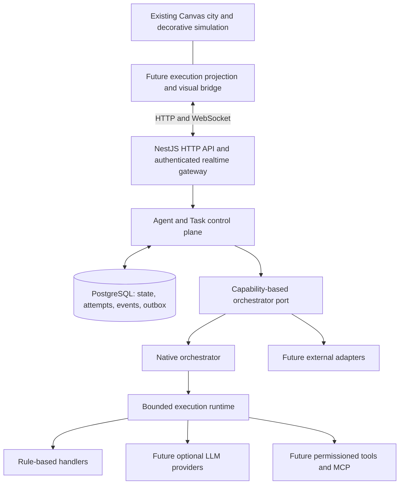

# Target architecture and decisions

Status: **PLANNED** except FUTURE items. [Audit](existing-system-audit.md) is the source of current-state findings. No code or configuration below exists yet.

## Additive architecture

Use one modular NestJS backend deployment and PostgreSQL. A bounded in-process worker polls durable pending executions; it is independent of requests and browsers. Keep the city as its existing static Canvas application. No microservices, Redis or RabbitMQ are necessary for Phase 1.



The frontend displays read models and sends authenticated commands; backend task state is authoritative. Network loss cannot stop execution. Decorative simulation must remain alive without any API. External runs have external execution authority; Elyqreth records normalized observations, policy and identity without executing a second copy.

| Boundary / expected API module | Responsibility | Excluded responsibilities |
| --- | --- | --- |
| City, existing dist modules | Rendering, NPC movement/activity, camera, demo mission | Task execution truth, provider credentials |
| Identity/agents | Owner-scoped logical configuration/lifecycle and permissions | Coordinates, visual animation state |
| Tasks/executions | Durable commands, attempts, validation, retry and recovery | Provider SDK types, decorative schedules |
| Orchestration | Capability negotiation, adapter routing, external reconciliation | Framework dependency in core domain |
| Runtime | Claims/leases, bounded handler invocation, deadlines, cancellation | Request lifetime or animation timing |
| Providers (FUTURE) | Model requests, usage and provider error normalization | Agent identity or task routing policy |
| Tools (FUTURE) | Authorized isolated side effects and approvals | Unrestricted execution of model output |
| Events/realtime | Transactional lifecycle journal, filtered replay and delivery | Uncommitted success broadcasts |
| Infrastructure | DB access, secrets, auth, health, configuration, telemetry | Business transitions hidden in controllers |

Use dependency injection at external boundaries, not a generic abstraction for every class. Keep controllers thin, transition logic in services, transactions in explicit application operations, and vendor SDKs within adapters. Nest modules encapsulate related providers and exported interfaces; this supports the proposed modular deployment. [Nest module documentation](https://docs.nestjs.com/modules).

## Repository strategy

Choose the **existing repository with additive packages**. It becomes a lightweight monorepo without moving the frontend. Phase 1 candidate layout:

```text
dist/                         # unchanged existing frontend source/static root
tests/                        # unchanged city regressions
scripts/check.mjs             # unchanged city syntax check
apps/api/                     # future NestJS package; build to apps/api/dist
  src/{auth,agents,tasks,executions,orchestration,runtime,events,realtime,infra}/
  test/
packages/contracts/           # future TS types + versioned schemas/OpenAPI
docs/ai-agent-platform/       # transfer this documentation when using real repo
compose.yaml                  # future local API + PostgreSQL, never public by default
```

T02 may add npm workspaces `apps/*` and `packages/*` after preserving root scripts, checking ESM/CommonJS boundaries, recording a real Git baseline and confirming package resolution. Keep city `dev`, `check`, `test` behavior; add explicit backend scripts instead of replacing them. Shared contracts can publish ESM JS, JSON Schema and declarations: the vanilla browser must not load raw TypeScript or require a frontend rewrite. T02 selects transport/runtime schema tooling and supported backend Node/Nest versions then pins them; T01 does not install or prescribe unverified package versions.

Preserve `.openai/hosting.json`, asset-relative URLs and Vite root. Static hosting alone does not run a persistent Nest process: future backend hosting must support long-running processes, DB networking, TLS and WebSocket upgrades. Determine that host before any deployment change. Local Compose is a new development path, not replacement hosting.

| Alternative | Decision and consequence |
| --- | --- |
| Move frontend immediately to apps/web | Reject for Phase 1: breaks root/path/hosting assumptions for no execution benefit; optional later with dedicated parity review |
| Separate API repository | Defer: independent release isolation is useful later, but contracts/version coordination and local setup become harder now |
| NestJS modular monolith | Recommend: explicit modules/guards/DI with one operational unit; avoid introducing unnecessary distributed services |
| PostgreSQL | Recommend for transactional task/attempt/event state, uniqueness and durable worker claims |
| Redis | Defer until measured need for shared cache/rate limits/fanout; not task truth |
| RabbitMQ | Defer until worker scale/routing requires broker delivery; retained outbox provides migration seam |
| WebSocket | Plan authenticated native-WebSocket-compatible transport, with HTTP snapshot/poll fallback; do not assume Socket.IO wire compatibility |
| Workflow framework as mandatory engine | Reject: domain and adapter port must work without any one framework |

Nest gateways support transport adapters, so T02 must deliberately choose native WebSocket versus Socket.IO and document client compatibility; the existing browser has neither. [Nest gateway documentation](https://docs.nestjs.com/websockets/gateways).

## API-first surface

Candidate `/api/v1` endpoints: list/create/get/patch/deactivate agents; list orchestrators/capabilities; create/get/list/cancel tasks; list attempts/get execution/result; authorized event history and state snapshot. Use pagination, resource versions/If-Match for edits, Idempotency-Key for task creation and retry commands, structured errors and schema-validated bodies. Persist accepted work before returning 202. Never expose ORM entities directly.

Task creation chooses one agent and its registered orchestrator, snapshots execution-relevant configuration and validates capabilities. A later explicit retry creates an attempt, not a new logical task. Return 409 for conflicting versions/state, 422 for invalid or unsupported requests, 401/403 for access failures, 429 for quotas, 503 for unavailable dependencies. Errors carry code, safe message, retryability and correlation ID. Exact endpoint schemas and HTTP codes become tested contracts in T04–T07.

## Optional LLM and tool boundaries

**FUTURE; not Phase 1 integrations.** Agent has an optional execution-profile reference, never a mandatory provider/model field. Rule handlers need no profile; externally managed runtimes own their own models. Profile versions snapshot provider/model/options/credential reference per execution, so later agent edits do not change a running attempt.

Provider port: `describeCapabilities`, `invoke` and optional `stream`/`cancel`; advertise text, vision, structured output, streaming, tool calling and usage reporting independently. Normalize request content, deadline, token/output limits, model identifier, correlation and optional tool schemas. Return output, finish reason, usage/cost metadata and safe normalized errors. Missing token/cost information is UNKNOWN, never zero. Estimate and actual usage have distinct provenance and pricing timestamp/currency. Enforce budgets before and during execution; collect actual usage when available.

| Integration | Boundary and handling |
| --- | --- |
| Local Ollama | Optional provider adapter, configured server URL, model capability verification, localhost/host-network ambiguity documented in deployment; no automatic downloads |
| OpenAI-compatible endpoints | Optional adapter; compatibility is negotiated/tested, not assumed for tool calling, streams or usage |
| Cloud LLMs | Provider-specific credentials and endpoint policies; deadlines, bounded retries and classified auth/rate-limit/model errors |
| Rule-based agents | Native deterministic real handler, no model dependency or mock LLM |
| External model-managed agents | External orchestrator boundary; do not wrap their hidden model lifecycle in native execution |
| Tool calls | Model proposes typed calls; permissioned tool executor validates arguments, scope, quotas and approval; output treated as untrusted |
| MCP | Future tool transport behind the same authorization/isolation layer; discovery is not permission |

Fail with `UNSUPPORTED_CAPABILITY` when tool calling/structured output is required but unavailable; never silently fall back to parsing arbitrary text into executable instructions. Allow only an explicitly configured safe non-tool fallback. Credentials remain server-side secret references. Enforce request/total deadlines, token/concurrency/cost limits, cancellation support reporting, output size limits and safe redaction. Tool side effects require independent idempotency and audit; retrying a model request is not permission to repeat a side effect.

## Decisions to close during implementation

ORM/migration tool, backend runtime version, auth mechanism/identity provider, event retention, result size limit, provider catalog and hosting remain unselected. T02/T03 must record choices and constraints. Phase 1 assumes one configured owner scope and authenticated local API; multiuser membership is FUTURE, but ownership columns/checks start now. City bindings and external runtime semantics require Phase 2/3 design validation against actual integrations.

## T02 scope resolution

The target above remains the T01 plan. [T02 implementation record](backend-foundation.md) describes the additive HTTP foundation now implemented. Following the explicit T02 requirements, the empty contracts package, Docker/Compose/database configuration, authentication and WebSocket dependency are deferred. Only public liveness is exposed; authentication/ownership remain required before protected APIs. NestJS 11/TypeScript with Express and Node 24 were selected, retaining root/browser ESM and an API-local CommonJS boundary. No frontend configuration/client or business execution was added.

## T03 persistence decision

Drizzle/pg, explicit SQL migrations, an injectable DatabaseModule and PostgreSQL-only Compose are implemented in the actual source tree. See [T03 database record](database-foundation.md). No startup migration, business API, execution, publisher or NPC synchronization was added. Original target decisions above are preserved; T04 remains gated on real authentication/ownership controls.
