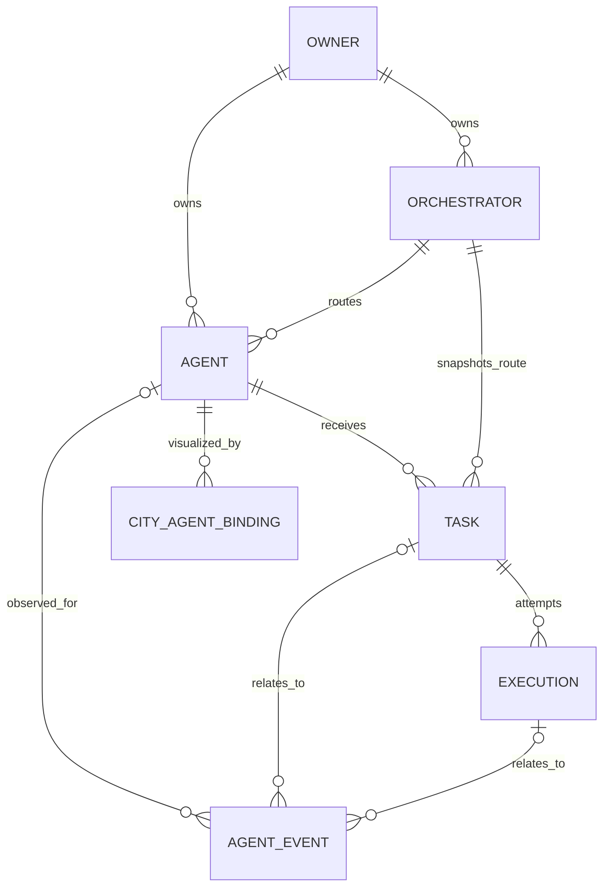

# Initial domain model

Status: **PLANNED**. No schemas/migrations created. Current numeric NPC IDs and mutable Simulation objects are described in the [audit](existing-system-audit.md), not reused as platform identity.

## Identity, relationships and scope

Use server-generated UUIDs for logical Agent, Orchestrator, Task, Execution, Event and future Binding. UUIDs persist in PostgreSQL across restarts; names and framework IDs are not primary keys. Execution IDs identify attempts, not new agents. External IDs are namespaced by registered orchestrator. Every protected entity has an owner/scope; enforce same-scope relationships, including event/result lookups.

Events can have no agent (for example orchestrator connectivity). OWNER denotes an authenticated scope, initially provisioned locally rather than a user-management product.

| Entity / phase | Candidate fields and semantics |
| --- | --- |
| Agent / Phase 1 | id, ownerId, name, description, type (`RULE_BASED`, future `LLM`/`EXTERNAL`), capabilities[], configuration (validated/versioned, no secrets), orchestratorId, lifecycleStatus (`ACTIVE`, `DISABLED`, `ARCHIVED`), version, createdAt, updatedAt |
| Orchestrator / Phase 1 minimal native registration | id, ownerId, name, type, capabilities descriptor/version, configurationReference, registrationStatus (`ENABLED`, `DISABLED`), observedStatus (`UNKNOWN`, `CONNECTED`, `DEGRADED`, `DISCONNECTED`), lastObservedAt, version, timestamps; connectivity is separate from permission to dispatch |
| Task / Phase 1 | id, ownerId, agentId, orchestratorId snapshot, input (bounded JSON), status, statusReason, version, idempotencyKey/requestHash, retryPolicy snapshot, deadlineAt, cancelRequestedAt, createdAt, updatedAt, completedAt; request identity/input remain stable across attempts; results belong to attempts |
| Execution / Phase 1 | id, taskId, attempt (positive integer), status, version, adapterKey/configVersion, agentConfigSnapshot/reference, authority (`NATIVE`, future `EXTERNAL`), externalExecutionId, submissionKey, startedAt, finishedAt, error (safe code/message/retryable), resultReference, resultAvailability (`NONE`, `PENDING`, `AVAILABLE`, `UNAVAILABLE`), deadlineAt, nextEligibleAt, leaseOwner/leaseToken/leaseExpiresAt, lastHeartbeatAt, reconciliationState |
| Agent Event / Phase 1 | id/eventId (one identifier), ownerId, eventType, schemaVersion, aggregateType/id/version, aggregateSequence, streamPosition, optional agentId/taskId/executionId/orchestratorId, correlationId, causationId, occurredAt/recordedAt, payload (redacted/bounded), source/sourceEventId |
| City Agent Binding / FUTURE | id, ownerId, cityId, agentId, npcKey, visualizationMode, enabled, timestamps; npcKey is durable city identity, not raw session counter |

Native configuration initially identifies an allowlisted rule handler and bounded inputs. No model/provider is mandatory. Proposed capabilities do not grant tool permissions: grants are independently authorized. Registration can accept DISABLED draft agents; ACTIVE requires a compatible enabled orchestrator and configured handler. Disabled/archived agents reject new tasks; in-flight work follows explicit cancel/drain policy, never disappears on registry removal.

## Cardinality and constraints

- Agent routes to one orchestrator at a time; orchestrator serves many agents. Each task snapshots the route; attempts for that task remain pinned in Phase 1. Rebinding affects only future tasks. External migration/reassignment requires explicit future policy.
- Task has one assigned logical agent initially and zero or more attempts. Multi-agent coordination is FUTURE: add participant/step records without overloading agentId or cloning the task for retries.
- One task may have many failed attempts and one successful attempt. At most one PENDING/RUNNING attempt per task. Phase 1 limits native agent concurrency to one running attempt through a transactional claim; future per-agent concurrency must be explicit.
- Task `(id, ownerId)` relationships and validation prevent cross-owner agent/orchestrator references. Event agent/task/execution references must describe the same task/attempt; orchestrator-only events allow nullable references.
- `UNIQUE(taskId, attempt)`; partial unique active-attempt constraint on taskId for PENDING/RUNNING; `UNIQUE(orchestratorId, externalExecutionId)` when external ID exists. `UNIQUE(ownerId, idempotencyKey)` on task creation scope with canonical request hash. Submission keys are immutable per attempt.
- Terminal attempts require finishedAt; RUNNING requires startedAt. Task completedAt denotes any terminal outcome. Database checks cover structural invariants; transition service covers history-dependent rules.
- Result reference belongs to execution and owner. Phase 1 may keep small bounded JSON results in a DB result record referenced by execution; large blob/object storage is FUTURE. Fetch through authorized API, never arbitrary filesystem URLs. Future external success can persist an authorized remote result reference or explicit unavailable marker independently of retrieval availability; an unavailable result never authorizes reexecution of successful work.
- Archive instead of hard-delete agents/orchestrators with task history. Retention/redaction must preserve audit referential integrity; purging input/results follows policy, not frontend reset.
- FUTURE bindings: one enabled binding per `(cityId, agentId)` and per `(cityId, npcKey)` initially; multiple-city views allowed. Missing local NPC leaves binding unresolved without creating/deleting agents. Store legacy NPC numeric ID only as session resolution data.

## Index proposal and ownership

Candidate indexes: Agent(ownerId,lifecycleStatus,id), Agent(ownerId,orchestratorId); Orchestrator(ownerId,registrationStatus), Orchestrator(ownerId,observedStatus); Task(ownerId,status,createdAt,id), Task(agentId,status), Task(orchestratorId,status); Execution(status,nextEligibleAt), Execution(leaseExpiresAt) for active work; Event(ownerId,streamPosition), Event(aggregateType,aggregateId,aggregateSequence) unique, Event(taskId,recordedAt), Event(executionId,recordedAt); outbox(publishedAt,nextAttemptAt). Use actual query plans in T03/T08 before adding redundant JSON indexes.

Registry service owns Agent lifecycle/configuration. Orchestrator registration service owns configuration/capabilities; connectivity observer owns freshness. Task transition service owns task/attempt status under transaction; runtime reports facts, not arbitrary SQL updates. External observations pass adapter/reconciliation validation. Event service appends history; frontend is a projection only. Neither NPC state nor simulated `workStatus` is persisted as execution truth.

Required operational records beyond the six requested entities: owner scope, task idempotency, result storage, transactional lifecycle journal/outbox, command audit. Define these in T03; T07 completes public event normalization/replay. Provider profiles, tool grants/approvals, usage/cost ledger, external subscriptions, multi-agent graphs and City Agent Binding storage/API are FUTURE, not silently included in Phase 1.

## T03 applied schema

The preceding proposal is retained as T01 history. [T03 database record](database-foundation.md) documents the actual schema, including binding metadata brought forward at the explicit T03 request, owner-scoped IDs, required initial routing, attempt-owned results, guarded history and per-owner event ordering. No orchestrator/agent seed, business API or NPC synchronization exists.
