# Phase 1 implementation plan

Status: **PLANNED**. T01 is documentation only; T02–T08 have not begun. Paths below are candidates relative to the audited source root. Do not implement against the initially empty documentation workspace as though it were the city repository.

## Dependency and scope overview

```mermaid
flowchart LR
  T01[T01 audit and plan] --> T02[T02 backend foundation]
  T02 --> T03[T03 database and migrations]
  T03 --> T04[T04 agent registry]
  T03 --> T05[T05 task and attempt storage]
  T04 --> T05
  T05 --> T06[T06 lifecycle and rule execution]
  T06 --> T07[T07 normalized events and history]
  T07 --> T08[T08 integration and acceptance]
  T08 --> P2[Phase 2 city bridge and optional models]
  P2 --> P3[Phase 3 external adapters and scaling]
```

Tests, authorization and internal lifecycle recording start in each slice; T08 integrates rather than introduces them. T03 includes journal/outbox storage; T04–T06 write transition history transactionally. T07 defines/exposes normalized event schemas, replay and delivery. This resolves the ordering issue where durable lifecycle changes precede the public event-contract task.

Phase 1 deliverable: authenticated owner-scoped registry and durable task/attempt API; one minimal native orchestrator; bounded LLM-independent rule execution surviving API/browser lifetimes; history/events with recoverable delivery. Existing city remains a functioning independent demo. No city-to-backend network wiring is required to claim Phase 1 completion.

## T02 — Backend Foundation & Workspace Integration

**Objective:** add a minimal API package and contract package without changing how the existing city runs.

**Dependencies:** completed T01; locate the actual working repository (the inspected export has no Git metadata), record revision if available and preserve the 160-file source baseline. Rebase/copy T01 docs into the working repository as documentation when that repository is selected; do not overwrite historical docs. No need to move frontend files.

**Expected modules/files:** `apps/api/package.json`, `src/main.ts`, `src/app.module.ts`, `src/auth/`, `src/infra/config/`, health controller, TypeScript/Nest/test configuration; `packages/contracts/`; additive root scripts/workspace entries; local `compose.yaml`, `.env.example`, developer instructions. All are future changes requiring the implementation task, not T01.

**Boundaries:** retain `dist`, root city tests/scripts, package identity, Vite root and hosting metadata. Backend output belongs under `apps/api/dist`. Select and pin supported backend runtime/Nest versions, module format, HTTP/WebSocket transport compatibility and runtime schema/auth tooling. Single-owner authenticated development baseline; no user administration product. Local Compose may introduce API/PostgreSQL configuration; DB schemas come in T03.

**Acceptance criteria:** existing static-server workflow and city npm commands work identically; separate API dev/test commands work; liveness returns only safe status; non-health surfaces fail closed without credentials; validated config fails visibly; API default bind/ports are local; no root dist output collision. Backend starts without a browser and without LLM credentials. Document hosting assumptions rather than changing live hosting.

**Testing:** backend boot/config/auth smoke tests, invalid configuration and CORS/origin checks; all existing syntax checks and 51 city tests. Verify diff and asset URLs; capture browser baseline for later comparison if browser tooling is available. Dependency installation is permitted only in the future implementation task.

**Security:** secret references and ignored local environment files; no public no-auth default; explicit allowed origins, bounded request bodies and safe errors.

**Risks:** exported rather than Git repository, workspaces/lockfile churn, root ESM versus Nest module output, CLI scaffolding overwriting dist, static host unable to run API, native WebSocket versus Socket.IO mismatch.

**Exclusions:** frontend relocation/refactor, DB migrations, agent/task endpoints, real execution, providers, adapters, visual redesign, deployment/publishing.

## T03 — Database Schema & Migrations

**Objective:** establish PostgreSQL durable entities, transactional constraints and reproducible migration infrastructure.

**Dependencies:** T02 configuration/auth scope and package layout. Select one ORM/query/migration tool with documented transaction/locking support; do not mix competing persistence frameworks.

**Expected modules/files:** `apps/api/src/infra/database/`, schema/repositories, migrations under API-owned migration directory, database test harness and fixtures; schema documentation. Tables: owner scope, Agent, minimal native Orchestrator, Task, Execution, bounded Result, idempotency records, command audit, lifecycle journal/outbox and scoped stream counter. Final public schema mapping belongs to T07.

**Boundaries:** model fields/relationships from [domain model](domain-model.md); UUID identities; route/config snapshots, same-owner references, unique attempts/submission/event keys, active-attempt constraints, version fields and timestamps. Bootstrap native orchestrator idempotently. Binding/provider/tool/multi-agent tables deferred unless a required foundation field is explicitly justified. No migration operates on frontend state.

**Acceptance criteria:** clean DB migrates to current schema; repeated startup does not duplicate seed/identity; persisted records survive process/container restart; uniqueness/check/FK constraints reject invalid ownership/attempts; state/result/journal/outbox transaction rolls back entirely on injected failure. Backup/restore and migration failure/rollback strategy documented.

**Testing:** integration tests against disposable real PostgreSQL, not only repository mocks; migration from empty and preceding schema; owner mismatch, active-attempt uniqueness, transaction rollback, durable volume and restore smoke tests. Inspect representative query plans for proposed indexes.

**Security:** least-privilege application DB role distinct from migration role, no logged credentials, validated local connection/TLS policy, restricted test database names and explicit disposable fixtures.

**Risks:** status constraints hard to evolve, ORM hides transaction boundary, accidental destructive reset, indexes out of step with queries, archive/retention policy unspecified. Resolve retention defaults and migration recovery before acceptance.

**Exclusions:** binding migrations, cloud DB provisioning, public DB ports, Redis/broker, full user-management schemas, provider usage/cost ledger.

## T04 — Agent Registry API

**Objective:** implement durable logical agent creation, retrieval, update, disable and archive with owner-scoped access.

**Dependencies:** T02 auth/validation/contracts, T03 Agent/Orchestrator repositories/audit/journal. Native descriptor from T03; external orchestrators remain unimplemented.

**Expected modules/files:** `apps/api/src/agents/` controllers/service/DTO/repository interfaces; minimal `src/orchestration/` descriptor/capability reader; schemas/OpenAPI in `packages/contracts`; registry integration tests and API examples.

**Boundaries:** no NPC creation or mapping. Registry configuration contains validated handler references and safe options; ACTIVE requires compatible enabled native descriptor. Status/owner are not freely mass-assigned. Define archive versus disable, versioned updates and in-flight drain/cancel policy, with history preserved.

**Acceptance criteria:** stable UUID across restart; paginated owner-filtered list/get, validated create/patch, optimistic concurrency conflict handling; invalid agent type/role-like capability/config rejected; disabled/archived agents cannot accept new tasks once task API exists; archive does not delete historical relationships. Every mutation transaction records actor and lifecycle fact. Secret fields are rejected/redacted.

**Testing:** real DB CRUD/restart and concurrent update tests, cross-owner reads/writes, forged owner/status, bad config, route mismatch, safe serialization and archive history. Re-run city regressions if shared/root setup changes.

**Security:** explicit registry administration/execution grants, resource filtering on all queries, rate/body limits, safe error messages. Config cannot load arbitrary handlers or endpoints.

**Risks:** UI's fixed Researcher/Designer/Developer/Tester roles may be confused with backend agent type/capability; prevent coupling. Archive semantics must not silently cancel accepted work.

**Exclusions:** changing Add resident/Remove agent UI, persistent NPCs, external discovery/registration, LLM/provider/tool configuration UI, multi-agent membership.

## T05 — Task & Execution Persistence

**Objective:** accept and retrieve durable tasks with independently identified attempts, safe input/result records and idempotency.

**Dependencies:** T03 task/attempt/result/idempotency storage and transactional journal, T04 registry/capability/lifecycle validation and owner scope.

**Expected modules/files:** `apps/api/src/tasks/`, `src/executions/`, repository transactions and DTOs, contract schemas, API/DB tests. No runtime invocation yet.

**Boundaries:** persist CREATED → QUEUED and first PENDING attempt atomically for accepted runnable tasks; pin agent/orchestrator/config/policy snapshots. Resource reads expose safe versioned DTOs. Task identity survives multiple attempts. Result storage is bounded owner-scoped JSON/reference, not an arbitrary URL/file loader.

**Acceptance criteria:** commit before success/202; same owner/idempotency key + canonical request returns original task/attempt, conflicting content returns conflict; concurrent duplicate requests create one task; disabled/unauthorized/incompatible agents rejected; list/get/history references survive restart; at most one active attempt. No execution occurs through HTTP or frontend timing.

**Testing:** concurrent submission and rollback injection, cross-owner task/execution/result lookup, malformed/oversize input, pagination, route/config snapshot unaffected by later registry edits, process restart persistence. Verify state+journal/outbox atomicity.

**Security:** task input limits, owner quotas, forbidden status/attempt injection, no secrets in events/errors, authentication before idempotency lookup to prevent cross-owner information disclosure.

**Risks:** acceptance without atomic attempt creation, noncanonical hashes, deleted configuration reference, accidental inference from visual states, overbroad result DTO.

**Exclusions:** live workers, transitions beyond persistence acceptance, retry/cancel coordination implementation (T06), frontend submission wiring, real AI, arbitrary file artifacts.

## T06 — Task Lifecycle Service

**Objective:** implement validated transitions, bounded native execution coordination, cancellation, retry and restart recovery without an LLM.

**Dependencies:** T05 durable accepted work, T04 permissions/lifecycle, T03 transactions/claims/journal. Use the [lifecycle](task-lifecycle.md) and [orchestrator port](orchestration-contracts.md) rather than existing Simulation phases.

**Expected modules/files:** `src/tasks/task-lifecycle.service.ts`, `src/executions/`, `src/orchestration/` native adapter/descriptor, `src/runtime/` worker/claim/lease/handler registry, cancellation/retry command DTOs, deterministic rule handler and tests. Names are illustrative.

**Boundaries:** backend-owned poller in the same deployment, small allowlisted real rule operation with bounded input/output and no external effects. Native port routes submissions; unsupported operations explicit. No framework SDK mandatory. Claim/commit/invoke/complete are separate steps; no DB lock held during runtime I/O.

**Acceptance criteria:** all allowed transitions and invalid transition rejection; one active attempt per task and one native running task per agent; independent agents can execute concurrently within global limit. Completion persists real rule output; attempt failure and task final failure remain distinct. Bounded retries retain task identity; cancellation/timeout races resolve once; interrupted work recovers after backend restart with stale worker writes fenced. Work continues with browser closed. Unknown external outcomes cannot be retried automatically even though external adapter implementation is deferred.

**Testing:** state-table tests; actual DB worker concurrency, duplicate delivery and lease expiry; child-process termination/restart; cancellation-before-claim and completion-vs-cancel race; deadline/budget exhaustion; no retries for permission/validation errors; stale attempt completion; output persistence. Native port conformance and unsupported capability tests.

**Security:** recheck permissions/config/lifecycle policy at claim; fixed safe handler catalog, deadlines/quotas/backoff, no arbitrary code/tools/network. Complete first-real-agent security gate before enabling execution by default.

**Risks:** treating lease expiry as proof a side effect stopped; multiple workers racing agent capacity; event facts lost before T07; timers creating phantom retries after restart. Use durable nextEligibleAt and transactional history from the start.

**Exclusions:** external orchestrator SDKs, LLM/mock LLM, multi-agent graph, queue broker, tool/MCP runtime, NPC activity control and demo pipeline replacement.

## T07 — Event Contracts & Audit History

**Objective:** expose normalized versioned lifecycle history and recoverable backend realtime delivery over committed records.

**Dependencies:** T03 journal/outbox/stream ordering, T04–T06 append facts with commands/transitions, finalized DTO vocabulary. Schemas may be drafted earlier but event meaning must match lifecycle facts.

**Expected modules/files:** `packages/contracts/events/` schemas/types, `src/events/` journal/public mapper/outbox/history, `src/realtime/` authenticated gateway and resume protocol, snapshot/replay HTTP endpoint, tests and contract examples.

**Boundaries:** persistent lifecycle versus transient progress, public redaction, aggregate ordering, owner-stream cursor and resync defined in [event contracts](event-contracts.md). Initial gateway uses DB outbox plus local notifications/poll wakeups, not RabbitMQ. Do not emit task.failed for a retryable attempt failure. Current frontend log is not migrated into fabricated platform history.

**Acceptance criteria:** state/journal/outbox consistency, at-least-once deduplication, replay after reconnect/gateway restart, snapshot/subscription race closed, retention expiry yields RESYNC_REQUIRED, slow consumer bounded/disconnected, HTTP fallback available. Owner streams cannot leak other tasks/results. Prior lifecycle facts from T04–T06 remain readable. Unknown versions are safely rejected/resynced.

**Testing:** contract/schema fixtures, outbox failure/retry and crash-after-send, duplicate/source-event deduplication, commit-order cursor race, replay gap/expired cursor, auth/origin/resource subscription tests, large frame/slow consumer, no credentials in event payload. Native WebSocket interoperability smoke test outside the city.

**Security:** equal authorization for live and historical records, redacted safe summaries, bounded payloads and replay pages, token expiry/session invalidation, audit access policy.

**Risks:** serial IDs mistaken for committed stream order, unbounded replay/buffers, two competing event histories, transport-library mismatch, gateway restart losing truth.

**Exclusions:** city client integration, historical animation playback, external webhooks, RabbitMQ/Redis, token streaming and model/tool telemetry integrations.

## T08 — Integration Tests & Acceptance Review

**Objective:** verify the platform foundation end to end and prove existing city preservation.

**Dependencies:** T02–T07 complete and documented; disposable PostgreSQL/local backend environment; prior source/hash/browser baseline available.

**Expected modules/files:** `apps/api/test/` integration/recovery/security acceptance suites, contract validation fixtures; documented acceptance checklist/runbook, backend deployment prerequisites and updated documentation index. New browser acceptance automation only as justified by actual changes/tooling; preserve existing tests.

**Boundaries:** acceptance covers real native rule execution and durability; it does not claim LLM, external framework or NPC synchronization support. Tests must validate behavior and failures, not mirror implementation internals.

**Acceptance criteria:** register owner-scoped agent → submit idempotent task → persist attempt → worker executes rule handler → result/history/event retrieval; restart retains records and recovers safe work; duplicate/cancel/retry/deadline races correct; unauthorized resources inaccessible; secrets absent; DB outage visible; queue/outbox bounded. All 51 original city tests and module syntax checks pass. Browser city starts offline and retains Icy White branding/materials, building positions/layout, roads/bridges/rail/Station, water/train/traffic, NPC routines, four-stage demo/handoffs/error recovery, inspector/roster, camera/pan/zoom, pause/speed/reset, keyboard/touch behavior and road-debug query view.

**Testing:** full API + real DB run, backend process-kill/restart, concurrent clients/workers, event reconnection and snapshot recovery, migration/backup restore, security negative cases; static city in real browser with API absent and present, screenshots at overview/cafe/park/night/selected resident and multiple animation samples. Capture representative draw cost/FPS on the same browser/hardware and scene before/after; define tolerance from baseline and investigate regressions. Historical throttled captures alone are insufficient. If unavailable, report the unverified checkpoint rather than claim visual acceptance.

**Security:** all first-agent gates reviewed with evidence; pure handler enabled only after gate completion; public hosting remains separately gated on TLS/auth/origin/secret/DB configuration and approvals required by implementation context.

**Risks:** flaky random/time tests, mocked DB hiding race behavior, browser throttling, source export lacking revision, test coverage mistaken for real external AI capability. Use seeded fixtures and actual process/DB evidence.

**Exclusions:** automatically deploy/publish, begin Phase 2, introduce LLMs/tools/frameworks, rewrite rendering, rename/move directories or relax controls to pass tests.

## Acceptance checkpoints

| Gate | Evidence needed |
| --- | --- |
| After T02 | Original city commands intact; independent authenticated API boot; preserved dist/hosting |
| After T03 | Durable schema/migration/transaction/restore checks |
| After T04–T05 | Owner-scoped stable identities, idempotent task/attempt acceptance and no browser authority |
| After T06 | Real bounded rule handler, verified transitions/recovery/concurrency and first-agent security gate |
| After T07 | Versioned safe events, durable history, authenticated replay/resync |
| After T08 | End-to-end and failure tests, city browser parity, documented uncertainties; no inflated AI capability claims |

## Phase 2 and Phase 3 dependencies

**Phase 2 — real platform visibility and optional models:** depends on T08 and approved security gates. First add authenticated frontend client/read model and explicit demo/platform distinction; define durable NPC keys and binding storage/API; then build guarded bridge with cleanup/interruption and offline/replay acceptance. Separately add optional provider profiles and rule/LLM runtime capability checks, usage/budget reporting and provider failures. Tool executor/approvals require isolation and side-effect idempotency before any write-capable tool; MCP follows the same boundary. City activity must remain inference-free. These streams can be staged independently; visual integration does not require an LLM.

**Phase 3 — external orchestration and scale:** depends on durable identity/lifecycle/event contracts from Phase 1; use Phase 2 frontend projection if visualizing runs. Pick one actual external runtime, audit its APIs/cancellation/idempotency/event capabilities, implement a conforming adapter with reconciliation and security tests, then expand. Add multi-agent participants/steps/handoffs only when real coordination exists. Split workers and adopt RabbitMQ via outbox when measured throughput/delivery needs justify it; optional Redis for measured cache/fanout. Multiuser identity/membership, production hosting and operational SLOs require corresponding authorization/backup/monitoring reviews. None mandates a particular framework or a city rewrite.

## Current implementation checkpoint — T03

T01/T02 are completed historical work. T03 PostgreSQL/Drizzle schema and migrations are now implemented in the actual source tree, with [verification and deviations](database-foundation.md). T04 is next, not begun; T05–T08 remain planned. No business API, worker, AI execution, event publisher or NPC synchronization has been implemented. Database storage does not replace the future transition/authorization services.
