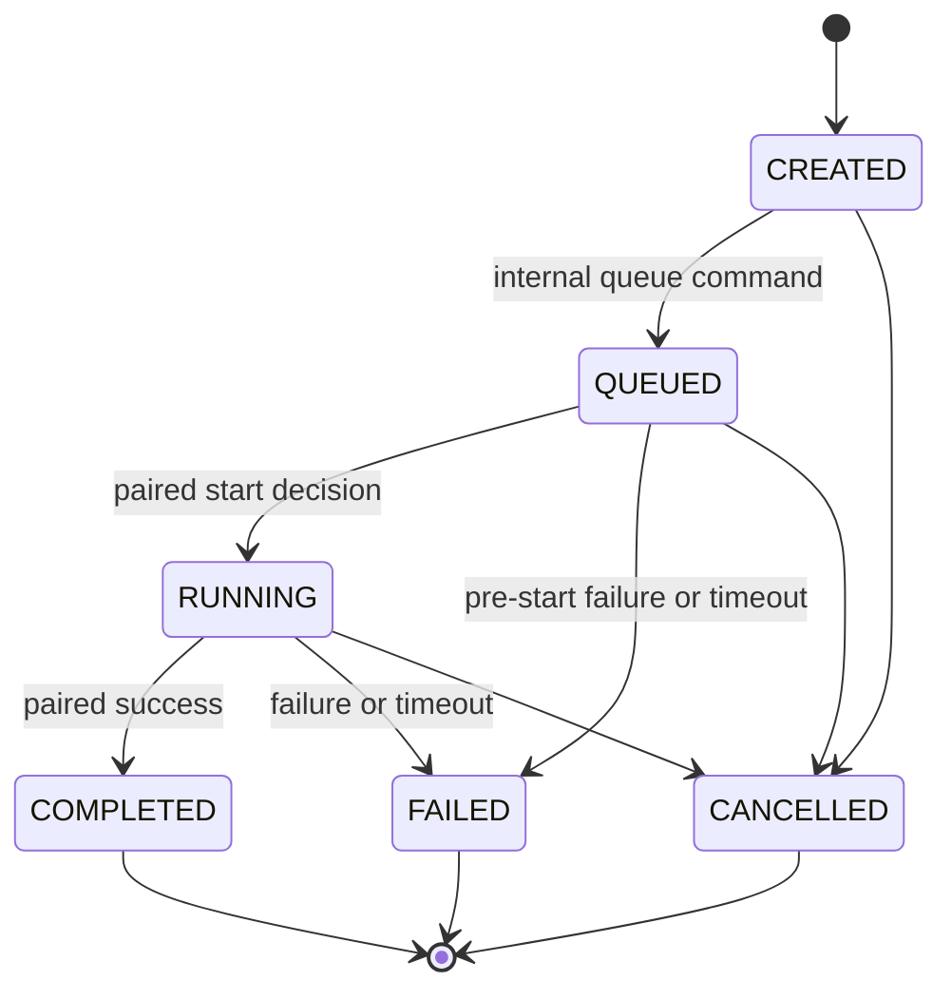
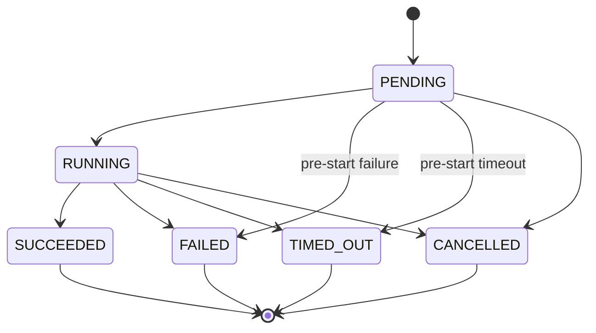

# T06 — Task Lifecycle Service

The [T08 acceptance review](phase-1-acceptance.md) verifies these unchanged internal services with real HTTP registration, PostgreSQL lifecycle races, transactional events and new-application-instance persistence. Cancellation/timeout still persist decisions only; no worker, process termination or retry scheduler exists.

Status: **IMPLEMENTED**, 2026-10-21 (Asia/Bangkok). Existing NestJS/Drizzle/PostgreSQL modules and T03–T05 persistence are reused. This is internal lifecycle **persistence**, not an execution runtime. No new HTTP route, schema change, dependency, worker, broker, provider or frontend integration is added.

The earlier [T01 lifecycle proposal](task-lifecycle.md) is historical/planned where it discusses handler invocation, retries, leases, restart recovery or confirmed process termination. The implementation described here is authoritative for T06. The explicit user scope excludes actual execution, retry scheduling and process control. T05 HTTP creation remains CREATED with no attempt; only an explicitly called internal queue operation creates/adopts a PENDING attempt.

## State machines



| Task current | Allowed next |
| --- | --- |
| CREATED | QUEUED, CANCELLED |
| QUEUED | RUNNING, FAILED, CANCELLED |
| RUNNING | COMPLETED, FAILED, CANCELLED |
| COMPLETED / FAILED / CANCELLED | None |



| Execution current | Allowed next |
| --- | --- |
| PENDING | RUNNING, FAILED, TIMED_OUT, CANCELLED |
| RUNNING | SUCCEEDED, FAILED, TIMED_OUT, CANCELLED |
| SUCCEEDED / FAILED / TIMED_OUT / CANCELLED | None |

All other transitions, including self-transitions, are rejected. Direct CREATED → RUNNING/COMPLETED and PENDING → SUCCEEDED are forbidden. Pre-start FAILED/TIMED_OUT and QUEUED → FAILED retain T01's explicit preflight-failure semantics: they never invent a RUNNING phase. CREATED → FAILED, RUNNING → QUEUED and retries from the earlier broader proposal remain unimplemented.

**Repeated commands always conflict**, rather than silently succeed. A stale expected version yields LIFECYCLE_CONFLICT. Repeating with current versions gives ALREADY_TERMINAL for terminal records, or the relevant invalid-transition code for a nonterminal self-transition. No timestamp/version/event is changed by rejection. After a lost response, callers must re-read authoritative state and reconcile; they must not interpret an error as proof that the original commit failed.

Terminal outcomes cannot be reopened or rewritten by either service. A new attempt never reuses an earlier UUID/attempt number. T06 failure/timeout always terminalizes its Task; it never schedules another attempt. The T05 low-level allocation primitive remains available to trusted application code, but it rejects terminal Tasks and is not a retry policy/API.

## Internal interfaces

`LifecycleModule` exports `TaskLifecycleService` and `ExecutionLifecycleService`; it has **no controller** and no startup/background hooks. Task methods are the single atomic coordinator. Execution-facing methods delegate to it, preventing duplicated/independent Task and Execution transition rules.

```ts
const queued = await lifecycle.queueTask(taskId, {
  taskVersion: task.version,
  authority: 'NATIVE', // or explicit EXTERNAL metadata, no adapter call
});
const running = await lifecycle.startTask(taskId, queued.execution!.id, {
  taskVersion: queued.task.version,
  executionVersion: queued.execution!.version,
});
const finished = await lifecycle.completeTask(taskId, running.execution!.id, {
  taskVersion: running.task.version,
  executionVersion: running.execution!.version,
});
```

These are illustrative explicit backend calls. No endpoint invokes them, and persisting RUNNING/SUCCEEDED does not itself perform work. Future trusted workers/adapters must report actual facts after their own authorization, claims and execution integration exist.

| Method | Arguments / policy |
| --- | --- |
| queueTask | taskId, `{taskVersion,authority}`; CREATED only; atomically allocate first PENDING attempt or adopt an existing T05 PENDING attempt |
| startTask | taskId, executionId, `{taskVersion,executionVersion}`; QUEUED/PENDING → RUNNING/RUNNING |
| completeTask | IDs, versions, optional `resultReference`; RUNNING/RUNNING → COMPLETED/SUCCEEDED |
| failTask | IDs, versions, `errorCode`; QUEUED/PENDING or RUNNING/RUNNING → FAILED/FAILED |
| timeoutTask | IDs, versions; same paired nonterminal states → FAILED/TIMED_OUT |
| cancelTask | taskId, `{taskVersion,executionId?,executionVersion?}`; supported cancellation cases below |

Execution-facing methods: `startExecution`, `succeedExecution`, `failExecution`, `timeoutExecution`, `cancelExecution`. Each requires the intended Task ID, Execution ID and expected versions, and coordinates both records through the same Task service. There is no free-form `setStatus` or execution-only terminal mutation.

IDs must be UUIDs, versions integers 1–2,147,483,647, and command objects may contain only their documented fields. Missing/invalid versions, arbitrary raw messages, status injection and URL/file result references are rejected. Return value is `{task,execution}` using the existing safe T05 representations; execution is null only for cancellation without an attempt.

Queue and start recheck ACTIVE agent, ENABLED same-owner route and matching immutable routing. Connectivity is not a runtime-readiness claim. Allocation uses T05's transaction-aware primitive and safe metadata snapshot. Queue adopts an existing latest PENDING record only with matching route/authority; it never overwrites that snapshot. Existing historical success or a terminal latest attempt without an explicitly allocated pending record is inconsistent with a new queue operation and is rejected, not silently retried. Historical failed attempts followed by a valid T05 pending record are preserved and can be adopted.

## Success and sanitized failures

Success may omit `resultReference`/supply null: the attempt succeeds with resultAvailability NONE. A supplied reference must be exactly `result:<UUID>` and identify an existing execution_results record belonging to this owner and selected execution. No arbitrary URL/path is loaded, and no result creation API is introduced. On success the reference is saved on the Execution only, with availability AVAILABLE; the Task has no result column. Public read DTOs continue omitting result references and bodies. A future result writer must store authorized bounded results before reporting this outcome; richer transaction composition can be introduced with that actual writer.

`failTask` accepts only these stable codes, with server-selected persisted messages:

| Code | Persisted message |
| --- | --- |
| EXECUTION_FAILED | Execution failed. |
| PROCESS_INTERRUPTED | Execution was interrupted. |
| RUNTIME_UNAVAILABLE | Execution runtime was unavailable. |

Timeout stores EXECUTION_TIMED_OUT / `Execution timed out.`. No raw runtime exception/message/stack is accepted. Existing T05 read serialization continues returning generic error summaries. Task statusReason stores the safe code for failure/timeout. Cancellation uses status/reason fields and does not report an execution error.

## Cancellation and timeout

- CREATED with no attempt: cancel Task; no Execution is invented.
- CREATED with a T05 PENDING attempt or QUEUED/PENDING: caller must supply that attempt ID/version; Task and attempt cancel atomically. No prior historical attempt is edited.
- RUNNING/RUNNING: the same explicit IDs/versions are required. Both become CANCELLED, with `reconciliationState=CANCELLATION_UNCONFIRMED` on the attempt. This records an administrative lifecycle decision and rejects later completion; it **does not prove process termination**.
- Task cancelRequestedAt and completedAt, plus attempt finishedAt when present, are persisted together. Pending cancellation leaves startedAt null; running cancellation retains startedAt.
- Completed/failed/cancelled Tasks cannot be cancelled, even repeatedly. Success already committed wins over a competing cancellation; cancellation already committed prevents success.

This persistence-only cancellation policy deliberately differs from T01's **future** process-aware two-stage request/confirmed-stop protocol. No real runtime is connected. Before enabling an actual external runtime, implement capability-aware cancellation/reconciliation and authoritative remote observation; a persisted CANCELLED decision must never be treated as evidence that external side effects stopped.

Timeout is also an explicitly invoked persisted decision, not a timer, deadline scanner, process kill or automatic retry. It terminalizes Task FAILED and attempt TIMED_OUT. T06 cannot prove that external work stopped after a running timeout. Future runtime isolation/cooperative abort, reconciliation and retry policy are separate prerequisites; no worker is started automatically after restart.

## Transactions, timestamps and concurrency

Each command runs in one Drizzle/PostgreSQL transaction. Lock order is parent Task `FOR UPDATE`, selected/latest Execution, then eligibility agent/orchestrator share locks where required. T05 allocation uses the same parent lock. The service validates both expected versions inside the transaction, verifies same owner/Task/agent/orchestrator, and requires the current latest attempt. Older attempts and cross-Task references cannot mutate the Task.

Queue commits the new/adopted pending attempt and QUEUED Task together. Start commits both RUNNING statuses and Execution startedAt. Terminal commands commit both terminal statuses, Execution finishedAt and Task completedAt, plus reference/error/cancellation metadata. PostgreSQL clock_timestamp text preserves microseconds for paired timestamp writes; JS millisecond truncation cannot violate same-millisecond database checks. Existing triggers advance updatedAt and resource versions. Returned versions must be used by the next command.

Existing unique constraints enforce one active attempt per Task, unique attempt number per Task and one running native execution per agent. Competing commands serialize on the Task; only one conflicting start/completion/failure/cancel can commit. The loser gets a version/state/constraint conflict. Different Tasks competing for the same native agent hit the existing partial unique index; the losing transaction remains QUEUED/PENDING. There are no in-memory locks, Redis locks, distributed claims or exactly-once execution guarantees.

Actual transitions append lifecycle events, an accepted command audit and the existing trigger-created outbox rows in the **same transaction**. Paired events share a correlation UUID; aggregate sequences are allocated under the resource locks and remain distinct from resource versions. Queue's newly allocated attempt retains the T05 creation fact/correlation; queue history is linked through taskId/executionId. Payloads contain status/version only, no input, results, credentials or error text. Event types: task.queued, task.started, task.completed, task.failed, task.cancelled; execution.started, execution.completed, execution.failed, execution.cancelled, execution.timed_out. T07 owns final public contracts; no publisher/replay transport is implemented. Rejections append no lifecycle history; rejected-command persistent audit remains later work.

Audit/event failure rolls back status, timestamp, version, attempt creation and outbox writes. Tests inject failures after the application has updated both records and verify the persisted pre-command state exactly. No migration is necessary; original schema/migration/index files are unchanged.

## Domain errors

`LifecycleError` is one small transport-independent Error with a stable `code` and code-only safe message. There is no new HTTP status mapping because these operations have no routes.

| Code | Meaning |
| --- | --- |
| INVALID_COMMAND | Invalid UUID/version/authority/error/result/command fields |
| ACCESS_DISABLED | No configured trusted development owner or production invocation |
| TASK_NOT_FOUND | Missing/out-of-scope Task |
| EXECUTION_NOT_FOUND | Missing/out-of-scope attempt |
| EXECUTION_TASK_MISMATCH | Owned attempt belongs to another Task/route |
| INVALID_TASK_TRANSITION | Disallowed nonterminal Task transition |
| INVALID_EXECUTION_TRANSITION | Disallowed nonterminal attempt transition |
| ALREADY_TERMINAL | Fresh-version command targets terminal history |
| LIFECYCLE_CONFLICT | Stale versions/older attempt/eligibility/capacity/uniqueness/serialization/deadlock conflict |
| INCONSISTENT_STATE | Invalid persisted pairing/history or violated database FK/CHECK invariant |
| RESULT_NOT_FOUND | Result not found under this owner and attempt |
| PERSISTENCE_UNAVAILABLE | Unexpected/availability persistence failure, with original details hidden |

Validation runs before DB access. Scoped Task/attempt lookup precedes version checks; versions precede transitions. Do not match raw PostgreSQL/Nest error strings. Future transport adapters must explicitly map these codes and enforce their real authentication/authorization boundary rather than exposing worker operations by default.

## Legacy data, security and future work

No existing data is rewritten. Inconsistent states (for example RUNNING with no active attempt, completed attempt under CREATED, or an old success followed by a pending attempt) cause commands to fail closed where the pairing is checked. Reads remain available for diagnosis. Remediation: stop new lifecycle commands for the affected scope, take a verified backup, inspect Task/attempt/event history and external evidence, prepare a reviewed forward correction with actor/reason and a durable audit trail, then verify on a restored isolated copy. Do not disable constraints, reset history or silently manufacture a successful run. The service supplies no automated repair script.

The HTTP gates remain the T04/T05 opt-in loopback credential boundary, disabled by default and closed in production. Internal lifecycle services also require configured development/test owner scope. No fake user, authentication infrastructure or new public mutation surface exists. Internal code must be trusted; production workers need real identity/permissions and lease/fencing integration before they are enabled. Database business rules can still be bypassed by a privileged SQL administrator; existing T03 structural/terminal guards do not replace authorized application control.

**FUTURE:** execution handlers, lease claims/heartbeats/fencing, runtime readiness/capability checks, automatic recovery, real external cancellation/timeout confirmation, bounded retry scheduling, LLMs/tools, external framework adapters, durable event publishing and NPC synchronization. None is implemented by T06. A frontend pause/reset/disconnect has no lifecycle effect. The decorative city stays independent.

## Verification and files

Use root commands: `npm run lint`, `npm run build`, `npm run test:all`, `npm run test:db`, `npm run db:check`, `npm run db:generate` (PowerShell can use npm.cmd). No separate frontend build exists; lint includes city syntax and API strict typechecking. Docker tests target only the existing randomly named/labeled test container and isolated databases, never a configured developer database.

Unit tests exhaust every Task/Execution state pair, repeats and terminal outcomes; validate command/result/error/version contracts and fail-closed scope; and check the execution-facing facade delegates to the shared coordinator. Real PostgreSQL tests cover paired persistence/timestamps/results/restart, pre-start and running failures/timeouts, every cancellation case, existing pending adoption, scope/mismatch/latest-attempt guards, native capacity, concurrent queue/start/complete/cancel/failure, audit rollback, result ownership, invalid transitions and inconsistent legacy data. Original Agent Registry, Task API and database tests remain in the same suite.

Created: `apps/api/src/lifecycle/lifecycle-policy.ts`, `task-lifecycle.service.ts`, `execution-lifecycle.service.ts`, `lifecycle.module.ts`; `apps/api/test/lifecycle.test.cjs`, `lifecycle.integration.cjs`; this guide. Modified: `apps/api/src/app.module.ts`, `apps/api/test/database.integration.cjs`; root README/WORKSPACE and documentation README, architecture, domain-model, task-lifecycle, task-execution-persistence, security-and-reliability, phase-1-implementation-plan (current checkpoint notes). Removed: none. No dependency, schema, migration, Docker, deployment or city source change.

Next: **T07 — Event Contracts & Audit History**. It has not begun.

## Executed T06 verification

- `npm.cmd run test:all`: passed **51 original city tests + 39 backend/unit/configuration/HTTP tests**, zero failures/skips. Final source was also rebuilt and all 39 backend tests rerun successfully after the last lifecycle guard changes.
- `npm.cmd run test:db`: final run passed **41 real PostgreSQL tests**, including all previous 33 persistence/registry/task cases and 8 new lifecycle integration/concurrency cases. Assertions inspect actual persisted records, versions, exact paired timestamps, histories, event/outbox counts and prior snapshots.
- Race tests: concurrent queue/start create/start only one attempt; duplicate completion and success/cancel or failure/success races commit one matching Task/Execution terminal pair. Native-agent capacity leaves the losing Task/attempt QUEUED/PENDING. Stale/older/mismatched commands and inconsistent historical successes cannot overwrite outcomes.
- Rollback tests: scoped audit failure injection rolls back queue allocation, paired start, success and cancellation, including timestamps/versions/events/outbox. The first rollback fixture initially encountered native capacity before its intended audit fault; the corrected fixture uses an external-authority metadata attempt for the already-running record, leaving capacity available for the tested start. Assertions and DB constraints were retained.
- `npm.cmd run lint`, `npm.cmd run build` and subsequent test builds passed. `npm.cmd run db:check` passed; `npm.cmd run db:generate` reported no schema changes. Migration history checks, fresh/repeated migration, T03-to-T05 upgrade and actual container restart persistence still pass in the isolated suite.
- SHA-256 comparison: **all 155 protected baseline files unchanged**: 148 city/source/assets/tests/hosting/reference files and all 7 migration SQL/metadata files. No dependencies, schema, deployment or original city code were changed. Documentation links/fences checked; no labeled test containers or volumes remained after cleanup.
- Production runtime deployment, browser/FPS performance and real external process termination were not tested; none is claimed. The city is buildless and has no frontend build script. This export has no Git metadata, so no Git diff/commit is claimed. No developer/production database was targeted or reset.
