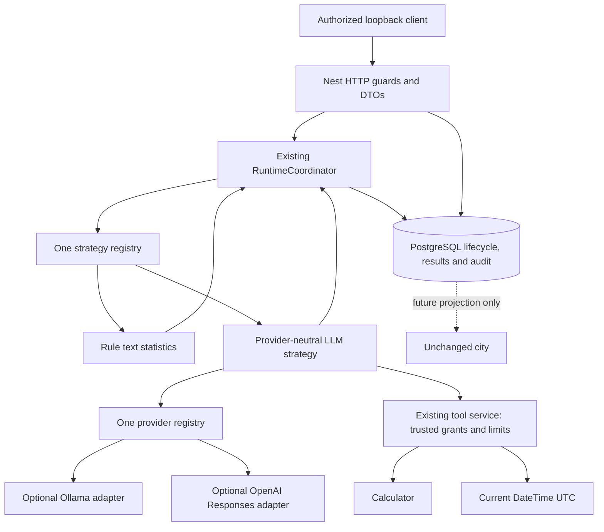

# Phase 2 acceptance review - T12

Review date: **2026-10-24, Asia/Bangkok**. Scope: the existing local-development AI Agent Runtime, not a production deployment or Phase 3. Canonical backend: `apps/api`; existing Canvas city source remains root `dist/`.

**Decision: ACCEPTED WITH LIMITATIONS — local development only.** All mandatory local-development checks passed, including isolated PostgreSQL and actual installed Ollama text/calculator integration. This decision does not authorize external production exposure: production identity/access controls are missing. Detailed evidence and limitations follow.

## Executive summary and scope

Phase 2 implements one native NestJS RuntimeCoordinator, rule-based and provider-neutral LLM strategies, explicit provider/tool registries, optional Ollama/OpenAI adapters, trusted definition/profile selection, bounded tool calls, cancellation/deadline handling, atomic PostgreSQL lifecycle/results/audit, guarded synchronous runtime APIs and structured observations. It reuses Phase 1 Agent/Task/Execution/owner/orchestrator models and Drizzle/pg transactions.

No worker, scheduler, broker, Redis, streaming, multi-agent runtime, external orchestrator adapter, NPC synchronization, memory/RAG, new ORM or city change was introduced. The current deployment boundary is deliberately a loopback-only configured local operator. Real production person/tenant authorization is absent, so externally exposed runtime operation is not approved.

T12 directly inspected the current implementation rather than treating earlier task prompts as completion evidence. No applicable AGENTS.md exists in this workspace/ancestor chain. `git status --short` reports no Git repository. A maintained-file SHA-256 inventory was captured before edits; no branch/history/clean-tree or prior-commit secret audit claim is possible.

## Architecture consistency and deliberate decisions

Source review and DI tests found exactly one production coordinator, strategy registry, provider registry and ToolRegistry. Registered strategies are `text.stats.v1` and `llm.text.v1`; providers are `ollama` and `openai`; tools are Calculator and Current DateTime. No fake strategy/provider is registered in production. Test providers/transports/delays are injected only by test fixtures.

Providers map/validate model protocol and never import or call database/lifecycle mutation services. Tools only validate/perform their finite operation; committed claim checks are supplied by existing authority callbacks, not an SQL tool. The LLM strategy owns a bounded local loop and returns a candidate; only the coordinator/persistence/lifecycle boundary writes outcomes.



The T01 design originally preferred CLI execution and proposed queue-only API acceptance. The explicit T11 task permitted synchronous HTTP and required actual execution. Current HTTP therefore awaits the existing coordinator, with a server-owned 30-second abort budget, disconnect cancellation and no detached promises/202 durability claim. This documented adjustment preserves the engine and persistence boundaries. CLI invocation remains available. A process is locally limited to one active execution; separate instances are fenced by PostgreSQL per native Agent/Task.

## T01-T11 traceability matrix

Commands are real repository scripts; provider tests use controlled transports unless explicitly labelled LIVE. `verify:phase1` remains the historical aggregate script name and discovers all Phase 2 tests. Exact results and infrastructure recovery are recorded below.

| Task / requirement | Implementation evidence | Tests / command | Status and limitation |
| --- | --- | --- | --- |
| T01 architecture and incremental plan | [Architecture](runtime-architecture.md), [roadmap](implementation-plan.md), actual single `src/runtime` module | Source/module boundary review, class registration search, DI startup tests in `test:api` | PASS; synchronous T11 deviation explicitly recorded; historical sketches are not executable contracts |
| T02 contracts and execution context | `runtime/contracts`, `context/execution-context.factory.ts`, stable runtime errors | `runtime-contracts.test.cjs`, `runtime-interruption.test.cjs`; `test:api` | PASS; runtime validation/immutability/size and scoped signal/monotonic deadline checks, not types alone |
| T03 coordinator and lifecycle | `runtime-coordinator.ts`, `runtime-persistence.service.ts`, existing `lifecycle` | `runtime-coordinator.test.cjs`, `runtime.integration.cjs`; `test:api`, `test:db` | PASS; claim/lease/version fencing, result/audit rollback and duplicate terminal observations; no crash recovery engine |
| T04 real rule-based strategy | `strategies/text-statistics.strategy.ts`, execute/inspect CLI | `text-statistics.test.cjs`, `text-statistics.integration.cjs`; `test:api`, `test:db` | PASS; actual protected HTTP + PostgreSQL completion, deterministic Unicode statistics, persisted API result, no provider needed |
| T05 provider-neutral contracts/selection | Provider registry, configuration/validation, guarded selection and deadlines | `providers.test.cjs`, `providers.integration.cjs`; `test:api`, `test:db` | PASS; exact trusted profiles/models, no Task override or paid fallback |
| T06 Ollama adapter | Native chat mapper/provider and pinned bounded transport | `ollama*.test.cjs`, `llm-providers.test.cjs`; `test:api`; separate LIVE command below | PASS deterministic and current LIVE text + calculator integration; remote compute termination and model reliability are not guaranteed |
| T07 optional OpenAI adapter | Official Responses mapping/transport and isolated credential configuration | `openai*.test.cjs`, `llm-providers.test.cjs`; `test:api` | PASS mocked protocol/transport/selection; LIVE OpenAI NOT RUN because paid opt-in is false |
| T08 tools and authorization | Existing opaque execution-scoped ToolExecutionService, compiled registry/validators, Calculator/UTC clock | `tools.test.cjs`, LLM tool PostgreSQL scenarios; `test:api`, `test:db` | PASS; real authorization/session/claim checks, default deny, per-execution budgets; no arbitrary code/network/filesystem/SQL tools |
| T09 LLM loop and native tool continuation | One LlmAgentStrategy, provider-neutral proposals/results, private provider continuation | `llm-agent.test.cjs`, `llm-providers.test.cjs`, `llm.integration.cjs`; both test commands | PASS deterministic and current local live text/tool probes; old string-operand failures retained as evidence of model variability |
| T10 cancellation, timeout and failure | Existing coordinator scope, provider/tool guards, monotonic checks and five-second shutdown drain | Runtime interruption/coordinator/provider/tool suites and actual PostgreSQL races/shutdown; both test commands | PASS including additional HTTP-during-tool cancellation; 89/89 PostgreSQL tests; no hard-kill/recovery or forcible JavaScript termination claim |
| T11 protected APIs/results/observability | `runtime/http`, existing Task/Execution/events reads, AsyncLocalStorage and structured logger | `runtime-api.test.cjs`, real HTTP rule/LLM/tool/history/auth/disconnect cases and T12 endpoint matrix; both test commands | PASS existing and current API cases; production exposure BLOCKED by unavailable production identity controls |

### Additional verification classifications

| Verification | Status | Evidence / boundary |
| --- | --- | --- |
| Dependency tree | PASS | `npm.cmd ls --all --json` exited 0, using existing installation/lock conventions |
| ESLint-specific check | NOT APPLICABLE | No ESLint configuration/script is installed; actual `lint` is city syntax/static validation plus TypeScript noEmit |
| Formatting-specific check | NOT APPLICABLE | No configured formatter/check script; no invented passing formatter command |
| Hosted GitHub Actions | NOT RUN | Existing workflow uses Node 24/npm and owned Docker harness; equivalent local commands executed, no remote workflow claim |
| Live OpenAI/account/model access | NOT RUN | Explicit paid flag false; no key inspection, purchase, request or paid model invocation |
| Live remote computation termination | NOT RUN | Cannot prove that client abort stops server computation/billing; deterministic transport abort/late response tests pass |
| Ollama-in-Docker and container-to-container deployment | NOT RUN | Current Node/Ollama run on host, PostgreSQL in Docker; other networking modes documented, not claimed exercised |
| Abrupt kill/OOM durable recovery | NOT RUN | Lease/stale-write and graceful shutdown tests exist, but no recovery engine or blanket process-crash safety guarantee |
| Dependency CVE/advisory audit and external penetration test | NOT RUN | This is repository-focused acceptance, not an external vulnerability certification |

## Build, static checks and dependency evidence

Supported runtime is Node 24; actual Node **v24.9.0**, npm **11.6.2**, Docker engine **27.4.0**. npm workspaces, NestJS 11/strict TypeScript, Drizzle and pg are preserved. No dependency or lockfile change was needed.

`npm.cmd ls --all --json` passed. The aggregate command passed repository lint/typecheck, backend build, frontend build, migration-file checks, **173/173 backend tests** and **51/51 city tests**. It initially stopped at PostgreSQL setup because the installed Docker engine was stopped (missing Linux-engine pipe): those setup failures are BLOCKED infrastructure evidence, not successful migration verification or application assertions. The installed Docker Desktop was then started; owned database/browser commands were rerun. No development database was reset.

Final isolated database counts and browser results are recorded below. A single all-green aggregate rerun is not claimed when verification completed via its individually executed constituents.

## PostgreSQL, migration and restart acceptance

The existing harness creates random labelled containers/volumes, generated test credentials and an isolated database, checks ownership labels before cleanup, applies the real version-controlled migration journal and uses real Nest services/HTTP. It never accepts an arbitrary production/development URL for cleanup.

Executed coverage includes fresh migration, repeat application/data preservation, journal hash drift refusal, foreign keys/owner references, uniqueness/defaults/timestamps, populated T03-to-T05 and T05-to-T07 upgrades, actual PostgreSQL container restart and new Nest application-instance result/history persistence. This is a populated test upgrade, not a restored production snapshot.

Task/Execution ownership and attempt numbering remain database enforced. Start/finalization use Task/Execution/Agent locks plus expected versions and native lease tokens. Result insertion, paired terminal state, durable events/command audit commit in the existing transaction. Injected event/result failures roll back partial success. History/result mutation triggers remain enabled. No migration or historical record was rewritten by T12.

## End-to-end acceptance scenarios

| Scenario | Actual path and assertions | Result |
| --- | --- | --- |
| Rule-based Agent | HTTP register/activate, Task create, guarded execute -> real text.stats.v1 -> PostgreSQL -> safe result GET and seven lifecycle events | PASS |
| LLM no tools, CI | Real registry/API/coordinator/LLM strategy with test-only deterministic provider -> committed result/lifecycle and restart | PASS |
| Calculator and DateTime, CI | Structured proposals -> genuine registry/service authorization and schema checks -> real Calculator and UTC clock -> correlated model continuation -> persisted final answer | PASS |
| Unauthorized/unknown tool | Model proposal has no grant/unknown identifier; complete batch validated before handler; no unauthorized execution; failed lifecycle/audit persisted | PASS |
| Malformed/duplicate/budget | Bad operands, duplicate call IDs, bounded model/tool counts, conversation/result limits, private continuation tampering and cross-execution reuse reject safely | PASS |
| HTTP status/results/history/audit | Bound owner/parent queries, pending/unavailable/validated result states, deterministic pages/cursors, observed committed-success result fetch, restart reads | PASS |
| API auth/ownership | Every read/write/history/audit path rejects missing authentication and foreign owner; wrong parent 404, unallowlisted same-owner Agent execution 403; malformed/oversized commands and pagination rejected | PASS in existing/new endpoint probes; final counts below |
| Actual client disconnect | Real pending HTTP execution, client abort -> coordinator signal -> CANCELLED pair, no result or duplicate terminal event | PASS |
| Cancellation during tool | Test-only controlled cooperative handler delay retains real tool schemas/session/claim/authorization; actual HTTP abort must reach child signal and fence continuation | PASS: child signal aborted, one provider call, no continued model call, CANCELLED pair/no result and correct terminal audit |
| Concurrency | Two instances/claims, cancellation versus success/failure, duplicate finalizers, independent execution scopes and per-execution budgets | PASS |
| Shutdown | Real Nest shutdown cancels/drains before pool close; controlled unit grace expiry returns unresolved rather than inventing finalization | PASS |

LLM fake providers and mock HTTP do not prove live inference. Rule/tool functionality is genuine application code; only nondeterministic provider output or deliberate waiting is substituted in deterministic cases. No production fake Agent/Orchestrator was created: fixtures are scoped to the owned test database.

## Live provider evidence

### Ollama: text through actual protected HTTP - PASS

Local endpoint `http://127.0.0.1:11434` was available; reported server **0.40.10**. Existing installed text model: **qwen3:0.6b**, digest `7df6b6e09427a769808717c0a93cadc4ae99ed4eb8bf5ca557c90846becea435`, size 522653767 bytes, reported Qwen3/751.63M/Q4_K_M and context length 40960. The adapter still applies its smaller configured context/request limits. Read-only server capability inspection reported completion/tools/thinking. The other installed model was an embedding model and was not used as a chat substitute.

No install or pull occurred. One protected HTTP Task generated a response containing READY, reached COMPLETED/SUCCEEDED, persisted its validated result and seven audit events, and remained retrievable after application restart. Reported usage: **82 input, 122 output, 204 total tokens**. Persisted execution duration: **4559 ms**. One logical provider request was made. The roughly 8.7-second test duration additionally includes fixture/application/restart work and is not model inference latency.

Command (variables apply only to that shell process):

```powershell
$env:ELYQRETH_OLLAMA_RUNTIME_LIVE='true'
$env:ELYQRETH_OLLAMA_RUNTIME_MODEL='qwen3:0.6b'
node --test --test-name-pattern 'T12 live installed Ollama text' apps/api/test/database.integration.cjs
```

### Ollama: current structured Calculator probe - PASS

One separately selected existing live tool test ran, with strict schemas and the real provider/strategy/coordinator/Calculator/PostgreSQL path. It observed **one successful authorized tool invocation**, **two logical generation requests**, a final answer containing 6000, COMPLETED/SUCCEEDED, a persisted result and seven lifecycle events. Reported aggregate usage: **718 input, 270 output, 988 total tokens**. The test passed 1/1. No retry or argument coercion was added.

```powershell
node --test --test-name-pattern 'T09 live installed Ollama tool' apps/api/test/database.integration.cjs
```

That command uses the same explicit opt-in/model variables as the text command. Each live case owns a fresh disposable database and separate Agent/Task. Prior T09 probes on this model failed because it proposed string operands. Those historical failures are not erased by one current pass. This is current protocol/integration evidence, not a statistical reliability benchmark or a guarantee that the model follows tool schemas consistently. Live Current DateTime and live in-flight abort/timeout were not separately exercised; deterministic versions pass.

### OpenAI - mocked PASS; live NOT RUN

The official Responses adapter passed controlled HTTPS/protocol/error/capability/timeout/cancellation tests, including native call/result correlation, private reasoning continuation, usage and no paid request on startup. The explicit `ELYQRETH_OPENAI_LIVE=true` flag was false. No credential value was read/printed or paid request sent. Account/model access, live cloud refusal/billing/latency and cloud native tool reliability remain unverified; that optional live gate is not counted as a failure of deterministic development acceptance.

## Cancellation, timeout and failure boundaries

Cancellation before claim does not mark an unclaimed Task failed or dispatch a strategy. Persisted cancellation is observed through claim checks/heartbeats/finalization; explicit caller/disconnect cancellation reaches linked execution/provider/tool signals. Completion and cancellation are serialized by PostgreSQL and first committed terminal state wins. Stale/current duplicate administrative cancellation returns the existing conflict policy with no second effect; repeated runtime finalization observes the stored terminal outcome.

Execution/provider/tool deadlines use trusted bounds and T10 monotonic checks plus persisted UTC/SQL lease/deadline fences. Remaining-time, wall-clock rollback, multi-round total budget, provider/tool timeout, pre-handler authorization time, count/size limits and late outcomes are covered with controlled clocks/transports. Timeout maps to Task FAILED / Execution TIMED_OUT; cancellation maps to CANCELLED/CANCELLED. No partial output is converted to success.

Normalized provider auth/unavailable/rate/quota/response errors, tool denial/input/handler/output failures, lifecycle/persistence conflicts and unexpected errors remain closed codes with fixed safe public messages. No raw SDK/DB errors are exposed. Provider/tool operations occur outside long lifecycle transactions. A secondary finalization failure reports unresolved state and preserves safe original diagnostic classification.

Hard kills can bypass shutdown; unresolved lease/quarantine records require trusted operator investigation. Cancellation cannot forcibly preempt arbitrary synchronous/noncooperative code or prove a remote server stopped computation/billing. Only the two finite built-in tools are registered. No automatic retry, paid fallback, distributed cancellation, exactly-once external side-effect or durable recovery claim is made.

## Security findings and release gates

This is a focused source/test review, not a penetration-test or vulnerability-advisory certificate. No active CRITICAL defect was confirmed in the supported loopback-only configuration.

| ID / severity | Evidence and impact | Resolution / release consequence |
| --- | --- | --- |
| SEC-01 HIGH for external exposure | Current authentication is one local operator bearer/owner scope, not production person/tenant/per-Agent authorization. Guard/config tests reject production/default exposure, spoofed Host/Origin and missing token; new full endpoint matrix checks foreign owner/parent access | MITIGATED for accepted local configuration by fail-closed production, loopback socket/Host/Origin and explicit runtime allowlist. External deployment remains BLOCKED until real identity/access and operational controls exist; T12 does not invent them |
| REL-01 MEDIUM | Both actual provider adapters called telemetry without protection. A throwing sink converted an otherwise valid generation into INTERNAL_RUNTIME_ERROR. Two new controlled adapter tests failed before the fix | FIXED in both adapters using best-effort diagnostics; same regressions passed after fix with exactly one transport call, and broad provider tests rerun |
| COMP-01 MEDIUM operational | Installed small Qwen model had historical invalid string-operand proposals although it advertises tools. Current text/tool probes pass; deterministic invalid proposals are denied before handler | OPEN model reliability limitation. Strict schemas/default-deny remain; no automatic coercion/repair/fallback. Review model/tool profiles before wider use; no reliability or unattended deployment promise |
| OPS-01 MEDIUM operational | In-process execution and five-second drain cannot acknowledge work during hard crash or database outage; existing quarantine fences stale owners | DOCUMENTED boundary. No background recovery or automatic takeover; such deployment remains a separate gate |
| OBS-01 LOW | Adapter and strategy can both log provider.completed, so the old live diagnostic's completion-event count overstated logical requests after T11 | FIXED diagnostic counters to use one strategy provider.started per round. Logs remain observations, not billing or exactly-once metrics; actual live counts 1/2 verified |
| DOC-01 LOW | T01/T03 planning pages retained statements that executable strategies/adapters/API were future/currently absent | Current acceptance/API links and explicit historical labels added. T11 synchronous deviation is recorded; old task evidence and Phase 1 documents preserved |
| AUD-01 LOW | Export has no Git metadata; historical secret/commit provenance and remote CI execution cannot be audited here | OPEN evidence limitation. No T12 credentials or secret literals introduced; ignored .env/key paths remain ignored. No commit/push/tag/release/deploy performed |

Runtime provider/model/endpoints/tool grants are server-owned and validated; prompt text cannot grant permissions. Tools have no eval/shell/filesystem/network/SQL access. HTTP body/query/UUID/version/size and output/payload/cursor bounds remain enforced. Logs/audits do not automatically copy prompts, credentials, arguments, raw provider objects or internal stack traces. Request IDs are bounded diagnostic strings; frozen runtime UUIDs connect HTTP observations to durable execution audit. AsyncLocalStorage isolates concurrent request chains; no distributed tracing or unauthenticated metrics endpoint exists.

## Observability and resource/performance observations

Existing structured logs cover request/start/outcome/conflict, provider/tool start/completion/failure and bounded durations/budget observations. Audit is the authoritative committed-event source; repeated logs are not counted as durable terminal outcomes. Durations/counts are actual observations, optional usage remains nullable and no billing costs are calculated. IDs are correlation fields in logs, not high-cardinality metric labels in a new metrics system.

The bounded local sample executes five sequential HTTP Tasks using the real database/coordinator/LLM strategy and a fake provider; it is not LLM inference or a load test. It measures execute HTTP elapsed time only (Task creation/setup excluded from those latency values) and process memory around the whole five-Task sample. Final measurements are recorded below. No performance threshold was weakened or inferred from test completion.

Host observations: Windows x64, 12 logical CPUs, reported AMD Ryzen 5 5600H, 16541872128 bytes physical memory. These are host facts, not proof of Ollama GPU/CPU placement. SQL EXPLAIN cost is a planner estimate on a tiny owned dataset; no forced-index or production-scale efficiency claim follows from it. Existing query bounds/index/attempt uniqueness tests support the expected access patterns. RSS/heap variation in a shared test process is not a leak diagnosis or capacity guarantee.

## Docker, startup and reproducibility

Compose validation with `docker compose --env-file .env.example config --services` passed and listed only `postgres`. Existing Compose pins PostgreSQL 17.11 by digest, binds its port to loopback, persists a named volume and has pg_isready health/restart policy. The owned acceptance harness separately exercises actual image startup, connectivity, migrations and restart. It does not start/reset the developer's Compose volume.

Typical local startup remains:

```sh
# Configure ignored environment files from the documented placeholders first.
docker compose up -d postgres
npm run db:migrate
npm run dev:api
npm run dev:web
```

Those are operator instructions, not a claim this review started the development stack or applied migrations to its data. Real acceptance apps started on ephemeral loopback ports with isolated PostgreSQL, valid configuration and real HTTP; backend needs no frontend dev server. Rule agents work without any LLM configuration; OpenAI remains optional. Health, invalid configuration, safe errors and graceful shutdown are tested. Host Ollama/host Nest and Docker PostgreSQL were exercised; container-to-host and container-to-container Ollama addresses remain documented deployment modes, not new tested services.

CI uses existing Node 24/npm commands and owned Docker fixtures. No paid cloud key or model download is needed in deterministic CI. Live commands are explicitly opt-in and not part of CI globs.

## Frontend preservation and regression

City tests and the existing frontend build passed. Browser smoke on Chrome 155 passed with 101 resource requests and zero exceptions: Canvas draws, city clock/environment, four Agents/decorative citizens, camera zoom/focus/recenter, help/developer panels, simulated mission start/pause/resume/reset, mobile viewport/reload. No API is required by those original animations.

This is smoke evidence, not exhaustive screenshot/animation/FPS/gesture acceptance. No renderer/NPC/road/bridge/river/railway/station/theme/UI source changed. Final SHA-256 preservation results are recorded below. Phase 1 registry/lifecycle/audit tests, runtime/provider/tool regressions and migrations remain in the executed suites.

## Final command evidence and acceptance decision

Final isolated PostgreSQL run: **89/89 PASS**, zero failures/skips, 60815.0219 ms. This includes the new complete endpoint authentication/ownership matrix, controlled authorized-tool cancellation through actual HTTP, and bounded performance observations.

| Actual command | Outcome |
| --- | --- |
| npm.cmd ls --all --json | PASS, exit 0; existing dependency tree |
| npm.cmd run verify:phase1 | Initial aggregate: lint/typecheck, backend build, frontend build, migration files, 173 backend and 51 city tests PASS; then BLOCKED at database setup because Docker was stopped; aggregate exit was nonzero |
| node --test --test-name-pattern 'T12 a failing' apps/api/test/ollama.test.cjs apps/api/test/openai.test.cjs | Before fix 0/2 pass; after fix/build 2/2 PASS |
| npm.cmd run test:db | After Docker startup: 88/88 PASS; after final tool-cancellation regression: 89/89 PASS |
| npm.cmd run test:browser | PASS; Chrome 155, 101 resource requests, zero exceptions |
| docker compose --env-file .env.example config --services | PASS; only postgres |
| Explicit opt-in selected live Ollama text test | 1/1 PASS; actual protected HTTP, persistence and application restart |
| Explicit opt-in selected live Ollama calculator test | 1/1 PASS; one tool invocation and two model requests |
| Live OpenAI | NOT RUN; no paid opt-in |
| Hosted CI / dedicated formatting / ESLint | NOT RUN / NOT APPLICABLE / NOT APPLICABLE respectively |

Final five-sample execute HTTP latencies: **208.580, 156.553, 167.214, 184.042, 163.999 ms**; minimum 156.553, median 167.214, maximum 208.580 ms. RSS before/after: 225423360/220008448 bytes; heap delta -11258904 bytes. History plan root Limit, estimated cost 13.7; five provider requests. Memory includes shared-process allocation/GC, and planner cost is an estimate. This is not a model benchmark, concurrency capacity test or memory-leak proof.

**Acceptance: ACCEPTED WITH LIMITATIONS**, strictly for the existing local-development platform. Mandatory real persistence, HTTP, tool authorization, cancellation/race, regression/build and local provider integration checks pass. There is no unresolved release-blocking defect in that constrained configuration. External production release remains BLOCKED by SEC-01 and required operational controls. Live OpenAI, remote CI, other deployment networking modes and hard-crash recovery were not verified/implemented. Small-model variability remains a disclosed operational limitation. Plan Phase 3 only after reviewing these gates; no Phase 3 implementation or release action was performed.

## T12 files and preservation evidence

Compared with the pre-T12 SHA-256 inventory of 345 maintained files: **24 modified, one created, zero removed**. All **92 protected files** (city source, existing Agent/Task/Execution/lifecycle/events/database sources, migrations and native HTTP transports) are unchanged. Package manifests/lockfile, Compose and CI are unchanged. Phase 1 documentation is preserved. Generated API output and disposable build/test files are not maintained source changes.

Created:

- docs/ai-agent-platform/phase-2/acceptance.md

Modified:
- WORKSPACE.md
- README.md
- docs/ai-agent-platform/README.md
- apps/api/test/openai.test.cjs
- apps/api/test/ollama.test.cjs
- apps/api/test/llm.integration.cjs
- docs/ai-agent-platform/phase-2/tool-security.md
- docs/ai-agent-platform/phase-2/safe-tools.md
- docs/ai-agent-platform/phase-2/runtime-coordinator.md
- docs/ai-agent-platform/phase-2/runtime-contracts.md
- docs/ai-agent-platform/phase-2/runtime-architecture.md
- docs/ai-agent-platform/phase-2/runtime-api.md
- docs/ai-agent-platform/phase-2/rule-based-runtime.md
- docs/ai-agent-platform/phase-2/README.md
- docs/ai-agent-platform/phase-2/provider-foundation.md
- docs/ai-agent-platform/phase-2/provider-abstraction.md
- docs/ai-agent-platform/phase-2/openai-adapter.md
- docs/ai-agent-platform/phase-2/ollama-adapter.md
- docs/ai-agent-platform/phase-2/llm-agent.md
- docs/ai-agent-platform/phase-2/implementation-plan.md
- docs/ai-agent-platform/phase-2/execution-lifecycle.md
- docs/ai-agent-platform/phase-2/cancellation-timeout-failure.md
- apps/api/src/runtime/providers/openai/openai.provider.ts
- apps/api/src/runtime/providers/ollama/ollama.provider.ts

Local Markdown links and fenced-block balance were checked across the current root/workspace/platform and Phase 2 documents: zero issues. No Git metadata is available, so these are inventory-based changes, not a Git diff or commit-provenance guarantee.

