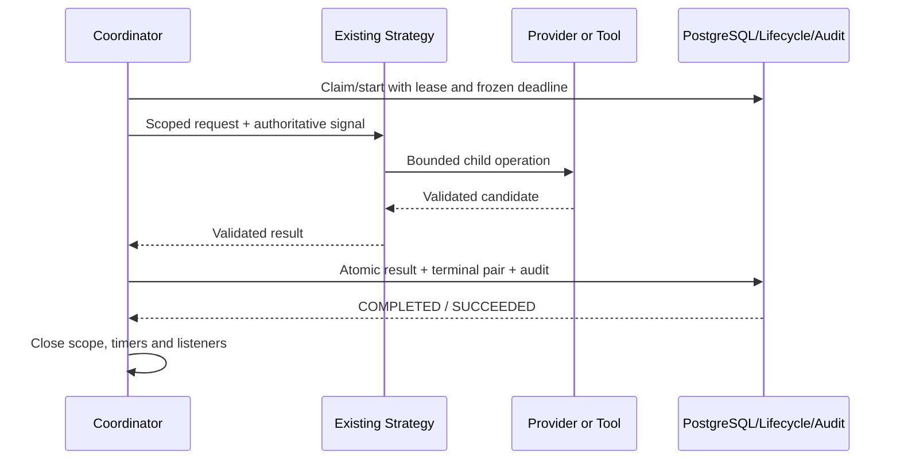
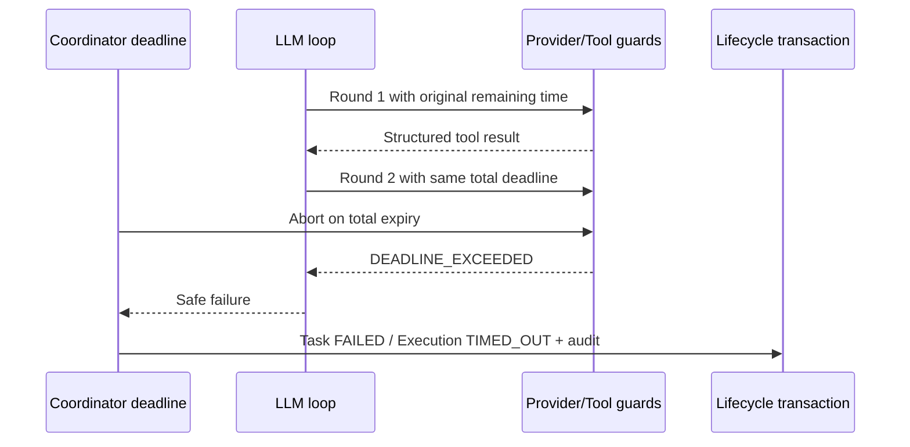

# T10 - Execution Cancellation, Timeout & Failure Handling

**T12 acceptance (2026-10-24): ACCEPTED WITH LIMITATIONS for local development only.** See [the acceptance report](acceptance.md) for 173 backend, 89 isolated PostgreSQL and 51 city tests, both builds, browser smoke and live installed Ollama text/calculator evidence. Live OpenAI was NOT RUN. External production exposure remains BLOCKED without production identity/access controls. Earlier task checkpoints below are historical evidence.

Status: implementation complete; final verification evidence is recorded at the end of this guide. T11 and T12 remain planned. Updated 2026-10-24 (Asia/Bangkok).

This extends the existing `apps/api` NestJS runtime. It does not add a coordinator, cancellation daemon, HTTP route, worker, ORM, migration or recovery engine. City source in root `dist/` remains unchanged. Phase 1 acceptance and [T09 evidence](llm-agent.md) remain historical records; the installed-model calculator limitation is unchanged and no new live inference is required for this task.

## Repository audit and requirement recovery

No applicable AGENTS.md exists in the workspace or its ancestor chain. This export has no Git metadata, so `git status --short` cannot establish a clean tree. A pre-T10 maintained-file SHA-256 inventory was captured outside the workspace. The actual backend uses NestJS 11, strict TypeScript, Drizzle/pg and PostgreSQL. Existing CI runs `npm run verify:phase1` on Node 24 with an owned disposable PostgreSQL harness; it needs no model or paid credential.

| Requirement group | At audit | T10 treatment / evidence |
| --- | --- | --- |
| Terminal Task/Execution transitions | COMPLETE | Existing lifecycle policy, locked version/claim checks and real PostgreSQL terminal tests retained |
| Trusted cancellation ownership and scope | COMPLETE | Caller signal plus persisted decision, coordinator-owned AbortController; tools/providers cannot write lifecycle |
| Execution deadline and platform bounds | PARTIAL | Existing wall-clock/SQL deadlines retained; factory-created context now also has private monotonic elapsed budget |
| Ollama/OpenAI request abort and timeouts | COMPLETE | Existing bounded transport and provider guard retained; lease-loss classification and monotonic postcondition hardened |
| Tool cancellation, authorization and budgets | PARTIAL | Existing session/claim/budget checks retained; monotonic tool scope checks now include authorization time before handler dispatch |
| LLM loop interruption | PARTIAL | Existing checks retained; explicit check immediately after each awaited tool result added |
| Atomic finalization/results/audit | COMPLETE | Existing RuntimePersistenceService and lifecycle transactions unchanged; race, duplicate and rollback regressions |
| Failure taxonomy and safe errors | COMPLETE | Existing closed RuntimeError codes reused; no raw diagnostics or new inheritance tree |
| Resource cleanup and execution isolation | PARTIAL | Existing timer/listener cleanup retained; coordinator now closes its authoritative scope on every exit |
| Process shutdown drain | MISSING | Implemented in existing coordinator OnModuleDestroy hook, before database onApplicationShutdown |
| Deterministic and PostgreSQL coverage | PARTIAL | Added elapsed-clock, interruption, cleanup, shutdown, independence and real persisted race cases |
| Documentation / roadmap | PARTIAL | This guide and current roadmap/checkpoint updates |

T09 dependencies are present and verified by regression tests. No prerequisite is blocked. An older planning sketch suggested a reconciliation/recovery command in T10; this task's explicit exclusions defer durable job recovery and new APIs. No such command or distributed recovery was implemented.

## Ownership and lifecycle policy

The coordinator owns one AbortController for its one admitted local Execution. A caller-provided signal is relayed to that controller but is never itself aborted by the runtime. Each context retains its Task/Execution/Agent/owner/correlation identities. Child provider/tool controllers shorten deadlines and relay the parent; they cannot extend it or cancel another execution. Separate coordinator instances have separate scopes. The existing local one-at-a-time capacity restriction and PostgreSQL cross-process claims remain in force.

Only trusted internal code invokes the coordinator or lifecycle service. Task input cannot select cancellation targets, providers, models, tools or budgets. Persisted cancellation is accepted by the existing owner-scoped lifecycle transaction, then observed by authority checks, heartbeats or finalization. There is no new public cancellation/start/tool endpoint. Registry/runtime remain explicitly enabled local development only and fail closed in production.

| Task | Allowed next states |
| --- | --- |
| CREATED | QUEUED, CANCELLED |
| QUEUED | RUNNING, FAILED, CANCELLED (existing pre-start failure policy) |
| RUNNING | COMPLETED, FAILED, CANCELLED |
| COMPLETED / FAILED / CANCELLED | None |

| Execution | Allowed next states |
| --- | --- |
| PENDING | RUNNING, FAILED, CANCELLED, TIMED_OUT (existing pre-start failure policy) |
| RUNNING | SUCCEEDED, FAILED, CANCELLED, TIMED_OUT |
| SUCCEEDED / FAILED / CANCELLED / TIMED_OUT | None |

Provider/tool timeout or total deadline -> Task FAILED + Execution TIMED_OUT, using the existing conservative policy. Explicit cancellation -> CANCELLED/CANCELLED. Other operational errors -> FAILED/FAILED. Success -> COMPLETED/SUCCEEDED with one bounded result. No failed attempt is restarted, and history is preserved.

Duplicate runtime finalization observes the committed terminal pair without another write or event. Preserve Phase 1's stricter administrative command policy: replaying an old cancellation version returns LIFECYCLE_CONFLICT; repeating with current terminal versions returns ALREADY_TERMINAL. These are effect-idempotent refusals, not a new successful acknowledgement. The tests assert unchanged state/history. Changing that external contract belongs to an explicitly reviewed API change rather than silently altering lifecycle semantics.

## Deadlines and interruption

The existing runtime binding is trusted server configuration, not Agent metadata or Task input. Existing schema validators cap an execution at 300000 ms, provider request at application/profile limits (at most 120000 ms through the provider guard), tools at 2000 ms, provider rounds at three and tool invocations at two. Child operation limits are the minimum of parent deadline and applicable configured timeout.

The context factory validates the UTC deadline against the execution budget and records a private WeakMap monotonic anchor (`performance.now`). `assertRuntimeActive` checks both UTC expiry and elapsed budget. This does not add mutable clock data to the serializable context. A backward wall-clock adjustment cannot renew the total execution budget; a forward adjustment can terminate it conservatively sooner. Coordinator timers bound waiting. PostgreSQL uses its own clock and checks persisted deadlines and leases under the finalization lock.

Provider and tool guards also check monotonic elapsed time. Tool authorization and handler execution share one scoped timeout, so time spent validating the committed claim does not grant a fresh handler budget. Provider guard retains LEASE_LOST instead of relabeling it CANCELLED. Existing transport deadline/abort listeners, socket destruction and bounded request/response bodies remain unchanged. No automatic retry, failover or paid-provider substitution occurs.

The LLM strategy checks activity before/after provider calls, before each tool, immediately after each tool and before returning a validated result. It closes its existing tool session in finally. The coordinator checks again before result finalization and the database checks the authoritative signal/deadline/terminal state under lock. Model/tool count limits and the original deadline are never reset between rounds.

## Finalization and races

RuntimePersistenceService.finish locks the Task/Execution, verifies ownership, lease token and deadline, and delegates to existing lifecycle transaction methods. Result insertion, terminal pair updates and audit writes commit atomically. No transaction stays open during model/tool work. Rejected or observed no-op outcomes do not add terminal events. Failed result/event persistence rolls back success; a secondary failure returns the existing unresolved result with both safe original/finalization codes.

If cancellation commits first, late provider/tool output cannot insert a result or success event. If completion commits first, a later cancellation cannot overwrite it. Failure versus cancellation has one persisted winner. A late command can observe the committed outcome while retaining a safe diagnostic of its competing error. No exactly-once external side-effect guarantee is claimed.



```mermaid
sequenceDiagram
  participant O as Trusted caller/lifecycle
  participant C as Coordinator
  participant L as LLM Strategy/Provider
  participant D as PostgreSQL
  O->>C: Abort, or persisted cancellation observed
  C->>L: Relay authoritative abort
  C->>D: Finalize/observe cancellation
  L-->>C: Abort or late response
  C->>C: Discard late candidate
  Note over D: CANCELLED stays terminal; no success result
```

```mermaid
sequenceDiagram
  participant C as Coordinator
  participant S as LLM Strategy
  participant T as Existing Tool Execution Service
  C->>S: Execution-scoped signal
  S->>T: Authorized, bounded invocation
  C->>T: Parent abort
  T->>T: Abort child wait; quarantine session
  T-->>S: CANCELLED
  S->>S: Close session; no next model/tool call
  Note over T: Non-cooperative code cannot be forcibly stopped
```



```mermaid
sequenceDiagram
  participant X as Cancellation transaction
  participant Y as Completion transaction
  participant D as Locked PostgreSQL Task
  X->>D: Lock + expected versions
  Y->>D: Wait for same Task lock
  X->>D: CANCELLED pair + events, commit
  D-->>Y: Terminal state observed; no success write
  Note over X,Y: If completion locks/commits first, cancellation instead fails
```

## Failure classification and privacy

| Failure | Existing runtime code |
| --- | --- |
| Provider unreachable | PROVIDER_UNAVAILABLE |
| Provider auth / rate / quota | PROVIDER_AUTH_FAILED / PROVIDER_RATE_LIMITED / PROVIDER_QUOTA_EXCEEDED |
| Invalid model output | INVALID_PROVIDER_OUTPUT |
| Unauthorized/unknown tool | TOOL_DENIED |
| Invalid tool input | INVALID_INPUT |
| Tool handler/output failure | TOOL_FAILED (oversized output may be OUTPUT_LIMIT_EXCEEDED) |
| Model/tool invocation budget | CAPACITY_EXCEEDED |
| Conversation/output size | INVALID_INPUT / OUTPUT_LIMIT_EXCEEDED according to existing boundary validator |
| Provider/tool/total deadline | DEADLINE_EXCEEDED |
| Explicit cancellation | CANCELLED |
| Claim/terminal ownership conflict | LEASE_LOST |
| Persistence failure | PERSISTENCE_UNAVAILABLE |
| Unacknowledged/ambiguous outcome | OUTCOME_UNCERTAIN or existing unresolved coordinator result |
| Unexpected strategy exception | INTERNAL_RUNTIME_ERROR |

RuntimeError.toJSON emits only its closed code and fixed safe message. Correlation/identity metrics use existing scoped logging; no prompt, credential, tool argument, raw SDK error, database exception or stack trace is accepted into public errors/audit. Provider adapters own transport errors; tool service owns tool errors; strategy owns loop validation; coordinator owns final outcome; persistence owns atomicity. No second error/event system is added.

## Cleanup and shutdown

On every coordinator exit, deadline/heartbeat timers and caller/abort listeners are removed, the authoritative controller is closed to stop remaining cooperative children, and local capacity is released after synchronous cleanup. Tool sessions close on loop exit; their weak references do not become a global execution cache. Private continuation/conversation buffers become unreachable when the strategy releases them; this is ordinary garbage collection, not secure memory erasure. Non-cooperative unresolved promises can retain their own references until they settle.

The existing coordinator implements Nest OnModuleDestroy. It stops accepting queue/execute commands, signals cancellation to active work and waits up to **5000 ms** for finalization. This lifecycle phase precedes DatabaseService.onApplicationShutdown pool closure. No deployment signal API changed: the existing HTTP foundation already enables SIGINT/SIGTERM hooks. Unit tests use controlled timers for a stuck persistence acknowledgement; PostgreSQL tests close the real Nest application while a provider is pending and verify committed cancellation before the pool closes.

The five-second grace bounds the coordinator's drain wait, not the entire OS shutdown: database pool closure and external process behavior have their own limits. Grace expiration does not invent a persisted terminal outcome. Database unavailability may leave RUNNING/unresolved lease/quarantine records requiring operator investigation. A hard kill, host crash or OOM can bypass all hooks. No automatic takeover, durable recovery command or retry scheduler is implemented.

Aborting HTTP cannot prove that Ollama or a cloud provider stopped computation or billing. Persisted RUNNING cancellation remains CANCELLATION_UNCONFIRMED where the existing schema requires it. There is no hard isolation for arbitrary JavaScript; synchronous work can block timers and signals. Only the existing bounded Calculator and UTC clock are registered. No shell, filesystem, unrestricted HTTP/SQL or dynamic loading is added.

## Tests and verification

`test/runtime-interruption.test.cjs` adds controlled monotonic/wall-clock tests, remaining-time propagation, lease-loss classification, post-tool cancellation, total multi-round deadline, pre-handler timeout and listener cleanup. `test/runtime-coordinator.test.cjs` adds shutdown/drain, bounded grace, all-outcome scope cleanup, independent execution and pre-admission/finalization cancellation checks.

The existing owned PostgreSQL harness additionally loads five T10 scenarios in `test/llm.integration.cjs`: cancellation winner/duplicate/late result, completion winner/late cancellation, provider failure versus cancellation, independent concurrent claims, and real Nest shutdown before pool closure. Tests assert persisted Task/Execution pairs, results, reconciliation flags and event history. Existing suites cover duplicate finish, rollback faults, lease conflicts, provider transport aborts, tool timeouts, no-tools/Calculator/DateTime LLM strategies and deterministic agents.

Run from the root:

```sh
npm run verify:phase1
```

It runs backend typecheck/static lint, builds, migration-file checks, city/backend unit suites, disposable real PostgreSQL tests and browser smoke. The CI workflow already runs this command; no new secrets or infrastructure are required. Pure runtime tests can run after `npm run build` with `node --test apps/api/test/runtime-interruption.test.cjs apps/api/test/runtime-coordinator.test.cjs`.

Live provider verification is NOT RUN for T10. Mocked HTTP/provider tests do not establish live model reliability. The optional T09 live calculator limitation is retained without weakening argument schemas or adding retries.

## Executed verification - 2026-10-24

`npm.cmd run verify:phase1` completed with exit code 0 on the final source. Its constituent commands actually executed:

| Command | Result |
| --- | --- |
| `npm run lint` (city static lint + backend TypeScript noEmit) | PASS |
| `npm run build` | Backend build PASS |
| `npm run build:web` | Frontend build PASS; existing root dist source preserved |
| `npm run db:check` | Migration-file/journal validation PASS |
| `npm run test:all` | 51/51 city tests and 161/161 backend tests PASS, zero skips |
| `npm run test:db` | 80/80 real PostgreSQL tests PASS, zero skips; owned disposable database only |
| `npm run test:browser` | Chrome 155 smoke PASS; 55 resource requests, zero exceptions |

Before that full run, `npm.cmd run build` and focused `node --test apps/api/test/runtime-coordinator.test.cjs apps/api/test/runtime-interruption.test.cjs` passed 21/21 tests. The aggregate includes those same tests plus existing provider/tool/strategy/Phase 1 regressions. An early compiler check caught optional-property typing in the new coordinator fields; it was corrected before these passing runs, without weakening compiler options.

The PostgreSQL suite verifies fresh migrations, populated upgrades, actual container restart, cross-module persistence and audit fault rollback as well as the new five T10 cases. No historical migration changed. Local CI-equivalent commands ran; hosted GitHub Actions execution is not claimed. No Ollama/OpenAI live request was made by this task. Browser smoke is not a complete visual-diff, gesture, animation or long-duration performance acceptance test.

A final pre-task SHA-256 comparison found **92 protected files unchanged**, including all 51 existing city source files, core Agent/Task/Execution/lifecycle/event/database code, migrations and both provider HTTP transports. No new dependency, environment variable, table, status value, execution route, worker or messaging service was added.

**T10: COMPLETE.** Mandatory deterministic implementation/verification passes, with the documented operational limitations (fixed bounded grace, unresolved crash/persistence outcomes, cooperative cancellation and existing administrative replay conflicts). Production authentication and distributed recovery are not claimed. Next is **Phase 2 T11 - Runtime APIs, Results & Observability**; it has not begun.

## Maintained-file change manifest

Relative to the pre-T10 inventory; generated builds and temporary verification logs excluded. No maintained files were removed.

### Created

- `docs/ai-agent-platform/phase-2/cancellation-timeout-failure.md`
- `apps/api/test/runtime-interruption.test.cjs`

### Modified

- `WORKSPACE.md`
- `README.md`
- `docs/ai-agent-platform/README.md`
- `docs/ai-agent-platform/phase-2/implementation-plan.md`
- `docs/ai-agent-platform/phase-2/README.md`
- `apps/api/test/runtime-coordinator.test.cjs`
- `apps/api/test/llm.integration.cjs`
- `apps/api/src/runtime/runtime-coordinator.ts`
- `apps/api/src/runtime/context/execution-context.factory.ts`
- `apps/api/src/runtime/providers/provider-deadline.ts`
- `apps/api/src/runtime/tools/tool-deadline.ts`
- `apps/api/src/runtime/strategies/llm-agent.strategy.ts`
- `apps/api/src/runtime/contracts/execution-context.contract.ts`
