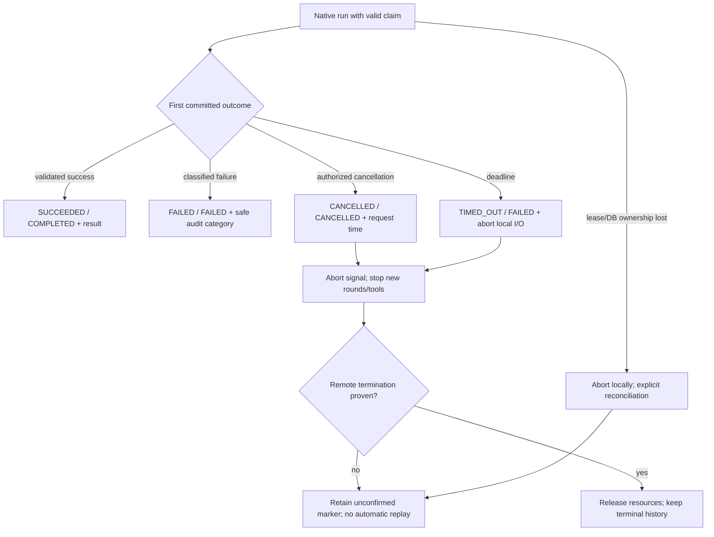

# Runtime integration with persisted lifecycle

**T12 acceptance (2026-10-24): ACCEPTED WITH LIMITATIONS for local development only.** See [the acceptance report](acceptance.md) for 173 backend, 89 isolated PostgreSQL and 51 city tests, both builds, browser smoke and live installed Ollama text/calculator evidence. Live OpenAI was NOT RUN. External production exposure remains BLOCKED without production identity/access controls. Earlier task checkpoints below are historical evidence.

**T04 checkpoint:** [Rule-based runtime](rule-based-runtime.md) adds the genuine text.stats.v1 DI registration and trusted local execute/inspect command. Execution is still opt-in, never automatic. Earlier no-strategy/CLI-deferred statements below are the preserved T01-T03 historical record. No provider, tool, worker or city integration is added.

**Current T03 implementation:** see the [coordinator guide](runtime-coordinator.md) for internal invocation, registered strategy resolution, database claims, result persistence, cancellation and verified boundaries. The earlier status/design below is retained as the T01/T02 historical snapshot; it does not override the current guide. No concrete strategy/provider/tool is enabled.

Status: **PLANNED**, building on the [implemented T06 service](../lifecycle-service.md) and [T07 event foundation](../event-audit-foundation.md). A lease column is not a running scheduler. No method or status extension below has been implemented in this documentation task.

## Preserve the state machines and authority

| Task current | Allowed next |
| --- | --- |
| CREATED | QUEUED, CANCELLED |
| QUEUED | RUNNING, FAILED, CANCELLED |
| RUNNING | COMPLETED, FAILED, CANCELLED |
| COMPLETED / FAILED / CANCELLED | None |

| Execution current | Allowed next |
| --- | --- |
| PENDING | RUNNING, FAILED, TIMED_OUT, CANCELLED |
| RUNNING | SUCCEEDED, FAILED, TIMED_OUT, CANCELLED |
| SUCCEEDED / FAILED / CANCELLED / TIMED_OUT | None |

These are **current implemented transitions**, not proposed enum additions. Repeated lifecycle commands conflict; registry same-state no-ops have different documented semantics. Runtime command redelivery must inspect persisted state/claim and return a command-level already-accepted/completed view without calling a transition twice. A repeated trigger must not call a strategy twice. Expected versions and terminal immutability remain enforced.

Native runtime accepts only owner-scoped, runtime-allowlisted routes and NATIVE executions for RULE_BASED/LLM agents. EXTERNAL attempts/agents are rejected even if the underlying Phase 1 state service can store them. An orchestrator's free-form type string, connectivity flag or an NPC role cannot grant authority. External adapters will require capability/ownership/status normalization and reconciliation; native cancellation/recovery policies here must never be applied to an externally authoritative run by inference.

## Transaction boundary extension required in T03

Current public lifecycle methods open their own transactions; `completeTask` requires a previously persisted result. Calling insertResult then public completeTask is **not atomic**. Plan an internal transaction-aware seam in the existing service: wrappers retain existing behavior/tests and call shared locked operations; coordinator passes the same `PersistenceTransaction` to claim/start/finish/result/audit helpers. No nested independent commit, post-commit event insert, status SQL in a new coordinator, or provider request while DB locks are held.

All runtime Task/Execution transitions retain Task → selected Execution locking and latest-attempt/owner/route validation. Native admission/claim/terminal operations also serialize their agent capacity/quarantine checks through an Agent row lock after those locks. Do not acquire another task's row while holding the agent lock. Validate the lock ordering against all existing metadata/eligibility operations; translate deadlock/serialization conflicts safely and retry only the **DB transaction before dispatch**, never provider execution. All status changes and corresponding v1 events still flow through the shared lifecycle service.

Runtime-owned attempts carry an immutable versioned runtime snapshot. Legacy internal wrappers must reject runtime-owned start/success/failure without the proper execution authorization/token; administrative cancellation/recovery are explicitly separate scoped commands. Legacy persistence tests and non-runtime attempts remain supported. No untrusted caller obtains a database transaction or lease token.

## Admission and execution sequence

```mermaid
sequenceDiagram
  participant Op as Authorized local operator
  participant C as Runtime coordinator
  participant L as Existing lifecycle + planned transaction seam
  participant DB as PostgreSQL
  participant S as Strategy / provider
  Op->>C: invoke existing task + expected version
  C->>C: authorize owner/agent/native route and resolve definition
  C->>L: transaction A: queue with frozen definition
  L->>DB: create/adopt eligible PENDING + Task QUEUED + events/audit
  DB-->>C: committed task/attempt IDs
  C->>L: transaction B: claim and start
  L->>DB: validate tokens/versions/eligibility, lease + paired RUNNING + events
  DB-->>C: committed claim/context
  C->>S: run validated context outside transaction
  S-->>C: bounded candidate output or classified failure
  C->>C: validate output; recheck abort/deadline
  C->>L: transaction C: finish with lease fence
  L->>DB: result + paired terminal state + events/audit/outbox
  DB-->>Op: committed result/status view
```

1. Task POST still creates CREATED and task.created only. It never invokes the coordinator.
2. Admission checks existing Task input/owner/ACTIVE Agent/ENABLED native route and configured definition. Queue creates its first PENDING Execution in the existing allocation transaction, freezing runtime settings **at insert**. A runtime-snapshotted existing PENDING may be adopted only if its definition is still explicitly allowed; do not create a second attempt or resolve it to a changed provider. Unsupported/missing snapshots fail closed.
3. Claim/start validates QUEUED/PENDING, versions and native authority, then atomically stores a fresh lease owner/token/deadline and RUNNING states/events. Exactly the claimant whose transaction commits can dispatch the strategy. If the commit result is ambiguous, do not dispatch automatically; reconcile the token/state first. If it cannot be proven that dispatch has not already occurred, quarantine rather than submitting again. A DB unique constraint remains the last capacity guard.
4. Release transaction connections before doing CPU work, provider or tool I/O. No long DB transaction spans generation. Context contains input/profile snapshot; private coordinator owns lease token/abort controller.
5. Candidate success is validated and then, under lock with a valid claim, insert one result, reference it as `result:<uuid>`, and call the shared completion primitive in **one transaction**. If result/event/audit insert or paired status update fails, everything rolls back. A result insert must never be used as a durable success signal on its own.
6. For failure/timeout, the shared service records both terminal states and the correct events. Use current persistence failure codes EXECUTION_FAILED/PROCESS_INTERRUPTED/RUNTIME_UNAVAILABLE and fixed messages; persist finer bounded runtime categories in whitelisted audit metadata. No raw error/provider text. Existing Execution serializer may remain generic.

If an existing result row from legacy/test workflows occupies the unique execution slot, never overwrite it. Require explicit reconciliation and matching validated identity/content; generic runtime completion rejects an unexpected preexisting result. No automatic delete or silent attach to an unrelated reference.

## Claim, heartbeat and stale-command protection

Reuse existing `leaseOwner`, `leaseToken`, `leaseExpiresAt`, `lastHeartbeatAt`, `deadlineAt`, `nextEligibleAt`, `reconciliationState`. Proposed local defaults: random instance UUID/token, 20 s lease, 5 s heartbeat, one run/process and fixed effective deadline. Set effective deadline from the minimum of existing task/attempt deadlines and captured runtime budget, never extend a preexisting earlier deadline. Compute lease/deadline checks using PostgreSQL time; use a monotonic process timer for prompt local abort. Expiry never extends the total budget.

- Every heartbeat transaction locks/rechecks Task → Execution, owner, NATIVE/RUNNING status, token and unexpired lease. It may renew operational fields only, never set business status. Heartbeats write no lifecycle events.
- Existing update triggers increment Execution.version even for heartbeats. Terminal commands therefore read **fresh versions under lock**, validate the token, then use shared lifecycle primitives in that same transaction. Never reuse the start response's version, suppress trigger increments or weaken optimistic concurrency.
- For same-process timer/finish interleaving, stop and await heartbeat updates before finalization; guard with persisted token regardless. The JavaScript map/controller is just an abort optimization, not ownership authority.
- DB failure/lease loss stops dispatch of new provider rounds/tools immediately and aborts outstanding local I/O. Do not complete/fail using a lost token. Leave durable unresolved state for reconciliation if the DB cannot commit the decision.
- Terminal operations clear the active lease in the same transaction, while retaining bounded reconciliation evidence. No terminal outcome is later changed. Lease cleanup/metadata changes do not generate a second terminal event.

**No automatic takeover/re-execution of expired RUNNING attempts.** A lease fences local writes; it cannot stop a remote model request or retract a tool side effect. Explicit recovery can claim a QUEUED/PENDING attempt that was never started, using its frozen descriptor. An expired RUNNING attempt becomes an operator-visible unresolved condition, not a new generation opportunity. When prior local process termination is established and outstanding work is safely resolved, a scoped recovery command may invoke the existing fail/timeout operation with fresh versions and auditable reason. If remote disposition is unknown, quarantine instead. Do not start another task for that agent while unresolved native work exists, even if its Task was administratively CANCELLED and the RUNNING unique index no longer blocks it. Admission and terminal paths serialize these checks through the agent lock.

Proposed reconciliation markers such as `NATIVE_OUTCOME_UNCERTAIN` reuse the existing non-enum text field with a closed application vocabulary; they are operational flags, not new task states. Record how resolution was authorized in command audit. No migration or automatic status rewrite is performed in T01. Recovery remains explicit until a separately tested supervisor is introduced.

## Cancellation, deadline and failure



Distinguish three facts: an operator **requests cancellation**; the lifecycle transaction **accepts a persisted cancellation decision**; transport/model/tool work **actually stops**. Current T06 atomically writes request time and terminal CANCELLED; there is no intermediate CANCEL_REQUESTED status. Keep that local-native policy: after cancellation commits, late success is discarded/rejected, never attached as the task's result. If success commits first, cancellation conflicts. Both competing outcomes cannot commit. Running cancellation already stores CANCELLATION_UNCONFIRMED; preserve or refine that marker truthfully.

Signal an in-process controller immediately after commit if available. A CLI in another process observes DB cancellation at heartbeat/check boundaries (target ≤5 s under healthy DB); that is not immediate remote termination. Abort before every new round/tool, enforce HTTP deadlines while waiting and limit teardown grace. A fixed pure built-in rule completes within its bounded input/algorithm; arbitrary blocking JavaScript cannot be forcibly stopped by AbortSignal and is prohibited. Hard-killable untrusted workloads need a separate process/isolation design later.

Provider request timeout includes connection, response headers and body-read time, including cold model load. Total runtime timeout includes tool rounds and cleanup reservation; no silent extension on progress. Pending/queued timeout follows existing PENDING→TIMED_OUT and QUEUED→FAILED. RUNNING timeout follows TIMED_OUT/FAILED. Startup configuration errors prevent admission; provider failures after start are safe failures. Unknown network acceptance or lost connection may imply paid work continues: classify uncertainty, prohibit auto replay/fallback, and quarantine where disposition is unresolved. Failed HTTP attempts may still incur cost; unknown usage is not zero.

Minimum cancellation/deadline/lease/error behavior is a **T03/T05 prerequisite**, not deferred until T10. T10 expands recovery, race, shutdown and multi-process tests. Stop new admissions on graceful shutdown, abort bounded active I/O, finish a valid claim if possible and close the pool; after a hard crash, use explicit recovery rather than fabricating a clean shutdown.

## Result, event and error ownership

| Outcome | Execution / Task | Result and committed facts |
| --- | --- | --- |
| Success | SUCCEEDED / COMPLETED | One bounded result reference; execution.completed then task.completed with shared operation correlation |
| Failure | FAILED / FAILED | No success output; execution.failed/task.failed; safe category in command audit |
| Timeout | TIMED_OUT / FAILED | execution.timed_out/task.failed; local abort and honest reconciliation marker |
| Cancellation | CANCELLED / CANCELLED | execution.cancelled/task.cancelled when attempt exists; no claimed process termination |
| Claim lost / DB unavailable | Last committed state retained | No invented terminal event; safe operational diagnostic and explicit reconciliation |

All state events remain schema v1 with closed payloads. Provider usage and tool summaries are not added to those payloads. Proposed correlation root is generated at runtime admission, supplied through trusted lifecycle options and captured in the immutable runtime snapshot/logs/audit; existing creation events keep their original correlations. Pairs for one transition share correlation as today. Clients correlate complete history by Task/Execution IDs, not a promise that all historical facts share one UUID. Snapshot correlation is set at allocation, not retrofitted when adopting a queued attempt.

Runtime errors are a bounded transport-independent union: INVALID_INPUT, DEFINITION_UNAVAILABLE, ACCESS_DENIED, UNSUPPORTED_CAPABILITY, CAPACITY_EXCEEDED, PROVIDER_UNAVAILABLE, PROVIDER_AUTH_FAILED, PROVIDER_RATE_LIMITED, MODEL_UNAVAILABLE, INVALID_PROVIDER_OUTPUT, OUTPUT_LIMIT_EXCEEDED, TOOL_DENIED, TOOL_FAILED, DEADLINE_EXCEEDED, CANCELLED, LEASE_LOST, OUTCOME_UNCERTAIN, PERSISTENCE_UNAVAILABLE. Client messages come from a fixed catalog. Provider retry hints are informational only. Do not repurpose a failure category as an automatic retry instruction or overwrite old attempts. Future retries need a separate attempt plus an explicitly redesigned task retry policy; the current Task terminal states cannot reopen.

## Required verification before enabling

Extend the owned PostgreSQL harness, preserving all Phase 1 tests: duplicate invocations dispatch once; separate coordinators race claim/start; heartbeat-version changes do not break valid completion; stale tokens fail after cancellation/expiry; old definition bindings do not mutate an attempt; result/event/audit failure rolls everything back; success/cancel/timeout races leave one coherent terminal pair and no orphaned result; restart sees persisted outcome; crash-after-dispatch never automatically submits again; unresolved work blocks new same-agent admission. Tests inspect persisted state/events/results, use barriers rather than sleeps to force races, and never use a development database. Mock provider transport is adequate for protocol/timing tests, not database atomicity.
