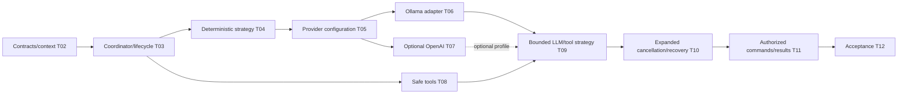

# Phase 2 implementation plan — T02–T12

**T12 acceptance (2026-10-24): ACCEPTED WITH LIMITATIONS for local development only.** See [the acceptance report](acceptance.md) for 173 backend, 89 isolated PostgreSQL and 51 city tests, both builds, browser smoke and live installed Ollama text/calculator evidence. Live OpenAI was NOT RUN. External production exposure remains BLOCKED without production identity/access controls. Earlier task checkpoints below are historical evidence.

Status: **T02-T11 IMPLEMENTED; T12 REVIEW COMPLETE — ACCEPTED WITH LIMITATIONS (local development only).** The acceptance report is the current evidence; earlier per-task counts and live-model failures remain historical, not contradictory current status. T12 does not approve external production exposure or implement Phase 3.

## Dependency order and scope adjustments

Recommended delivery order follows task numbering. OpenAI has no technical dependency on Ollama, and tools can be tested without models. T09 does not require a paid provider; T07 can remain disabled after its fixture tests. **Minimum** lease fencing, cancellation/deadline handling, bounded I/O and atomic result writes belong in T03/T05, before dispatch. T10 expands robustness instead of introducing first-call safety late. T06 and T07 implement provider adapters only; the later task instructions defer the first LLM Agent Strategy to T09. Minimum safety controls still precede any provider call.

No new infrastructure is required by default. Reuse existing schema columns/JSON/result/audit storage; no mandatory migration is identified. Any concrete missing invariant discovered in implementation must receive a narrowly justified **new forward migration**, populated-upgrade tests and updated documentation. Never edit historical migrations, reset developer data or add fake production registrations/models.

## T02 — Runtime Contracts & Execution Context

**Implemented and verified:** [T02 record](runtime-contracts.md). No coordinator, executable strategy, adapter, tool, schema change or runtime route was added. Explicit capability/context/result validation is implemented; actual ownership/claim/transport enforcement remains T03 onward.

- **Objective:** define strict provider/orchestrator-neutral runtime types, immutable context, bounded budgets, result/error contracts and registered strategy identifiers.
- **Dependencies:** reviewed Phase 1/T01 design; no runtime must be enabled to test contracts.
- **Implementation scope:** discriminated rule/LLM definition descriptors, snapshot schema version, strategy/context/authorized tool interfaces, capability enum/unsupported behavior, RuntimeError catalog, input/output validators. Preserve existing TaskInput; define `text.stats.v1` semantics and deny-all tools. Define actor/correlation and private claim versus strategy context boundaries.
- **Expected files:** `src/runtime/contracts/{definition,context,strategy,result,error,provider,tool}.ts` as justified; `test/runtime-contracts.test.cjs`; documentation updates. Avoid an empty shared package or deep class hierarchy.
- **Database changes:** none; types do not widen Agent DTO or persist anything.
- **Security:** no credentials/DB/client/token in strategy/tool context, no arbitrary executable definitions, closed bounded schemas and prototype/unknown-key rejection.
- **Tests:** valid/invalid discriminated definitions, Agent.type compatibility, missing/unsupported capabilities, context identity, byte/budget/deadline limits, results/error serialization and secret-field rejection.
- **Acceptance:** strict build/unit checks pass; contracts cover deterministic and optional LLM modes without SDK imports; fixtures cannot inject IDs/permissions/secrets or make network/database calls. No runtime startup side effects.
- **Exclusions:** coordinator, provider adapter, execution, migrations, routes, tools or scaffolding just to claim support.

## T03 — Runtime Coordinator & Lifecycle Integration

**Implemented:** [T03 verification](runtime-coordinator.md). Resolver, result writer and lease boundary are consolidated in RuntimePersistenceService. The useful operator CLI wrapper is deferred to T04; T03 exposes trusted internal service invocation only, with no executable strategy registered. No migration was needed.

- **Objective:** establish a safe trusted execution boundary before a real strategy can be dispatched.
- **Dependencies:** T02; existing T05/T06/T07 services and real PostgreSQL harness.
- **Implementation scope:** native route/operator/agent allowlists and separate runtime opt-in configuration; definition catalog/binding validation; atomic allocation snapshot; explicit local command and one-run admission; transaction-aware **existing** lifecycle primitives retaining wrappers; native claim/start, heartbeat/token/deadline checks; atomic result/state/events/audit; minimal abort/cancel/timeout and explicit fail-closed recovery/quarantine. Inject a test strategy only in tests until T04. Keep command audit actor/correlation truthful.
- **Expected files:** `runtime.module.ts`, `runtime-coordinator.ts`, `definition-resolver.ts`, `runtime-command.ts`, `runtime-configuration.ts`, `runtime/results/`; targeted changes to existing lifecycle/executions/config/app modules and tests. CLI entry should create/close an application context without opening a public listener. Add justified npm command only after it works.
- **Database changes:** existing snapshot/lease/deadline/reconciliation/result/audit fields expected sufficient. Snapshot must be written at attempt insertion, not patched past the immutable trigger. No DB status updates outside shared lifecycle operations.
- **Security:** disabled by default and in production; scoped explicit permission, NATIVE authority only, old metadata-only attempts ineligible, no network/LLM/tools. Private claim token, bound counters/time, agent quarantine and no automatic RUNNING takeover.
- **Tests:** real DB claim races, duplicate trigger dispatch count, heartbeat/version interactions, pre-start/active cancellation, deadline and lost claim; result/event/audit failure rollback; stale tokens; process/new-instance recovery; definition snapshot/type mismatch, external rejection, production refusal. All Phase 1 HTTP behavior retained.
- **Acceptance:** only one claimant dispatches; all terminal writes are atomic and fenced; crash never automatically redispatches RUNNING; queue/start still uses existing state rules/events; no public runtime/worker route or boot-time scanning. Transaction code never waits for strategy I/O.
- **Exclusions:** real rule handler, paid/local model calls, tools, automatic retries, durable broker/continuous worker/supervisor, external adapters or city integration.

## T04 — Rule-Based Agent Runtime

**Implemented:** [T04 guide and verification](rule-based-runtime.md). Genuine compiled text.stats.v1 strategy, strict existing input/output validation, explicit DI registration and a bounded local execute/inspect command. Existing Agent metadata, trusted runtime bindings, lifecycle, results and events are reused; no migration or coordinator rewrite.

- **Objective:** execute the first real deterministic logical agent end to end without an LLM.
- **Dependencies:** T02/T03 safety/transaction tests pass.
- **Implementation scope:** compiled pure `text.stats.v1` strategy: validated instruction to bounded Unicode/word/nonempty-line statistics, documented context handling. Bind an actual registered RULE_BASED agent explicitly, execute only by local command, persist validated result through coordinator, reuse audit history. No canned result pretending inference occurred.
- **Expected files:** `runtime/strategies/text-summary.ts` (or a clearer text-statistics name), strategy registration, unit/DB acceptance tests and local walkthrough. Pure counting helper can be separate if useful.
- **Database changes:** none expected; successful v1 result in existing execution_results.
- **Security:** finite input/algorithm, one native run/agent, no tool/provider/FS/network access, output size and total deadline. Never evaluate the instruction as code.
- **Tests:** empty/malformed/maximum/Unicode/line-ending inputs, deterministic expected output, context exclusion, result validation; HTTP registration/task → explicit runtime → COMPLETED/SUCCEEDED/result/audit → new-instance persistence. Duplicate invocation must not execute again.
- **Acceptance:** a real isolated PostgreSQL scenario and documented local invocation prove persisted output, matching terminal pair, valid ordered events and no provider request. City still works with runtime disabled/unavailable.
- **Exclusions:** LLM, tool registry, runtime HTTP API, automatic execution after Task creation or retries.

## T05 — LLM Provider Abstraction & Configuration

**Implemented:** [T05 guide](provider-foundation.md). Reuses T02 contracts with runtime validators, exact digest-pinned profile/model selection, empty DI registry, safe private credentials, scoped deadlines and a guarded neutral generation port. No migration/dependency or actual adapter/HTTP operation. Protocol/transport fixture tests (redirects, DNS binding, proxy behavior, response body limits) are explicitly required in T06/T07 before the first real call; T05 tests validators, policy, fake-port behavior and existing PostgreSQL regressions.

- **Objective:** implement safe optional profile selection, capabilities, request/response mapping contracts and HTTP transport policies.
- **Dependencies:** T02 provider contracts; T03 coordinator safety; T04 deterministic control case.
- **Implementation scope:** DI provider registry; disabled/explicit profiles, adapter-private credentials; central configuration precedence/validation; bounded output/context/input/request bytes, timeout/body abort, endpoint/redirect/DNS/proxy policy; error/usage normalization. No default paid profile or automatic retries/fallback. Profiles point only to implemented adapters.
- **Expected files:** `runtime/providers/{provider-registry,provider-configuration,http-transport}.ts`, config validators, focused fixture tests and future environment examples.
- **Database changes:** none expected. Freeze nonsecret profile/model/budget/version in the allocation descriptor; no provider credential stored in JSON.
- **Security:** LLM enablement separate from runtime; cloud permission separate from local; zero tools initially. No arbitrary client endpoints/headers, redirects, environment dumps or secrets in context/logs.
- **Tests:** disabled startup needs no key/provider; enabled incomplete profiles fail clearly; unsupported capability rejected before HTTP; redirects/DNS rebinding/proxy bypass, slow headers/body, oversize output, abort and known HTTP errors; no retries and no secret sentinels exposed.
- **Acceptance:** deterministic runtime still passes with all LLM settings absent; mock HTTP fixtures prove bounded calls and safe mappings; no live provider is invoked by CI or bootstrap.
- **Exclusions:** provider-specific production adapter, model installation, live requests, provider pricing service or tools.

## T06 — Ollama Local LLM Adapter

**Implemented:** [T06 guide](ollama-adapter.md). Real Ollama adapter, fixed native chat mapping, DNS/IP-pinned HTTP transport, limits/errors/usage/cancellation, DI registration and optional diagnostic script. Live qwen3:0.6b probe succeeded without downloads. The current task explicitly excludes the original T01 scope's proposed minimal LLM strategy; that part is not implemented and belongs to T09. No Task/execution/audit state is changed by the adapter or probe.

- **Objective:** add optional local inference and verify the first text-only LLM agent.
- **Dependencies:** T03/T05 safety; all endpoint/deadline/secret tests pass. Actual Ollama/model setup is an explicit operator prerequisite.
- **Implementation scope:** native `/api/chat`, explicit stream:false, exact configured tag and verified digest, positive token/context caps, safe completion/usage/error mapping. Add minimal single-call no-tools LLM strategy using the same coordinator. Document host/container connectivity and cold-start handling. Separate opt-in live script/suite from deterministic CI.
- **Expected files:** `runtime/providers/ollama-provider.ts`, `runtime/strategies/llm-agent.strategy.ts` (text-only initially), protocol fixture tests, opt-in live test and provider guide. No application auto-pull or model startup daemon.
- **Database changes:** none expected; approved provider/model identity and optional usage in bounded result/audit metadata.
- **Security:** explicit local endpoint/profile/data approval, no tools/cloud fallback, bounded bytes/time/tokens, no thinking trace persistence, lost/unknown work does not retry itself.
- **Tests:** Ollama protocol fixtures for missing tag, malformed output, server load/error, timeout/abort, unknown usage and unsupported tools. Optional live procedure: model listing, one bounded nonsensitive request, persisted Task/Execution/result/events and new-instance read.
- **Acceptance:** fixture/DB suites pass AND a clearly labeled operator-run local model acceptance result is recorded for the LLM-enabled milestone. If host/model is unavailable, mark that live criterion BLOCKED/NOT VERIFIED; do not fabricate AI completion from fixtures. Capture server/model digest/hardware and budget outcome.
- **Exclusions:** model downloads/installation by the application, tool loop, cloud fallback, Ollama container infrastructure unless explicitly justified for the selected setup.

## T07 — OpenAI Provider Adapter

**Implemented:** [T07 guide](openai-adapter.md). Official foreground Responses API, fixed TLS authority with reviewed DNS addresses, isolated environment credentials, request/result mapping, quota classification, deadline/abort and DI registration. Deterministic HTTPS fixtures pass; live paid verification is NOT RUN. No SDK/dependency, migration, lifecycle change or LLM strategy was added.

- **Objective:** optional explicit paid-provider support without a mandatory account or SDK.
- **Dependencies:** T05 and existing T06 conventions; no concrete LLM strategy required.
- **Implementation scope:** foreground Responses API at approved endpoint, model from approved configuration, environment key, store:false, bounded max_output_tokens/bytes/deadline, safe output/refusal/incomplete/error/usage mapping. No background mode, hosted tools or automatic retries. Recheck current official documentation at implementation.
- **Expected files:** `runtime/providers/openai/`, protocol fixtures, opt-in paid diagnostic/guide; dependency change only if an SDK is concretely justified.
- **Database changes:** none expected; no credential/SDK-type column. Usage nullable; cost estimate only with an explicitly versioned approved rate table.
- **Security:** existing RUNTIME_LLM_ENABLED catalog and explicit LLM_ALLOW_PAID permission, model/profile/owner-agent authorization, approved data, per-run request/token caps and operator account controls. Local abort never promises exact remote termination or zero billing.
- **Tests:** deterministic HTTP fixtures for 401/403/429/5xx, missing usage, refusal/incomplete output, message mapping, caps, secret leakage, no fallback, redirect or retry. Paid live verification is manual, never CI/default startup.
- **Acceptance:** provider is selectable only through an enabled approved binding; disabling it leaves all local checks functional. Fixture tests pass. Live account/model access remains explicitly NOT VERIFIED unless separately authorized and exercised; that does not block the local-only milestone.
- **Exclusions:** mandatory paid access, live spend during CI, automatic model selection/fallback, assistants/hosted tools/background response polling.

## T08 ? Safe Tool Registry & Tool Execution

**Implemented:** [T08 guide and verification](safe-tools.md). Reuses the T02 contracts, extends trusted binding policy, and adds a compiled registry, permissioned execution service, opaque per-Execution budgets and Calculator/Current DateTime. Claim origin is proven after committed admission and revalidated using existing PostgreSQL lease/identity checks. No LLM loop, tool endpoint, new dependency or schema is introduced.

- **Objective:** two real, validated, permissioned read-only tools with no ambient capabilities.
- **Dependencies:** T02 context/contracts, T03 committed claims and existing local owner/binding policy. No live provider needed.
- **Scope/files:** `runtime/tools/`, extended tool contracts/tokens, small context-origin and runtime-persistence verification seams, configuration and tests.
- **Database changes:** none. Read-only claim verification transactions finish before handler execution. Existing lifecycle events are unchanged; tool metrics are transient only.
- **Security:** default deny; compiled platform allowlist intersects Agent binding and context grants; reject forged/copied contexts and duplicate calls. At most two sequential calls, bounded bytes/time, no shell/eval/files/network/SQL tools.
- **Tests:** real built-ins, registry/DI, strict schemas/unsafe outputs, authorization and cross-agent isolation, cancellation, deadlines, concurrency and call budgets. Real PostgreSQL proves committed context origin and terminal/foreign-instance rejection. Existing providers/city regressions remain required.
- **Acceptance:** authorized invocations return validated results; denied/invalid calls invoke zero handlers; session reopening cannot reset budgets. Current rule agent stays zero-tool and LLM dispatch stays unavailable.
- **Exclusions:** LLM strategy/loop, public tool API, new durable tool audit types, external side effects, dynamic plugins, distributed recovery and arbitrary expression evaluation.

## T09 — LLM Agent Strategy & Tool Integration

**Implemented, with live-model limitation:** [T09 guide](llm-agent.md). One existing-ID llm.text.v1 strategy, trusted instruction/profile/budget snapshots, bounded neutral calls/results, native Ollama/OpenAI mapping with private stateless continuation, permissioned sequential tools and existing claim/result/lifecycle transactions. Unit/provider/PostgreSQL acceptance passes; live qwen3:0.6b text-only execution passed, but its calculator case generated string operands and was rejected with no tool execution. Paid OpenAI live verification was not enabled.

- **Objective:** implement the first LLM Agent Strategy with a small bounded tool-proposal loop; the existing deterministic text strategy remains separate.
- **Dependencies:** T06 adapter, T08 safe invoker, T05 negotiated model/profile capabilities. T07 optional.
- **Implementation scope:** trusted instruction template + untrusted user content, final-text versus proposal union, sanitized tool replies, execution-scoped adapter continuation state, sequential rounds; cap three model rounds/two tool calls with aggregate budget/deadline. Keep ordinary one-call/zero-tool operation selectable.
- **Expected files:** extend `runtime/strategies/llm-agent.strategy.ts`, tool/protocol helpers, adapter capability tests and multi-turn fixture scenarios. Do not introduce a framework orchestrator.
- **Database changes:** none expected; successful bounded structured result plus audit counters. No prompt/token-stream history table.
- **Security:** every proposal independently authorized, schema-checked and fenced; no model-generated endpoint/credential/agent/provider override. No hosted tools, raw reasoning storage, unbounded repair loop or recursive handoff.
- **Tests:** unsupported model tools fail before dispatch; malicious proposals, excessive batches, duplicate IDs, max rounds/tokens, late/cancelled proposals, session isolation and malformed output. DB tests verify final result/events/usage while mocks exercise protocol.
- **Acceptance:** deterministic mocked transport proves authorized tool use and denied proposals; an optional local capable model can demonstrate the same, with honest unsupported capability outcome where needed. No unauthorized handler execution or secret/prompt leakage.
- **Exclusions:** multi-agent planning, agents SDKs, durable external side-effect tools, unlimited autonomous loops.

## T10 — Execution Cancellation, Timeout & Failure Handling

**Implemented T10:** see [the verified cancellation/deadline/shutdown guide](cancellation-timeout-failure.md). Scope follows the current task: monotonic deadlines, child-scope cleanup, bounded shutdown drain and persisted race tests. The original recovery-command sketches below remain planning history; durable recovery and new runtime APIs were explicitly excluded from T10 and remain deferred.

- **Objective:** harden the minimum policies already required in T03/T05 across processes, restarts and ambiguous provider outcomes.
- **Dependencies:** T03/T05 baseline abort/fencing; T09 tool loop (also exercise no-tools mode and deterministic agents).
- **Implementation scope:** explicit reconciliation/recovery command, stale lease/quarantine resolution, graceful shutdown/drain, cross-process cancellation observation, fixed error taxonomy, uncertainty visibility and bounded cleanup. Preserve first committed terminal outcome and no automatic RUNNING takeover/retry.
- **Expected files:** targeted coordinator/lease/lifecycle/recovery changes, multi-process child fixtures, real PostgreSQL race tests and failure runbooks.
- **Database changes:** existing operational fields expected sufficient; if missing operational constraint is proven, add forward migration and populated upgrade coverage. Never silently rewrite legacy inconsistent states.
- **Security:** only authorized recovery; no lease-token reuse, uncertain request replay, remote-termination claim from AbortSignal, or agent capacity release while unresolved work is quarantined.
- **Tests:** cancellation before queue/start, during body/tool/round, success-cancel-timeout races, crash after commit/before dispatch/after provider acceptance, heartbeat failures, lost terminal acknowledgement, stale worker writes, shutdown deadlines and durable recovery evidence. Inspect persisted DB states/results/events.
- **Acceptance:** all exercised races leave one consistent terminal outcome or explicitly unresolved state; cancelled/expired results cannot overwrite it; prior attempts survive and ambiguous paid work is not automatically duplicated.
- **Exclusions:** automatic retry scheduling, generic process sandbox, remote orchestrator termination, distributed broker/locks.

## T11 — Runtime APIs, Results & Observability

**Implemented T11:** [Runtime API contracts and verified behavior](runtime-api.md). The current task explicitly requires actual HTTP execution and allows synchronous semantics. The existing in-process coordinator is awaited with a server-owned 30-second abort budget, owner/allowlist checks and disconnect cancellation. The older queue-only 202/API sketches below are historical proposals, not implemented endpoints or asynchronous guarantees. No detached executor, worker or durable recovery was added.

- **Objective:** expose safe command/result views without making the request a job runner.
- **Dependencies:** T10; prior scoped local access and runtime permission gates; real production auth required before public deployment.
- **Implementation scope:** proposed protected `POST /api/v1/tasks/:id/queue` for durable authorized admission (202 with execution/history location, **not** proof work has started); `POST /api/v1/tasks/:id/cancel` for lifecycle cancellation decision; `GET /api/v1/tasks/:taskId/executions/:executionId/result` for scoped versioned bounded result/status view. Existing Task/Execution/event reads provide monitoring; no separate metrics database needed. Keep explicit CLI execution of queued attempts as first workflow; document that queue acceptance waits for an explicit runtime invocation.
- **Expected files:** thin runtime command/result controllers/DTO/guards; existing lifecycle/result service integration, request/response docs and API tests.
- **Database changes:** none expected; derive status from Task/Execution and result from scoped execution_results, safe metrics from result/audit. No mutable duplicate status store.
- **Security:** existing socket/Host/Origin/bearer checks plus runtime allowlist; path/body/query/If-Match validation, owner/parent checks, no credential/profile/tool injection, safe result serialization/content type and body limits. No unrestricted start/finish/event/Execution write route.
- **Tests:** 202 durable admission/no provider dispatch, repeated/conflicting commands, scoped result/404/error paths, cancellation semantics, production refusal, output XSS/secret markers, runtime disabled behavior and old registry/Task APIs intact.
- **Acceptance:** HTTP commands commit validated durable state and return promptly; execution is independent of the request. Result/status/usage are truthful and survive restart. If automatic consumption is later desired, add a separately enabled bounded supervisor/dedicated worker with T10 recovery tests; do not smuggle detached promises into this API slice.
- **Exclusions:** public anonymous runtime, full auth product, automatic worker as an unstated prerequisite, chat UI, WebSocket/SSE or NPC visualization.

## T12 — End-to-End Verification & Acceptance Review

**Reviewed and verified:** [T12 acceptance](acceptance.md). Local development ACCEPTED WITH LIMITATIONS; 173 backend, 89 PostgreSQL and 51 city tests, builds, migration verification, browser smoke and installed-model text/calculator probes passed. Production exposure remains blocked. The original task scope follows for traceability.

- **Objective:** evidence-based acceptance of the actual implemented Phase 2 scope and its security gates.
- **Dependencies:** T02–T11 implemented/verified to their declared scope; local live Ollama milestone evidence available. OpenAI live access optional and clearly separated.
- **Implementation scope:** traceability, end-to-end deterministic and local LLM scenarios, optional tool scenario, restart/rollback/concurrency/fault tests, reproducible CI/local commands, source preservation, documentation/results and readiness review. Fix confirmed narrow defects with regressions; no speculative refactor.
- **Expected files:** extend existing `test/database.integration.cjs` owned harness and focused runtime unit/HTTP/mock-provider/live tests; minimal updates to scripts/CI; Phase 2 acceptance report and guides.
- **Database changes:** none just to pass acceptance. Verify fresh and populated upgrades if any prior slice required a forward migration, and preserve all original migration hashes/data.
- **Security:** production gate, runtime/provider/tool grants, prompt-injection probes, endpoint policy, credential/result/log exposure, limits and uncertain-outcome recovery reviewed together.
- **Tests:** complete matrix below; tests assert persisted status/result/event/audit, not just a returned success object. Existing city/Phase 1 suites and browser smoke remain mandatory available regressions.
- **Acceptance:** report exact executed commands/counts and NOT VERIFIED/BLOCKED conditions. Do not call a fixture-backed adapter a live AI success. Phase 2 LLM-enabled acceptance requires an actual opt-in local model run; missing local model/hardware blocks that criterion. Paid OpenAI live tests may remain unverified with its profile disabled. No unconditional production-ready claim without production controls.
- **Exclusions:** Phase 3 realtime/NPC work, external adapters, Qyvra, deployment, automatic commit/tag/push, broad city changes.

## Testing and verification matrix

| Layer | Required evidence | Environment |
| --- | --- | --- |
| Unit/contracts | Strategy/type selection, immutable context, definition/profile capabilities, byte/time/token limits, result/error validators, deterministic statistics, tool arithmetic/policy, session isolation | Node test runner; no providers or DB |
| Provider protocol | Exact body/header mapping, schema/tool capability rejection, refusal/incomplete/unknown usage, 4xx/5xx, malformed/oversize/slow body, timeout/abort, no fallback/retry, endpoint/redirect/DNS/proxy restrictions | Owned HTTP fixtures with explicit test-only credentials; no internet/paid keys |
| Database integration | Registry/Task persistence, snapshot identity, queue/claim/heartbeats/versioning, atomic result/terminal/events, rollback faults, race/barrier tests, restart/lease loss/quarantine and history | Existing real isolated PostgreSQL harness; never a developer URL/reset |
| API integration | Read/create/queue/cancel/result contracts, production/default denial, ownership/parent identity, bounded pagination/metadata, no anonymous worker/event writes | Real Nest HTTP + isolated DB; strategy/provider fixtures injected only in test modules |
| Live local LLM | Exact installed tag/digest/server/hardware, bounded nonsensitive text, correct persisted result/lifecycle/audit after restart, cancellation/timeout observations and declared tool support | Explicit opt-in Ollama; model obtained by operator, no automatic download |
| Optional paid live | Explicit model/account/consent, very small bounded request, safe results/usage and failure behavior | Manual opt-in only; never required by CI/local deterministic development |
| Preservation/regression | Existing city tests, static checks/build, browser smoke and original Phase 1 suites/migrations | Existing `verify:phase1` extended conservatively only when runtime tests exist |

`npm run verify:phase1` remains the existing verification command. T02/T03 runtime unit tests are included by the backend test glob; the real PostgreSQL harness includes coordinator claim/result/audit/race/rollback coverage with injected test-only fakes. T04 supplies the real deterministic strategy and execute/inspect CLI; T05 adds provider contract/configuration/selection/deadline tests with test-only fakes. T06 adds native Ollama mapper and owned HTTP conformance fixtures plus a separately opt-in live diagnostic. T07 adds Responses mapping, mocked HTTPS/error/security tests and an explicitly opt-in paid diagnostic. T08 implements the permissioned Calculator/Current DateTime registry/invoker and scoped budget/claim checks. T09 implements the single LLM strategy and bounded tool loop through the existing native runtime; no worker, public execution route or city bridge is implemented. CI must not download models or require provider credentials.

