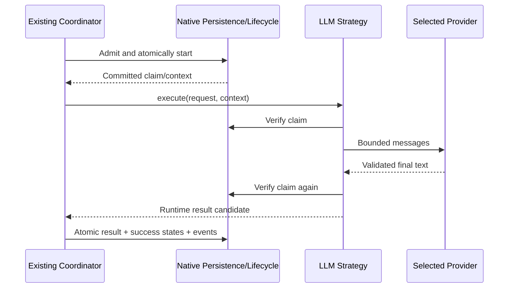
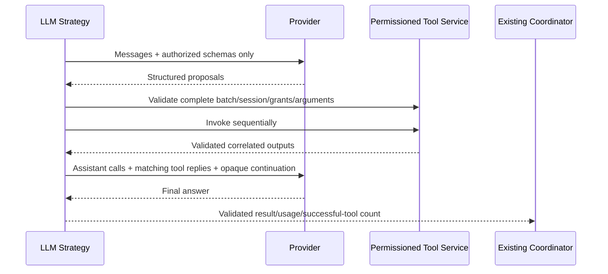

# Phase 2 T09 — LLM Agent Strategy & Tool Integration

**T12 acceptance (2026-10-24): ACCEPTED WITH LIMITATIONS for local development only.** See [the acceptance report](acceptance.md) for 173 backend, 89 isolated PostgreSQL and 51 city tests, both builds, browser smoke and live installed Ollama text/calculator evidence. Live OpenAI was NOT RUN. External production exposure remains BLOCKED without production identity/access controls. Earlier task checkpoints below are historical evidence.

Implementation date: **2026-10-23, Asia/Bangkok**. One compiled `llm.text.v1` strategy now integrates the existing coordinator, provider selection, native claims, permissioned tools and result/lifecycle/audit transactions. No additional framework, backend, ORM, database migration, worker, public execution route or city change is introduced. T10–T12 remain planned.

**Verification boundary:** deterministic unit/provider and real PostgreSQL acceptance pass. Live installed Ollama **text-only Task execution passed**, including persistence and lifecycle history. Its calculator case **FAILED safely**: qwen3:0.6b produced string operands where Calculator requires numbers; no calculator ran. Live OpenAI was **NOT RUN**, because paid opt-in was absent. These results are not interchangeable with mocked test success.

## Repository findings and integration decisions

The actual backend remains `apps/api`, NestJS 11 / strict TypeScript / Drizzle/PostgreSQL, with npm workspaces and Node 24. The Phase 1 acceptance report remains the historical READY WITH LIMITATIONS local-development baseline. T02 supplied native definitions/context/results; T03 owns fenced admission and lifecycle; T04 provides `text.stats.v1`; T05–T07 provide configured selection and bounded transports; T08 supplies Calculator, Current DateTime and claim-backed sessions. Both adapters previously advertised/rejected tool calls; native admission rejected LLM definitions. These were the concrete T09 integration gaps.

No applicable AGENTS.md or Git metadata exists. Git status cannot establish a clean branch; a fresh SHA-256 inventory protects unrelated files. Existing Agent JSON remains category/color metadata only. Runtime/provider/tool authority stays in reviewed server configuration, not editable prompts or Agent Registry JSON. No schema change is necessary because existing Agent type LLM, runtime snapshots, result JSON and lifecycle fields support this integration.

The established strategy ID **`llm.text.v1`** is retained instead of inventing the illustrative `llm.agent` alias. It uses the existing `AgentStrategy` interface. A small optional `validateDefinition` preflight lets the registry resolve model/provider configuration before queue/attempt writes. The strategy remains stateless: messages, usage, call IDs and continuation handles are local to one execute call.

## Trusted configuration

Register and activate an `LLM` Agent through the existing protected registry. Configure its reviewed Agent/orchestrator pair in `RUNTIME_BINDINGS`, with a definition shaped like this abbreviated example:

```json
{
  "schemaVersion": 1,
  "definitionId": "reviewed.assistant",
  "definitionVersion": 1,
  "agentType": "LLM",
  "strategyType": "LLM",
  "strategyId": "llm.text.v1",
  "outputType": "text",
  "systemInstructions": "Answer briefly and use approved tools where appropriate.",
  "toolCapabilities": ["tool.calculator.v1"],
  "providerProfile": "REPLACE_WITH_EXACT_REVIEWED_PROFILE_OBJECT",
  "budget": {
    "executionTimeoutMs": 120000,
    "providerTimeoutMs": 60000,
    "toolTimeoutMs": 1000,
    "maxOutputTokens": 4096,
    "maxProviderRounds": 3,
    "maxToolCalls": 2,
    "maxResultBytes": 32768
  }
}
```

The profile placeholder is deliberately invalid: replace it with the exact object required by [provider configuration/digest selection](provider-foundation.md), matching `LLM_PROFILES` ID, version, model, capabilities and `providerSettingsDigest`. There is no model/provider default or endpoint inference. Set profile `toolCalls:true` only after reviewing actual model support; adapter support alone does not establish model/schema reliability. For plain generation set zero tool calls/timeout/grants and use a text-only profile if desired. Existing definition rules require at least two provider rounds for tool use and at most three rounds/two calls.

`systemInstructions` is optional, LLM-only, at most 2048 UTF-16 units / 4096 UTF-8 bytes, and subject to existing credential/control-character checks. Absent instructions do not add a serialized field or alter old definition digests. Change definition/profile versions deliberately when updating frozen bindings. Agent Registry metadata, descriptive capabilities and Task context cannot set these fields.

Retain the existing dev/test loopback registry owner/token/runtime gates. Enable `RUNTIME_LLM_ENABLED` and reviewed profiles explicitly. Tools additionally require `RUNTIME_TOOLS_ENABLED=true` and `RUNTIME_TOOL_ALLOWLIST` from [T08](safe-tools.md). Provider and definition limits intersect; public OpenAI profiles additionally require `LLM_ALLOW_PAID=true`, the official fixed endpoint policy and an isolated environment credential. Nothing starts when registering an Agent or submitting a Task. No key or Ollama connection is required for startup when that provider is unused.

## Execution flow and lifecycle

Registry preflight selects the trusted profile without contacting a model. Existing admission validates owner, ACTIVE Agent, ENABLED native route and Task status, allocates/adopts the existing attempt, freezes the snapshot and atomically starts Task/Execution. The existing postcommit claim proof is then available to the strategy/tool service. No PostgreSQL transaction spans inference or a tool handler.

The strategy verifies the native claim before and after generation and uses the existing deadline/abort guard. Success returns an existing runtime result candidate; only the coordinator persists it and atomically commits SUCCEEDED/COMPLETED plus lifecycle events. Failures propagate safe RuntimeError codes into the same failure/cancellation/fencing path. No status is written by the strategy or provider, no attempt is silently retried, and no alternate provider is selected after an error.



## Messages and structured calls

The shared contracts extend existing messages with assistant `calls`, tool `callId`/`toolId`/content and optional opaque continuation. Approved descriptions carry stable schema IDs plus fixed descriptions and closed JSON schemas from a compiled catalog for calculator/current_datetime. Arbitrary client schemas, remote `$ref`, hosted tools and SDK objects are rejected.

The initial transcript contains a fixed trusted system boundary plus bounded operator instructions, followed by one user message with JSON-encoded Task `instruction` and optional `context`. No owner IDs, database entities, credentials, execution internals or unrelated history are inserted into model messages. User/tool content remains untrusted data; prompts are not an authorization mechanism or a guarantee against injection.

Only native structured calls are parsed. No regex or prose extraction turns generated text into commands. Calls must have bounded safe identifiers, registered tool names, unique IDs and bounded plain-object arguments. Names and arguments still pass authorization and the compiled runtime schema; JSON syntax or a declared model capability alone is insufficient.

For each proposal batch the strategy checks remaining rounds/tokens/tool count and all call IDs/names, then `ToolExecutionService.validateRequests` checks the entire batch before any handler runs. Calls execute sequentially through the existing invoker. Each successful bounded output becomes a correlated tool message; the next model call receives that message and the unchanged assistant proposal. Duplicate IDs across turns are rejected; no output replay or automatic repair is attempted.



## Adapter mapping and private continuation

Ollama uses the existing `/api/chat` transport, native `tools[].function`, assistant `tool_calls`, object arguments and named tool-result messages. Native IDs are retained when present; otherwise the adapter generates a bounded local call ID and carries it consistently. Replies are sequential and named because the native protocol may correlate by tool name/order. Thinking and native assistant content are retained privately for the next turn, never returned as the final answer. This follows [Ollama's tool conversation format](https://docs.ollama.com/capabilities/tool-calling). Non-streaming text-only requests remain supported; no model pull, SDK or new endpoint is added.

OpenAI continues to use foreground Responses at its fixed official endpoint. Approved definitions map to function tools with `strict:true`; `parallel_tool_calls:false` requests sequential calls. `function_call.arguments` is parsed as JSON, with native call IDs retained; outputs map to `function_call_output`. The schema has closed object properties and explicit required fields, consistent with [official function-calling guidance](https://developers.openai.com/api/docs/guides/function-calling). Runtime validators remain authoritative even with strict decoding.

With `store:false`, OpenAI continuation replays the complete validated native output sequence, including reasoning items and encrypted content, rather than relying on a stored response ID. [Official reasoning guidance](https://developers.openai.com/api/docs/guides/reasoning) describes this stateless replay requirement. Missing encrypted reasoning on a tool turn fails safely rather than pretending that a partial transcript is complete. Tool messages without the required adapter continuation are rejected.

Both adapters return an opaque continuation handle, not provider-specific records. It is bound to provider, Execution, correlation and exact profile plus the previous neutral transcript, tool definitions and expected calls. The next request must present the exact prefix and matching sequential replies. Forged/cross-Execution/cross-profile handles and transcript changes fail before another request. Immutable private state is reachable only through a WeakMap handle, not an Agent-global conversation cache. It is never persisted in a result, prompt log or audit payload and is garbage-collected when the execution drops it.

Neutral history stays at 8 messages / 16 KiB combined content / 32 KiB serialized request. Private replay stays at 16 KiB, 32 array entries, bounded nodes and protocol nesting; tools retain their stricter T08 nesting/byte validation. Existing transport limits (32 KiB request, 64 KiB response, 8 KiB headers), destination pinning, TLS, no redirects/proxy inheritance and deadline cancellation remain. Text-only profiles still reject tool requests/outputs. A model can advertise tools yet produce invalid arguments, as observed in live verification; there is no text fallback or coercion.

## Bounds, errors and cancellation

- At most three provider rounds and two sequential tools, further limited by each definition.
- An Execution has a total output-token allowance from definition `maxOutputTokens`; each request also respects the selected application cap. Reported output tokens reduce the allowance. Missing usage conservatively reserves the full requested amount without inventing token counts.
- Conversation/result/argument/output sizes are validated on every turn. A batch that cannot leave another model round is rejected before tool execution; incomplete output is never returned as success.
- One opaque tool session is opened per claimed Execution and closed in `finally`, preserving duplicate/concurrency/count guards. Revoked grants, disabled Agent/route, cancellation and lost leases cannot authorize a subsequent tool result.
- All tool errors terminate this initial loop. No safe-error self-repair messages, automatic retries, model substitutions or provider failover occur.

Existing codes remain: configuration/provider/model/capability failures; INVALID_PROVIDER_OUTPUT for malformed responses, INVALID_INPUT for schema rejection, TOOL_DENIED for missing grants or repeated IDs, TOOL_FAILED for handler/output faults, CAPACITY_EXCEEDED for exhausted rounds/calls, OUTPUT_LIMIT_EXCEEDED for size/token ceilings, and CANCELLED/DEADLINE_EXCEEDED/LEASE_LOST for execution termination/fencing. No new hierarchy or event type is added.

```mermaid
sequenceDiagram
  participant M as Model
  participant S as Strategy
  participant T as Tool Service
  participant C as Coordinator
  M-->>S: Unauthorized or invalid batch
  S->>T: Validate complete batch
  T-->>S: Safe error; no handler
  S-->>C: Failure
  C->>C: Existing atomic failure/result rollback rules
```

```mermaid
sequenceDiagram
  participant O as Operator/Lifecycle
  participant C as Coordinator
  participant S as Strategy
  participant L as Provider/Tool
  O->>C: Caller abort or persisted cancellation
  C->>L: Relay AbortSignal / heartbeat observes state
  L-->>S: Abort or late candidate
  S->>S: Stop loop; close session
  S-->>C: Cancellation/timeout/claim conflict
  C->>C: Persisted terminal outcome wins; reject late success
```

Runtime active checks now preserve known timeout/lease-loss abort reasons rather than mislabeling them as explicit cancellation. The coordinator still owns total deadline, heartbeat, resources and terminal reconciliation. Client abort cannot guarantee remote computation/billing stops immediately, and timers cannot preempt arbitrary synchronous code. The only tools remain the short bounded Calculator and server UTC clock; there is no general JS, shell, filesystem, SQL or HTTP execution.

## Results, usage and audit

The existing schema remains `schemaVersion:1`, Execution identity, `{type:"text",text}`, optional usage and `{toolSummary:{invocationCount}}`. Provider metadata retains profile ID/model/version and adds optional `providerId` for the actual registered adapter. Old results without that field remain valid. Configured model identity stays frozen; reported model snapshots remain adapter-safe diagnostics.

Usage is summed across model calls only where all component counts are reported; otherwise the affected total is null. Tool counts increase only after successful execution. No raw provider DTO, continuation, thinking, prompt, argument, internal error or credential enters the result. Results remain validated/bounded and written only by the coordinator.

The same 17 durable lifecycle events describe committed Task/Execution changes. Tool/provider round counts use existing scoped transient metrics; no separate tool audit/event system or replay guarantee is claimed. Free-form model text remains untrusted and may be inaccurate; metadata confirms actual tool invocation count, not the truth of every sentence the model emits.

## Local workflow

1. Start existing PostgreSQL and explicitly apply migrations using the documented Phase 1 commands. Do not reset an existing database.
2. Configure local registry owner/token and native orchestrator. Register/activate an LLM Agent via `/api/v1/agents`.
3. Configure its reviewed runtime binding and exact provider profile, optional instructions, budgets and tool policy. For Ollama, verify an already installed model with `/api/show`; do not assume every Qwen/model supports reliable structured calls. For OpenAI, approve cloud data/spend and isolate the key.
4. Start the backend normally. Create a bounded Task through `/api/v1/tasks`; creation does not execute it.
5. Use the existing privileged local command:

```sh
npm run runtime:execute -- --task-id EXISTING_TASK_UUID --task-version OBSERVED_VERSION
npm run runtime:execute -- --inspect --task-id EXISTING_TASK_UUID
```

This reuses queue/admission/coordinator/result inspection, not a new pipeline. Retrieve bounded Execution/audit history through existing protected Task history APIs. Production/local-host/owner restrictions remain in force; no public runtime/tool execution endpoint is added.

## Tests and optional live verification

`llm-agent.test.cjs` uses test-only provider/claim seams and genuine tools. `llm-providers.test.cjs` tests native mapping, schema/capability checks, private reasoning continuation, call correlation and tampering rejection with controlled HTTP transport. Existing transport tests continue to check bounded bodies, errors, DNS/TLS, abort and no startup traffic.

`llm.integration.cjs` is loaded by the existing owned disposable PostgreSQL harness. It exercises real Agent registration/activation and Task APIs, actual LLM strategy/provider selection and real tools with a fake provider, frozen attempts, result persistence, restart/history, unauthorized/invalid/duplicate calls, cancellation, concurrent claims and injected success-event rollback. No production/development database or paid key is consumed.

```sh
npm run verify:phase1
```

That remains the standard CI/local command, including all deterministic tests, migrations, builds and city smoke tests. Live checks are absent unless explicitly opted in. Hosted CI execution is not claimed.

An optional local installed-model test uses the same owned DB harness. Explicitly set `ELYQRETH_OLLAMA_RUNTIME_LIVE=true` and `ELYQRETH_OLLAMA_RUNTIME_MODEL` to a reviewed already installed model, then run:

```sh
node --test --test-name-pattern "T09 live installed Ollama tool" apps/api/test/database.integration.cjs
```

Build the backend first. This selects only the calculator live case, creates/removes owned test infrastructure, verifies model tool capability and attempts a real persisted calculator Task. For the separate text-only smoke case, use the pattern "T09 live installed Ollama text-only". It never pulls a model. Unset both flags afterward. It is deliberately excluded from standard CI and does not weaken normal assertions or automatically retry a failed Task.

The installed `qwen3:0.6b` (digest `7df6b6e09427a769808717c0a93cadc4ae99ed4eb8bf5ca557c90846becea435`) reported completion/tools/thinking. Four explicitly run diagnostic Tasks failed INVALID_INPUT because both operands were strings. The final diagnostic used explicit JSON-number instructions and still failed. Every attempt stopped after one provider call with zero tool invocations; the successful end-to-end assertions did not pass. No input coercion, model download, relaxed test or automatic recovery was introduced. This is an unresolved live model/schema reliability limitation, not a claim of successful local agent/tool execution. A separate explicitly configured text-only Agent/Task passed on the same model: one provider request, COMPLETED/SUCCEEDED, persisted result and seven audit events, with reported usage 81 input / 130 output / 211 total tokens. The failed calculator Task was not retried or converted into a text-only Task.

OpenAI live verification: **NOT RUN**. Paid opt-in was false; no credential was requested/printed and no cloud request was made. Mocked native continuation tests pass; actual cloud model access and live behavior remain unverified.

## Continuation recovery review (2026-10-24)

The interrupted implementation was recovered in place. No applicable AGENTS.md was found in the workspace or its ancestor chain. This directory has no Git metadata: `git status --short` reports "not a git repository". File preservation/change accounting therefore uses the pre-T09 SHA-256 inventory, not an invented Git diff. The existing backend is `apps/api`, using NestJS, Drizzle and PostgreSQL. No parallel backend, ORM, registry or execution pipeline was created.

| Recovered requirement | Classification | Implementation and verification |
| --- | --- | --- |
| LLM strategy and registry integration | COMPLETE | `LlmAgentStrategy`, existing runtime module/registry; real DI and Task scenario |
| Agent configuration and trusted provider/model resolution | COMPLETE | Definition validation, admission preflight, ProviderSelectionService; configuration/strategy tests |
| Provider-neutral messages and structured tool contracts | COMPLETE | Existing provider contracts/validators extended; message/schema/correlation tests |
| Ollama native tool calls and text-only compatibility | COMPLETE | Native chat mapper, private thinking continuation; mapper/transport regression tests |
| OpenAI native tool calls and text-only compatibility | COMPLETE | Responses mapper, private encrypted reasoning continuation; mocked transport tests |
| Bounded model/tool loop and conversation | COMPLETE | Strategy budgets, byte limits and scoped tool budgets; boundary/duplicate tests |
| Tool registry/service and default-deny authorization | COMPLETE | Existing opaque claim-bound tool session; whole-batch validation before invocation |
| Calculator, UTC DateTime and call/result correlation | COMPLETE | Actual registered tools in unit and PostgreSQL scenarios; correlated continuation assertions |
| Final answer validation and safe result serialization | COMPLETE | Existing result constructor/provider guards; invalid/oversized output tests |
| Coordinator, result persistence and lifecycle integration | COMPLETE | Existing coordinator/result transaction; persisted COMPLETED/SUCCEEDED and restart assertions |
| Cancellation, deadlines, failures and duplicate claims | COMPLETE | Existing runtime ownership plus active checks; cancellation/race/error/fault tests |
| Durable audit integration | COMPLETE | Existing lifecycle transactions; event ordering/count and rollback assertions |
| Unit, provider regression and PostgreSQL tests | COMPLETE | Existing aggregate verification command, detailed evidence below |
| Documentation and final change manifest | PARTIAL at recovery; completed here | Replaced unfinished final-verification marker with this review and manifest |
| Optional live Ollama text execution | COMPLETE | Separate real Task passed; result and seven lifecycle events persisted |
| Optional live Ollama calculator scenario | BLOCKED by installed model compatibility | Four probes returned string operands; strict validation rejected them before any tool ran |
| Optional live OpenAI | NOT RUN | Paid verification was not explicitly enabled; deterministic coverage uses mocked transport |

The runtime implementation and its tests were already present at recovery. This continuation inspected those components, reran verification and finalized documentation; it did not rewrite working runtime code. The live observations above are retained evidence from the earlier part of this task, not new paid/model requests in the continuation. Mandatory deterministic tool execution is verified independently of the optional live model limitation.

## Final verification evidence

The prior full `npm run verify:phase1` run passed: 51 city tests, 147 backend tests, 75 real PostgreSQL tests and browser smoke (77 requests, zero exceptions). The subsequent final backend run passed 149/149 tests after two additional edge-case tests. A focused `node --test apps/api/test/ollama.test.cjs` rerun during continuation passed 6/6, including text-only compatibility and opt-in diagnostic safety.

Continuation verification on 2026-10-24: the first sandboxed aggregate attempt stopped at the frontend build because esbuild could not read ancestor directories. With the required process access, `npm.cmd run verify:phase1` passed lint/typecheck, backend build, frontend build, migration-file checks, 51/51 city tests and 149/149 backend tests. It then stopped because Docker Desktop was not running: the database suite reported 75 setup failures, not verified database behavior. After starting the installed Docker engine, `npm.cmd run test:db` passed **75/75**, with zero failures/skips, against its owned disposable PostgreSQL database. `npm.cmd run test:browser` separately passed on Chrome 155 with 55 resource requests and zero exceptions. No second full aggregate success is claimed; all constituent checks ultimately passed through these documented runs.

Current PostgreSQL evidence includes all five T09 scenarios: persisted plain answer and restart; genuine Calculator/DateTime with correlated results; unauthorized/invalid/duplicate calls; cancellation against late provider completion; concurrent coordinators dispatching once and result rollback on audit failure. Standard CI uses fake providers and controlled transports, not paid or installed-model inference.

Documentation checks passed: 16 balanced code fences and no broken local links in this guide. Temporary verification logs remain outside the repository under `elyqreth-p2-t09-continuation*.log` in the operator's temporary directory.

**T09 completion status: COMPLETE for mandatory implementation and deterministic acceptance requirements, with the optional installed-model calculator limitation documented above.** This is not production deployment approval or a claim that the installed model reliably follows tool schemas. T10, T11 and T12 have not been started.

Preservation check against the pre-T09 inventory: 90 protected files unchanged, including all 51 existing city source files plus core domain/database/migration files and both HTTP transports. No database migration, dependency, public execution/tool route, worker or city source change was introduced. Browser smoke is limited regression evidence, not a visual-diff or exhaustive animation/performance acceptance test.

Live evidence remains distinct from deterministic verification: Ollama text-only PASS; Ollama calculator FAIL safely for the installed model; OpenAI NOT RUN. There is no automatic provider fallback, relaxed argument validation or claim that mocked inference proves live model reliability.

## T09 change manifest

The following is the entire T09 change set relative to the pre-task inventory, including work completed before interruption. This continuation changes only this guide. Generated build outputs and temporary logs are excluded. No maintained files were removed.

### Created
- `apps/api/test/llm-agent.test.cjs`
- `apps/api/test/llm.integration.cjs`
- `apps/api/test/llm-providers.test.cjs`
- `apps/api/test/llm-fixtures.cjs`
- `docs/ai-agent-platform/phase-2/llm-agent.md`
- `apps/api/src/runtime/strategies/llm-agent.strategy.ts`
- `apps/api/src/runtime/contracts/tool-description.ts`
- `apps/api/src/runtime/providers/provider-continuation.ts`

### Modified

- `WORKSPACE.md`
- `README.md`
- `apps/api/.env.example`
- `docs/ai-agent-platform/README.md`
- `apps/api/test/runtime-contracts.test.cjs`
- `apps/api/test/openai-fixtures.cjs`
- `apps/api/test/ollama.live.cjs`
- `apps/api/test/ollama-fixtures.cjs`
- `apps/api/test/database.integration.cjs`
- `docs/ai-agent-platform/phase-2/tool-security.md`
- `docs/ai-agent-platform/phase-2/safe-tools.md`
- `docs/ai-agent-platform/phase-2/runtime-coordinator.md`
- `docs/ai-agent-platform/phase-2/runtime-contracts.md`
- `docs/ai-agent-platform/phase-2/README.md`
- `docs/ai-agent-platform/phase-2/provider-foundation.md`
- `docs/ai-agent-platform/phase-2/provider-abstraction.md`
- `docs/ai-agent-platform/phase-2/openai-adapter.md`
- `docs/ai-agent-platform/phase-2/ollama-adapter.md`
- `docs/ai-agent-platform/phase-2/implementation-plan.md`
- `apps/api/src/runtime/runtime-persistence.service.ts`
- `apps/api/src/runtime/runtime.module.ts`
- `apps/api/src/runtime/strategy-registry.ts`
- `apps/api/src/runtime/contracts/provider.contract.ts`
- `apps/api/src/runtime/contracts/provider-validation.ts`
- `apps/api/src/runtime/contracts/execution-result.contract.ts`
- `apps/api/src/runtime/contracts/execution-context.contract.ts`
- `apps/api/src/runtime/contracts/definition.contract.ts`
- `apps/api/src/runtime/contracts/agent-strategy.contract.ts`
- `apps/api/src/runtime/tools/tool-execution.service.ts`
- `apps/api/src/runtime/tools/tool-validation.ts`
- `apps/api/src/runtime/providers/provider-selection.service.ts`
- `apps/api/src/runtime/providers/openai/openai.provider.ts`
- `apps/api/src/runtime/providers/openai/openai.mapper.ts`
- `apps/api/src/runtime/providers/ollama/ollama.provider.ts`
- `apps/api/src/runtime/providers/ollama/ollama.mapper.ts`

Next task: **Phase 2 T10 — Execution Cancellation, Timeout & Failure Handling**. T10, T11 and T12 remain unimplemented by this task.
