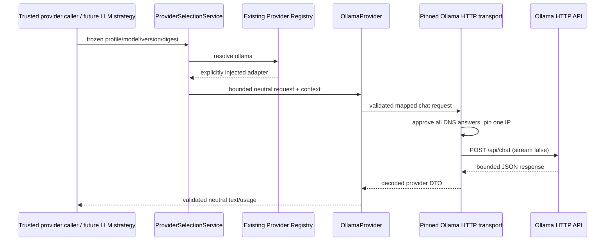

# Phase 2 T06 - Ollama local provider adapter

**T12 acceptance (2026-10-24): ACCEPTED WITH LIMITATIONS for local development only.** See [the acceptance report](acceptance.md) for 173 backend, 89 isolated PostgreSQL and 51 city tests, both builds, browser smoke and live installed Ollama text/calculator evidence. Live OpenAI was NOT RUN. External production exposure remains BLOCKED without production identity/access controls. Earlier task checkpoints below are historical evidence.

T09 update: [native structured tools and private conversation replay](llm-agent.md) are implemented alongside text generation. Installed qwen3:0.6b advertised tools but failed strict numeric argument validation in the full runtime live probe; the earlier T06 text-only live success below does not establish T09 tool compatibility.

Status: **IMPLEMENTED and verified for local development**, 2026-10-22 (Asia/Bangkok). Implements a real native Ollama HTTP adapter and optional live provider diagnostic. **No LLM Agent Strategy or LLM Task execution workflow is implemented.** The latest T06 instructions explicitly exclude the minimal text strategy proposed in the original T01 roadmap; that integration is deferred to T09.

## Repository findings

The backend remains `apps/api`, NestJS 11/strict TypeScript, Drizzle/PostgreSQL, Node 24/npm workspaces. Reviewed T01/T02 contracts, T03 coordinator/claims, T04 rule strategy, [T05 provider foundation](provider-foundation.md), Agent metadata, Task/Execution persistence, lifecycle/audit, config/DI, tests, CI and Compose. No applicable AGENTS.md or Git metadata exists. Preservation uses a pre-task SHA-256 baseline, not an invented clean Git tree.

There was no existing provider HTTP transport or SDK. T06 uses Node core HTTP/HTTPS/DNS/TLS without dependencies. Existing Compose still contains PostgreSQL only; no API/Ollama container or new exposed port is introduced. Ollama 0.40.7 and a running local server with an installed qwen3:0.6b model were found; no installation, service reconfiguration or model pull was performed.

## Architecture and registration



RuntimeModule injects OllamaProvider and OllamaHttpTransport, binds the DNS resolver seam, and supplies the compiled adapter through the **existing** LLM_PROVIDERS token. LlmProviderRegistry duplicate/unknown checks remain unchanged. The provider is registered even when LLM configuration is absent, but constructor/capability checks never connect, discover models or generate text. Rule agents need no Ollama or OpenAI credentials. No fake provider is registered in production.

The coordinator's existing RULE_BASED-only execution gate remains unchanged. This adapter contains no Task/Execution queries, status changes, result persistence, audit writes, scheduling or NPC behavior. A provider request is not a persisted Task execution. A future LLM strategy must reuse coordinator lifecycle/authorization/result/audit boundaries rather than bypass them.

## Protocol and mapping

Current official [chat API](https://docs.ollama.com/api/chat) documents POST /api/chat, ordered chat messages, nonstreaming responses, completion fields, optional usage/duration and model-dependent thinking controls. T06 maps system/user/assistant messages unchanged, sends stream:false explicitly and leaves think unset. It does not assume every model accepts the same thinking setting. Reasoning returned in message.thinking is never exposed or persisted.

Only these generated fields go on the wire:

```json
{
  "model": "<exact configured model tag>",
  "messages": [{"role":"user","content":"<validated text>"}],
  "stream": false,
  "keep_alive": 0,
  "options": {"num_predict":128,"num_ctx":8192}
}
```

num_predict uses the approved positive output-token cap. num_ctx is a fixed 8192-context ceiling; neither can be replaced with arbitrary user options. Their meanings are documented in the [Modelfile parameter reference](https://docs.ollama.com/modelfile). keep_alive:0 requests unloading after the call, trading repeated cold-start latency for reduced idle retention; it is not a hard GPU-memory/process limit.

T05 message/role/unknown-field/credential checks remain. Wire request is at most 32 KiB. Additional conservative admission requires UTF-8 message-content bytes + output cap + 1024 template reserve <=8192. Oversized input rejects, never truncates. This byte guard is **not a tokenizer or universal context guarantee**: models/templates/context capacity require operator verification before real Task integration. The adapter sends every admitted message in order.

Response requires exact configured model string, done:true, assistant role and valid nonempty text. Missing optional done_reason is accepted; if supplied only stop succeeds. A length outcome or reported output exceeding the requested cap returns OUTPUT_LIMIT_EXCEEDED. Malformed, incomplete, substituted or credential-pattern output rejects. Tool/image/logprob output is unsupported; empty arrays are tolerated. Optional thinking is discarded, not treated as final output. Vendor DTOs stay inside the adapter.

Usage maps reported prompt_eval_count and eval_count to input/output tokens. Missing individual counts remain null; if both are absent usage is omitted. Total is derived only when both counts are reported, never estimated; cached-prompt count is not added twice. Invalid counts reject. Explicit tokenUsage:none suppresses usage exposure. Optional server nanoseconds are validated and converted to bounded serverDurationMs diagnostics. Public port result remains the existing text/usage contract; local elapsed duration and IDs use safe structured logging. No raw prompts, generated text, reasoning, headers or error bodies are logged by the adapter.

## Configuration

T05 semantics remain authoritative; LLM_PROVIDER/LLM_MODEL/OLLAMA_BASE_URL aliases remain rejected. Use the enabled profile catalog and trusted model selection, not Task-level endpoints/options. Defaults leave LLM work off.

| Setting | Requirement |
| --- | --- |
| RUNTIME_LLM_ENABLED | Explicit true to use configured profiles; requires existing permitted local runtime/registry/DB configuration |
| LLM_PROFILES | Reviewed profile with providerId ollama, exact model ID, private endpoint origin and literal address allowlist |
| LLM_REQUEST_TIMEOUT_MS | 1-120000, default 60000; capped by captured execution/provider deadline |
| LLM_MAX_OUTPUT_TOKENS | 1-4096, default 512; request and captured definition caps still apply |
| LLM_ALLOW_PAID | No paid fallback; Ollama adapter only accepts local-network profiles |

Example profile, not a command to install a model:

```json
{
  "id":"local.small", "profileVersion":1, "providerId":"ollama",
  "model":"<operator-approved-installed-model>",
  "capabilities":{
    "text":true,"transportAbort":true,"remoteCancellation":"unknown",
    "structuredOutput":"none","toolCalls":false,"streaming":false,"tokenUsage":"optional"
  },
  "endpoint":{"origin":"http://127.0.0.1:11434","network":"local","allowedAddresses":["127.0.0.1"]}
}
```

This native local adapter rejects credentialEnv and public-network profiles. It does not forward bearer keys or support authenticated reverse proxies in T06. Keep unrelated cloud credentials out of Ollama configuration. Model is selected only by the pinned catalog/profile descriptor; no silent substitution, cloud fallback or download occurs. Mutable server-side model tags are not weight pinning: the live diagnostic records/checks installed digest, but generation itself does not query tags on each request. Reviewed model identity/digest recording and server policy remain T09 integration requirements.

T05 providerSettingsDigest still pins profile version/model/capabilities/adapter/endpoint policy. Settings changes need an approved new descriptor/version/binding. Credential/config/endpoint data never enter Task input or raw audit payloads. Existing config precedence remains process > ignored apps/api/.env > defaults. No schema/migration, Agent configuration widening or required OpenAI key is added.

## Transport, timeout and errors

OllamaHttpTransport has a fixed /api/chat operation, not a generic proxy/tool. It revalidates the private endpoint policy, resolves DNS per request, requires **every** answer to match approved literal IPs and connects directly to one approved address. No alternate-address retry or subsequent DNS lookup is used. Host header preserves the configured origin; socket peer is checked. A DNS result arriving after cancellation cannot dispatch a request.

Requests use dedicated one-shot Node agents (agent:false), no inherited global agent/proxy behavior, no cookies/authorization, identity encoding, no redirects and an 8 KiB response-header limit. HTTPS uses certificate verification, original DNS servername and original-host identity checks even though transport connects to the pinned IP. Compression/NDJSON or unexpected content type rejects. Body ceiling is 64 KiB, enforced on declared length and chunks before accumulation; UTF-8 decoding is fatal and JSON parsing is bounded. Final neutral result is independently limited to 32 KiB. TLS identity options were unit-checked; no live private-CA/container TLS deployment was tested.

Existing withProviderDeadline bounds DNS, connection, headers and body under the earlier request/execution deadline. Its scoped signal is passed into Node HTTP so cancellation/timeouts destroy the request/socket. Timers/listeners are cleaned up; tests check parent listeners and socket closure. DNS lookup itself is not cancellable at the OS API: late results are ignored before any connection. Aborting HTTP does **not** prove Ollama immediately stops model computation or releases GPU memory. Hard process isolation, remote reconciliation and resource quotas remain outside this adapter.

Official [Ollama error documentation](https://docs.ollama.com/api/errors) describes HTTP errors and error payloads. T06 classifies status facts without forwarding raw response bodies:

| Condition | Runtime code |
| --- | --- |
| Connection refused/DNS failure/socket failure/5xx | PROVIDER_UNAVAILABLE |
| 400 or other ordinary 4xx | INVALID_INPUT |
| 401/403 | PROVIDER_AUTH_FAILED |
| 404 on fixed chat operation | MODEL_UNAVAILABLE; an incompatible/misrouted server can also return 404 |
| 429 | PROVIDER_RATE_LIMITED |
| Redirect, disallowed/rebound destination, invalid TLS identity | CONFIGURATION_ERROR |
| Deadline / explicit cancellation | DEADLINE_EXCEEDED / CANCELLED |
| Malformed/incomplete/non-JSON/invalid UTF-8/header overflow | INVALID_PROVIDER_OUTPUT |
| Header-declared/chunked body limit, text/result/token limit | OUTPUT_LIMIT_EXCEEDED |
| Tool/JSON/schema/stream mode requested | UNSUPPORTED_CAPABILITY |

No automatic retry/failover occurs, and unknown provider details are replaced with safe categories. Local endpoint validation alone is insufficient SSRF protection; connection pinning, redirect/proxy policy and transport tests provide additional defenses. Trusted operator/server/network configuration remains part of the boundary. A local Ollama server can itself have remote features: review its policy and installed models; the application cannot attest an independently administered server's internals.

## Docker and host networking

| API location / Ollama location | Reviewed origin and limitations |
| --- | --- |
| Host / same host | Loopback origin; this is the live-verified mode |
| API container / host (Docker Desktop) | Explicit host.docker.internal:11434 plus approved private resolved IPs; host service must listen on an appropriately restricted reachable interface, with firewall review |
| API container / Ollama container | Dedicated private network, service DNS such as ollama:11434, approved private IPs; no public host model port required |
| Host / Ollama container | Publish only the intended host-loopback port and configure that exact origin |
| Linux Docker / host | Host gateway mapping/routing must be explicitly arranged; Desktop DNS name is not assumed |

Inside a container localhost is that container. Do not bind/publish the host model service publicly just to make a test pass. Resolve/review approved addresses from the **API's namespace**, including all relevant answers. DNS/network changes fail closed and require reviewed configuration/version/digest updates. Actual API/Ollama container deployment was not run; controlled hostname-to-IP fixture tests validate the policy, not a deployment topology. Existing PostgreSQL Compose is unchanged.

## Deterministic and optional live verification

```powershell
npm.cmd run test:api   # includes pure mapper + owned loopback HTTP fixtures
npm.cmd run test:db    # owned disposable PostgreSQL, prior runtime/agent/audit checks
npm.cmd run verify:phase1
```

The historical command name includes current runtime/provider tests. CI uses only in-process fake transport and owned loopback HTTP servers, never a real Ollama/model/account. Fixtures verify DNS pin/rebind/mixed/late answers, native HTTP proxy bypass in a new process, redirects/status errors, slow headers/body, socket abort, limits/encoding/parser failures, mapping and no eager provider calls. Existing real rule-agent CLI/persistence/audit/restart tests remain regression coverage.

Optional host-loopback diagnostic (no installation/model pull):

```powershell
$env:ELYQRETH_OLLAMA_LIVE='true'
$env:ELYQRETH_OLLAMA_LIVE_MODEL='<already-installed-text-model>'
# Optional expected 64-character digest, if independently approved:
# $env:ELYQRETH_OLLAMA_LIVE_DIGEST='<installed-model-digest>'
# Optional host-loopback origin; default is http://127.0.0.1:11434:
# $env:ELYQRETH_OLLAMA_LIVE_ORIGIN='http://127.0.0.1:11434'
npm.cmd run test:ollama:live
```

Disabled flag or missing server/model prints NOT RUN, with no model download. Production or malformed/non-loopback diagnostic origins reject. The script uses bounded local GET /api/tags to check the exact installed name/digest, then the real adapter through registry/selection with a 60-second timeout and 256-token cap. The [model-list API](https://docs.ollama.com/api/tags) supplies installed names/digests. Generated probe UUIDs are diagnostic correlation IDs, **not fabricated persisted Execution records**. No database, Agent, Task, lifecycle event or automatic worker is involved. It is not the existing runtime Task execution CLI.

### Executed live evidence

- Ollama **0.40.7**, host-loopback server; existing **qwen3:0.6b**.
- Installed/expected digest: `7df6b6e09427a769808717c0a93cadc4ae99ed4eb8bf5ca557c90846becea435`.
- Command: root `npm.cmd run test:ollama:live` with explicit opt-in/model/digest.
- Status: **PASS**. Nonempty response: `Yes, I'm ready to respond with "READY."` Exact wording was not asserted as deterministic.
- Reported usage: **20 input / 139 output / 159 total tokens**; local elapsed **4486 ms** under configured **60000 ms** deadline.
- Only final assistant text was returned; no thinking trace persisted/logged. No model install/pull, production data, Task execution or paid provider was used. Latency is one diagnostic observation, not an availability/performance guarantee.

## Verification results and files

Executed checks:

| Command | Actual result |
| --- | --- |
| `npm.cmd run check:api` | Strict TypeScript PASS |
| `npm.cmd run verify:phase1` | PASS: static checks, API build, frontend disposable bundle, migration check, 51 city tests, 100 backend tests at that point, 69 real PostgreSQL tests and Chrome smoke |
| `npm.cmd run test:api` after final opt-in/startup/listener assertions | **101/101 PASS**, zero failures/skips; includes 6 mapper/provider/diagnostic groups and 6 controlled HTTP groups |
| `node --test apps/api/test/ollama.test.cjs` after build | Initial 5 mapper/provider/TLS-option groups PASS (the final opt-in group is covered by the complete 101-test run) |
| `node --test apps/api/test/ollama-http.test.cjs` after build | 6/6 PASS; owned loopback fixtures, no live model |
| `npm.cmd run test:ollama:live` with explicit opt-in | **PASS against actual installed model**, evidence above; separate from deterministic CI |

The full suite includes previous Phase 1 HTTP/API, lifecycle/concurrency/transaction/audit/migration/restart checks and the genuine rule-agent root CLI execution with no Ollama configured. Chrome smoke passed with zero exceptions: Canvas/environment/clock/agents/decorative citizens without an API, camera zoom/focus/recenter, help/developer panels, simulated mission start/pause/resume/reset and mobile reload/viewport. Visual-diff/FPS/exhaustive gestures/long-duration acceptance, hosted CI and container/TLS deployment were not executed.

Baseline SHA-256 checks: **51/51 city files and 9/9 migration SQL/metadata files unchanged**; no existing file removed. Dependency lockfile, schema, coordinator/lifecycle/audit implementations and existing deployment/CI files remain unchanged. All 81 Phase 2 local documentation links resolve and Markdown fences balance; Mermaid source was reviewed, not rendered. Docker inspection found no remaining labeled test container/volume.

The live probe above was actually executed and is not inferred from mocked tests. It created no database records and used no paid provider. Final command opt-in rejection tests explicitly override diagnostic flags, so CI cannot accidentally contact an installed server. Earlier T01/T05 reports are retained as historical evidence, not relabeled as current inference capability.

Created: `apps/api/src/runtime/providers/ollama/{ollama.provider,ollama.mapper,ollama-http.transport}.ts`; `apps/api/test/{ollama-fixtures.cjs,ollama.test.cjs,ollama-http.test.cjs,ollama.live.cjs}`; this guide.

Modified: runtime module/token registration, API environment example, root/API diagnostic script entries, existing runtime contract DI assertions and documentation checkpoints. No dependency, ORM/schema/migration, coordinator/lifecycle/event implementation, city source, deployment or CI changes. Exact modified inventory:

- `package.json`, `apps/api/package.json`: optional test:ollama:live scripts only, no dependency change.
- `apps/api/.env.example`.
- `apps/api/src/runtime/runtime.module.ts`, `apps/api/src/runtime/tokens/runtime.tokens.ts`.
- `apps/api/test/runtime-contracts.test.cjs`: confirms registered adapter through DI while socket/network sentinels prohibit startup traffic.
- Root `README.md`, `WORKSPACE.md`; `docs/ai-agent-platform/README.md`.
- `docs/ai-agent-platform/phase-2/{README,implementation-plan,provider-abstraction,provider-foundation,rule-based-runtime,runtime-architecture,runtime-contracts}.md`.

Removed files: none. The preexisting model/server installation was only read/probed; no model pulls, service configuration changes or unrelated user database changes were performed.

## T09 integration boundary and next task

T09 must implement the trusted LLM Agent Strategy separately: build controlled messages from persisted validated input, select the captured profile, invoke this guarded port, convert neutral text/usage into the existing runtime success candidate and let the coordinator own terminal persistence/audit. Retain explicit authorization, model/profile identity review, zero tools unless separately authorized, cancellation/deadline/result bounds and no automatic retries. Do not expose a model proxy or use NPC animation as execution authority.

Next: **Phase 2 T07 - OpenAI Provider Adapter**. Not begun by T06.
