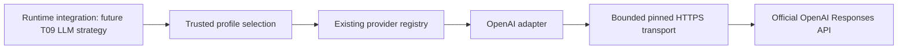

# Phase 2 T07 — OpenAI provider adapter

**T12 acceptance (2026-10-24): ACCEPTED WITH LIMITATIONS for local development only.** See [the acceptance report](acceptance.md) for 173 backend, 89 isolated PostgreSQL and 51 city tests, both builds, browser smoke and live installed Ollama text/calculator evidence. Live OpenAI was NOT RUN. External production exposure remains BLOCKED without production identity/access controls. Earlier task checkpoints below are historical evidence.

T09 update: [Responses function tools and private stateless continuation](llm-agent.md) extend this adapter. Deterministic mapping/replay tests pass; paid live verification remains NOT RUN. The T07 text-only implementation record below remains historical.

Implemented 2026-10-22. This is an optional provider adapter, not an LLM Agent Strategy or an LLM Task workflow. T08 tools and T09 strategy remain planned. The existing rule-based coordinator, PostgreSQL lifecycle, events and city are unchanged.

## Repository findings and API decision

The backend remains `apps/api`, using NestJS 11, strict TypeScript, npm workspaces, Node 24 and Drizzle/PostgreSQL. T02 contracts, T05 registry/selection/deadline policy and T06 Ollama transport/tests were inspected alongside the Phase 1 acceptance report. No additional backend, ORM, SDK or migration is needed. No applicable AGENTS.md or Git metadata is present; SHA-256 comparison protects unrelated files instead of claiming a clean Git tree.

The adapter uses foreground `POST https://api.openai.com/v1/responses`. Responses is recommended for new text-generation integrations in the [official text guide](https://developers.openai.com/api/docs/guides/text). The official SDK was evaluated; existing native Node HTTPS infrastructure is sufficient for this small surface and permits exact DNS pinning, byte limits, fixed TLS authority, no proxy inheritance and zero retries without another dependency. SDK types never enter the neutral contracts. This is direct use of the official HTTP API, not an OpenAI-compatible alternate service.



## Implemented components

Under `apps/api/src/runtime/providers/openai/`:

- `openai.provider.ts`: existing `LlmProvider` port, exact profile/digest/config matching, isolated credential lookup, existing deadline helper and safe completion metrics.
- `openai.mapper.ts`: closed request construction, completed text response extraction, reported usage and protocol error normalization.
- `openai-http.transport.ts`: fixed authority/path, reviewed public addresses, authenticated TLS, bounded JSON and native request abort.

RuntimeModule registers `openai` alongside `ollama` through the existing `LLM_PROVIDERS` factory. Construction, registration, capability checks and selection initialization do not contact either provider. With no enabled cloud profile, no OpenAI key is required. An enabled profile must be valid even when no agent currently selects it.

## Configuration and selection

Existing process environment > ignored `apps/api/.env` > defaults precedence remains. Keep all credentials out of tracked files, frontend variables, Agent configuration, Task input, results and audit payloads.

| Setting | Rule |
| --- | --- |
| `RUNTIME_LLM_ENABLED` | Default false. Existing local runtime/registry/owner gates still apply to the application. |
| `LLM_PROFILES` | Existing reviewed catalog, 1–16 profiles, at most 32 KiB; no Task-controlled endpoints. |
| `LLM_ALLOW_PAID` | Must explicitly be `true` for any public cloud profile. Does not itself trigger inference. |
| `OPENAI_API_KEY` | Example credential environment reference; required only for an enabled profile referring to it. 8–4096 printable non-space ASCII characters; provider verifies actual validity. |
| `LLM_REQUEST_TIMEOUT_MS` | 1–120000, default 60000; actual deadline is the earliest caller/definition/configuration limit. |
| `LLM_MAX_OUTPUT_TOKENS` | 1–4096, default 512; request/definition limits can lower it. Includes reasoning tokens where the model uses them. |

Profile template below contains deliberate placeholders; replace them with reviewed values before enabling. Do not copy an arbitrary public IP from tests. The configured model must be accessible and compatible with Responses and these minimal options.

```json
{
  "id": "cloud.reviewed",
  "profileVersion": 1,
  "providerId": "openai",
  "model": "operator-approved-responses-model",
  "capabilities": {
    "text": true,
    "transportAbort": true,
    "remoteCancellation": "unknown",
    "structuredOutput": "none",
    "toolCalls": false,
    "streaming": false,
    "tokenUsage": "optional"
  },
  "endpoint": {
    "origin": "https://api.openai.com",
    "network": "public",
    "allowedAddresses": ["REPLACE_WITH_VERIFIED_PUBLIC_ADDRESS"]
  },
  "credentialEnv": "OPENAI_API_KEY"
}
```

The same profile/version/model/capabilities/endpoint digest must be captured by the trusted runtime definition; see [T05 selection and binding instructions](provider-foundation.md). No application-wide default, Task override, prompt-based selection, model substitution, retry or provider fallback is introduced. `LLM_PROVIDER`, `LLM_MODEL`, `OPENAI_MODEL` and endpoint aliases remain rejected. A rule agent needs none of these settings.

Only the exact origin `https://api.openai.com` is accepted for OpenAI. No configurable alternate base URL, custom port, URL credentials, query, path or HTTP origin is allowed. Each request resolves all DNS answers and requires all of them to belong to the reviewed public address list; the chosen address is pinned to the socket. Host, SNI and certificate identity remain `api.openai.com`. DNS changes fail closed and require operator review/profile update. On Windows, `Resolve-DnsName api.openai.com` can assist that review; results must be verified against the intended service, not blindly trusted. Standard TLS trust is required. Proxies, redirects and global connection agents are not inherited. Egress controls remain an additional operational boundary; URL validation is not a complete SSRF solution.

## Request and response mapping

Requests use only the validated model, ordered system/user/assistant messages, `max_output_tokens`, `store:false`, `stream:false`, `background:false` and `truncation:"disabled"`. System messages retain their transcript position and role. There is no automatic database/context expansion, continuation ID, hosted tool, arbitrary parameter bag or conversation memory. Existing limits remain 1–8 messages, 16000 UTF-16 units per message, 16 KiB aggregate message UTF-8 and 32 KiB serialized request/transport body. Unknown fields/roles and unsupported tools/JSON output are rejected before dispatch.

The mapper checks `object:"response"`, `status:"completed"`, no error/incomplete details, bounded output items and completed assistant messages. It concatenates ordered `output_text` parts without added separators, discards reasoning items, and rejects unexpected tool/non-text content. It never assumes the first output item contains the answer, consistent with the [official output guidance](https://developers.openai.com/api/docs/guides/text). Empty/unsafe text, malformed output, refusal and filtering fail safely as `INVALID_PROVIDER_OUTPUT`; refusal text is not exposed. Token-limit incompletion is `OUTPUT_LIMIT_EXCEEDED`, never partial success. [Reasoning documentation](https://developers.openai.com/api/docs/guides/reasoning) explains why a token budget can be exhausted before visible text appears.

The trusted requested model is never rewritten. An official model alias can resolve to a reported snapshot: the validated reported identifier is captured in the safe completion log; the neutral result stays the existing `{kind:"text",text,usage?}` contract. Pin an exact model snapshot operationally when reproducibility requires it. There is no account/model discovery or capability probe at startup. Actual model compatibility/access remains unverified without an explicit live call.

Input/output/total usage is mapped only when reported, with unknown counts null and absent usage omitted; known totals must agree and output tokens cannot exceed the request cap. Nested vendor usage/reasoning metadata is discarded. There is no invented token count, cost calculation or billing service. Duration is measured locally. The adapter does not persist prompts, results, usage or lifecycle events; T09 will consume the same port and existing result/lifecycle infrastructure.

## Errors, deadlines and capabilities

| Protocol fact | Runtime error |
| --- | --- |
| Missing/invalid enabled configuration or endpoint/TLS policy | `CONFIGURATION_ERROR` (environment validation may reject first) |
| Missing adapter credential; HTTP 401/403 | `PROVIDER_AUTH_FAILED` |
| HTTP 404 / `model_not_found` | `MODEL_UNAVAILABLE` |
| Invalid request / other 4xx | `INVALID_INPUT` |
| HTTP 429, transient rate limit | `PROVIDER_RATE_LIMITED` |
| Explicit quota/billing-exhaustion code/type at 429 | `PROVIDER_QUOTA_EXCEEDED` |
| Transport/DNS connection failure / 5xx | `PROVIDER_UNAVAILABLE` |
| Deadline / explicit abort | `DEADLINE_EXCEEDED` / `CANCELLED` |
| Malformed/empty/refused/incomplete provider output | `INVALID_PROVIDER_OUTPUT` |
| Token/body/output limit | `OUTPUT_LIMIT_EXCEEDED` |
| Unsupported requested/output capability | `UNSUPPORTED_CAPABILITY` |
| Unexpected nonprotocol exception | `INTERNAL_RUNTIME_ERROR` |

Only closed error codes/types and HTTP statuses are interpreted; provider messages, headers, raw bodies, stack traces and arbitrary causes are never surfaced. The new quota category is nontransient; rate limiting/availability may be transient, but **no automatic retries occur**. See [official error guidance](https://developers.openai.com/api/docs/guides/error-codes). Unknown quota codes conservatively retain generic rate-limit classification until explicitly mapped.

The existing deadline helper owns timers/listeners; native HTTP receives its child AbortSignal. Aborts stop waiting and destroy the local request. Late DNS cannot dispatch after cancellation. Client abort does not guarantee immediate termination of remote computation or billing. There is no distributed cancellation/recovery. Transport bounds are 32 KiB request, 64 KiB response and 8 KiB headers; malformed UTF-8/JSON, compression, redirects and streaming content are rejected. The neutral result remains at most 32 KiB.

Advertised capabilities: non-streaming text, local transport abort, optional token usage, remote termination unknown. Structured JSON, tool calling, streaming, multimodal input and embeddings are unimplemented even where OpenAI or a particular model supports them. Unsupported requests fail predictably. No concrete LLM strategy or automatic Task invocation is registered.

## Privacy and access boundary

Ollama can keep inference on an operator-controlled local server. OpenAI transmits the explicitly constructed messages to a cloud service and can incur charges. Approve data, account controls and spend before enabling a cloud profile. `store:false` avoids opt-in response application-state storage; it does **not** promise zero retention or disable every abuse-monitoring/caching behavior. Review the [current OpenAI data controls](https://developers.openai.com/api/docs/guides/your-data) and your account policy.

Keys exist only in isolated nonserializable configuration storage and the official TLS Authorization header. Privileged server code is trusted, not sandboxed. Existing input credential heuristics are not general DLP; operators must ensure messages contain approved data. Logs contain only provider/execution/correlation IDs, reported model and bounded duration, never prompts, generated text or keys. No public OpenAI proxy, execution route or new authentication scheme is added. Existing local credential/owner checks and production fail-closed restrictions remain; this is not production authorization readiness.

## Reproducible verification

```sh
npm run check:api
npm run test:api
npm run verify:phase1
```

`openai.test.cjs` uses injected test-only transport; `openai-http.test.cjs` mocks native HTTPS at its connection seam while exercising the production parser, limits, DNS policy, headers, abort and status handling. They make no real OpenAI connections and use only a noncredential sentinel. Standard CI runs these deterministic tests and the existing owned PostgreSQL/browser suites without keys, paid calls or model downloads.

Optional paid diagnostic, **never CI or startup**: in a reviewed development/test shell, explicitly export `ELYQRETH_OPENAI_LIVE=true`, `ELYQRETH_OPENAI_LIVE_PROFILE` matching the enabled OpenAI profile, `NODE_ENV`, `RUNTIME_LLM_ENABLED`, `LLM_ALLOW_PAID`, `LLM_PROFILES` and the referenced secret. Then run `npm run test:openai:live`. This separate probe reads process environment only, uses at most 128 output tokens and 30 seconds (lower configured limits prevail), sends one harmless prompt with no retry and prints only completion/usage/model/duration, not credentials or generated text. It creates no database, Agent, Task or Execution record; diagnostic UUIDs are correlation only. Models using reasoning may require more tokens than this probe permits; an incomplete result is a safe failure, not an invitation to retry automatically. Unset the opt-in flag afterward.

Default/disabled diagnostic returns `NOT RUN` before credential lookup or networking. Production opt-in returns `ACCESS_DENIED`. Live verification for this implementation: **NOT RUN**, because explicit paid opt-in was absent. No key was requested, inspected, created or purchased.

## Executed verification and preservation

| Executed command/check | Result, 2026-10-22 |
| --- | --- |
| `npm.cmd run check:api` | PASS, strict TypeScript |
| `npm.cmd run test:api` | Initial adapter/regression run: 115/115; final aggregate below includes the additional live opt-in safety test |
| `npm.cmd run verify:phase1` | Lint/static checks, API build, disposable web build, migration-journal check, 51/51 city tests and 116/116 backend tests PASS. Command then stopped because Docker Desktop's Linux engine was not running; this was an infrastructure failure, not a database assertion failure. |
| `npm.cmd run test:db` after starting the installed Docker engine | PASS, 69/69 real PostgreSQL integration tests, including migrations, restart persistence, native claim races, result/event rollback, rule-agent HTTP/CLI/history and existing registry/task/audit checks. Only owned disposable test resources were used. |
| `npm.cmd run test:browser` | PASS, Chrome 155, 62 resource requests, zero exceptions: Canvas/clock/environment, four agents/decorative citizens without API, camera zoom/focus/recenter, panels, simulated mission controls and mobile reload. Smoke only, not pixel/FPS/long-duration acceptance. |
| `node apps/api/test/openai.live.cjs` | NOT RUN: no explicit paid opt-in; no external request |
| Documentation links/fences | New guide's local links resolve; fenced blocks balanced |
| SHA-256 comparison | 93 protected files unchanged, including all 51 city source files, prior migrations, lifecycle/database/Agent/Task/Execution/event code and Ollama adapter. No files removed. |

The first sandboxed aggregate attempt stopped earlier at esbuild's parent-directory access restriction; running with the required filesystem access allowed the frontend build. After that run reached the stopped Docker engine, only the blocked PostgreSQL stage and the previously unreached browser stage were run separately. The aggregate command was not claimed to exit successfully; all its component checks passed through these recorded invocations. Remote GitHub workflow execution and paid account/model compatibility are not claimed.

## File manifest

Created:

- `apps/api/src/runtime/providers/openai/openai.provider.ts`
- `apps/api/src/runtime/providers/openai/openai.mapper.ts`
- `apps/api/src/runtime/providers/openai/openai-http.transport.ts`
- `apps/api/test/openai-fixtures.cjs`
- `apps/api/test/openai.test.cjs`
- `apps/api/test/openai-http.test.cjs`
- `apps/api/test/openai.live.cjs`
- `docs/ai-agent-platform/phase-2/openai-adapter.md`

Modified:

- `package.json`, `apps/api/package.json` — opt-in live command, no dependency changes.
- `apps/api/.env.example` — reviewed cloud configuration notes, no real key.
- `apps/api/src/runtime/runtime.module.ts` — existing provider array/DI integration.
- `apps/api/src/runtime/contracts/runtime-error.contract.ts` — stable quota-exhaustion category.
- `apps/api/src/runtime/providers/provider-errors.ts` — closed quota mapping.
- `apps/api/src/runtime/providers/provider-configuration.ts` — reject alternate OpenAI origins during environment validation.
- `apps/api/test/runtime-contracts.test.cjs` — verify both registered adapters and extended closed error catalog.
- `README.md`, `WORKSPACE.md`, `docs/ai-agent-platform/README.md` — current checkpoint.
- `docs/ai-agent-platform/phase-2/README.md`, `implementation-plan.md`, `provider-foundation.md`, `provider-abstraction.md` in that same directory — T07 implemented, T08/T09 still planned, original planning/verification provenance retained.

Removed: none. Generated API build files are not maintained source changes. No lockfile, dependency, database schema, historical migration, Compose service, CI workflow or frontend source change was required; existing CI test globs include the new deterministic tests.

Next task: **Phase 2 T08 — Safe Tool Registry & Tool Execution**. It has not begun.
