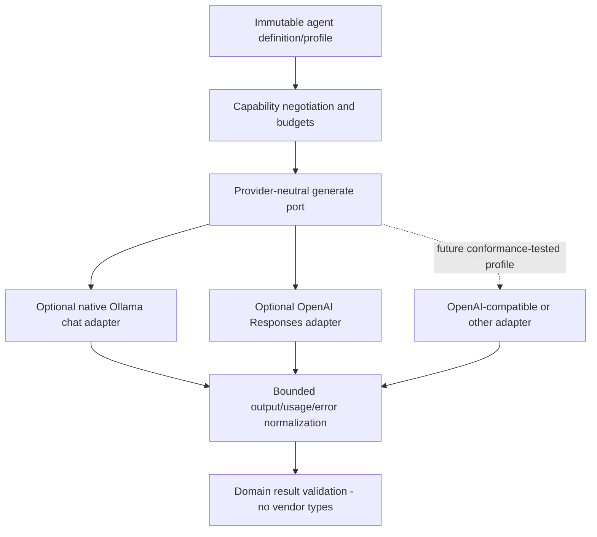

# Optional provider abstraction and adapter plan

**T12 acceptance (2026-10-24): ACCEPTED WITH LIMITATIONS for local development only.** See [the acceptance report](acceptance.md) for 173 backend, 89 isolated PostgreSQL and 51 city tests, both builds, browser smoke and live installed Ollama text/calculator evidence. Live OpenAI was NOT RUN. External production exposure remains BLOCKED without production identity/access controls. Earlier task checkpoints below are historical evidence.

T09 update: [LLM strategy and native tool mappings](llm-agent.md) are implemented. The following T01 design/earlier checkpoints remain provenance; current limits, provider continuation and live limitations are documented in that guide.

T07 implementation checkpoint: [OpenAI Responses adapter](openai-adapter.md) implements the planned foreground text port. The following T01 design remains historical; actual consent uses the existing RUNTIME_LLM_ENABLED reviewed catalog plus LLM_ALLOW_PAID, not a new OPENAI_ENABLED alias. LLM Agent Strategy and tools remain planned.

**T06 checkpoint:** [Ollama adapter](ollama-adapter.md) now supplies native nonstreaming text generation and a pinned/limited HTTP transport, with deterministic fixtures and an actual opt-in local model probe. Earlier empty-registry/no-adapter statements below are historical. No LLM Agent Strategy or Task execution integration is added; that remains T09.

**T05 checkpoint:** [Provider foundation](provider-foundation.md) implements validated contracts, exact profile selection, isolated configuration, empty provider registry and guarded timeout/output boundaries. Historical statements below about those foundations being unimplemented are preserved snapshots. Concrete adapters, LLM strategy and network inference remain planned.

T02 now supplies [inert provider/profile/capability contracts](runtime-contracts.md). No adapter, credential resolver, HTTP transport, provider configuration or generation operation is implemented. The protocol examples below remain T01 plans; JSON/schema output execution is deferred beyond the current text-only request contract.

Status: **PLANNED**, checked against official documentation on 2026-10-21. No adapter, SDK, credentials, model download, network probe of local Ollama or paid generation is added by T01. Actual installed providers/models/account access are **UNKNOWN**. Source links establish protocol features, not that this workspace implements them.

## Common port and capability negotiation



Conceptual TypeScript contracts; T02 defines validated shapes, T05 implements configuration/registry, T06/T07 supply adapters:

```typescript
interface LlmProvider {
  readonly id: string;
  capabilities(profile: ResolvedProviderProfile): ProviderCapabilities;
  generate(request: LlmGenerateRequest,
    context: LlmExecutionContext): Promise<LlmGenerateResult>;
}
interface LlmGenerateRequest {
  messages: readonly LlmMessage[]; // closed role/content/tool-result union
  maxOutputTokens: number;
  output: { kind: 'text' } | { kind: 'json'; schemaId: string };
  tools?: readonly AuthorizedToolDescription[];
}
interface LlmExecutionContext {
  executionId: string;
  correlationId: string;
  profile: ResolvedProviderProfile; // nonsecret ID/version/model; server-resolved
  deadlineAt: string;
  signal: AbortSignal;
}
```

Provider-specific request/response classes remain inside adapters. A resolved profile is not taken from Task input and does not contain an API key. Adapter-only credential/endpoint configuration is injected separately. Successful port output is a discriminated union: final bounded text/validated JSON, or bounded tool proposals `{callId, toolId, arguments}` with normalized optional usage and finish reason. Error output is a typed exception/result with a fixed RuntimeError category and safe diagnostics, never a vendor error body. For text-only definitions any tool proposal is rejected. Empty/refused/incomplete/malformed output is classified, not accepted as SUCCEEDED by string coercion.

| Capability | Common guarantee / unsupported representation |
| --- | --- |
| Text generation | Required for an enabled LLM profile; no guarantee of factual accuracy |
| Local transport abort | Adapter must accept signal and deadline; remote work termination is separately `unknown` / documented-best-effort |
| Structured output | `none`, `json`, or `schema`; constrained schema subset registered server-side. Requesting unsupported mode returns UNSUPPORTED_CAPABILITY before dispatch. Always validate output independently. |
| Function tool proposals | Boolean per **configured model/profile**, not provider brand alone. Initial adapters expose false until conformance tests pass. No built-in hosted tools. |
| Streaming | False in first common implementation. Provider HTTP `stream:false` is distinct from future frontend event streaming. |
| Token usage | Optional input/output/total and selected reasoning-token count when supplied; missing is null |
| Remote cancellation/status lookup | Not guaranteed. Native adapter transport abort is not an external orchestrator contract. |

Provider selection is exact profile ID and version in the definition snapshot, not a mutable global default per request. Multiple profiles may exist, but there is no automatic model/provider switch, paid fallback, automatic model pull or capability emulation through unbounded prompt loops. A requested tool/schema feature must pass the profile capability intersection before any spend. OpenAI-compatible endpoints become a distinct adapter/profile with conformance tests, explicit endpoint/credential policy and declared supported API dialect; an arbitrary `/v1` URL does not establish Responses compatibility.

## Configuration and credentials

Illustrative future settings only; **not accepted by the current configuration implementation or added to .env.example in T01**:

```dotenv
RUNTIME_ENABLED=false
RUNTIME_LLM_ENABLED=false
# Server-owned definitions bind existing owner/agent/route UUIDs to a profile.
LLM_ENABLED_PROFILES=local-small
OLLAMA_BASE_URL=http://127.0.0.1:11434
OLLAMA_MODEL=qwen3:0.6b
LLM_MAX_OUTPUT_TOKENS=512
LLM_REQUEST_TIMEOUT_MS=60000
# Explicit optional paid profile, off by default:
OPENAI_ENABLED=false
# OPENAI_MODEL=<operator-approved-model-id>
# OPENAI_API_KEY=<secret from process environment or ignored API .env>
```

Do not combine a global `LLM_PROVIDER` default with per-agent profile bindings that can disagree. Configuration validators build one catalog from explicitly enabled profiles, each with provider, model, profileVersion and model capabilities. Disabled profiles need no key/model; enabled profiles require all fields. Process > `apps/api/.env` > defaults remains; root .env remains Compose-only. Validate numeric budgets, maximum profile/catalog sizes and nonempty model IDs. A model identifier is an approved exact opaque string, never parsed as an endpoint or shell command. Fail enabling an unimplemented adapter.

Secrets stay in the adapter closure/DI credentials provider; only opaque credential references may enter server-side profile metadata, never raw keys. No keys in Agent configuration, snapshots, Task input, result, audit/log payloads, CLI arguments or frontend variables. OpenAI uses an explicit operator-provided environment key. Future secret-manager support can replace that source without changing the domain. Failures log field names/categories only; do not log environment values. Runtime/LLM/paid gates are distinct: enabling the deterministic runtime grants no cloud access.

Endpoint policy: native Ollama permits only an operator-approved local endpoint/origin (including explicitly reviewed container destinations). Reject URL credentials, query/hash, unexpected path/port/scheme, task/model-provided URLs, redirects and DNS rebinding to unapproved addresses. Resolve and bind requests to the approved destination using a controlled HTTP transport; revalidate every connection/fail closed on address changes. An allowlisted host name plus unchecked redirects/default DNS lookup is insufficient SSRF protection. Local HTTP is an explicit trusted-network exception, not a generic private-network allowlist. OpenAI initial endpoint is fixed `https://api.openai.com/v1/responses`; no arbitrary cloud base URL override. Production TLS verification stays on. HTTP proxy environment behavior must be explicit and tested before enabling any profile.

## Ollama adapter

Use the native chat API with nonstreaming text responses for the initial adapter. Ollama documents `POST /api/chat`, message roles, optional tools/format/options and `stream` defaulting true, so the adapter must explicitly send false. Do not assume the model supports tools or schema constraints merely because the API accepts those fields. [Official chat API](https://docs.ollama.com/api/chat).

Map a positive bounded output cap to `options.num_predict` and context cap to `options.num_ctx`; never use an unlimited sentinel. The Modelfile reference documents num_predict as the prediction limit; context and generated bytes still require local bounds. [Ollama parameter reference](https://docs.ollama.com/modelfile), [context options](https://docs.ollama.com/faq).

The model tag **`qwen3:0.6b` is verified to exist** in the official library. It is an illustrative small local test candidate, not a quality, capacity, installed-model or RAM guarantee. Capture actual model digest/version during opt-in verification so a mutable tag cannot silently change a run's recorded identity. Do not substitute embedding models with similar names. [Verified model page](https://ollama.com/library/qwen3:0.6b).

First request: one controlled system/developer-equivalent prompt plus instruction/context as untrusted user content; no tool list, no images, no thinking traces in results. Explicitly negotiate model-specific thinking settings rather than hardcoding a universal boolean. Accept only expected role/content/final completion shapes and bounded response sizes; consume the entire body within the deadline. Loading time is part of the deadline. Missing model, connection refusal, server busy/OOM and malformed output map to safe categories. Abort the request on signal; remote stop/reclaimed GPU memory are not guaranteed and must not be inferred from a local rejected promise.

### Connectivity matrix

| API execution location | Ollama location | Planned address / condition |
| --- | --- | --- |
| Host (current API) | Same host | `http://127.0.0.1:11434`, loopback only; preferred first setup |
| API container (not present today) | Host on Docker Desktop | Explicit `http://host.docker.internal:11434`; host service must be reachable on an appropriately restricted interface, with firewall review |
| API container | Ollama container on same private network | Service DNS such as `http://ollama:11434`; no public model-server port needed |
| Host API | Ollama container | Publish only the intended host loopback port and configure that origin explicitly |
| Linux Docker engine | Host Ollama | Do not assume Desktop's name exists; explicitly configure/review a host-gateway route or use a private container network |

Inside a container `localhost` is that container. Docker Desktop documents `host.docker.internal` for host services. An address alone does not make a loopback-bound host service reachable or secure. No Docker/Compose change is proposed until a slice actually needs containerized Ollama/API. [Docker host-networking guidance](https://docs.docker.com/desktop/features/networking/networking-how-tos/).

### Minimal optional live verification (future T06, not run in T01)

1. Operator installs/starts Ollama separately and explicitly obtains an approved model; the application never downloads it automatically.
2. From the same network namespace as the future API/CLI, bounded `GET /api/tags` must list the exact configured model and digest. Treat absent model as MODEL_UNAVAILABLE. The endpoint is documented for installed model metadata. [Ollama model listing](https://docs.ollama.com/api/tags).
3. Run a bounded direct adapter text probe using nonsensitive data, one generation, no tools, small positive output/context limits, with provider text excluded from logs. Check warm/cold timeout and cancellation behavior; record server/model/hardware versions and latency. Do not claim a minimum GPU/RAM without measuring the intended host.
4. Register/activate a real logical LLM Agent using existing APIs, provision its reviewed server binding/native route, create a Task, explicitly invoke runtime, and verify COMPLETED/SUCCEEDED, one bounded result and committed ordered audit facts after a new application instance.
5. Disable/remove the profile and verify deterministic agents/health/city still work. Live suite stays opt-in; failures are reported separately from deterministic CI and cannot trigger paid fallback.

## Optional OpenAI adapter

Plan a direct foreground Responses API adapter using bounded Node HTTP/fetch, so no SDK is required for the first minimal implementation. If the official SDK is later justified, wrap it entirely behind this port and explicitly disable automatic retries. Keep the model operator-configured and validate access at live verification; no default paid model or current pricing assumption is frozen into the Agent domain. Responses is documented for text generation; vendor output arrays must be parsed deliberately, not assumed to contain one plain string. [Official OpenAI text generation guide](https://developers.openai.com/api/docs/guides/text).

Map approved messages and a positive `max_output_tokens` cap; reasoning tokens may consume that cap, so output may be incomplete even when visible text is short. Reject unexpected incomplete/refusal/tool-only output in text-only mode; normalize usage when supplied. Never persist internal reasoning text. Token usage can be absent after an interrupted request. [Official reasoning/output-budget guidance](https://developers.openai.com/api/docs/guides/reasoning).

Set `store:false`, no background mode, no hosted tools/files/vector stores/MCP, no previous-response/conversation identifiers sourced from clients, and no automatic retries/fallback. Storage control is **not** a universal zero-retention guarantee; account abuse-monitoring/caching/other data policies must be reviewed before sending any approved data. [Official OpenAI data controls](https://developers.openai.com/api/docs/guides/your-data).

Use AbortSignal plus absolute deadline/body ceiling. The OpenAI background guide distinguishes cancellation of background responses from terminating a synchronous connection. This design uses foreground calls and does not promise a durable remote cancel operation or immediate cessation of billing/work. Background response polling/cancel is a different capability requiring its own retention/reconciliation design, deferred here. [Official cancellation limitations](https://developers.openai.com/api/docs/guides/background).

Before the first paid call, require explicit OPENAI_ENABLED, runtime LLM permission, approved agent/profile/model, request/token/total-execution caps and operator acceptance of the account/data/spend policy. Max request count/tokens and account/project spending controls limit exposure; local estimates are not an exact invoice or a guaranteed dollar ceiling. Unknown cost must stay unknown. Unit/CI uses an HTTP fixture server with test-only credentials, never a real OpenAI key. Optional paid live verification is a separate manually selected operation and is not required for local or CI acceptance.

## Controlled tool round evolution

T06/T07 text mode has zero tools. T09 may offer only the authorized intersection of compiled tools, definition grants, operator scope and provider/model support. A response is either final output or a bounded proposal batch; ToolExecutionService validates and executes proposals, and the strategy supplies sanitized tool results in a next round. Total rounds ≤3, tool calls ≤2, one call at a time, immutable deadline/token budget, no recursive agent dispatch or parallel calls. Exceeding a limit fails safely rather than generating indefinitely.

Adapters retain any provider-specific continuation items needed for that bounded conversation in execution-scoped memory behind an opaque internal session handle. Never drop required protocol items blindly, expose them to domain services, persist raw reasoning/prompts, use an arbitrary client response ID, or mix sessions between agents. Dispose the handle/buffer on completion/abort. Capability tests must establish this behavior before enabling tools on a model; otherwise text-only remains available and tools return UNSUPPORTED_CAPABILITY.

## Required deterministic adapter tests

Use owned localhost HTTP fixture servers, not a production mock provider registered at startup. Cover request mapping and secret header isolation; explicit nonstreaming mode; missing/invalid model/profile; 401/403/404/429/5xx; malformed JSON/roles/tool calls; refusal/incomplete output; oversize body and slow headers/body; abort before dispatch/during read; unknown usage; disabled retries; no follow-redirect SSRF; DNS/proxy policy; token/context ceilings; no key/text in logs/audit; unsupported capability rejection before network. Test all provider/domain boundaries without a paid account. Live server/model availability and resource behavior remain separate opt-in evidence.
