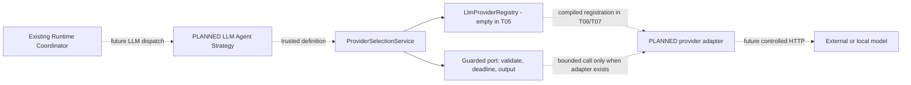

# Phase 2 T05 - Provider abstraction and configuration

**T12 acceptance (2026-10-24): ACCEPTED WITH LIMITATIONS for local development only.** See [the acceptance report](acceptance.md) for 173 backend, 89 isolated PostgreSQL and 51 city tests, both builds, browser smoke and live installed Ollama text/calculator evidence. Live OpenAI was NOT RUN. External production exposure remains BLOCKED without production identity/access controls. Earlier task checkpoints below are historical evidence.

T09 update: [structured tool integration](llm-agent.md) extends the existing neutral ports with compiled schemas, assistant proposals, correlated tool results and Execution-bound opaque continuation. No registry, endpoint policy or credential source was replaced.

T07 update: the [OpenAI adapter](openai-adapter.md) is implemented alongside Ollama with no startup network calls or paid fallback. The runtime catalog now has 22 codes, adding nontransient PROVIDER_QUOTA_EXCEEDED. The T05 verification counts below remain historical.

**T06 checkpoint:** [Ollama adapter](ollama-adapter.md) now supplies native nonstreaming text generation and a pinned/limited HTTP transport, with deterministic fixtures and an actual opt-in local model probe. Earlier empty-registry/no-adapter statements below are historical. No LLM Agent Strategy or Task execution integration is added; that remains T09.

Status: **IMPLEMENTED and verified for local development**, 2026-10-22 (Asia/Bangkok). Provider-neutral validation, empty DI registry, exact profile selection, guarded generation port, isolated credential configuration and bounded request lifetime are implemented. **No concrete provider adapter, HTTP client, LLM strategy or inference is implemented.**

## Repository findings and decisions

Retains `apps/api`, NestJS 11/strict TypeScript, Drizzle/pg/PostgreSQL, npm workspaces and Node 24. The [T01 provider plan](provider-abstraction.md), [T02 contracts](runtime-contracts.md), [T03 coordinator](runtime-coordinator.md), [T04 rule-based runtime](rule-based-runtime.md), Agent DTO, Task/Execution schema, lifecycle/events, configuration, tests and existing CI were inspected. No applicable AGENTS.md or Git metadata exists. A fresh SHA-256 baseline preserves unrelated work; no clean-tree/commit claim is made.

T02 already defines LlmProvider, messages, requests, results, context, capabilities and TokenUsage. T05 extends those contracts rather than replacing them. Agent configuration remains category/color metadata. Trusted runtime bindings retain the native agent/route and frozen definition. The coordinator still refuses LLM execution; no new status writer, Task API, runtime route, strategy or automatic provider call is added.

The approved T01 architecture chooses an **exact profile ID/version**, not a mutable application default. T05 therefore deliberately does not implement a global provider/model fallback or permit Agent Registry JSON/Task input to select providers. The catalog maps profiles to explicitly injected adapters. All enabled profiles must resolve at application initialization; T05 ships zero adapters, so enabling a profile fails clearly with PROVIDER_UNAVAILABLE before execution.

## Components and DI



RuntimeModule binds existing LLM_PROVIDERS to an empty frozen array and provides/exports LlmProviderRegistry and ProviderSelectionService. No extra global module, dependency, worker, startup generation or eager provider connection is introduced. Explicit registration validates IDs/methods, rejects duplicates and binds/freezes adapter methods. No dynamic module loading or class-name evaluation exists. The registry's raw port is trusted adapter infrastructure; consumers use the **selected guarded port** to enforce request/context/output limits. Test fakes exist only in tests.

## Contracts and limits

| Contract | Implemented behavior |
| --- | --- |
| ProviderCapabilities / LlmProviderCapabilities | Required text and transport-abort support; remote cancellation unknown/best_effort, structured output none/json/schema, toolCalls boolean, streaming false. Optional tokenUsage none/optional; absent remains the compatible unknown/optional reporting contract, not a guarantee counts will exist. |
| ResolvedProviderProfile | Nonsecret ID, positive profileVersion, exact model, capabilities, optional bindingDigest at type level; digest is **required by selection** for enabled profiles. No URL/key/credential source in the context profile. |
| LlmGenerateRequest | Messages, bounded maxOutputTokens, output kind text, optional empty tools only. Model comes exclusively from context.profile, never message content or a second request-level override. |
| Messages | 1-8 closed system/user/assistant messages; nonempty content, at most 16,000 UTF-16 units each, at most 16 KiB aggregate content UTF-8, at most 32 KiB serialized request. Existing unsafe-control/credential-pattern checks apply. No provider-specific fields, prompt metadata or unbounded history. |
| LlmRequestContext | UUID execution/correlation identity, nonsecret profile, canonical UTC millisecond deadline and native AbortSignal. Signal is non-enumerable in validated contexts; private raw abort reasons are not serialized. |
| LlmGenerateResult | Closed kind text + nonempty bounded text, optional usage; at most 32 KiB for the full serialized result. Tools/structured output/streaming remain unavailable. Invalid output maps to INVALID_PROVIDER_OUTPUT, oversized output to OUTPUT_LIMIT_EXCEEDED. |
| TokenUsage / LlmUsageMetadata | Optional input/output/total counts; explicit null means unknown. Counts are integers 0-1,000,000,000; when all are known the sum must match. Never infer missing counts or pricing. |

Runtime validators reject unknown fields, custom prototypes, hidden/accessor properties and malformed arrays without invoking getters. Validated copies are frozen. Existing tool-message/proposal types remain reserved for later tasks; runtime validation does not authorize them in T05. The only additive profile fields are optional tokenUsage capability and bindingDigest; existing T02 construction and deterministic execution remain compatible. Previously unpinned LLM descriptors cannot be selected, and are not rewritten. No LLM strategy previously executed them.

Capabilities are per configured **model/profile** and constrained by the adapter's declaration; provider brand is not capability evidence. Selection checks structured-output rank, tool capability, declared best-effort remote cancellation and explicit no-usage reporting. A more capable adapter does not upgrade a profile's permission. These declarations do not implement JSON/schema generation, tool calling, streaming or factual correctness. Even if declared, those request modes reject in T05.

## Configuration reference

Existing precedence: process environment > ignored `apps/api/.env` > defaults. Root `.env` remains Compose configuration. Enabling model configuration requires the existing local runtime, DB and owner-scoped registry opt-ins; their dev/test and literal-loopback restrictions still apply.

| Variable | Validation/default |
| --- | --- |
| RUNTIME_LLM_ENABLED | false/absent by default; exact true/false only. true requires RUNTIME_ENABLED and the local runtime prerequisites. |
| LLM_PROFILES | Required when enabled: JSON array of 1-16 profiles, at most 32 KiB, unique profile IDs, closed schema below. Omit when disabled. |
| LLM_REQUEST_TIMEOUT_MS | Integer 1-120000, default 60000 when enabled. No scientific notation, zero or unlimited sentinel. |
| LLM_MAX_OUTPUT_TOKENS | Integer 1-4096, default 512 when enabled. |
| LLM_ALLOW_PAID | Exact true/false, default false. Every public-network profile requires true plus an explicit credential reference; no paid fallback. |
| `<NAME>_API_KEY` | Only read if named by an enabled profile's credentialEnv. Name must match the restricted uppercase *_API_KEY pattern; value 8-4096 printable non-whitespace ASCII characters. No unused OpenAI key is required. |

Disabled configuration rejects stale catalog/budget/paid settings rather than partially enabling them. Ambiguous aliases LLM_PROVIDER, LLM_MODEL, LLM_DEFAULT_PROVIDER, LLM_ENABLED_PROFILES, OLLAMA_BASE_URL, OLLAMA_MODEL, OPENAI_MODEL and OPENAI_ENABLED reject: use the exact catalog instead. Unused OPENAI_API_KEY is ignored, not copied into application configuration. Validation failures report field names only, never JSON/URL/key values.

Illustrative catalog entry (not an installed provider or verified model):

```json
{
  "id": "local.small",
  "profileVersion": 1,
  "providerId": "ollama",
  "model": "operator-approved-model",
  "capabilities": {
    "text": true, "transportAbort": true, "remoteCancellation": "unknown",
    "structuredOutput": "none", "toolCalls": false, "streaming": false,
    "tokenUsage": "optional"
  },
  "endpoint": {
    "origin": "http://127.0.0.1:11434",
    "network": "local",
    "allowedAddresses": ["127.0.0.1"]
  }
}
```

Each profile requires ID/providerId matching lowercase token syntax (1-64 characters), profileVersion 1-2147483647, explicit model (1-128 allowed identifier characters, no credentials or :// URL), capabilities and endpoint policy. Optional credentialEnv is a nonsecret reference such as OPENAI_API_KEY; credentials never appear in this JSON. No models are probed, downloaded, substituted or presumed installed. A valid identifier does not establish server/model/account availability.

Endpoint origin must be canonical HTTP(S), no credentials/query/hash/non-root path/wildcards/trailing-dot host, at most 512 characters. It grants only that exact origin and 1-16 approved literal addresses. Local profiles permit loopback/RFC1918/IPv6 ULA destinations; public profiles require HTTPS and addresses outside rejected local, link-local/metadata, unspecified, multicast, reserved/documentation and mapped/NAT64 ranges. Literal origin addresses must match approved destinations. This is operator-reviewed destination configuration, **not a user-defined HTTP tool**.

## Selection and profile pinning

1. Future trusted LLM strategy passes the validated frozen Agent definition to ProviderSelectionService.select. The service is not an HTTP authorization substitute; Task/owner/Agent admission remains the coordinator's responsibility.
2. Definition must be LLM, with the exact profile ID/version/model/capabilities and bindingDigest approved by the enabled catalog. Missing selection fails; there is no application default.
3. Registry must contain the explicitly registered providerId. No adapter installation/import, second provider or fallback occurs automatically.
4. Adapter capability declaration must support the approved profile. Startup validates all configured adapters' declarations without calling generate or making a model availability probe.
5. The returned guarded port checks context/profile equality and validates messages/tokens **before adapter invocation**, then applies the earlier execution/request deadline, normalizes errors and validates bounded output/usage afterward. Effective timeout/output cap is the minimum of global configuration and the captured definition's provider budget.

`providerSettingsDigest(settings)` hashes a canonical nonsecret descriptor: profile ID/version, adapter ID, model/capabilities, endpoint policy with sorted approved addresses and credential environment reference. Selection recomputes it. A catalog alias cannot silently switch adapter/endpoint while retaining the captured profile identity. Secret values are excluded so approved credential rotation need not change the digest. Operators must review/version descriptor changes and create new approved bindings; never edit immutable historical attempts. Old LLM definitions missing the digest fail closed, while rule-based definitions require none. No schema/migration is needed for this additive JSON descriptor.

Use the exported helper when building a trusted definition; the profile snapshot contains id/profileVersion/model/capabilities/bindingDigest, not provider endpoint or credentials. T06 should provide a reviewed local setup procedure after a real adapter exists. No arbitrary Task-level model override or provider-selection field is accepted.

## Timeout, cancellation, usage and errors

`withProviderDeadline(context, timeoutMs, operation)` validates identity/profile/signal/deadline, creates one scoped child signal, caps deadline to the earlier parent deadline or request timeout, rejects pre-cancelled/expired work without invocation, races bounded work against abort, consumes late rejections and removes timer/listeners in finally. It preserves trusted parent DEADLINE_EXCEEDED as timeout while sanitizing arbitrary abort reasons to CANCELLED. It never extends the execution deadline or changes database lifecycle state.

A timed-out wait is not proof a remote request stopped. Adapters must actually observe the signal during connection/body reads; arbitrary blocking JS cannot be preempted. The coordinator remains authoritative for persisted cancellation, terminal fencing and reconciliation. No retry, polling worker or distributed cancellation service is added.

Usage metadata is optional. Provider/model identity comes from the selected profile; duration can use the existing safe logger's bounded durationMs metric. Do not copy prompts/headers/vendor responses into usage, results or audit. No invented tokens, billing costs or pricing lookup is implemented. Future adapters must normalize vendor usage rather than returning SDK objects.

The RuntimeError catalog is reused without a new hierarchy (21 codes at T05; T07 adds PROVIDER_QUOTA_EXCEEDED):

| Adapter classification | Runtime code |
| --- | --- |
| not registered / unavailable | PROVIDER_UNAVAILABLE |
| invalid profile/configuration | CONFIGURATION_ERROR |
| missing model | MODEL_UNAVAILABLE |
| unsupported mode/capability | UNSUPPORTED_CAPABILITY |
| timeout / cancellation | DEADLINE_EXCEEDED / CANCELLED |
| malformed response / output limit | INVALID_PROVIDER_OUTPUT / OUTPUT_LIMIT_EXCEEDED |
| rate limit / authentication | PROVIDER_RATE_LIMITED / PROVIDER_AUTH_FAILED |
| unknown error | INTERNAL_RUNTIME_ERROR |

Future adapters classify verified protocol facts, not error-message text. Unknown exceptions are replaced with fixed errors; public serialization excludes stack/cause/raw body/credentials. Trusted diagnostic context is bounded stage/category plus existing execution/correlation IDs; no unrestricted vendor diagnostic object is preserved. providerFailureAdvice marks potentially transient categories and uncertain cancellation/timeouts, but always automaticRetry=false.

## Credential and transport boundaries

Configured credentials are held by ProviderCredentials in private fields with a non-enumerable configuration reference and safe JSON/inspection views. Only future adapter infrastructure should read its get(profileId) seam. Profile/strategy/context/request/result/audit interfaces contain no secrets. This prevents accidental serialization; it is not process isolation against trusted code with config/database access. Configuration references and destination policies remain server-side. Never log the whole environment or use Task input as a provider message/config builder without its prescribed validation.

**URL/IP validation alone does not eliminate SSRF.** T05 performs no DNS lookup or HTTP operation. T06/T07 must implement and test connection-time approved-address pinning, rebinding checks, redirect rejection, explicit proxy/environment handling, TLS validation and response header/body limits within the same deadline, before the first provider request is enabled. The guarded domain port cannot enforce transport properties on a malicious/nonconforming adapter. This intentionally narrows T01's proposed T05 HTTP-fixture scope: actual transport and protocol fixtures belong with adapters, since this task explicitly excludes concrete HTTP adapters/requests. No generic unrestricted transport is introduced to simulate readiness.

Docker networking: current API runs on host; same-host Ollama may use reviewed loopback. Inside a container localhost points to that container. Docker Desktop host.docker.internal or an Ollama service DNS name must be explicitly reviewed with its actual private IP allowlist; Linux host routing differs. No API/Ollama container, Compose service, model download or network probe is added. Pin changes require new reviewed settings/digest; public DNS rotation is not an excuse to drop address validation.

## T06/T07 handoff

- T06: implement one compiled Ollama adapter, inject it explicitly via LLM_PROVIDERS, use validated private settings/credentials, enforce transport/body/cancellation limits above, map bounded text requests/results/usage/errors and test against owned HTTP fixtures. Add the approved minimum LLM text strategy/CLI binding procedure only within T06 scope. Then perform opt-in local model verification; no paid fallback.
- T07: [implemented optional OpenAI adapter](openai-adapter.md) with separately approved fixed endpoint/protocol, credentials, paid/data consent and the same conformance tests. Provider-neutral code contains no vendor SDK types, protocol paths, default paid model or SDK retry behavior. Other compatible APIs require their own explicit adapter/profile and conformance tests, not an arbitrary user URL.
- T08/T09: tools remain denied until schema/policy/authorization/round limits and model compatibility are implemented. JSON/schema/streaming claims do not enable those modes here.

## Verification and file inventory

Executed on the final frozen source: `npm.cmd run verify:phase1` **PASS**, exit 0. This existing command includes the new provider tests through the backend glob and owned PostgreSQL harness.

| Check | Result |
| --- | --- |
| `npm run lint` | City static checks and strict API typecheck PASS; no new ESLint framework installed |
| `npm run build` | NestJS/TypeScript PASS |
| `npm run build:web` | Disposable Vite production bundle PASS; maintained city source untouched |
| `npm run db:check` | Migration journal/schema check PASS |
| `npm test` | 51/51 city tests PASS |
| `npm run test:api` | 89/89 backend tests PASS, including 13 provider groups; no skips/failures |
| `npm run test:db` | 69/69 real PostgreSQL tests PASS; no skips/failures |
| `npm run test:browser` | Chrome smoke PASS, zero exceptions |
| `node --test apps/api/test/providers.test.cjs` after build | 13/13 focused provider groups PASS |

The final PostgreSQL run includes fresh/repeated/populated-upgrade migrations, prior Phase 1 API/lifecycle/audit/race/rollback checks, the real deterministic root npm command/result/restart history and unavailable-provider startup. No provider HTTP service or live account is required. Chrome checked Canvas/environment/clock/agents/decorative citizens without API, camera zoom/focus/recenter, help/developer panels, simulated mission start/pause/resume/reset and mobile reload/viewport. This is smoke coverage, not visual-diff, FPS, exhaustive gestures or long-duration acceptance. Hosted CI and production deployment were not executed.

SHA-256 checks confirm **51 city source files and 9 migration SQL/metadata files unchanged**. Existing files outside the enumerated implementation/documentation edits are preserved. Phase 2 documentation local links resolve and Markdown fences balance; Mermaid is source-reviewed, not rendered. No Git metadata exists, so no Git clean-tree claim is made.

Development tests caught Node BlockList mixing mapped IPv6 and IPv4 checks, which initially rejected an approved public IPv4 destination. Address-family checks were separated; expanded mapped/NAT64/reserved-address regression cases pass. Strict compilation also caught missing callback parameter annotations. An in-progress full run observed newly edited tests against an earlier build; after freezing source, the complete verification command above passed without skipped or weakened assertions. Provider unit tests use injected fakes only. Real PostgreSQL regression includes the existing genuine deterministic Agent/CLI/result/audit/restart scenario with empty provider registry, plus a real app configured with an unavailable provider that fails initialization without any Task/Execution/event writes. No live model account, model install or LLM network call is needed.

Created: `src/runtime/contracts/provider-validation.ts`; `src/runtime/providers/{provider-configuration,provider-registry,provider-selection.service,provider-deadline,provider-errors}.ts`; `test/provider-fixtures.cjs`, `test/providers.test.cjs`, `test/providers.integration.cjs` (paths relative to apps/api); this guide.

Modified: existing provider/definition/result/common validators, central configuration, runtime DI/tokens, API example environment, test harness/DI/rule-regression assertions and documentation checkpoints. No dependency, schema, migration, deployment, CI or city-source changes. Exact modified inventory:

- `apps/api/.env.example`, `apps/api/src/config/configuration.ts`.
- `apps/api/src/runtime/runtime.module.ts`, `apps/api/src/runtime/tokens/runtime.tokens.ts`.
- `apps/api/src/runtime/contracts/{provider.contract,definition.contract,execution-result.contract,validation}.ts`.
- `apps/api/test/database.integration.cjs`, `apps/api/test/runtime-contracts.test.cjs`, `apps/api/test/text-statistics.integration.cjs`.
- Root `README.md`, `WORKSPACE.md`; `docs/ai-agent-platform/README.md`.
- `docs/ai-agent-platform/phase-2/{README,implementation-plan,provider-abstraction,runtime-contracts,runtime-architecture,rule-based-runtime}.md`.

Removed files: none. Package manifests/lockfile, database schema/migrations, coordinator/lifecycle persistence, frontend/hosting/assets, deployment and CI remain unchanged. Prior Phase 1 and Phase 2 design/implementation records are preserved with current checkpoint links.

Next: **Phase 2 T06 - Ollama Local LLM Adapter**. T06/T07 are not implemented by this task.
