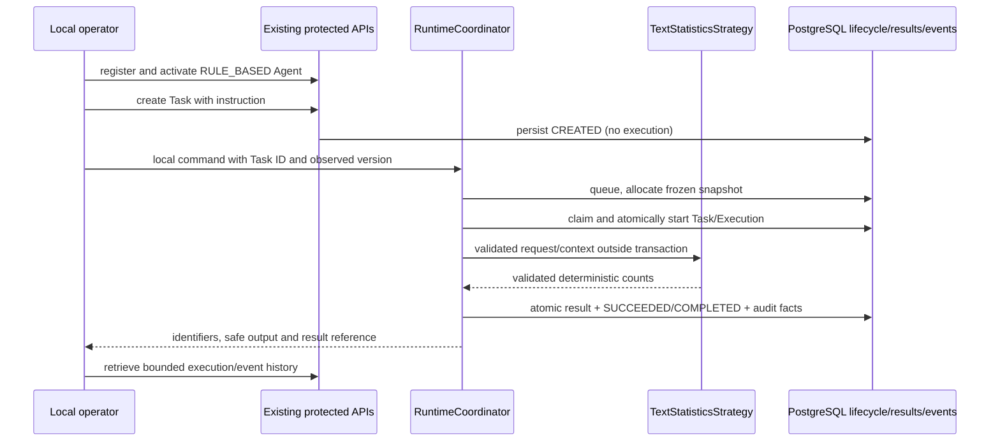

# Phase 2 T04 - Rule-based text statistics

**T12 acceptance (2026-10-24): ACCEPTED WITH LIMITATIONS for local development only.** See [the acceptance report](acceptance.md) for 173 backend, 89 isolated PostgreSQL and 51 city tests, both builds, browser smoke and live installed Ollama text/calculator evidence. Live OpenAI was NOT RUN. External production exposure remains BLOCKED without production identity/access controls. Earlier task checkpoints below are historical evidence.

**T06 checkpoint:** [Ollama adapter](ollama-adapter.md) now supplies native nonstreaming text generation and a pinned/limited HTTP transport, with deterministic fixtures and an actual opt-in local model probe. Earlier empty-registry/no-adapter statements below are historical. No LLM Agent Strategy or Task execution integration is added; that remains T09.

**T05 checkpoint:** [Provider foundation](provider-foundation.md) implements validated contracts, exact profile selection, isolated configuration, empty provider registry and guarded timeout/output boundaries. Historical statements below about those foundations being unimplemented are preserved snapshots. Concrete adapters, LLM strategy and network inference remain planned.

Status: **IMPLEMENTED and verified for local development**, 2026-10-22 (Asia/Bangkok). T04 adds one genuine compiled strategy and an explicitly invoked local command. No model/provider, tool, worker, runtime HTTP API or city integration is added.

## Repository findings and compatibility

The existing backend is `apps/api`, NestJS 11/strict TypeScript with Drizzle/pg and PostgreSQL. npm workspaces and Node 24 remain unchanged. The [Phase 1 acceptance](../phase-1-acceptance.md), [T01 plan](implementation-plan.md), [T02 contracts](runtime-contracts.md), [T03 coordinator](runtime-coordinator.md), Agent DTO/services, Task/Execution persistence, lifecycle/events, environment, tests and CI were inspected. No applicable AGENTS.md or Git metadata was found; a fresh SHA-256 baseline protects existing work.

The approved architecture already specifies `text.stats.v1`, Task input `{instruction, context?}`, and output `text.statistics.v1` with `codePointCount`, `wordCount`, `nonemptyLineCount`. Those established contracts take precedence over the illustrative `rule-based.text-analysis`, `{text}` and character/line field names in the task prompt. No incompatible aliases or migration are introduced. Nonempty-line count intentionally excludes blank lines rather than counting every physical line.

Agent Registry remains RULE_BASED with optional metadata `{category, color}`. Runtime selection belongs to the privileged `RUNTIME_BINDINGS` definition, not user-writable configuration, capabilities or Task input. Agents start DISABLED and must be explicitly activated; disabled/archived agents cannot be admitted. No automatic Agent/owner/orchestrator seed is added.

## Input, counting policy and output

```json
{"instruction":"Welcome to Elyqreth AI City"}
```

Only `instruction` and optional string `context` are permitted. Instruction must be nonempty after whitespace trimming, at most 16,000 UTF-16 code units; context has the same length cap, and the serialized combined Task input is limited to 32 KiB UTF-8. Existing control-character and common credential-pattern rejection applies. The strategy revalidates input using the same Task validator and closed-object runtime checks; prototypes, symbols, hidden fields and getters are rejected by the parser. Input is never silently truncated or logged. Context is validated and persisted as Task data but **excluded from analysis**.

The bounded algorithm:

1. Character metric: count Unicode code points in the original instruction, including all whitespace and line-break characters. Emoji outside the BMP count once; combining marks count separately. This is neither UTF-16 length nor grapheme-cluster count. CRLF therefore contributes two code points.
2. Words: count maximal runs of ECMAScript non-whitespace (`\S+`, Unicode mode). Punctuation remains attached; languages without whitespace are not linguistically segmented. No locale-sensitive NLP/tokenizer is used.
3. Lines: split CRLF as one boundary, also split bare CR, LF, U+2028 and U+2029. Count only segments with nonempty trimmed content. Leading/trailing/whitespace-only empty lines contribute zero. The string is not normalized or trimmed for character counting.

```json
{
  "schemaVersion": 1,
  "executionId": "<persisted-execution-uuid>",
  "output": {
    "type": "text.statistics.v1",
    "data": {"codePointCount": 27, "wordCount": 5, "nonemptyLineCount": 1}
  }
}
```

Output uses the T02 constructor: closed fields, finite nonnegative integers, word/line counts no greater than code-point count, captured output budget and 32 KiB platform cap. No input text, metadata, credentials, SDK objects or lifecycle status is included. The strategy is stateless and has no database/filesystem/network/tool dependencies, evaluation, shell or side effects. Complexity and allocation are bounded by the existing input limits.

## DI and coordinator integration

`TextStatisticsStrategy` implements the existing AgentStrategy contract. RuntimeModule registers it as a normal Nest provider and supplies the explicit `text.stats.v1` entry through RUNTIME_STRATEGIES. Registry duplicate/type/unknown checks remain intact. Merely importing/starting the app never executes it or requires an LLM. Runtime remains disabled by default.



The coordinator still owns admission, authorization, deadline/AbortSignal, lifecycle, token/version fencing and cleanup. It makes no new status writes, scheduling or automatic retries. The existing one-result-per-attempt store receives the validated result atomically with terminal state/events/audit/outbox. Existing protected history APIs omit raw input/results; local inspection can retrieve the bounded persisted result. No result HTTP route is added ahead of T11.

## Local workflow (PowerShell)

Use this repository root and Node 24. Set real local values in ignored root/API environment files using the [database guide](../database-foundation.md) and [registry guide](../agent-registry.md). Never commit credentials. Prerequisites: Docker Desktop running, configured `POSTGRES_PASSWORD`, DATABASE_URL and DATABASE_SSL_MODE, an **actual provisioned owner UUID and ENABLED native orchestrator UUID in that owner**. Use the documented administrative provisioning procedure; neither the command nor Agent Registry creates an orchestrator. Do not fabricate an arbitrary UUID as a database reference.

```powershell
npm.cmd ci
docker compose up -d postgres
npm.cmd run db:migrate
```

Initial API configuration: `NODE_ENV=development`, `API_HOST=127.0.0.1`, `API_PORT=3001`, DATABASE_URL/SSL settings, `AGENT_REGISTRY_ENABLED=true`, existing `AGENT_REGISTRY_OWNER_ID`, and a random `AGENT_REGISTRY_TOKEN` of at least 32 bytes. Keep `RUNTIME_ENABLED=false` and omit RUNTIME_BINDINGS until binding the actual registered Agent. Existing precedence remains process environment > `apps/api/.env` > defaults. Do not print/copy credentials into Agent JSON. The following session assumes `$env:AGENT_REGISTRY_TOKEN` holds that configured credential and `$nativeOrchestratorId` holds the real native route ID.

In a separate configured terminal start the API:

```powershell
npm.cmd run dev:api
```

Register/activate an Agent via the protected API:

```powershell
$headers = @{Authorization = "Bearer $env:AGENT_REGISTRY_TOKEN"}
$base = 'http://127.0.0.1:3001/api/v1'
$body = @{name='Text Statistics'; type='RULE_BASED'; orchestratorId=$nativeOrchestratorId; configuration=@{category='general'}} | ConvertTo-Json -Depth 8
$agent = Invoke-RestMethod "$base/agents" -Method Post -Headers $headers -ContentType application/json -Body $body
$versionHeaders = $headers.Clone()
$versionHeaders['If-Match'] = '"' + $agent.version + '"'
$agent = Invoke-RestMethod "$base/agents/$($agent.id)/activate" -Method Post -Headers $versionHeaders -ContentType application/json -Body '{}'
```

Configure runtime in the **command terminal**, with the same local DB/registry settings. No secret belongs in this binding:

```powershell
$definition = @{
  schemaVersion=1; definitionId='local.text-stats'; definitionVersion=1
  agentType='RULE_BASED'; strategyType='RULE_BASED'; strategyId='text.stats.v1'; outputType='text.statistics.v1'
  toolCapabilities=@()
  budget=@{executionTimeoutMs=120000; providerTimeoutMs=0; toolTimeoutMs=0; maxOutputTokens=0; maxProviderRounds=0; maxToolCalls=0; maxResultBytes=32768}
}
$env:RUNTIME_ENABLED='true'
$binding = @{agentId=$agent.id; orchestratorId=$agent.orchestratorId; definition=$definition}
$env:RUNTIME_BINDINGS = ConvertTo-Json -InputObject @($binding) -Depth 12 -Compress
```

These process environment settings apply to the command, not an already running API. The API may remain runtime-disabled and still serve registration/task/history. To enable runtime in a different process configure its own validated environment explicitly. Production rejects enablement.

Create the Task (no automatic execution), then run the command:

```powershell
$taskBody = @{agentId=$agent.id; input=@{instruction='Welcome to Elyqreth AI City'}} | ConvertTo-Json -Depth 6
$task = Invoke-RestMethod "$base/tasks" -Method Post -Headers $headers -ContentType application/json -Body $taskBody
npm.cmd run runtime:execute -- --task-id $task.id --task-version $task.version
npm.cmd run runtime:execute -- --inspect --task-id $task.id
Invoke-RestMethod "$base/tasks/$($task.id)" -Headers $headers
Invoke-RestMethod "$base/tasks/$($task.id)/executions?limit=20" -Headers $headers
Invoke-RestMethod "$base/tasks/$($task.id)/events?limit=20" -Headers $headers
```

The root npm command delegates to the existing API workspace, builds it and invokes a minimal command module. It opens a Nest **application context with no HTTP listener**, resolves the existing Task and owner/agent binding, queues through the coordinator, then executes using the newly observed queue version. Unknown flags/IDs/versions reject. Execute requires the caller's observed Task version; stale/repeated terminal execution is rejected rather than silently rerun. Inspection uses current owner scope and configured agent/route allowlist, returns the latest attempt/result only and revalidates its persisted result against the immutable definition. Inspection does not execute or alter history.

Expected output: kind `finished`, Task COMPLETED, Execution SUCCEEDED, counts above and a `result:<uuid>` reference. Inspection reports the same persisted result after restart. Result/reference is stored on the Execution/result table, not an invented Task result field. Failed/unresolved command returns nonzero exit; errors use fixed runtime messages without stacks, SQL or credentials. Ctrl+C/SIGTERM requests cooperative cancellation and the application context is closed. The command never creates an Agent or silently retries a Task.

## Security, cancellation and limitations

- Local invocation is trusted operator functionality, not full person authentication or tenant RBAC. It checks validated runtime/registry/DB opt-ins, dev/test, literal loopback and scoped binding. Production remains closed; registry API tokens are not provider/tool spending authorization.
- Task data cannot pick a strategy or grant capabilities. RULE_BASED binding, ACTIVE Agent, native ENABLED route and existing claim/quarantine checks remain required. Unknown/unsupported configuration rejects before dispatch.
- The strategy checks cancellation/deadline before and after its bounded synchronous calculation and rejects mismatched request/context identity. AbortSignal cannot interrupt synchronous JavaScript mid-calculation; timers/cross-process cancellation are observed when the event loop resumes. Coordinator terminal fencing prevents late success from replacing persisted cancellation.
- The existing input credential heuristics are not general DLP. Task input remains sensitive DB data; output/events contain only counts/identifiers/status facts. Do not feed credentials into Tasks.
- Claim leases are not exactly-once external-side-effect guarantees. In-process crash recovery, uncertainty clearance, production authentication and hard process isolation remain deferred; no automatic takeover/retry is added. No providers, paid calls, tools, workers, brokers or WebSockets are enabled.

## Verification and change inventory

Executed verification:

| Command/check | Actual outcome |
| --- | --- |
| `npm.cmd run verify:phase1` | PASS: city static checks, API strict typecheck/build, disposable frontend production build, migration check, 51 city tests, 75 backend tests at that point, 68 real PostgreSQL tests, Chrome smoke |
| `npm.cmd run check:api` after command error classification | PASS |
| `npm.cmd run test:api` with final command/startup assertions | 76/76 PASS, zero failures/skips; includes six new strategy/command groups and all prior coordinator/Phase 1 tests |
| `npm.cmd run test:db` with the root npm command acceptance | 68/68 PASS, zero failures/skips; includes four new T04 groups and all previous PostgreSQL regressions |
| Strategy-only `node --test apps/api/test/text-statistics.test.cjs` | 6/6 PASS after corrections |
| SHA-256 preservation | 51/51 city files and 9/9 migration SQL/metadata files unchanged; no removed existing file |
| Documentation | 67 Phase 2 local links resolve; Markdown fences balanced; Mermaid reviewed as source, not rendered |
| Docker cleanup | No labeled test container/volume remains |

The final DB acceptance runs the actual root npm command in a child process with an isolated development configuration and real PostgreSQL, not a mocked CLI. It registers/activates the Agent and creates the Task through real HTTP, verifies one persisted result and the seven ordered Task-run events, restarts the app, and invokes inspect using a new command application context. The workflow's runtime/HTTP/database portion was executed against disposable fixtures, not the user's persistent database or manually provisioned developer services. No developer Agent or seed was created. Hosted CI/production deployment and a user-configured persistent local installation were not executed.

Chrome smoke passed with zero exceptions: Canvas draws, city clock/environment, simulated agents/decorative citizens without API, zoom/focus/recenter, help/developer panels, simulated mission start/pause/resume/reset and mobile viewport/reload. No visual-diff baseline, FPS/performance threshold or exhaustive gesture/long-duration review is claimed. Source, camera/NPC/environment logic and visual assets are hash-identical.

Development checks initially caught incorrect test expectations (27 characters rather than 26; Execution rather than nonexistent Task result reference), an expired-context fixture that omitted its non-enumerable AbortSignal, and an opt-in test using an invalid empty DATABASE_URL. Those fixtures were corrected; configuration errors now also receive the fixed CONFIGURATION_ERROR category. No failed assertions were skipped or weakened. The final checks above passed. The strategy, coordinator and database state/event rules did not need a redesign. The isolated workflow exercises HTTP registration/activation/task creation, the actual CLI child process, genuine DI strategy, persisted result/history and new-instance inspection. No test-only strategy is used in that successful scenario. Existing T03 fake-strategy tests retain their injection within tests, separate from production registration.

Created: `apps/api/src/runtime/strategies/text-statistics.strategy.ts`, `apps/api/src/runtime/local-command.ts`, `apps/api/test/text-statistics.test.cjs`, `apps/api/test/text-statistics.integration.cjs`, this guide.

Modified: runtime module/token registration, API environment example, root/API package scripts, existing runtime contract/integration tests and database harness, documentation checkpoints/indexes. No schema/migration, package dependency, deployment, CI or city source change is needed. Exact modified files:

- `package.json`, `apps/api/package.json` (new runtime:execute scripts only; no dependency changes).
- `apps/api/.env.example`.
- `apps/api/src/runtime/runtime.module.ts`, `apps/api/src/runtime/tokens/runtime.tokens.ts`.
- `apps/api/test/database.integration.cjs`, `apps/api/test/runtime-contracts.test.cjs`, `apps/api/test/runtime.integration.cjs` (test-only fake registry substitution remains isolated).
- `README.md`, `WORKSPACE.md`, `docs/ai-agent-platform/README.md`.
- `docs/ai-agent-platform/phase-2/{README,implementation-plan,runtime-contracts,runtime-architecture,execution-lifecycle,runtime-coordinator}.md` (current checkpoint; prior implementation/design records preserved).

Removed files: none. Dependency lockfile, schema, migration history, coordinator/lifecycle/result persistence implementation, frontend/tests/assets, Docker/hosting/CI and other infrastructure remain unchanged.

Next: **Phase 2 T05 - LLM Provider Abstraction & Configuration**. Not begun by T04.
