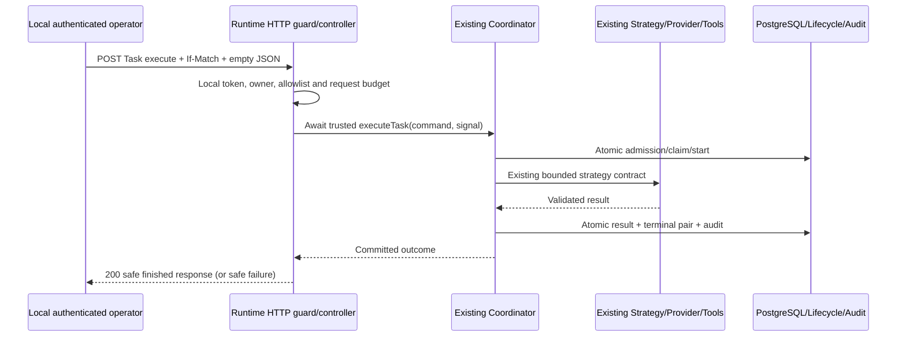
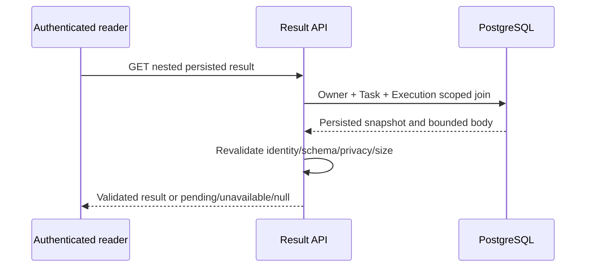
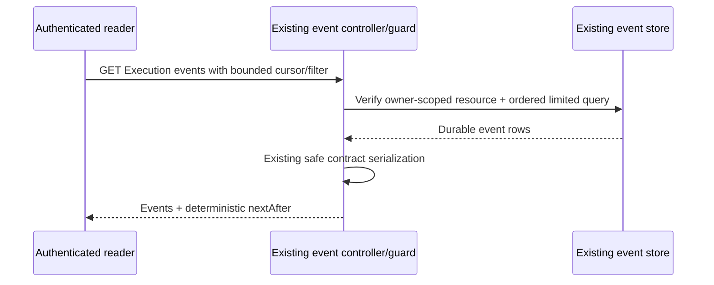

# T11 - Runtime APIs, Results & Observability

**T12 acceptance (2026-10-24): ACCEPTED WITH LIMITATIONS for local development only.** See [the acceptance report](acceptance.md) for 173 backend, 89 isolated PostgreSQL and 51 city tests, both builds, browser smoke and live installed Ollama text/calculator evidence. Live OpenAI was NOT RUN. External production exposure remains BLOCKED without production identity/access controls. Earlier task checkpoints below are historical evidence.

Updated 2026-10-24 (Asia/Bangkok). Historical T11 implementation and verification evidence is recorded below; T12 acceptance is linked above. This uses the existing `apps/api` NestJS backend, Drizzle/PostgreSQL, RuntimeCoordinator, lifecycle transactions, tools and audit events. There is no new execution engine, worker, identity platform, transport, ORM or database migration.

## Repository findings and requirement recovery

No applicable AGENTS.md was found in the workspace or ancestor chain. Git status reports "not a git repository"; this export has no Git metadata. A pre-T11 maintained-file SHA-256 inventory was captured outside the workspace to preserve unrelated work. T01 planning, Phase 1 acceptance and [T10 cancellation/shutdown evidence](cancellation-timeout-failure.md) were reviewed against the actual code. T09's installed-model tool reliability limitation remains unchanged.

| Requirement | At audit | Implemented boundary / verification |
| --- | --- | --- |
| Authorized execution API | MISSING | Synchronous guarded POST through existing coordinator, no provider/tool calls in controller |
| Authorized cancellation API | MISSING | Nested parent/Execution POST through existing lifecycle transaction and T10 observation/fencing |
| Task status | PARTIAL | Existing Task read reused; new bounded latest-Execution identifier view |
| Execution status/history | COMPLETE | Existing nested GET and paginated history retained, additive safe strategy/correlation/duration fields |
| Persisted result retrieval | PARTIAL | Existing CLI validation/persistence reused in owner-scoped HTTP read, bounded result schema revalidated |
| Audit reads | COMPLETE | Existing owner-scoped Task/Execution/Agent history and ordering/pagination/filter contracts reused |
| Authentication/authorization | PARTIAL | Existing local operator token + loopback/Host/Origin checks; new runtime allowlist checks; production identity remains unavailable and routes fail closed |
| DTO/error handling | PARTIAL | Existing UUID, If-Match and global validation reused; strict cancellation DTO/raw body guard and safe runtime code filter |
| Runtime/provider/tool logs | PARTIAL | Closed scoped event/metric contract extended; no prompt/argument/configuration fields accepted |
| HTTP-to-runtime correlation | PARTIAL | AsyncLocalStorage request ID plus existing immutable runtime/audit correlation UUID |
| Operational measurements | PARTIAL | Structured monotonic durations/count observations; no external metrics framework or metrics endpoint |
| HTTP unit/PostgreSQL tests | MISSING | Added deterministic HTTP/guard/DTO/context/serialization, real owned PostgreSQL API scenarios and regressions |
| Documentation/roadmap | PARTIAL | This canonical API guide, request/response examples, diagrams, security and status updates |

The prior implementation plan proposed durable queue acceptance returning 202 while keeping execution in the CLI. The current T11 request explicitly requires execution through HTTP and permits synchronous execution where the runtime supports it. The coordinator is in-process/awaited, so the implemented operation is synchronous with a strict abort budget. A 202 queue-only endpoint would not satisfy that request, and detached promises would falsely imply durability. No queue endpoint or automatic consumer was added.

## Authentication and authorization

All routes below require `Authorization: Bearer <local-development-operator-token>`. It is the existing configured registry token, never a sample credential or fake user. New runtime routes additionally require validated `RUNTIME_ENABLED=true`, database configuration and the existing trusted runtime binding catalog. No OpenAI/Ollama configuration is needed for rule-based execution.

Existing LocalAccessGuard requires development/test, loopback binding and direct remote socket, a loopback Host header and an allowed Origin if supplied. Forwarded headers do not grant trust. Unknown/missing bearer authentication is rejected before resource lookup or command validation. Production/default disabled configurations return 404; an enabled local boundary with an invalid token returns 401. Origin/host/socket rejection returns 403. CORS is not the authentication mechanism.

Every query includes the configured owner scope. Parent Task/Execution mismatch and another owner's identifiers return 404. Writes additionally require the Task's actual persisted Agent/orchestrator pair in the server runtime binding catalog; caller-supplied Agent/owner/provider/strategy/tool permissions are rejected. The coordinator still validates agent activation, native route, definition/profile, version, eligibility, claims and capacity. Reads may inspect historical records for the configured owner even when an Agent is no longer runnable; no new write permission follows from a read.

This is local-development operator authentication, not production person/tenant authorization. **Production exposure is blocked until real authentication/authorization and operational controls are implemented.** T11 does not publish an anonymous runtime proxy.

## API reference

All paths are prefixed `/api/v1`. New commands require JSON; unknown body/query fields are rejected. The existing parser caps request bodies at 64 KiB. No endpoint accepts provider credentials, endpoint/model/strategy overrides, tool grants, caller-selected owner/Agent or lifecycle status.

| Method and path | Behavior |
| --- | --- |
| POST `/tasks/:taskId/execute` | **New.** Await existing coordinator; 200 only for committed COMPLETED/SUCCEEDED. Empty JSON body `{}`; `If-Match` is observed Task version |
| POST `/tasks/:taskId/executions/:executionId/cancel` | **New.** Commit cancellation using existing lifecycle service. JSON `{ "taskVersion": n }`; `If-Match` is observed Execution version; 200 returns safe Task/Execution pair |
| GET `/tasks/:taskId/status` | **New.** Existing safe Task fields plus nullable `latestExecutionId`; latest lookup is limited to one |
| GET `/tasks/:taskId/executions/:executionId/result` | **New.** Safe persisted Execution view + availability + validated bounded result/null |
| GET `/tasks/:taskId` | Existing safe Task detail/status, unchanged |
| GET `/tasks/:taskId/executions/:executionId` | Existing safe Execution detail/status; additive `strategyId`, `correlationId`, `durationMs` |
| GET `/tasks/:taskId/executions` | Existing bounded attempt history, ascending attempt number; does not include result bodies |
| GET `/tasks/:taskId/events` | Existing durable Task audit history |
| GET `/executions/:executionId/events` | Existing durable Execution audit history |
| GET `/agents/:agentId/events` | Existing durable Agent audit history |

There is no competing global Execution mutation API, generic runtime proxy, direct tool invocation endpoint or event-write endpoint. New runtime views require runtime opt-in; existing Phase 1 history/audit reads retain their original registry guard independently of runtime enablement.

`If-Match` is required in the existing quoted positive integer format, for example `"3"`, maximum 2147483647. Do not silently upgrade a stale command by reading a newer version on the caller's behalf. Cancellation's Task version and Execution version are both checked under the existing lock; stale/racing commands return 409. Repeated cancellation preserves the existing conflict response, with no second state change or terminal event.

## Execution semantics and responses

The HTTP handler awaits `RuntimeCoordinator.executeTask`. Admission queues/allocates or adopts the existing eligible attempt using the coordinator's existing transaction; no alternate allocator is used. It does not return 202 or claim work is scheduled durably for later dispatch. New requests never start a second active execution, silently retry terminal work or bypass frozen trusted configuration.

A server-owned **30000 ms HTTP execution budget** aborts the coordinator signal with DEADLINE_EXCEEDED. A shorter existing execution/provider/tool deadline still wins. The coordinator preserves that timeout reason; it is not relabeled explicit cancellation. Request abort/response disconnect relays CANCELLED. Owned listeners and the timer are removed on every controller outcome. No fire-and-forget job remains behind the response.

The budget bounds the execution wait and signals interruption; database finalization may add bounded database I/O latency before the HTTP error is sent. It is not a guarantee that an unavailable database can acknowledge terminal state at exactly 30 seconds. T10's bounded shutdown, lease checks, quarantine and unresolved outcomes remain authoritative. Hard crash durability/recovery is not introduced.

Success JSON contains `kind:"finished"`, safe `task`, safe `execution`, the frozen `correlationId` and validated `result`. Failures use the existing error envelope fields `statusCode`, `message`, `requestId`, plus a closed runtime `code`. Poll the known Task status/history to discover the attempt after an unsuccessful/disconnected execute request. Do not blindly retry a request that may have performed external work.

### Illustrative commands

The IDs and timestamps below are examples, not pre-created records. Use your real Agent/Task and observed versions. Keep the token in an environment variable; never put it in Agent configuration or Task input.

```sh
curl -X POST "$API/api/v1/tasks/$TASK_ID/execute" \
  -H "Authorization: Bearer $REGISTRY_TOKEN" \
  -H 'Content-Type: application/json' -H 'If-Match: "1"' \
  -H 'X-Request-Id: local-runtime-check' --data '{}'

curl "$API/api/v1/tasks/$TASK_ID/status" \
  -H "Authorization: Bearer $REGISTRY_TOKEN"

curl "$API/api/v1/tasks/$TASK_ID/executions/$EXECUTION_ID/result" \
  -H "Authorization: Bearer $REGISTRY_TOKEN"

curl -X POST "$API/api/v1/tasks/$TASK_ID/executions/$EXECUTION_ID/cancel" \
  -H "Authorization: Bearer $REGISTRY_TOKEN" \
  -H 'Content-Type: application/json' -H 'If-Match: "3"' \
  --data '{"taskVersion":3}'
```

A Task status response uses the existing safe fields:

```json
{
  "id": "e143e519-2e9d-4f1b-8546-bf1b2eeed703",
  "agentId": "8c9fa7be-804c-44de-9dbc-72b13a8f7bf9",
  "orchestratorId": "314a0b78-cb8b-4b22-b6a2-226f8fcbab84",
  "status": "COMPLETED",
  "version": 4,
  "createdAt": "2026-10-24T01:00:00.000Z",
  "updatedAt": "2026-10-24T01:00:01.000Z",
  "completedAt": "2026-10-24T01:00:01.000Z",
  "latestExecutionId": "1e1d10eb-a927-4d74-9962-3a9bc76c107d"
}
```

Execution status retains identity, attempt number, status/version, safe failure summary, timestamps and resultAvailability. `strategyId` and `correlationId` come only from a validated runtime snapshot; legacy/invalid snapshots produce null. `durationMs` is the nonnegative persisted finishedAt-startedAt difference, or null if unavailable. It is not an estimated progress/duration for a running execution. Lease tokens, snapshots, Task input, raw errors, endpoint profiles and credentials are not serialized.

### Persisted result semantics

The result endpoint always reads PostgreSQL, not an active strategy or cached HTTP response. Its stable envelope is `{ execution, availability, result }`:

- PENDING/RUNNING: 200 with `availability:"PENDING"`, `result:null`.
- SUCCEEDED with validated stored body: 200 with `availability:"AVAILABLE"` and the existing schema-versioned RuntimeExecutionResult.
- FAILED/TIMED_OUT/CANCELLED or legacy nonlocal result: 200 with `availability:"UNAVAILABLE"`, `result:null`; persisted lifecycle status remains explicit.
- A supposedly available result is missing or fails identity/schema/size/privacy validation: 503 OUTCOME_UNCERTAIN. No raw stored body is echoed.
- Missing, foreign-owner or mismatched parent/Execution: 404.

Results may include the actual configured provider identifier/model, reported nullable token counts and successful tool invocation count. Missing usage is not invented; no costs are calculated. Rule-based output is the existing text.statistics.v1 schema. LLM output is untrusted text in JSON, not HTML or a provider SDK object. Consumers must render it as data. All responses retain `Cache-Control:no-store` and `X-Content-Type-Options:nosniff`. Stored bodies have the existing 64 KiB database bound and narrower execution result validation/budget; response metadata is fixed and bounded. Task input and raw tool arguments are not returned.

## History, audit and pagination

Execution history reuses `limit` (default 20, maximum 100) and `offset` (default 0, maximum 10000), with deterministic ascending attempt order. Response is the existing `{items,pagination:{limit,offset,hasMore}}`. No unbounded result bodies are joined into history.

Audit history reuses the existing deterministic stream-position ordering and envelope `{items,pagination:{limit,offset,hasMore,nextAfter}}`. It supports `eventType`, UUID `correlationId` and `after` stream position in addition to bounded limit/offset; do not combine nonzero offset with after. See the existing event contracts for exact supported types. Events expose event identity/type/schema, occurrence/persistence times and validated safe metadata, not raw prompts/arguments/configuration. No duplicate audit store, progress stream or event mutation API was added.

```sh
curl "$API/api/v1/tasks/$TASK_ID/executions?limit=20&offset=0" -H "Authorization: Bearer $REGISTRY_TOKEN"
curl "$API/api/v1/executions/$EXECUTION_ID/events?limit=20" -H "Authorization: Bearer $REGISTRY_TOKEN"
# Continue audit history with the returned nextAfter value:
curl "$API/api/v1/executions/$EXECUTION_ID/events?limit=20&after=$NEXT_AFTER" -H "Authorization: Bearer $REGISTRY_TOKEN"
```

## Errors and persisted progress

| HTTP | Meaning |
| --- | --- |
| 400 | Invalid UUID/version/body/query, unknown fields or runtime INVALID_INPUT |
| 401 / 403 | Missing/invalid operator token; local access/allowlist/tool denial |
| 404 | Disabled production/default boundary, or missing/foreign/mismatched scoped resource |
| 409 | Stale versions, active/terminal Task, lifecycle/lease conflict, or CANCELLED outcome |
| 413 / 415 | Existing body-size/content-type protection |
| 422 | Unsupported capability, tool/strategy validation/failure or bounded output rejection |
| 429 | Provider rate/quota failure, not proof that retrying this Task is safe |
| 500 | Sanitized unexpected internal runtime failure |
| 502 | Upstream authentication/model/response failure, not HTTP caller authentication failure |
| 503 | Provider/persistence/configuration unavailable or unacknowledged/corrupt outcome |
| 504 | Provider/tool/execution/HTTP execution deadline exceeded |

Runtime error codes reuse the existing closed taxonomy. Non-runtime DTO/auth errors preserve the existing generic envelope; no competing global error format or raw database diagnostics are added. Examples:

```json
{
  "statusCode": 409,
  "message": "Runtime operation was cancelled.",
  "code": "CANCELLED",
  "requestId": "local-runtime-check"
}
```

Only real persisted lifecycle states are returned. Cancellation is a committed lifecycle decision, not proof the remote process stopped. Timeout retains Task FAILED / Execution TIMED_OUT. Existing success/failure/cancel races commit one terminal pair/result/event outcome. There are no percentages, streaming token states or durable intermediate tool/provider progress events.

## Correlation and observability

`X-Request-Id` follows the existing validation policy: 1-64 safe alphanumeric/dot/underscore/hyphen characters, otherwise a generated UUID. It is echoed in the response and attached to errors. It is a diagnostic value, not an authority claim. AsyncLocalStorage binds it to the asynchronous HTTP operation; contexts are immutable and independent across concurrent requests. Nothing is stored in a mutable global current-request variable.

The existing runtime correlation UUID is generated at trusted admission for a new attempt, or reused from an existing frozen pending snapshot. It flows through coordinator/context, provider/tools and committed runtime audit events. The execute response and Execution status expose it. Task creation is a separate earlier command with its own existing correlation; T11 does not rewrite that history. Request/started/outcome logs bridge HTTP requestId and runtime correlationId. Multiple polls/cancel commands have their own request IDs while referencing the same execution correlation.

Existing ApiLogger emits structured stdout/stderr JSON. New/extended safe observations are:

- `runtime.requested`, `runtime.started`, `runtime.completed`, `runtime.failed`, `runtime.cancelled`, `runtime.timeout`, `runtime.conflict`.
- `runtime.cancellation.requested` and `runtime.cancellation.recorded` distinguish the HTTP command from the coordinator's later terminal observation.
- `provider.started/completed/failed`, with trusted providerId and bounded duration/error code.
- `tool.started/completed/failed`, with compiled toolId and bounded duration/error code.
- Existing `runtime.budget` call-count observations and HTTP route-template/status/duration logs.

Scoped log metrics accept only duration, invocation counts, safe provider/tool identifiers and known runtime error codes. No prompt, raw model/tool output, tool argument, API key, stack, request authorization header or whole database entity is allowed. Telemetry transport failures do not change lifecycle outcomes. Labels are validated identifiers, not model-selected strings or arbitrary URLs.

Operational measurements are structured event observations; no new metrics server/endpoint, time-series dependency or global counter was introduced. Durations use monotonic elapsed time and are capped at 300000 ms by the scoped diagnostic contract; persisted status duration remains separately derived from timestamps. IDs are log correlation fields, not metrics label dimensions. Audit history remains authoritative for committed terminal counts: log requests/observations can repeat, and cancellation command logs do not themselves prove provider termination. Hosted log retention/aggregation, dashboards and exactly-once metric delivery remain operational concerns.

## Interaction diagrams



```mermaid
sequenceDiagram
  participant O as Local authenticated operator
  participant H as Runtime HTTP
  participant L as Existing lifecycle transaction
  participant C as Active coordinator
  O->>H: POST nested cancel + observed versions
  H->>H: Resolve owner/parent/allowlisted native execution
  H->>L: Existing cancelTask(command)
  L->>L: Lock, versions, terminal checks, state + events
  L-->>O: Safe committed cancellation pair
  C->>L: Observe by authority/heartbeat/finalization
  C->>C: Abort cooperative children; reject late success
```





## Testing and verification

No paid API or installed local model is needed. Unit tests use controlled timers/signals and test-only service seams. PostgreSQL tests use the existing owned disposable database harness, genuine Nest HTTP, real strategies/tools/lifecycle/result/audit, and an injected fake LLM provider. They cover successful rule/LLM execution, authorization/IDOR/overrides/versions, pending and failed results, restart, history/audit pagination, cancellation/duplicate/late success, client disconnect and structured log privacy/correlation.

One initial corruption probe was rejected by the existing append-only result trigger. The corrected test injects a malformed NEW insert via an owner-scoped test trigger in the disposable database, then verifies safe result-read failure. History immutability was not disabled and no production data was touched.

```sh
npm run verify:phase1
# Focused HTTP unit tests after building:
node --test apps/api/test/runtime-api.test.cjs
```

The existing CI command discovers the new unit tests and extended PostgreSQL cases; no workflow/dependency/migration change is needed. There is no Swagger/OpenAPI implementation in this repository, so this extends existing Markdown API documentation rather than adding another documentation framework.

## Executed verification - 2026-10-24

The final `npm.cmd run verify:phase1` completed with **exit code 0**. These constituent commands actually ran:

| Command | Outcome |
| --- | --- |
| `npm run lint` (existing city static checks + backend TypeScript noEmit) | PASS |
| `npm run build` | Backend build PASS |
| `npm run build:web` | Frontend build PASS |
| `npm run db:check` | Migration-file/journal checks PASS |
| `npm run test:all` | 51/51 city tests; 171/171 backend tests; zero failures/skips |
| `npm run test:db` | 86/86 real PostgreSQL tests; zero failures/skips |
| `npm run test:browser` | Chrome 155 smoke PASS; 62 resource requests, zero exceptions |

The final rerun additionally verifies a genuine idempotent second finalization: HTTP retrieves the canonical stored success body even when the observed terminal response carries no result, with no duplicate lifecycle events. Earlier focused `npm.cmd run build` plus `node --test apps/api/test/runtime-api.test.cjs` passed the first eight API unit groups. An additional telemetry-failure case and actual coordinator timeout propagation regression are included in the final 171 tests. An initial production-disabled unit fixture omitted mandatory CORS configuration; it was corrected to a valid production configuration without weakening validation. The first SQL run passed 85/86; its result-corruption setup was blocked by append-only protection, corrected to the isolated NEW-insert fault described above, and the full final 86 passed.

The aggregate also covers original rule-based, provider transport, LLM/tool contracts, T10 cancellation/shutdown/concurrency and Phase 1 behavior. New HTTP scenarios exercise a genuine rule-based strategy without provider configuration, LLM plus both actual tools with a fake provider, restart-persistent result retrieval, safe pagination, auth/ownership/body/version rejection, pending/failed/cancelled results, terminal immutability, result revalidation and actual client disconnect cancellation. No paid API or real local inference was used. Hosted CI execution is not claimed.

A pre-T11 SHA-256 comparison verified **90 protected files unchanged**, including all 51 city source files, core lifecycle/database/migration/event/Agent implementations and both provider HTTP transports. The intentional Phase 1 module export and additive Execution serializer changes are listed below. There are no schema/migration, dependency, Compose, CI workflow or city changes. Browser smoke does not substitute for exhaustive visual-diff, long-duration animation or performance acceptance.

**T11 completion status: COMPLETE for the explicitly protected local-development API scope. Production exposure remains BLOCKED by missing production identity/authorization and operational controls.** No Phase 2 release-readiness decision is implied. The next task is **Phase 2 T12 - End-to-End Verification & Acceptance Review**, which has not begun.

## Maintained-file change manifest

Relative to the pre-T11 inventory; generated build files and temporary logs are excluded. No maintained files were removed.

### Created

- `docs/ai-agent-platform/phase-2/runtime-api.md`
- `apps/api/test/runtime-api.test.cjs`
- `apps/api/src/common/request-context.ts`
- `apps/api/src/runtime/http/runtime.dto.ts`
- `apps/api/src/runtime/http/runtime-api.service.ts`
- `apps/api/src/runtime/http/runtime-api.guard.ts`
- `apps/api/src/runtime/http/runtime-api.filter.ts`
- `apps/api/src/runtime/http/runtime-api.controller.ts`

### Modified

- `WORKSPACE.md`
- `README.md`
- `docs/ai-agent-platform/README.md`
- `docs/ai-agent-platform/phase-2/implementation-plan.md`
- `docs/ai-agent-platform/phase-2/README.md`
- `apps/api/.env.example`
- `apps/api/test/llm.integration.cjs`
- `apps/api/test/runtime-coordinator.test.cjs`
- `apps/api/test/text-statistics.integration.cjs`
- `apps/api/test/runtime.integration.cjs`
- `apps/api/src/tasks/tasks.module.ts`
- `apps/api/src/executions/executions.service.ts`
- `apps/api/src/common/http-foundation.ts`
- `apps/api/src/runtime/tools/tool-execution.service.ts`
- `apps/api/src/common/api-logger.ts`
- `apps/api/src/runtime/runtime-coordinator.ts`
- `apps/api/src/runtime/runtime.module.ts`
- `apps/api/src/runtime/contracts/execution-context.contract.ts`
- `apps/api/src/runtime/strategies/llm-agent.strategy.ts`
- `apps/api/src/runtime/context/execution-context.factory.ts`
