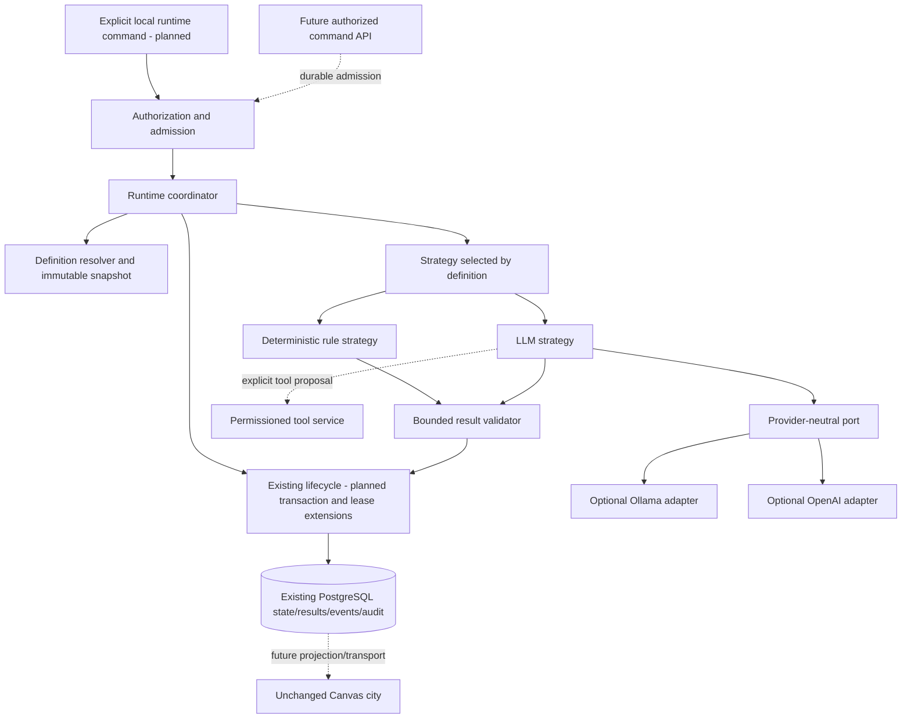

# Runtime architecture

**T12 acceptance (2026-10-24): ACCEPTED WITH LIMITATIONS for local development only.** See [the acceptance report](acceptance.md) for 173 backend, 89 isolated PostgreSQL and 51 city tests, both builds, browser smoke and live installed Ollama text/calculator evidence. Live OpenAI was NOT RUN. External production exposure remains BLOCKED without production identity/access controls. Earlier task checkpoints below are historical evidence.

**T06 checkpoint:** [Ollama adapter](ollama-adapter.md) now supplies native nonstreaming text generation and a pinned/limited HTTP transport, with deterministic fixtures and an actual opt-in local model probe. Earlier empty-registry/no-adapter statements below are historical. No LLM Agent Strategy or Task execution integration is added; that remains T09.

**T05 checkpoint:** [Provider foundation](provider-foundation.md) implements validated contracts, exact profile selection, isolated configuration, empty provider registry and guarded timeout/output boundaries. Historical statements below about those foundations being unimplemented are preserved snapshots. Concrete adapters, LLM strategy and network inference remain planned.

**T04 checkpoint:** [Rule-based runtime](rule-based-runtime.md) adds the genuine text.stats.v1 DI registration and trusted local execute/inspect command. Execution is still opt-in, never automatic. Earlier no-strategy/CLI-deferred statements below are the preserved T01-T03 historical record. No provider, tool, worker or city integration is added.

**Historical T03 checkpoint:** see the [coordinator guide](runtime-coordinator.md) for internal invocation, registered strategy resolution, database claims, result persistence, cancellation and verified boundaries. The earlier status/design below is retained as the T01/T02 historical snapshot; it does not override the current guide. No concrete strategy/provider/tool is enabled.

Historical T01/T02 status: **T01 design with T02 contracts/context then IMPLEMENTED** in the [T02 guide](runtime-contracts.md). Coordinator/strategies/providers/tools/results persistence and invocation remain **PLANNED**. Interface sketches below are historical design references, not exact export names; in particular no executable tools object is exposed by the current context. [Audited foundation/gaps](README.md) and [implementation plan](implementation-plan.md) define remaining enablement gates.

## Historical T01 decision: one native runtime module, explicit local invocation first

Keep the sole NestJS backend and Drizzle/PostgreSQL. Add a small `apps/api/src/runtime/` module with injected coordinator, definition resolver, strategies and result handling. Reuse lifecycle/events/DatabaseService. No framework dependency, broker or frontend rewrite is needed. Execution is independent of HTTP controllers and browser lifetimes.

The first trigger is an **explicit opt-in local CLI/internal invocation** targeting an already persisted Task, with expected version and allowlisted owner/agent/native route. An owned Nest application context lives until the bounded operation finishes, then closes. No constructor/OnModuleInit runs tasks; Task POST still creates CREATED only. No browser session is required. The CLI must use the same central configuration validation and scoped authorization as HTTP infrastructure, never a hardcoded test owner. Proposed entry `runtime/runtime-command.ts` and npm command are future implementation, not commands available today.

| Trigger alternative | Decision / practical tradeoff |
| --- | --- |
| Explicit internal local invocation | Selected for first deterministic and first local LLM tests. Durable state, bounded single process, no automatic scanning or delayed promise tied to a response. Process loss leaves an observable unresolved attempt; explicit reconciliation required. |
| Long HTTP request | T01 rejected this; T11 explicitly selected bounded synchronous HTTP (30-second abort budget), as documented in runtime-api.md. Historical rationale: rejected for execution. Client/proxy timeout cannot be the job lifetime or a license to repeat work. |
| In-process detached promise after HTTP 202 | Not sufficient: job ownership and crash recovery are undefined. Do not implement as a shortcut. |
| Controlled asynchronous API with execution supervisor | T11 only if demand requires it: 202 after durable acceptance, bounded supervisor consumes durable native work; no provider call inside controller. Requires lease/recovery/authorization tests and an explicitly enabled supervisor, not an untracked promise. |
| Dedicated native worker process | Future deployment option using the same coordinator/context/strategy interfaces and PostgreSQL claims. No rewrite of agent logic; implement independently enabled supervisor/claim loop when operationally needed. |
| RabbitMQ/Redis queue | Deferred; PostgreSQL identity/claims remain authoritative if a broker is later added. Delivery is a wake-up hint, never execution authority. |

## Components and responsibility



| Component / proposed location | Needed when | Owns / deliberately limited scope |
| --- | --- | --- |
| Runtime contracts/context `runtime/contracts/` | T02 | Plain TS bounded DTOs, abort/deadline/budget/error contracts; no SDK/db entity exports |
| Definition resolver `runtime/definition-resolver.ts` | T03 | Server-owned agent binding, profile/version selection, validated snapshot and admission; not code loading or name matching |
| Coordinator `runtime/runtime-coordinator.ts` | T03 | Scoped queue/claim/start, execute outside transaction, finish through lifecycle, teardown and explicit recovery |
| Lifecycle transaction/claim boundary, existing `lifecycle/` | T03 | Sole status policy, token/version guards, atomic results/state/events and deadlined leases; not model requests |
| Rule strategy `runtime/strategies/text-summary.ts` | T04 | Pure, bounded deterministic text statistics; no tools/network/LLM |
| Provider registry/config `runtime/providers/` | T05–T07 | Configured adapter/profile capabilities and credentials behind the adapter; not agent identity or task status |
| LLM strategy `runtime/strategies/llm.ts` | T06 limited / T09 tools | Controlled prompt/messages, validated provider result, bounded proposal loop; not authorization or direct tool dispatch |
| Result service `runtime/results/` | T03 | Closed versioned output and atomic storage in existing execution_results; not an object store |
| Tool service/registry `runtime/tools/` | T08 | Registered schema validators, allowlist and finite operations; no arbitrary imports, shell/filesystem/SQL/HTTP |

Do not create empty modules now or separate packages just for these conceptual rows. Merge small resolver/context/result helpers until their responsibilities justify files. Test doubles live under test/, never a production mock LLM adapter.

## Strategy and definition selection

Use a **server-owned, immutable versioned definition catalog** configured at process startup, with explicit `(ownerId, agentId, orchestratorId) -> definitionId@version` bindings. Validate a bounded catalog in configuration (proposed JSON environment setting, ≤32 KiB, ≤64 bindings; not a path or executable module). Definitions are trusted data describing compile-time registered strategies, profile IDs, input/output contract IDs, budgets and tool grants. Values never contain credentials, raw endpoints from tasks, scripts or file paths. CLI cannot pass a provider/model/tool override.

The allocator must freeze the resolved descriptor alongside existing category/color in `agentConfigSnapshot` **at insertion**, before it becomes immutable. Keep `configVersion` as the captured Agent version; add explicit `runtime.schemaVersion`, `definitionId`, `definitionVersion`, `profileVersion` and canonical nonsecret definition digest in the snapshot instead of overloading that integer. Preserve existing category/color keys for compatibility; future resolver validates new runtime keys. Existing Phase 1 snapshots lack runtime data and are **ineligible**, not interpreted using today's defaults. To run an old CREATED Task with no attempt, resolve/freeze a new first attempt normally. Old PENDING attempts require explicit operator cancellation under existing lifecycle rules and a separately submitted Task; no silent snapshot upgrade or automatic retry. Historical rows are never rewritten.

| Registry Agent.type | Native strategy policy |
| --- | --- |
| RULE_BASED | Must bind to a registered rule definition. First operation `text.stats.v1`: count Unicode code points, whitespace-delimited words and nonempty lines in instruction; context ignored by declared contract. Bounded pure calculation, reproducible output, not instructions executed as code. |
| LLM | Must bind to explicit LLM definition/profile; no default paid provider. Initially one text-only call, no tools. Tool loop requires T08/T09 and negotiated model capability. |
| EXTERNAL | Native resolver rejects. Future external adapter owns submission/status; never silently convert to a native strategy. |

Descriptive Agent.capabilities and category, NPC role/name/state, and orchestrator connectivity do not authorize execution. Agent must be ACTIVE; route must be ENABLED and explicitly registered in native runtime configuration. Existing free-form orchestrator.type alone is insufficient authority. Check agent/route at admission and start; disabling blocks new work, while stopping current work requires explicit cancellation. Every boundary carries owner scope; future multi-tenant identity must replace local operator assumptions before public use.

## Controlled execution context

Conceptual contract to implement in T02, not an exported interface today:

```typescript
interface ExecutionContext {
  readonly ids: { ownerId: string; taskId: string; executionId: string;
    agentId: string; orchestratorId: string; correlationId: string };
  readonly input: { instruction: string; context?: string };
  readonly definition: ResolvedDefinitionSnapshot;
  readonly deadlineAt: string; // UTC, durable; effective minimum of all deadlines
  readonly signal: AbortSignal;
  readonly budget: RuntimeBudget;
  readonly logger: SafeRuntimeLogger; // allowlisted fields only
  readonly tools: AuthorizedToolInvoker; // deny-all before T08/T09
}
```

Coordinator creates this only after scoped Task validation and a committed native claim/start. Input is a validated immutable copy loaded internally (Task read API intentionally omits it), never a raw ORM row. Keep the lease token, database/transaction/client, provider credential, endpoint authorization and AbortController in a private coordinator/adapter context; expose only read-only signal/budget views to the strategy. Tools receive an even narrower invocation context without the entire Task input, registry, provider client, secrets or tool-discovery authority. No uncontrolled global mutable current-task object. Per-call abort controller/timers/counters are destroyed in finally; stop heartbeats, await bounded teardown, discard temporary prompt/provider buffers and never retain histories globally. JavaScript string memory cannot promise cryptographic zeroization.

Proposed local defaults: one native run/process; one native RUNNING/agent already enforced by DB; 120 s total execution, 60 s provider call, 2 s tool, 20 s lease with 5 s heartbeat, 2 s abort grace; 512 output tokens/request; 32 KiB Task input ceiling retained; 16 KiB rendered model-input bytes; 64 KiB provider body ceiling; 32 KiB serialized successful result. Deployment validators enforce hard caps (total 300 s, provider ≤remaining total, tokens ≤4096, result ≤32 KiB), refuse zero/negative/unbounded values and never silently truncate instructions. These are **design budgets**, not measured model hardware requirements. T09 later permits ≤3 provider rounds and ≤2 tool calls total; text-only mode remains one round/zero tools. No automatic retries.

## Results and observability

Store successful output once in existing `execution_results.body`; use a v1 object with executionId, output type (`text.statistics.v1` / `text` / future closed tool summary), validated data, optional normalized usage/provider/model/profile identity. Serialized body ≤32 KiB and PostgreSQL `octet_length(body::text)` must also pass its 64 KiB check. No prompts, headers, reasoning traces, stack traces or raw provider object. Output prose can itself contain sensitive data: only approved task data, content policy checks and scoped result access are a gate, not a universal redaction claim.

Keep status, startedAt, finishedAt and error code in **Execution**, not a second mutable status in the result blob. Planned result read view combines those committed records into `{schemaVersion, executionId, status, startedAt, finishedAt, resultReference, output?, error?, usage?}`; failures/timeouts/cancellations return bounded catalog metadata and no success result. Current APIs do not expose a result endpoint; T11 adds authorized scoped retrieval, safe content-type and escaping. No HTML/model-markup rendering or object store is needed. Result plus success transition must share one transaction as detailed in [lifecycle integration](execution-lifecycle.md).

Concrete proposed success-body contract (design only; field lengths/finite integer bounds require validators in T02):

```typescript
type StoredRuntimeResultV1 = {
  schemaVersion: 1;
  executionId: string;
  output:
    | { type: 'text.statistics.v1'; data: {
        codePointCount: number; wordCount: number; nonemptyLineCount: number } }
    | { type: 'text'; text: string };
  provider?: { id: string; model: string; profileVersion: number };
  usage?: { inputTokens: number | null; outputTokens: number | null;
    totalTokens: number | null };
  toolSummary?: { invocationCount: number };
};
```

This is the value in `execution_results.body`; the outer row already supplies result UUID/owner/execution/createdAt. Validate matching executionId before insertion. The read view's error category/message comes from the fixed execution/runtime catalog and authorized audit metadata, never a raw provider exception. Definitions declare the exact result type; text cannot be silently accepted as JSON/tool output or vice versa. Use DB timestamps for persisted elapsed-time views and a monotonic clock for local measured runtime duration; neither is a second status source.

Reuse current lifecycle events unchanged for state facts; do not add provider text/usage keys to closed v1 payloads. Persist selected safe runtime metadata/failure category/optional usage in the existing command audit details **inside** the terminal lifecycle transaction. Aggregate status/timestamps remain authoritative, audit metadata explains the operation. Existing event correlation groups remain; a proposed runtime root correlation ID links queue/start/terminal logs/audit without rewriting task.created or historical events. Log only validated IDs, duration, approved provider/profile/model identifiers, counters, catalog error category and available token usage. Never use provider errors/request objects as logger fields. Cost is nullable, estimated only from an explicitly versioned local price table and known usage; unknown tokens/cost are null, not zero or invented invoices. No current price/model default is assumed.

Transient progress is optional bounded in-memory diagnostics, not a durable event per token. Leases/heartbeats are operational state, not user-visible execution progress. No WebSocket/SSE or event relay in this plan's implementation baseline; future transports consume committed facts/outbox with deduplication and authorization. Future city projections may map aggregate execution status to visual activities through a binding; no coordinates, simulation state, camera or animation controls enter runtime contracts. All existing decorative behavior continues offline.

## Decisions and alternatives

- Keep the existing Agent DTO closed; use server bindings first instead of widening registry JSON or adding an administration UI/table prematurely. A later authorized versioned definition API can replace deployment bindings without changing snapshots/strategies.
- Reuse existing lease/result/audit columns first. **No database migration is identified as mandatory** for this bounded MVP; behavior/validation must be added. If implementation discovers a missing invariant, justify an additive forward migration and test populated upgrades; never edit Phase 1 migration history.
- A built-in trusted pure strategy plus cancellable HTTP adapters is enough. Arbitrary scripts/plugins/untrusted CPU work require a separate sandbox/process architecture, not an AbortSignal in the API process.
- Extend the existing lifecycle transaction boundary; do not create a parallel runtime status service. Heartbeat-driven version changes and snapshot immutability are explicit integration constraints.
- Durable records survive crashes, but this first trigger does not automatically recover or promise exactly-once paid inference. Reconciliation, no automatic replay and stale-token rejection are mandatory; [failure policy](execution-lifecycle.md) defines the limits.
