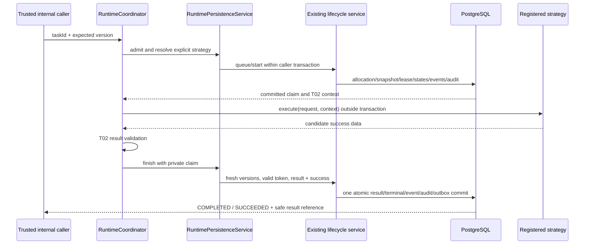

# Phase 2 T03 — Runtime coordinator and lifecycle integration

**T12 acceptance (2026-10-24): ACCEPTED WITH LIMITATIONS for local development only.** See [the acceptance report](acceptance.md) for 173 backend, 89 isolated PostgreSQL and 51 city tests, both builds, browser smoke and live installed Ollama text/calculator evidence. Live OpenAI was NOT RUN. External production exposure remains BLOCKED without production identity/access controls. Earlier task checkpoints below are historical evidence.

T09 update: [LLM strategy integration](llm-agent.md) now permits reviewed native LLM admission with pure provider preflight. Existing claim, lifecycle, result transaction and concurrency rules are reused; no second coordinator or worker was introduced.

**T04 checkpoint:** [Rule-based runtime](rule-based-runtime.md) adds the genuine text.stats.v1 DI registration and trusted local execute/inspect command. Execution is still opt-in, never automatic. Earlier no-strategy/CLI-deferred statements below are the preserved T01-T03 historical record. No provider, tool, worker or city integration is added.

Status: **IMPLEMENTED and verified for opt-in local development**. Date: **2026-10-22 (Asia/Bangkok)**. Reuses the existing NestJS/Drizzle/PostgreSQL backend, T02 contracts/factory and Phase 1 state machines/events. No concrete strategy, provider adapter, tool, worker, execution HTTP API, broker, WebSocket or city integration is introduced.

## Repository findings

The [Phase 1 acceptance report](../phase-1-acceptance.md), [T01 design](runtime-architecture.md), [lifecycle plan](execution-lifecycle.md), [T02 implementation](runtime-contracts.md), source models/services/configuration and tests/CI were inspected. Backend is still `apps/api`; root `dist/` is the maintained static city source. No applicable AGENTS.md or Git metadata was found. SHA-256 baseline comparison is used to preserve unrelated files; no clean-tree/commit claim is possible.

Confirmed integration gaps addressed here: lifecycle methods previously owned separate transactions; attempts froze only category/color; lease fields had no runtime enforcement; results had to be inserted before the old completion wrapper. The implementation adds a caller-transaction seam, optional immutable runtime snapshot, native claims/heartbeats and a result writer without replacing existing allocation/state rules or migration history.

## Module, registry and command

RuntimeModule imports the existing DatabaseModule/LifecycleModule and exports RuntimeCoordinator and StrategyRegistry alongside the existing context factory. The existing AppModule already imports RuntimeModule. No new global module or alternate app/ORM is created. Configuration is supplied by the existing global ConfigModule; standalone DI tests provide that module with database/runtime disabled.

StrategyRegistry receives explicit registrations through the RUNTIME_STRATEGIES DI token (empty frozen array by default). Trusted application modules may explicitly call `register(id, injectedStrategy)` for compiled handlers in future tasks. Registration rejects unknown IDs, duplicate IDs, missing execute methods and mismatched RULE_BASED/LLM types, and binds/freezes the method at registration. No class-name evaluation, dynamic import or Task-selected code is allowed. Fake registrations occur only in tests. Unknown configured strategy returns STRATEGY_NOT_FOUND before any persistent state change. LLM registration contracts are supported, but T03 **refuses LLM execution** until the separate provider/paid/data gates of T05–T07 exist.

Internal signatures:

```typescript
queueTask(command: ExecuteTaskCommand): Promise<{ task; execution }>;
executeTask(command: ExecuteTaskCommand, signal?: AbortSignal): Promise<RuntimeCoordinatorResult>;
// ExecuteTaskCommand = { taskId: UUID; taskVersion: positiveInteger; correlationId?: UUID }
```

Commands are closed, validated and HTTP-independent. TaskVersion is required optimistic intent, not client authority. Agent/owner/route/definition/grants cannot be supplied by the command. An optional caller-owned native AbortSignal is a separate argument; raw abort reasons are never forwarded. Queue is explicit admission only, not automatic scheduling.

T03 exposes internal Nest services only. A CLI wrapper is deferred until T04 supplies a usable compiled rule strategy; no misleading execution command is installed while production registrations are empty. This follows T01's explicit internal-invocation trigger option. No browser/HTTP request lifetime owns execution. No startup hook scans or dispatches work.

## Configuration and authorization

Current configuration precedence remains process environment > `apps/api/.env` > defaults. New settings:

| Setting | Behavior |
| --- | --- |
| RUNTIME_ENABLED | false/absent by default. true requires existing enabled registry scope, DB, dev/test and literal loopback; production refuses startup configuration. |
| RUNTIME_BINDINGS | Required JSON array when enabled; at most 64 entries and 32 KiB. Omit when runtime is disabled. Empty array is valid for inert startup. Each entry is `{agentId, orchestratorId, definition}` using existing actual UUIDs and the T02 definition contract. |

Binding IDs are normalized, duplicate agent bindings and unsupported/secret fields reject, and definitions/budgets are copied/frozen. No tool grants or nonzero tool-call budget is accepted in T03. Credentials and runtime owner are not part of this JSON. No registration/seed row is created automatically. Operator must explicitly bind an existing agent and a registered native route; descriptive Agent.capabilities/category/name/NPC state are never execution permission.

On each admission: validate configured local runtime access, scoped Task existence/version/status, latest attempt, ACTIVE Agent and same route/owner, trusted definition/type, explicit registered strategy, ENABLED route with type native, and no active/unconfirmed native work for the agent. Connectivity UNKNOWN does not pretend there is an external runtime; registration is the administrative gate. Missing/cross-owner Tasks share DEFINITION_UNAVAILABLE. Disabled Agent/route/terminal Task deny without mutation. Malformed legacy metadata/configuration rejects safely.

This is still a privileged **local operator development boundary**, not person authentication, multi-tenant RBAC or a process sandbox. Production remains disabled. A privileged application module can construct internal calls; exposed HTTP endpoints cannot. Full identity/authorization/TLS/role/operational controls remain prerequisites to production use.

## Admission, immutable snapshot and start

`queueTask` locks and queues a CREATED Task using the existing allocator and lifecycle method, creating a first PENDING attempt when absent. It freezes `{category?, color?, runtime:{schemaVersion:1, definition, digest, correlationId}}` in agentConfigSnapshot at insertion; configVersion remains the captured Agent version. SHA-256 digest covers the canonical validated nonsecret definition. Snapshot/attempt identity remains protected by existing database triggers. No applied migration is edited.

`executeTask` accepts CREATED (queue plus claim/start) or QUEUED with an already runtime-snapshotted PENDING attempt. It never upgrades a legacy metadata-only attempt or replaces the captured definition with today's settings. Current binding must still approve its digest; an explicitly different correlation ID cannot replace the frozen root. Prior terminal/EXTERNAL/other active attempts are not retried or adopted. Terminal Tasks are immutable; repeated execute commands reject rather than invoke a strategy again.

For a CREATED task, queue, allocation, context validation, lease and paired RUNNING transitions commit in one short transaction. This refines T01's optional split transaction diagram: `queueTask` permits the split workflow, while immediate execution uses one admission transaction so invalid context/unknown strategy cannot leave newly queued records behind. Every committed queue/create/start fact is still recorded in order. No transaction remains open during strategy execution.

Task → latest Execution → Agent row locks serialize identity, latest-attempt and per-agent quarantine checks. Native administrative cancellation also obtains the Agent lock before releasing a running capacity slot. Existing unique constraints remain the last defense: one active attempt per task, unique attempt number, one native RUNNING attempt per agent and one success per task. Registry/name lookup is not a substitute for these locks.

After commit, a private random lease token/owner identifies the claimant. A DB check before dispatch observes cancellation/lease loss. Runtime heartbeat runs every five seconds **only while this invocation owns work**, renewing a 20-second lease using PostgreSQL time. Effective deadline is the minimum of captured budget, Task deadline and existing attempt deadline. The budget starts at the earlier of Node and database time so a slightly advanced PostgreSQL clock cannot extend the context budget; database time still fences leases. Clock-skew regression coverage exercises this boundary; a queued attempt's deadline is not extended when later executed. These timers are bounded invocation resources, not a background scheduler or distributed cancellation service. Caller cancellation and deadline abort the strategy wait; persisted cancellation is observed through the approved heartbeat boundary (normally ≤5 seconds with a healthy DB), not an instantaneous cross-process push.

## Successful execution



T02 constructs the immutable request/context, exposes no DB/lease token to the strategy and provides default-deny tool permissions. Metadata comes from the captured snapshot, not a mutable current Agent object. The registry supplies the T02 execute interface; there is no LLM-specific coordinator code.

Candidate output is validated twice (before persistence and within the finalization boundary) against execution identity/type and the 32 KiB result cap. Request owner/Task/Agent/route/Execution identities are rechecked against persisted rows. Existing execution_results stores one versioned body; reference is `result:<uuid>`. Insert, SUCCEEDED/COMPLETED, matching timestamps and existing terminal event/audit/outbox rows share the transaction. Failure rolls back the result and state changes together. No object store or result HTTP API is added.

Heartbeats increment the existing Execution.version trigger. Finalization therefore locks/read-checks **fresh** versions and the private token rather than using start-time versions. Legacy start/complete/fail wrappers cannot mutate a runtime-owned attempt without the fence. Administrative cancellation retains its existing privileged path. The lifecycle transition matrices are unchanged.

## Failure and unresolved outcomes

```mermaid
sequenceDiagram
  participant S as Strategy/context/result validator
  participant C as Coordinator
  participant L as Existing lifecycle in transaction
  participant DB as PostgreSQL
  S-->>C: error or invalid result
  C->>C: fixed RuntimeError classification
  C->>L: finalize owned attempt with fresh versions
  alt transaction succeeds
    L->>DB: paired FAILED + events/audit
    DB-->>C: committed safe failure
  else competing terminal outcome
    DB-->>C: observe existing outcome; no overwrite/event
  else lease or persistence unavailable
    DB-->>C: transaction rejected/rolled back
    C-->>C: unresolved + original error + finalization error
  end
```

Pre-claim rejection throws RuntimeError and never marks an unclaimed Task FAILED. Normal strategy errors map to fixed safe codes; raw exceptions become INTERNAL_RUNTIME_ERROR. Invalid candidate data uses T02 INVALID_INPUT/result-stage or OUTPUT_LIMIT_EXCEEDED. A finalization error never exposes driver text or replaces the original classified error. Post-claim failure attempts paired failure finalization; if that also fails, the returned `unresolved` outcome retains original and secondary codes separately and makes no false terminal-status claim.

The existing durable failure code catalog remains EXECUTION_FAILED / PROCESS_INTERRUPTED / RUNTIME_UNAVAILABLE, with EXECUTION_TIMED_OUT for timeouts. Safe finer runtimeErrorCode is appended to existing command_audit.details in the same transaction. Runtime lifecycle facts use actor `native-runtime`; admission creation and administrative cancellation remain local operator operations. No new event schema/status is introduced.

Return variants:

- `finished`: actual serialized Task/Execution, optional validated result/reference, safe error, observed flag when another committed outcome already won. If a cancellation/timeout overrides a local error, executionError preserves that original safe code.
- `unresolved`: Task/Execution IDs, original error and finalizationError, with no invented status/result.

An event insert failure during success rolls back the candidate result/success; the coordinator then attempts a safe failure transaction. If event/audit storage remains unavailable, records retain their last committed RUNNING state and the outcome is unresolved. A lost/expired token never authorizes a terminal write. No automatic transaction retry can redispatch strategy work.

## Concurrency and duplicate protection

```mermaid
sequenceDiagram
  participant A as Coordinator A
  participant B as Coordinator B
  participant DB as PostgreSQL
  participant S as Strategy
  A->>DB: lock task/version, queue/claim/start
  B->>DB: lock same task/version
  DB-->>A: committed unique claim
  DB-->>B: version/status conflict; no new attempt
  A->>S: invoke once
  B-->>B: reject; no invocation/event
```

One active invocation per Coordinator instance bounds local resource use; it is **not** the database correctness mechanism. Two Nest instances/pools race the same Task in tests; locks/versions/unique constraints admit one and suppress duplicate invocation. Cross-task native per-agent capacity also holds. Duplicate terminal transactions observe the already committed pair and do not add a second result/event or call a terminal transition twice. Existing lifecycle command repeats continue to conflict as before.

An ambiguous claim commit can leave RUNNING state with no strategy dispatched; automatic re-execution is forbidden because caller acknowledgement alone cannot prove what happened. Expired RUNNING work is never taken over. Restart reads persisted state and rejects redispatch; no worker, lease scanner or distributed recovery is implemented. Database transaction/connection timeouts bound persistence operations independently of the strategy timer; a blocked finalization can exceed the strategy deadline and return unresolved.

## Cancellation and deadline

```mermaid
sequenceDiagram
  participant Admin as Caller/admin cancellation
  participant C as Runtime invocation
  participant DB as PostgreSQL
  participant S as Strategy
  Admin->>DB: cancellation transaction
  DB-->>Admin: CANCELLED pair committed
  C->>DB: heartbeat or finalization
  DB-->>C: terminal cancellation observed
  C->>S: cooperative AbortSignal when observed
  S-->>C: optional late result
  C->>DB: finalize attempt
  DB-->>C: preserve CANCELLED; no result or success event
```

Caller signal cancellation is distinct from an accepted persisted cancellation and from actual code/provider termination. Deadline produces TIMED_OUT / FAILED; cancellation produces CANCELLED / CANCELLED. The first committed terminal decision wins. Pre-admission aborted signals reject without writes. `Promise.race` bounds the strategy wait and installs late rejection handlers; it cannot kill arbitrary blocking JS or undo remote side effects. Timers/heartbeat wait/listeners are cleaned up after completion, rejection, cancellation or unresolved return.

Cancelled/timed-out/explicitly uncertain work retains a reconciliation marker and **blocks new native work for that agent**, even after terminal state releases the RUNNING index. A local abort is not proof remote work stopped. There is no automatic retry/fallback/quarantine clearance. A privileged operator must establish termination/disposition and perform a reviewed, audited reconciliation before clearing uncertainty; no recovery API is added in T03. Preserve terminal history, never reset status or alter old results/snapshots. Expanded recovery/graceful shutdown and external-process isolation remain T10 work.

## Audit and compatibility

Reuse the existing seven task-run facts: task.created (original request correlation), execution.created, task.queued, execution.started, task.started, execution.completed/task.completed (or corresponding failed/cancelled/timed_out facts). Runtime-generated facts share the frozen runtime correlation root; historical Task creation is not rewritten. Streams remain ordered per owner, with no global cross-owner ordering claim. Lease/deadline writes may create aggregate-version gaps, not duplicate sequence positions; they are not lifecycle/progress events.

No event is inserted after a domain commit or published before it. Payloads remain the existing small closed v1 contracts without input/result/token/lease/provider diagnostics. API responses/logs do not expose lease tokens or raw ORM objects. Existing Agent/Task/Execution/history routes and local access restrictions remain; no public execution route exists. The outbox remains storage only, without a relay.

## Verification

Executed `npm.cmd run verify:phase1` successfully on the final source, using Node 24, owned disposable PostgreSQL and Chrome. Despite its historical name, this command includes the T02/T03 runtime tests through the existing globs/harness.

| Command inside verification | Result |
| --- | --- |
| `npm run lint` (city static checks + API strict typecheck) | PASS; repository convention is static/type checking, not an added ESLint installation |
| `npm run build` | PASS, NestJS/TypeScript |
| `npm run build:web` | PASS, disposable production bundle; maintained city source untouched |
| `npm run db:check` | PASS, four-migration journal/schema verification |
| `npm test` | 51/51 city tests PASS |
| `npm run test:api` | 70/70 backend tests PASS, including nine coordinator and 16 T02 contract groups |
| `npm run test:db` | 64/64 real PostgreSQL tests PASS (49 existing + 15 T03 groups), no skips/failures |
| `npm run test:browser` | Chrome smoke PASS, 55 resource requests, zero exceptions |

PostgreSQL evidence covers fresh/reapplied/populated-upgrade migrations, previous Phase 1 APIs/lifecycle/audit, immutable snapshots, pending adoption, heartbeat versions, cross-owner rejection, restart persistence, lease fencing, duplicate finalization, concurrency and injected result/event rollback. Two-instance claim and start/cancellation races run three repetitions each; assertions inspect persisted rows, results and events. Fakes are explicitly injected only into tests, with no model/provider/tool call.

Chrome checked Canvas draws, clock/environment, four simulated agents and decorative citizens without an API; zoom/focus/recenter, help/developer panels; simulated mission start/pause/resume/reset; and mobile reload/viewport. This is smoke coverage, not visual-diff/FPS, every gesture, or long-duration acceptance.

SHA-256 comparison against the pre-task baseline: **51/51 city source files and 9/9 migration SQL/metadata files unchanged**, no existing file removed. Dependencies, package scripts, ORM schema, deployment and CI configuration are unchanged. No Git metadata exists, so no Git clean-tree claim is possible. Phase 2 local documentation links and Markdown fences were checked; Mermaid source was reviewed, not rendered. Hosted CI and production deployment were not executed.

Earlier attempts are not counted as passes: Docker initially required starting its stopped engine; an early concurrency barrier stalled when both admissions rejected and was stopped with its exact labeled container/volume cleaned up. A subsequent full run captured INVALID_INPUT from context validation: PostgreSQL could be milliseconds ahead of Node and exceed the factory's budget. The final code clamps that budget boundary, adds a deterministic +250 ms database-clock regression, and passes the complete suite. The barrier now fails fast when all admissions reject; no failed assertion is retried or skipped to obtain a pass.

## Files changed

Created under `apps/api/src/runtime/`: `runtime-command.ts`, `runtime-configuration.ts`, `runtime-coordinator.ts`, `runtime-persistence.service.ts`, `strategy-registry.ts`, `contracts/runtime-snapshot.ts`.

Created under `apps/api/test/`: `runtime-coordinator.test.cjs`, `runtime-fixtures.cjs`, `runtime.integration.cjs`. Created this implementation guide.

Modified backend files: `.env.example`, `src/config/configuration.ts`, `src/executions/executions.service.ts`, `src/lifecycle/task-lifecycle.service.ts`, `src/runtime/runtime.module.ts`, `src/runtime/tokens/runtime.tokens.ts`, `test/database.integration.cjs`, `test/runtime-contracts.test.cjs` (all relative to `apps/api`).

Modified documentation: root README/WORKSPACE; platform README and Phase 1 implementation-plan checkpoint; Phase 2 README, implementation plan, runtime-contracts, runtime-architecture and execution-lifecycle. Historical Phase 1 acceptance and prior design records are retained. Removed files: none.

## T04 handoff and boundaries

Implement the first compiled deterministic `text.stats.v1` strategy only in T04, register it explicitly through DI/registry, and add a useful local command wrapper/run guide then. Do not treat test fixture statistics as a production rule agent. T03 has no actual strategy registered, no provider/paid/tool enablement and no externally callable execution endpoint. T04 must retain closed input/output validation, claim/timeout/cancellation/result/audit tests and zero browser dependence. LLM/adapter/tool/runtime HTTP/recovery/realtime work remains in its own later slices.
