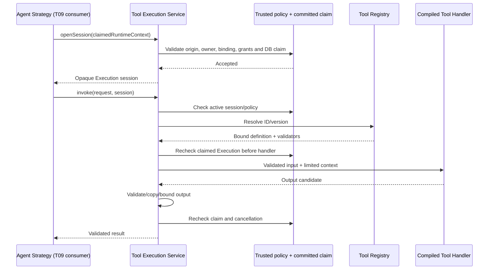

# Phase 2 T08 — Safe Tool Registry & Tool Execution

**T12 acceptance (2026-10-24): ACCEPTED WITH LIMITATIONS for local development only.** See [the acceptance report](acceptance.md) for 173 backend, 89 isolated PostgreSQL and 51 city tests, both builds, browser smoke and live installed Ollama text/calculator evidence. Live OpenAI was NOT RUN. External production exposure remains BLOCKED without production identity/access controls. Earlier task checkpoints below are historical evidence.

T09 update: [LLM Agent Strategy integration](llm-agent.md) now consumes this service through one claimed session, authorized definition discovery and whole-batch validation before sequential invocation. Original T08-only scope/verification below is historical.

Implementation date: **2026-10-23, Asia/Bangkok**. This slice implements the permissioned tool foundation and two compiled tools. It does not implement an LLM strategy, proposal loop, runtime API, worker or city integration. T09 remains planned.

## Repository audit and scope

The existing `apps/api` NestJS 11 / strict TypeScript / npm workspace remains authoritative. PostgreSQL/Drizzle, lifecycle transactions, native claims/leases, 17 v1 lifecycle events, provider registry, Ollama and OpenAI adapters were inspected alongside the Phase 1 acceptance report and Phase 2 plans. T02 already supplied tool interfaces, context grants and zero-tool defaults; there was no executable registry or invoker. Agent JSON accepts category/color only; descriptive Agent.capabilities are not execution permissions. Runtime definitions are server-reviewed bindings, not Task input.

No applicable AGENTS.md or Git repository metadata was found. A pre-edit SHA-256 inventory protects unrelated files; no clean Git-tree claim is made. No new dependency, ORM, backend, migration or infrastructure service is needed. Root `dist/` is preserved city source, not a build output to overwrite.

The latest T08 requirement supersedes the T01 sketch's single calculator/left-right operands: this implementation uses `a`/`b` and also implements Current DateTime. Existing rule-based definitions remain zero-tool; LLM dispatch is still rejected by the coordinator. Tool-bearing LLM definitions can now be represented in reviewed configuration, but no concrete LLM strategy or provider tool-calling capability is added.

## Contracts, registry and DI

The existing `contracts/tool.contract.ts` is extended, not replaced:

- `ToolDefinition`: immutable ID/version, required capability, local input/output schema IDs, byte limits and timeout. Schema IDs identify compiled validators; they are never remote schema URLs or arbitrary client JSON Schema.
- `ToolContract<Input, Output>`: definition fields plus runtime parsers. `ToolHandler` combines parsers with immutable definition metadata and an asynchronous `execute` returning schema-specific output.
- `ToolInvocationRequest` / alias `ToolExecutionRequest`: `{callId, toolId, version, input}`. Arguments remain untrusted. Call IDs are 1–128 safe ASCII letters/digits/dot/underscore/hyphen; tool IDs use the existing lower-case token contract.
- `ToolExecutionContext`: existing IDs, deadline, signal and immutable intersected grants. The service issues opaque, identity-bound sessions with this existing shape; a JSON copy is not a session.
- `ToolExecutionResult<T>`: frozen `{callId, toolId, output}`. No raw errors, input echo, provider objects or arbitrary metadata bag.
- `ToolExecutionError`: the existing RuntimeError taxonomy, not a new hierarchy.
- `ToolExecutionAuthority`: the privileged claim-verification seam, bound to existing persistence in production DI; tests replace it explicitly.

`ToolRegistry` registers only explicitly compiled handlers. It binds methods once, rejects duplicate IDs (including alternate versions under an already registered ID), validates definition limits and denies unknown IDs/versions. `listDefinitions()` returns sorted, immutable metadata without handlers/parsers. Registration never implies permission. Built-ins have no initialization side effects. The registry is an internal trusted-code API, not a public plugin surface.

RuntimeModule registers `ToolRegistry`, `ToolExecutionService`, `CalculatorTool` and `CurrentDatetimeTool`. `TOOL_HANDLERS` contains exactly these two handlers, `TOOL_CLOCK` supplies `Date.now`, `TOOL_EXECUTION_AUTHORITY` binds the real persisted-claim verifier, and the existing `AUTHORIZED_TOOL_INVOKER` token aliases the execution service. No external connection or automatic execution occurs during registration. The app starts without any provider configuration or key.



## Authorization and trusted context origin

All gates are required:

1. Development/test runtime and registry are explicitly configured, bound to loopback, with the existing owner scope. Production remains closed.
2. Platform tools are enabled, and the required capability is in the compiled platform allowlist.
3. The Agent/orchestrator pair has a reviewed runtime binding whose exact immutable definition matches the context.
4. The context grants contain the capability and the binding grants it. Task input, Agent metadata, prompts and model proposals cannot add permission.
5. The context was created by the injected context factory **and** belongs to a successfully committed native runtime admission from the same persistence instance.
6. PostgreSQL still reports the matching owner/Task/Execution/lease in RUNNING state, with an ACTIVE same-route Agent, ENABLED native orchestrator, unexpired lease and deadline.
7. The execution-scoped call/deadline/concurrency limits permit dispatch.

The new `ExecutionContextFactory.owns` checks construction provenance only. It is deliberately insufficient for authorization: even a newly factory-created context with copied legitimate IDs/grants is rejected by the persisted authority. `RuntimePersistenceService` retains an inaccessible WeakMap proof only after its existing admission transaction commits. `verifyToolContext` reuses existing identity/claim checks and short database transactions; it does not create attempts, change statuses, extend leases or emit events. Separate processes and copied contexts cannot recreate proof or recover/reset a session. There is no transaction held while a handler executes.

The service checks the claim when opening a session and before/after each handler. Administrative disablement, route disablement, persisted cancellation, terminal state or lease loss prevents an accepted result. PostgreSQL remains authoritative; the session is only a local budget/identity guard. A race after the final check still requires T09/coordinator terminal fencing; a pure tool result is never authority to complete a Task.

Arbitrary trusted server code is not sandboxed: it can import a pure calculator class or access DI. The guarantee concerns the permissioned execution port and untrusted data passing through it, not containment of malicious code installed in the backend. No public endpoint exposes registry handlers or permission minting.

## Trusted configuration

```env
# OFF by default; requires the existing local RUNTIME_ENABLED/registry setup.
RUNTIME_TOOLS_ENABLED=false
# Only set with explicit enablement:
# RUNTIME_TOOL_ALLOWLIST=["tool.calculator.v1","tool.current_datetime.v1"]
```

The allowlist is JSON, at most 256 bytes, one or two unique compiled capability names. Unknown tools, duplicate grants, an empty enabled list, malformed settings, or a list supplied while disabled fail configuration. Tool-bearing bindings require enabled platform policy and grants within its allowlist. Existing process environment > ignored API `.env` > defaults precedence remains. There is no Task-level override.

Existing definition budgets remain authoritative: at most **two calls per Execution**, sequential only, and `toolTimeoutMs` at most **2000 ms**, no longer than the total Execution deadline. Rule-based definitions retain zero calls/grants. Tools add no credentials or provider requirements. Both provider adapters currently advertise no tool-calling support; T09 must add explicit supported protocol/capability handling rather than treating this registry as provider capability.

## Execution-scoped budgets and lifetime

The trusted owner calls `openSession(runtimeContext)` once after committed admission and closes it in `finally`. Reopening the same context returns the same session/counters. Session state lives in WeakMaps, not a shared global counter or client-writable context. Closing it is irreversible for that context and aborts a current invocation. The production authority issues only one context per claimed Execution, so another factory context cannot reset the budget.

Valid, authorized, schema-accepted attempts reserve their call ID/count before awaiting claim verification or the handler. Only one invocation can be active. Denied/invalid input does not invoke a handler; T09 must also bound proposal/repair rounds so repeated invalid proposals cannot become an unbounded model loop. Duplicate call IDs are rejected, even with identical arguments; results are not cached/replayed and inconsistent reuse never re-executes. These are local read-only-tool safeguards, not durable side-effect idempotency.

The earliest total deadline, definition tool timeout and tool-specific timeout bounds the operation, including asynchronous pre/post claim checks. Both built-ins cap invocation duration at 1000 ms. Cancellation propagates via a child AbortSignal; timers/listeners are removed on completion. A timeout, cancellation or lease loss quarantines the session, so a noncooperative late handler cannot be followed by another invocation. Late results/rejections are consumed and cannot become a success. Deadline timers cannot preempt blocking synchronous JavaScript; built-ins do only small bounded arithmetic/clock work. No untrusted plugin, process isolation or distributed cancellation is implemented.

## Built-in tools

### Calculator v1

Capability: `tool.calculator.v1`. Input schema: `calculator.input.v1`; output: `calculator.output.v1`. Required fields are exactly `operation`, `a`, `b`. Operations: add, subtract, multiply, divide.

```json
{"callId":"call_1","toolId":"calculator","version":1,"input":{"operation":"multiply","a":12,"b":8}}
```

```json
{"callId":"call_1","toolId":"calculator","output":{"result":96}}
```

Operands must be finite numbers with absolute value at most 1,000,000. Division by positive or negative zero is rejected; results must be finite and within ±1,000,000,000,000. Negative zero normalizes to zero. Arithmetic uses JavaScript IEEE-754 semantics; it is deterministic for identical accepted inputs, not an arbitrary-precision financial calculator. There is no expression parser, eval, Function constructor, math engine, shell or external service.

### Current DateTime v1

Capability: `tool.current_datetime.v1`. Schemas: `current_datetime.input.v1` / `current_datetime.output.v1`. Input must be exactly `{}`. The injected production clock reads the server's system time; the output is canonical ISO UTC, never the user's inferred timezone.

```json
{"callId":"call_2","toolId":"current_datetime","version":1,"input":{}}
```

```json
{"callId":"call_2","toolId":"current_datetime","output":{"iso8601":"2026-10-23T12:00:00.000Z","timezone":"UTC"}}
```

This timestamp is the deterministic test-clock example, not a claim about the current instant. The tool has no geolocation, scheduler, network, filesystem or database access.

## Validation, errors and privacy

Both tools have at most 1 KiB input and 1 KiB output. Before serialization, bounded copying rejects getters, hidden/symbol fields, custom prototypes, functions, undefined, bigint, cycles, nonfinite numbers, unsafe diagnostic/credential field names and known secret text patterns. Depth, object/array width and node count are bounded. Compiled per-tool parsers reject unknown fields and validate actual data; TypeScript and byte limits alone are insufficient. Results are copied/frozen and validated again after handler execution. The guards are not a general DLP system; reviewed handlers/data remain necessary.

| Condition | Existing safe code |
| --- | --- |
| Unknown ID/version, missing grant, forged/copied/closed session, duplicate call ID | `TOOL_DENIED` |
| Malformed input, unsupported arithmetic, division by zero, numeric overflow | `INVALID_INPUT` |
| Calls exhausted or simultaneous invocation | `CAPACITY_EXCEEDED` |
| Deadline / explicit cancellation / stale claim | `DEADLINE_EXCEEDED` / `CANCELLED` / `LEASE_LOST` |
| Invalid/unsafe output or unexpected handler/parser failure | `TOOL_FAILED` |
| Oversized output | `OUTPUT_LIMIT_EXCEEDED` |
| Invalid registration or environment policy | `CONFIGURATION_ERROR` or existing startup configuration failure |
| Inactive Agent or existing scope rejection | Existing `ACCESS_DENIED` |
| PostgreSQL access failure | Existing sanitized `PERSISTENCE_UNAVAILABLE` |

No error code, hierarchy or durable event type was added. Public error serialization remains `{code,message}` without raw exception, stack, credential or argument content. No automatic retry occurs.

Successful invocation uses the existing scoped logger's `runtime.budget` metric with tool count and existing owner/Agent/Task/Execution/correlation identifiers. Arguments, outputs, prompts and secrets are not logged. This is transient observability, **not durable tool audit history**. Phase 1's 17 lifecycle events remain unchanged and are emitted only by existing committed lifecycle operations. T09/T11 must design any durable bounded tool summary within the existing event architecture before claiming replay/history guarantees; no event table, write API, outbox delivery or alternate audit system was added.

## T09 integration contract and limits

```typescript
// Trusted runtime code only, after successful native admission:
const session = await tools.openSession(claimedRuntimeContext);
try {
  const result = await tools.invoke(validatedProposal, session);
  // Use bounded result only as data in a capability-negotiated next model turn.
} finally {
  tools.closeSession(session);
}
```

This shows intended internal use, not an HTTP/CLI endpoint. Today only the zero-tool text statistics strategy is registered. Positive service/DI tests use an explicitly injected test-only claim authority and genuine built-in handlers. Real PostgreSQL tests verify the production claim proof, identity isolation and terminal rejection on the existing native pipeline. T08 does not claim an end-to-end LLM/tool Task workflow.

T09 must implement the LLM strategy and explicitly permitted dispatch, negotiate actual provider/model tool support, preserve one session per claimed Execution, bound provider rounds/proposals/aggregate calls, pass cancellation and close the session on every outcome. It must keep existing lease heartbeat/fencing and result/lifecycle/event transactions, and never synthesize grants from Task/model text. No result persistence, Task transition or automatic tool invocation is performed by these tools.

External or destructive tools remain excluded. Future side effects need durable invocation identity, idempotency/reconciliation, scoped credentials, approvals where appropriate and isolation; this in-process read-only foundation does not supply those guarantees. Production identity/RBAC, distributed budget recovery and untrusted code execution remain out of scope.

## Verification and file changes

Run `npm run check:api`, `npm run test:api` or the existing complete `npm run verify:phase1`. Tool suites require neither PostgreSQL nor a provider; the aggregate separately runs owned disposable PostgreSQL, migration and browser regression checks. Standard CI's existing test glob includes these tests without paid APIs, real Ollama or model downloads. Live provider verification is not part of T08.

### Executed results

| Executed command/check | Result on 2026-10-23 |
| --- | --- |
| `npm.cmd run build` and `npm.cmd run check:api` | PASS, strict TypeScript/backend compilation |
| Focused `node --test --test-concurrency=1 apps/api/test/tools.test.cjs apps/api/test/tools-di.test.cjs` | Initial 16/16 PASS; two additional regressions were subsequently added and included in the final backend run |
| `npm.cmd run verify:phase1` | Lint/static checks, backend build, disposable frontend build, migration-journal check, 51/51 city tests and initial 132/132 backend tests PASS. Aggregate stopped at PostgreSQL because Docker Desktop's engine was not running. No database assertion was reached in that failed setup. |
| Final `npm.cmd run check:api` and `npm.cmd run test:api` | PASS, **134/134** backend tests, including 18 tool/DI/security cases plus all provider, coordinator, registry, Task and audit regressions. Includes explicit expiry/output limits and the confirmed policy-narrowing correction. |
| `npm.cmd run test:db` after starting the installed Docker engine | PASS, **70/70** on owned disposable PostgreSQL. Includes new proof of committed context origin, factory/copy/foreign-instance rejection and terminal fencing, alongside migrations/restart, lifecycle, concurrency, result/event rollback and real rule-based CLI coverage. |
| `npm.cmd run test:browser` | PASS, Chrome 155, 101 resource requests, zero exceptions. Checks city Canvas/environment/clock, four agents and decorative citizens without API, camera focus/zoom/recenter, panels, simulated mission controls and mobile reload. |
| New documentation links/fences | PASS, local targets resolve and fenced blocks balance |
| Source review | No eval/Function constructor, shell, filesystem, HTTP/fetch or database query operation exists in `runtime/tools/`. Claim authorization uses the existing parameterized persistence boundary only. |
| SHA-256 preservation | **96 protected files unchanged**, including all **51 city source files**, both provider adapters, prior migrations and Phase 1 lifecycle/database/Agent/Task/Execution/event code. No maintained files removed. |

The first aggregate command did not exit successfully because its Docker setup failed. The blocked database and unreached browser stages subsequently passed as separate invocations; the aggregate is not misreported as a successful command. The final backend rerun followed the policy-narrowing fix and additional tests. No production/development database reset occurred. The existing CI workflow/test globs include all new deterministic tests; hosted workflow execution was not performed.

Live Ollama/OpenAI verification: **NOT RUN**, not required for T08 and not enabled. All provider regressions used controlled transport. Browser checks are smoke coverage, not a pixel-diff, FPS, exhaustive gesture or long-duration guarantee.

### File manifest

Created:

- `apps/api/src/runtime/tools/tool-registry.ts`
- `apps/api/src/runtime/tools/tool-execution.service.ts`
- `apps/api/src/runtime/tools/tool-validation.ts`
- `apps/api/src/runtime/tools/tool-deadline.ts`
- `apps/api/src/runtime/tools/calculator.tool.ts`
- `apps/api/src/runtime/tools/current-datetime.tool.ts`
- `apps/api/test/tool-fixtures.cjs`
- `apps/api/test/tools.test.cjs`
- `apps/api/test/tools-di.test.cjs`
- `docs/ai-agent-platform/phase-2/safe-tools.md`

Modified:

- `apps/api/src/runtime/contracts/tool.contract.ts` — extend the T02 contracts and reuse their schema parser boundary.
- `apps/api/src/runtime/context/execution-context.factory.ts` — construction provenance tracking, without granting permission.
- `apps/api/src/runtime/runtime-persistence.service.ts` — postcommit context proof and read-only claim verification; intersect configured grants during existing context construction.
- `apps/api/src/runtime/runtime-configuration.ts` — default-deny tool policy and reviewed binding validation.
- `apps/api/src/runtime/runtime.module.ts`, `apps/api/src/runtime/tokens/runtime.tokens.ts` — compiled tool DI and existing invoker binding.
- `apps/api/test/runtime-contracts.test.cjs` — verify real registry/invoker DI without startup execution.
- `apps/api/test/runtime.integration.cjs` — owned PostgreSQL proof/identity/terminal regression.
- `apps/api/.env.example` — optional local tool policy, off by default.
- `README.md`, `WORKSPACE.md`, `docs/ai-agent-platform/README.md` — current checkpoint.
- `docs/ai-agent-platform/phase-2/README.md`, `implementation-plan.md`, `runtime-contracts.md`, `tool-security.md` in that same directory — implemented scope, historical design provenance and T09 integration boundary.

Removed: none. No package/lockfile/dependency, migration/schema, Compose, CI workflow, provider adapter or frontend source change.

Next: **Phase 2 T09 — LLM Agent Strategy & Tool Integration**. T09 has not begun.
