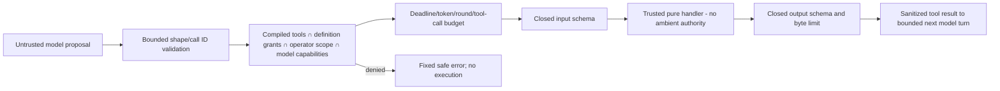

# Runtime and tool security boundaries

**T12 acceptance (2026-10-24): ACCEPTED WITH LIMITATIONS for local development only.** See [the acceptance report](acceptance.md) for 173 backend, 89 isolated PostgreSQL and 51 city tests, both builds, browser smoke and live installed Ollama text/calculator evidence. Live OpenAI was NOT RUN. External production exposure remains BLOCKED without production identity/access controls. Earlier task checkpoints below are historical evidence.

T09 update: [bounded LLM/tool integration](llm-agent.md) is implemented with native structured proposals and existing claim-backed authorization; no model prose parsing, numeric coercion or provider failover is allowed. Historical planning/checkpoints below remain provenance.

T08 IMPLEMENTED: [safe tools](safe-tools.md) documents the compiled Calculator/Current DateTime registry, trusted claim-backed invoker, strict schemas, budgets and tests. No LLM proposal loop exists. The following original T01/T02 planning snapshot remains provenance; its one-tool scope, left/right operand sketch and planned-only registry wording are superseded by the latest T08 requirements and implementation.

## Preserved T01/T02 planning snapshot

T02 implements [context/grant/result validation and safe logging](runtime-contracts.md), plus tool interface types. There is no Tool Registry, invoker binding or executable tool. The execution/transport/isolation/policy gates below remain required future work; context shape validation is not runtime authorization.

Status: **PLANNED**. Reuses the implemented [local access boundary](../agent-registry.md) and [Phase 1 limitations](../phase-1-acceptance.md), but real execution requires additional gates. No tools are implemented or implicitly authorized by a registry capability string.

## Gate before the first deterministic run

Runtime defaults OFF; enable only dev/test with existing database/owner scope and explicit runtime operator permission. Only allowlisted ACTIVE Agent + ENABLED configured native route + registered deterministic definition may run. Enforce Task/Execution owner/route/authority and immutable definition snapshot. Bound input, output, total deadline, concurrency and result size; add durable claim/token/atomic result/event behavior before dispatch. Retain production fail-closed and no public runtime mutation route until T11. A forged task ID, model setting, role/capability label or NPC selection is not authorization.

The local CLI is a privileged operator process using validated environment and selected scope; no pretend authenticated user is created. Runtime enablement is separate from registry access. Future HTTP runtime commands require the same socket/Host/Origin/bearer gate **plus** explicit runtime/agent/profile permission. For production, replace this dev exception with actual person/service identity, tenant membership, role permissions, TLS, operator audit and deployment controls; a bearer secret on loopback is not production RBAC. Never tunnel the development API or use local-mode flags on a public host.

## Additional gate before any real LLM call

All of these precede T06 live local generation and T07 paid generation; T10 is not an excuse to postpone them:

- Explicit LLM/profile/model permission, provider capabilities and data-location approval. No cloud fallback or auto-download.
- Strict endpoint/destination/redirect/DNS/proxy policy; local Ollama connectivity reviewed from the actual runtime namespace. OpenAI endpoint fixed; credentials adapter-private and environment-only.
- Validated input, bounded request bytes/tokens/rounds, deadline through the complete HTTP body, cancellable local I/O and fail-closed claim fencing.
- Validated bounded output with no raw provider/stack/error passthrough; result storage/access policy. No raw prompts, reasoning traces, environment dumps or key material in audit/logs.
- Zero tools by default, no arbitrary files/network/shell/SQL. Model output is untrusted data, never authority to perform an action or invoke another agent.
- One in-flight run/process and DB-backed per-agent exclusion/quarantine; no automatic retry or replay after unknown provider acceptance. Account/project spend controls and explicit consent for paid profiles.
- Deterministic HTTP fixture, abort/deadline, SSRF, secret-sentinel, rollback and concurrency tests pass before a live opt-in check.

## Minimal tool contract and allowlist

Only after T08/T09, add compiled definitions `{id, version, inputSchemaId, outputSchemaId, maxDurationMs, maxInputBytes, maxOutputBytes, requiredPermission}` and trusted handler references. Registry construction rejects duplicate IDs/versions and dynamic imports. Schemas are closed registered validators, not arbitrary client JSON Schema with remote `$ref`. A definition may name tools but cannot install or execute code.

Invoker is the only path to handlers. It verifies owner/execution/valid claim, abort signal and total budget before each call; no model-supplied identity can override context. Per-agent permission is the reviewed **definition binding**, not the current untrusted task or descriptive Agent.capabilities list. Tool context contains only invocation IDs, signal/deadline and safe logger; no raw DB pool, provider client, API keys, filesystem root or global registry. The strategy cannot bypass the invoker by importing arbitrary handlers.

Start with **one pure calculator**: `{operation: add|subtract|multiply|divide, left, right}`, finite operands bounded to ±1,000,000, divide-by-zero rejected, finite result capped at ±10^12, no expression parser/eval. Input/output ≤1 KiB, time cap ≤2 s and lower than remaining execution time. No network or filesystem needed. A second tool is unnecessary for MVP; if later useful, a bounded text-statistics utility can reuse pure deterministic logic. Date/time tools add nondeterminism and are optional, not required to claim tools support.

Initially at most two tool calls total and three provider rounds, sequential only. Duplicate call IDs within an execution return the cached validated outcome for this execution or reject inconsistent arguments; they never silently execute twice. This is not a durable side-effect idempotency guarantee and cannot be reused to justify future write tools. Denial/schema/budget violations terminate the controlled loop by default; no unlimited model self-repair cycle. Future destructive/external side effects require explicit human approval, scoped credentials, durable call identity/idempotency/reconciliation and isolation, beyond this MVP.

## Threat model and practical controls

| Threat | Required mitigation / acceptance evidence |
| --- | --- |
| Prompt injection in task/context/tool output | Treat all as untrusted content, separate trusted instruction templates, never interpolate into code/config/permissions. Adversarial prompts cannot broaden grants, alter provider/endpoint, reveal secrets or recursively delegate. Prompt formatting helps but does not itself guarantee injection resistance. |
| Unsafe model-generated commands | No shell, eval, script loader, unrestricted SQL/HTTP/file tool or provider-hosted tools. Only validated allowlisted calculator proposals can run. Test malicious names/arguments and unknown tool IDs. |
| Secret leakage | Adapter-private credentials; no context/env dump APIs; request headers/error bodies omitted from logs. Results/task prose can contain personal data: require approved nonsecret inputs, sensitive-pattern checks, scoped access and retention review; do not promise a complete DLP solution. |
| Cross-agent/tenant data access | Derive owner from authorized server scope; enforce composite FK/domain checks and context per attempt. No client-selected result owner, execution session, secret/profile override or shared mutable conversation. Test cross-scope IDs. |
| Unauthorized invocation/spend | Separate runtime/LLM/paid flags, explicit definition bindings, native route/authority checks and concurrency caps. Reject disabled/archived agents, EXTERNAL authority and unauthorized profiles before dispatch. |
| SSRF and credential exfiltration | Fixed/approved endpoint policy, controlled DNS/connection pinning, redirect denial, no credentialed URLs, no task-driven URL or generic fetch tool. Explicit private Ollama destination exception only. |
| Resource exhaustion/infinite loops | Fixed byte/token/context/round/call/time caps, one process run capacity, bounded admission, cancellable body reads and DB leases. Pure handlers must have bounded complexity; async timeout does not preempt blocking JavaScript. |
| Malicious model output/XSS | Closed result types, safe content type, text escaping on future clients; no HTML execution, script links or provider-generated config. Reject malformed/oversize structured output. |
| Audit leakage and dishonest progress | Existing lifecycle events only for committed facts, fixed small payloads, audit metrics whitelist, no prompts/tool arguments/results by default. Progress is transient and not status authority. |
| Duplicate execution after crash/cancel | Persisted claims/token guards, no automatic RUNNING takeover, uncertain-provider quarantine and no paid fallback/retry. Test races and lost commit acknowledgement. |
| Destructive actions | No destructive tool exists in MVP; future explicit operator approval must precede any such capability. Model consent is not operator approval. |

## Isolation, privacy and operations

Built-in pure handlers and bounded HTTP adapters run in the trusted Node process initially; this is **not a general sandbox**. Never accept arbitrary npm modules, command strings, Python/JavaScript snippets or writable working directories as agent definitions. A later untrusted runtime requires OS/container resource controls and process termination semantics; do not retrofit it as a new tool handler with broad permissions.

Use current command audit actor labels truthfully: an approved local operator initiates work, a runtime instance performs operations; neither is an authenticated person identity. Planned lifecycle seam accepts trusted bounded actor/correlation/runtime metadata rather than hardcoding every worker fact as the current local-development-operator. Public request data cannot forge those fields. No additional event-write API is needed.

No retention deletion job, raw-prompt storage or usage invoice service is added in the first runtime. Apply a reviewed retention/access policy before sensitive/production data; append-only history and RESTRICT references mean ad-hoc deletion would break invariants. Backups, restricted application versus migration roles, account policy and production recovery must be designed/verified before production. Browser receives no credential or direct model endpoint. Existing city works when every runtime/provider/tool flag is disabled.

## Security acceptance matrix

CI must test deny-by-default operation, production refusal, malformed UUID/query/body, unknown keys and mass assignment, cross-owner/agent/Task/Execution IDs, snapshot/type mismatch, unauthorized provider/tools, context leakage, request/response secret sentinels, prototype keys, invalid JSON/NaN/Infinity arithmetic, excessive sizes, abort/timeout during slow headers/body/tool result, redirects/DNS/proxy destinations, no automatic retry, cancelled/expired stale writes, conflicting outcomes and full transaction rollback. Provider HTTP is mocked at transport fixtures only; PostgreSQL invariants are verified on the owned real test DB. No paid API or model download is a CI requirement.
