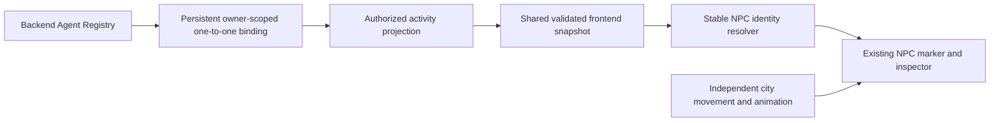
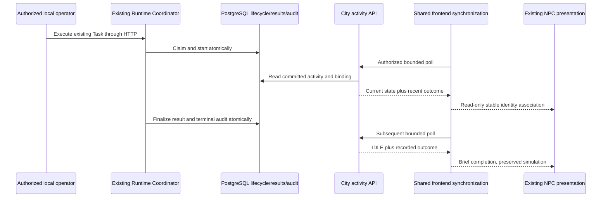
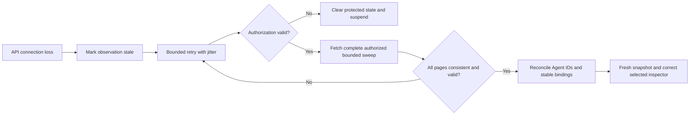
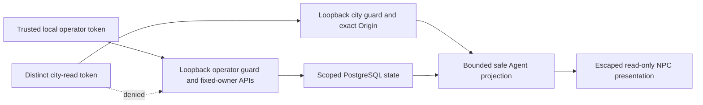

# Phase 3 T10 — End-to-end acceptance and release readiness

Date: **2026-10-25, Asia/Bangkok**. Decision: **ACCEPTED WITH LIMITATIONS for the approved local-development scope**. Public production exposure remains **BLOCKED**. This report supersedes the earlier planning/checkpoint statements; it does not change historical Phase 1/2 acceptance.

## Recovery and review boundary

The interrupted review had completed `npm.cmd run verify:phase1`: 125 frontend tests, 192 backend tests, 104 real PostgreSQL integration tests, static checks, both builds, migration checks and Chrome smoke passed. The saved log ended in the successful browser report. Existing T02–T09 implementations and evidence were retained. The unfinished work was a combined real-browser/real-backend acceptance fixture, final documentation and readiness decision.

No applicable AGENTS.md was found in the workspace or accessible ancestor locations. `git status --short` and `git diff --stat` fail because this supplied workspace has no Git metadata. A recovered SHA-256 inventory was used instead: [source preservation evidence](verification-evidence/t10-source-preservation.json) checks 166 existing frontend/assets, backend/migration and Docker files, with **zero changes**. This cannot establish Git cleanliness or visual-diff equivalence. No production application source, schema, dependencies or city assets changed during T10.

## Architecture and implementation inventory

All COMPLETE classifications below apply to the implemented local scope and stated disclosure/capacity limits. They do not imply production identity, full city-side result history or external orchestrator support.

| Task | Status | Implementation/documentation | Verification evidence |
| --- | --- | --- | --- |
| T01 Architecture | COMPLETE | [Architecture](architecture.md), [decisions](decisions.md), [roadmap](implementation-plan.md) | Actual modules preserve backend authority, one coordinator/provider/tool framework; no new transport/runtime |
| T02 Identity | COMPLETE | `apps/api/src/city/binding.*`, existing `city_agent_bindings`, immutable resident slots | Binding unit/SQL/CLI tests; real browser restart/reload/unbinding; [binding guide](agent-npc-bindings.md) |
| T03 Projection | COMPLETE | `apps/api/src/city/activity.*`, guarded operator/city controllers | Real SQL mapping, ownership, consistent lifecycle reads, bounded page-count tests; [projection guide](agent-activity-projection.md) |
| T04 Synchronization | COMPLETE | `dist/js/runtime/api-client.js`, `validation.js`, `runtime-store.js`, `sync-controller.js` | Fake-clock/request tests, real authorized HTTP compatibility and native Chrome fetch; [client guide](frontend-runtime-integration.md) |
| T05 NPC binding | COMPLETE | `npc-registry.js`, `npc-runtime-binding.js`; existing Simulation collection hooks | Resolution, conflict, missing NPC, decorative NPC and reconciliation tests; [binding guide](npc-runtime-binding.md) |
| T06 Visualization | COMPLETE | `npc-status.js`, `npc-status-drawing.js`, renderer injection | Status mapping, Canvas mocked-transport browser checks and real persisted-state acceptance; [visualization guide](npc-status-visualization.md) |
| T07 Inspection | COMPLETE within city-read contract | `inspection-model.js`, `npc-runtime-inspector.js`, existing app inspector | Selection/history-reference isolation, safe text, revoked access and real execution outcomes; [inspector guide](agent-inspection.md) |
| T08 Multi-Agent/reconnection | COMPLETE | Existing shared polling, version/request-generation fences, binding reconciliation | Fake clocks, 20-Agent updates, 100 reconnect cycles, real HTTP restart and Chrome outage/recovery; [T08 guide](multi-agent-synchronization.md) |
| T09 Security/performance/regression | COMPLETE with limits | [T09 report](security-performance-verification.md), parser regression tests and profiling scripts | Recovered full regression baseline; fresh audit, synthetic profile and SQL measurements below |
| T10 Acceptance | COMPLETE with local-release limits | This report, opt-in combined acceptance fixture and CI step | `npm.cmd run test:city:e2e`: one real Chrome/PostgreSQL workflow, five genuine coordinator executions |

The city remains vanilla ES modules/Canvas 2D under maintained **source** `dist/`; it is not a disposable build directory. The sole backend is NestJS/Drizzle/PostgreSQL in `apps/api`. Agent-linked markers and inspection consume the shared read-only runtime facade. Existing NPC movement, navigation, simulation needs/routines, train, water, camera and local mission retain their own authority.

## Test environment and actual end-to-end workflow

`npm run test:city:e2e` builds the API and selects the opt-in test in the existing PostgreSQL harness. It starts a fresh random, labelled PostgreSQL container/database/volume using the existing pinned image, applies migrations, and tears down only resources whose identity/labels match this run. It never consumes a developer or production DATABASE_URL. Vite and API instances bind ephemeral **127.0.0.1** ports. Chrome uses an owned disposable profile. Tokens are random per run; no paid provider or production credentials are used.

The parent registers/activates three RULE_BASED Agents over the actual authorized HTTP API. It creates three bindings through the existing trusted local service, verifies identical-request idempotency/conflict rejection, then opens the actual city. Browser requests use **native fetch**, real CORS/preflight and the separate city-read token. Only the trusted test parent has the operator token. Fixture commands travel over private child-process IPC, not an application route.

Deterministic barriers wrap dispatch to the existing `TextStatisticsStrategy`, then delegate successful work to that genuine strategy. Tasks are queued through `RuntimeCoordinator.queueTask`, preserving trusted snapshots. Deliberate failure throws a closed runtime error; timeout uses a real 600 ms trusted execution budget and cooperative abort. There is no test provider or lifecycle mutation shortcut on the primary execution path.

Verified checkpoints ([raw browser report](verification-evidence/t10-browser-e2e.json)):

1. Three authorized Agents resolve to the expected stable slots; the fourth NPC remains decorative/unbound and the city continues animating.
2. Missing credentials receive 401; a city-read token cannot read the operator Agent API. The existing SQL/security suites additionally exercise owner/Origin/Host boundaries and inaccessible IDs.
3. A queued trusted attempt projects QUEUED and shows Waiting; actual HTTP execution projects RUNNING and shows Running.
4. A and B execute concurrently on **two existing coordinator instances sharing PostgreSQL**. Cancelling B leaves A running. Cancellation persists and late completion cannot overwrite it.
5. A produces a genuine persisted `text.statistics.v1` result. The inspector shows SUCCEEDED, completion appears briefly and expires without replay on refresh.
6. A controlled strategy error persists FAILED; a real deadline persists TIMED_OUT with Task FAILED. The associated NPCs show recorded failure outcomes.
7. While Chrome's API transport is blocked, a subsequent eligible A execution completes on the real backend. NPC/inspector show stale connection data, not execution failure. Automatic shared polling recovers the committed missed outcome.
8. The primary Nest application is closed and reopened on the same port; the browser is reloaded. Persisted binding IDs remain identical, the city still has four NPCs, and explicit trusted reauthorization restores observations.
9. A real city-read credential rotation makes the old credential invalid. The store is emptied and protected inspector data is removed. Fresh authorized reconnect succeeds.
10. Removing A's exact binding leaves Agents, execution results/history/audit and visual NPCs intact. The inspector returns to ordinary NPC behavior.
11. All **five** executions have the expected terminal Task/Execution pair and exactly one terminal execution audit event; event IDs are unique. Private input/context and tokens are absent from captured city state/DOM and test log capture.
12. Common Chrome smoke verifies camera zoom/focus/recenter, help/developer panels, local mission pause/resume/reset and mobile reload/viewport, with zero uncaught browser exceptions.

One coordinator deliberately permits **one active execution at a time**. The concurrent acceptance fixture uses two normal Nest instances rather than removing that resource bound or introducing workers. Persisted running cancellation remains `CANCELLATION_UNCONFIRMED` and blocks fresh native work for that Agent; the test respects this quarantine. It does not claim automatic cancellation recovery.

## Final acceptance matrix

PASS means supported by the indicated executed evidence within the approved local-development boundary. BLOCKED entries define deployment or unsupported environment gates, not silently waived functionality.

| Category | Status | Evidence | Remaining limitation |
| --- | --- | --- | --- |
| Agent identity mapping | PASS | Binding unit/SQL/CLI suites; identical request/conflict, restart/reload and safe removal in real Chrome acceptance | 20 trusted resident slots; four default visual residents; unresolved slots never auto-spawn |
| Backend activity projection | PASS | T03 real SQL/HTTP tests; actual queued/running/terminal acceptance | Persisted state is not proof of process liveness; UNKNOWN/stale/uncertainty stays explicit |
| Frontend synchronization | PASS | 125 frontend tests include client/controller; actual native fetch and recovery | Shared two-second sampled polling can miss short transitions |
| NPC runtime binding | PASS | Indexed identity/resolution/reconciliation tests and real stable-slot checks | Missing NPC remains unresolved; simulation does not create Agents |
| NPC status visualization | PASS | Central status tests, mocked Canvas checks, real backend-to-inspector presentation | No pixel-by-pixel visual baseline or accessibility user study |
| Agent inspection | PASS | T07 tests plus actual selected NPC/current/latest outcome and revocation | At most three authorized execution references and latest outcome; no full result text/operator audit expansion |
| Multi-Agent synchronization | PASS | 20-Agent deterministic tests, real simultaneous A/B and isolated cancellation | One active execution per coordinator instance; no collaboration/scheduler |
| Network recovery | PASS | Fake-clock backoff/visibility tests, real HTTP restart, Chrome transport block and automatic reconciliation | No event replay, gap-free streaming or hard-crash recovery |
| Authentication | PASS | Approved local mode: distinct operator/read tokens, loopback/Host/Origin guards, credential rotation clears state | No human login/production identity/session platform |
| Authorization | PASS | Approved local mode: fixed-owner SQL/API/CLI tests, foreign-resource denial, city token denied operator APIs | No implemented multi-user/multi-tenant product; real cross-tenant login testing is NOT VERIFIED |
| Data privacy/injection | PASS for reviewed fields | Safe DTOs/allowlist/escaping tests; malicious test Agent name creates no image/script; private input/token absence | General arbitrary-content DLP is not guaranteed; result text remains excluded from city projection |
| Performance | PASS for bounded local observations | Fresh SQL query counts and synthetic processing/cleanup measurements below | No production capacity/FPS/long-soak guarantee; 100 linked NPCs unsupported |
| City simulation regression | PASS for executed smoke | 125 city tests; actual clock/NPC/train/water advancement, camera/mission/mobile smoke; unchanged source/assets hashes | Not exhaustive visual/gesture/routine testing |
| Automated tests | PASS | 125 frontend + 192 backend + 104 PostgreSQL baseline, final type/static checks and one additional combined acceptance | Existing Node scripts provide checking; no separate ESLint/formatter script is configured |
| Browser E2E | PASS | Installed Chrome 155 real city + real API/PostgreSQL acceptance, zero exceptions | Linux CI step added; hosted CI was not executed from this workspace |
| Documentation | PASS | Updated acceptance, indexes, roadmap, run/testing instructions and diagrams; link/fence checks | Historical records retain their original checkpoint scope |
| Release readiness | BLOCKED | Local-development acceptance passes: both builds, clean test migrations, protected APIs, isolated teardown and accurate environment docs | Public production release requires production identity/access/deployment review and operational recovery |

## Commands and retained evidence

Run from repository root with Node 24, installed dependencies, Docker engine and installed Chrome/Chromium. On Windows `npm.cmd` avoids PowerShell execution-policy interference. No optional live OpenAI test is required for this path.

For the repeatable isolated acceptance environment:

```sh
npm ci
npm run test:city:e2e
```

This command owns the entire test environment and tears it down; it leaves no development Agent or binding behind. Set `BROWSER_PATH` only if installed Chromium cannot be discovered. The CI workflow runs the same dedicated command after the ordinary aggregate checks.

For a persistent local development session, follow [the existing API/environment instructions](../README.md), [binding CLI guide](agent-npc-bindings.md) and [trusted browser connection setup](frontend-runtime-integration.md#configuration-and-authorization). Use an ignored `apps/api/.env` with a development PostgreSQL URL, `API_HOST=127.0.0.1`, registry owner/operator credential, `CITY_READ_ENABLED=true`, a **different** city-read token and the exact `CORS_ORIGINS` frontend origin. Apply `npm run db:migrate`, start `npm run dev:api`, then `npm run dev:web -- --host 127.0.0.1`. A real execution additionally needs `RUNTIME_ENABLED=true` and reviewed server-side `RUNTIME_BINDINGS`; neither Task input nor browser code selects providers/tools/strategies. The frontend integration stays disabled until trusted local composition calls `runtimeIntegration.connect`; a credential-entry UI is not implemented. Docker's supported static/full-stack workflow and its protected-runtime limitation are documented [separately](../../docker.md).

| Actual command | Result and scope |
| --- | --- |
| `git status --short`; `git diff --stat` | BLOCKED: no Git metadata in supplied workspace; file hashes used instead |
| `npm.cmd run verify:phase1` | PASS in recovered T10 baseline: `lint`, backend build, disposable frontend build, `db:check`, `test:all`, `test:db`, `test:browser` |
| `npm.cmd run lint` | PASS final continuation rerun: all game JS syntax, frontend runtime TypeScript, backend TypeScript no-emit |
| `npm.cmd run test:city:e2e` | PASS final combined acceptance, 1 test / 5 executions; includes fresh backend build, clean migration and real Chrome |
| `node --check apps/api/test/city-browser.integration.cjs` | PASS |
| `node --check scripts/phase3-acceptance-browser.mjs` | PASS |
| `node --check scripts/browser-smoke.mjs` | PASS |
| `node --check scripts/city-acceptance.mjs` | PASS |
| `npm.cmd audit --json` | PASS: zero reported vulnerabilities across all severities |
| `npm.cmd run profile:phase3 -- --out docs/ai-agent-platform/phase-3/verification-evidence/t10-node-profile.json` | Completed fresh bounded synthetic profile and 300 integration disposal cycles; no production capacity claim |

The preserved [baseline summary](verification-evidence/t10-baseline.json) records exact test totals, advisory counts and real SQL query measurements. Successful baseline tests were not needlessly repeated because production source remained unchanged. Only the changed acceptance fixture and relevant final static checks were rerun. The opt-in test is excluded from the ordinary 104-test SQL suite and runs through its dedicated script/CI step; it is not counted twice.

The [final check record](verification-evidence/t10-final-checks.json) includes the final combined test exit status, duration and log hash. The finalized combined workflow took 39.887 seconds including harness setup/cleanup; this is test duration, not an execution-latency benchmark.

Initial attempts are not reported as successes: Docker Desktop was initially stopped; after starting the installed engine, the first scenario incorrectly attempted to reuse a quarantined cancelled Agent. It was corrected to use another eligible Agent. Another test assertion checked DOM removal synchronously even though the existing inspector refresh is scheduled; it now waits for the same externally observable removal used by existing tests. The finalized test passed. These were fixture corrections, not changes to Phase 2 lifecycle policy or city behavior.

Fresh live Ollama/OpenAI probes: **NOT RUN** in T10. Deterministic adapter/provider/runtime tests are included in the backend/SQL baseline. Historical Phase 2 live Ollama evidence remains historical; no paid provider usage was incurred. Docker application smoke from T09 remains historical evidence, not a fresh T10 execution.

## Performance and cleanup observations

Environment: Windows 11 build 26200, Node 24.9.0, Ryzen 5 5600H, 12 logical CPUs, about 16.5 GB physical memory, Chrome 155. Local timings depend on concurrent host activity. There is no before/after optimization claim because T10 changed no production processing path.

The fresh baseline SQL test used 100 Agents with 2,000 historical Tasks and 100 CREATED Tasks:

| Agents | SELECTs/pages | Observed duration, ms |
| --- | --- | --- |
| 1 | 1 | 15.011 |
| 10 | 1 | 13.747 |
| 25 | 2 | 25.701 |
| 50 | 3 | 44.095 |
| 100 | 5 | 78.053 |

These are local projection observations, not end-to-end execution latency. One SELECT per bounded page avoids per-Agent query growth.

The [fresh synthetic Node profile](verification-evidence/t10-node-profile.json) performs 100 controlled sweeps per size through synchronization, binding and selected inspection, using mocked Responses:

| Projection rows | Linked slots | Requests / 100 sweeps | Median / p95, ms |
| --- | --- | --- | --- |
| 1 | 1 | 100 | 0.947 / 1.878 |
| 10 | 10 | 100 | 1.578 / 3.085 |
| 20 | 20 | 100 | 1.687 / 3.064 |
| 25 | 20 | 200 | 2.010 / 3.211 |
| 50 | 20 | 300 | 3.194 / 6.554 |
| 100 | 20 | 500 | 7.662 / 12.315 |

Beyond 20, rows are deliberately unbound, not evidence for 100 linked NPCs. Three hundred create/connect/refresh/dispose cycles have forced-GC heap checkpoints 8,899,864 → 9,092,592 → 9,049,936 → 9,094,224 bytes. This short bounded plateau and deterministic timer/listener cleanup tests investigate resource handling; they do not prove absence of long-term/native/browser leaks. T09's separate real browser frame/heap observations remain linked in its report. No fresh T10 FPS benchmark was performed.

## Security, operational boundaries and known limitations

- **Production release blocker:** local shared tokens/fixed owner/loopback boundaries are the approved development architecture. There is no production multi-user identity, tenant administration or browser login. Do not expose these APIs publicly or weaken guards to make container/LAN access work.
- Docker starts the static city, API health and PostgreSQL/migrations, but protected runtime/city APIs remain disabled in that bridged deployment. See [Docker instructions](../../docker.md). Local protected observation uses a loopback-host API and exact approved frontend CORS origin.
- The browser connection is explicitly composed by trusted local code with a distinct city-read token in memory. Reload clears that token; reauthorization is required, while database identity mappings remain persistent. No secrets are bundled or stored in URLs/browser storage.
- Current status is separate from recent outcome. Historical completion is IDLE plus a bounded completion marker; FAILED/CANCELLED are recorded outcomes. Persisted RUNNING without a reliable lease/liveness signal is not claimed as live execution.
- Projection pages are internally consistent SQL reads, not a transaction across an entire paginated sweep. Request generations, same-identity versions and full-sweep validation prevent supported stale overwrite cases. No global replica ordering/event replay is claimed.
- City inspection intentionally has no unrestricted raw result, prompt, provider response, tool payload, full history or audit access. Operator APIs retain their existing separate authorization. Future disclosure expansion requires its own review.
- Twenty identity slots and four default residents are supported. Missing slots remain unresolved; decorative citizens never become backend Agents. No spawning, movement, pathfinding or animation logic is controlled by runtime state.
- A hard crash can leave unresolved leases/quarantine; cancellation cannot forcibly stop arbitrary noncooperative code or guarantee remote computation/billing cessation. No recovery worker, retries, failover or exactly-once external side effects are claimed.
- Pixel-perfect screenshots, exhaustive manual accessibility/gesture review, long-duration load/heap soak, production multi-user login, hosted CI execution and fresh live provider probes are not verified here.

No new unresolved Critical/High defect was found within the accepted local boundary. T09's parser/security fixes are retained and covered by the fresh baseline; zero advisory results are not a comprehensive security proof. Production authentication/deployment gaps remain explicit blockers for broader release.

## Architecture diagrams









## Files changed during T10

Created:

- `apps/api/test/city-browser.integration.cjs` — opt-in owned PostgreSQL/API/operator fixture and actual-browser acceptance.
- `scripts/city-acceptance.mjs` — dedicated existing-harness test selection.
- `scripts/phase3-acceptance-browser.mjs` — native browser read-only workflow and private fixture control.
- `docs/ai-agent-platform/phase-3/acceptance.md` — inventory, acceptance matrix, diagrams, commands and release decision.
- `docs/ai-agent-platform/phase-3/verification-evidence/t10-baseline.json`.
- `docs/ai-agent-platform/phase-3/verification-evidence/t10-browser-e2e.json`.
- `docs/ai-agent-platform/phase-3/verification-evidence/t10-node-profile.json`.
- `docs/ai-agent-platform/phase-3/verification-evidence/t10-source-preservation.json`.
- `docs/ai-agent-platform/phase-3/verification-evidence/t10-final-checks.json`.

Modified:

- `package.json` — adds `test:city:e2e`; dependencies/lockfile unchanged.
- `apps/api/test/database.integration.cjs` — registers the browser fixture only under explicit test opt-in.
- `scripts/browser-smoke.mjs` — reuses Chrome, diagnostic DOM, common city regression and cleanup for the real-backend branch; ordinary mocked smoke remains available.
- `.github/workflows/verify.yml` — runs the same combined acceptance after aggregate checks.
- `README.md`, `docs/ai-agent-platform/README.md`, `docs/ai-agent-platform/phase-3/README.md` — current scoped acceptance links and clear historical checkpoint labels.
- `docs/ai-agent-platform/phase-3/implementation-plan.md` — T10 complete within approved local scope; no subsequent phase started.

## Completion and next step

T01–T10 are complete for the approved local-development scope. **Phase 3 is ACCEPTED WITH LIMITATIONS.** Local acceptance can be closed with the evidence above. Public production release is blocked pending a separately approved production identity/access, deployment and operational recovery plan. Planning any subsequent phase is a separate task; no next-phase implementation, commit, tag, release or deployment is authorized or performed here.
