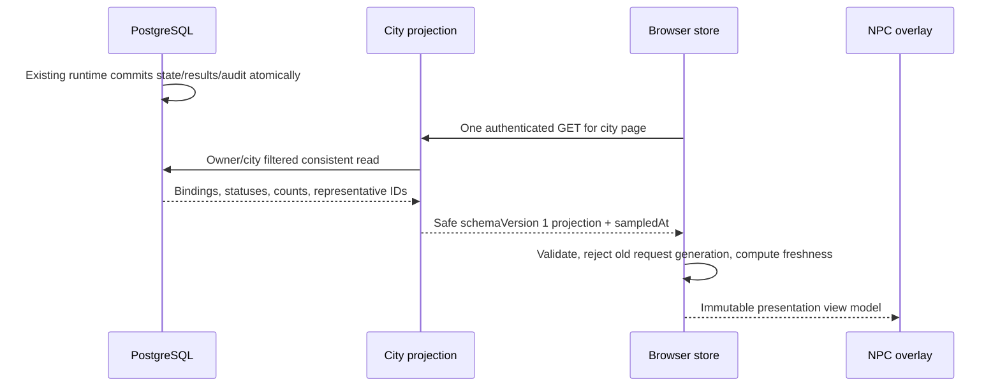

# Agent activity projection and APIs — planned

**T03 implemented and verified (2026-10-24):** [Backend Agent Activity Projection](agent-activity-projection.md) adds one-snapshot batched/single read models, separate city-read access, operator reads and explicit current-versus-recent outcome semantics. Full verification passed 190 backend, 102 PostgreSQL and 54 city tests, builds/static checks and browser smoke. T04–T10 remain PLANNED; no frontend code or database migration changed.

The T01 design below is historical. The implementation guide defines current routes/DTOs; history/result/audit inspector facade extensions remain deferred to T07 under the latest activity-only T03 scope.

## Separate four dimensions

Agent availability is ACTIVE/DISABLED/ARCHIVED. Task and Execution statuses retain the actual [lifecycle policy](../../../apps/api/src/lifecycle/lifecycle-policy.ts). Presentation states are a new **read DTO**, not database enums or event names. Connectivity/freshness is a client observation, not proof that an Agent process is OFFLINE.

For each enabled accessible binding, a consistent read selects all relevant counts and bounded representatives. Prefer active RUNNING Task/Execution; then QUEUED Task/PENDING Execution; then CREATED Task; then the latest terminal Task. Tie-break by relevant timestamp and UUID, never row order. A PENDING attempt represents waiting even before Task RUNNING. Count all matching queued/running/created tasks. Native one-running-per-Agent does not imply external engines share that restriction. If multiple active records exist, show counts and one explicit representative; never merge unrelated Task/Execution pairs. Latest attempt is by attemptNumber for that Task. Terminal pair conflicts project UNKNOWN/inconsistent, not a repaired success.

| Committed fact | Presentation | Inspector semantics |
| --- | --- | --- |
| No active/pending task; none terminal | IDLE | No known work, not provider connectivity |
| CREATED only | IDLE + awaiting queue count | Created is not queued or running |
| QUEUED Task or PENDING attempt | QUEUED | Waiting, no model/animation assumption |
| RUNNING matching Task/Execution | RUNNING | Committed active state; no percentage/token progress |
| COMPLETED + SUCCEEDED | COMPLETED recent outcome | Durable last outcome; transient visual badge only |
| FAILED + FAILED | FAILED recent outcome | Fixed safe failure category/message |
| FAILED Task without an attempt | FAILED recent outcome | Task-level failure only; no invented Execution |
| FAILED + TIMED_OUT | FAILED with reason TIMED_OUT | Never invent Task TIMED_OUT |
| CANCELLED pair, or Task cancelled without attempt | CANCELLED recent outcome | Not evidence of remote computation termination |
| Unknown enum/inconsistent references | UNKNOWN | Explicit unsupported/inconsistent data; no heuristic coercion |
| Expired lease on recorded RUNNING | UNKNOWN with recordedStatus RUNNING, requiresAttention | Read path does not finalize or recover runtime work |

Availability is orthogonal: DISABLED/ARCHIVED does not hide a genuinely recorded running attempt. New active work takes indicator precedence over recent terminal outcomes. Server sends latest outcome identity/time separately from current activity; a terminal-only Agent falls back to idle visually after the badge policy, while inspector retains the exact historical status.

## Proposed projection contract

Top level: `schemaVersion:1`, `cityId`, `manifestVersion:1`, server UTC `sampledAt`, `items`, `nextCursor`. Each item: bindingId/npcId/bindingRevision, Agent id/name/type/availability/version, activity state/counts/representative Task id/status/version and Execution id/status/version/attemptNumber, latestOutcome identity/status/finishedAt, sourceUpdatedAt and requiresAttention. Null means absent, not failure. No owner ID, description, instruction/context, arbitrary capabilities/config, endpoints, provider credentials, claim token, raw diagnostics or result body. Strategy identifier is optional validated safe snapshot identifier; absent means unknown/unconfigured, not guessed from Agent type.

Version is additive within schema 1 only for optional fields. Unknown required version/enum produces unavailable/unsupported UI. `sampledAt` measures server sampling, not lifecycle occurrence; browser receipt monotonic time drives freshness. Revisions are opaque per-record tokens, not a global event cursor. Do not use aggregate versions across different Agents or SQL stream positions as wall-clock progress.

## Minimal read facade

Existing APIs remain intact: GET `/api/v1/agents`, `/tasks?agentId=…`, `/tasks/:taskId/executions`, nested execution/result, and `/agents|tasks|executions/:id/events`. They require the local operator credential, lack batched current activity, and some return Task input or larger metadata. They are not used for background per-NPC reads or exposed wholesale to a read-only browser.

Add one planned City controller and read service, using existing authorization ownership predicates and repositories/serializers only where output is appropriate. All following routes use the separate [city-read credential](security.md), fixed authorized owner/city and enabled binding check:

| GET route under `/api/v1/cities/:cityId` | Purpose / bounds |
| --- | --- |
| `/agents` | Primary poll: enabled accessible bound Agents and projection, default/max limit 20, opaque validated keyset cursor by bindingId. Only configured city; complete sweep required for removal. |
| `/agents/:agentId/tasks` | Selected inspector history: safe Task summaries plus bounded attempt summaries, default 10/max 20, keyset createdAt/id descending. Include representative current Task even when its creation is older, separately from history page. |
| `/agents/:agentId/tasks/:taskId/executions/:executionId/result` | Explicit detail fetch: validate full owner/Agent/Task/Execution/binding chain; reuse stored-result validation and return AVAILABLE/PENDING/UNAVAILABLE. No automatic download; disclosure policy below. |
| `/agents/:agentId/tasks/:taskId/events` | Optional expanded history tab: reuse durable event query, original order and bounded cursor (10/max 50); allowlisted envelope/payload only. No new audit store or event broadcaster. |

No separate Agent detail/status/Execution controller is needed: projection supplies identity/current statuses, history supplies bounded safe attempt details including timestamps/duration/fixed failure code. No page includes unbounded outputs or input. Authentication failures 401, configured policy denial 403, foreign/missing chain 404, malformed query 400, payload cap failure safe 503; preserve current sanitized error envelope/requestId. No query can select owner, provider, tools or SQL. Unknown query fields and repeated parameters reject.

Result disclosure defaults off for LLM text. Safe rule counts/allowlisted usage can be returned; text requires explicit trusted city configuration and explicit user request, with at most 16 KiB UTF-8, escaped plain text, no Markdown/URL execution. Larger valid results report a safe size-limited state, not truncated text presented as complete. Model output can contain sensitive data even with clean metadata; allowlisting fields is not DLP. Do not log result bodies. Result-read facade must not depend on enabling runtime execution or bypass its existing allowlist for writes.

## Query and consistency requirements

Use one short REPEATABLE READ read-only transaction per page with a fixed bounded set of queries (target at most four), or equivalent single consistent SQL statement. Page bindings/Agents first; select ranked/count Task/Execution facts for those Agent IDs in sets. No `for each agent -> getTask -> getExecution` loops. Existing indexes on owner/Agent tasks, active attempts and binding scope are candidates; EXPLAIN on populated fixtures before deciding a forward index migration. History must select bounded Task IDs before ranked attempts; return at most three attempts per Task plus hasMore, not every historical attempt.

Twenty slots fit one page. Future larger paged sweeps are not a global point-in-time snapshot; only complete successful sweeps can reconcile removals, and absent bindings must be confirmed by the next complete sweep. No promise of seeing every short-lived RUNNING state via polling: latest terminal outcome/history is authoritative after gaps. Durable audit is for explicit history, not an inferred event-delivery guarantee.
