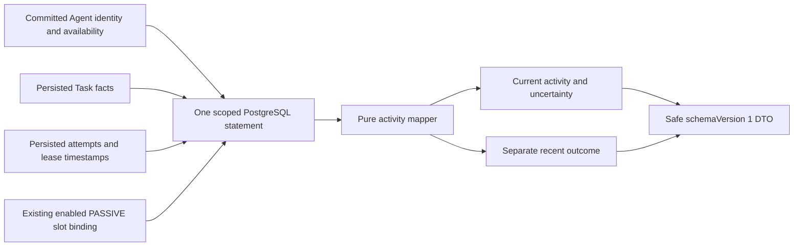
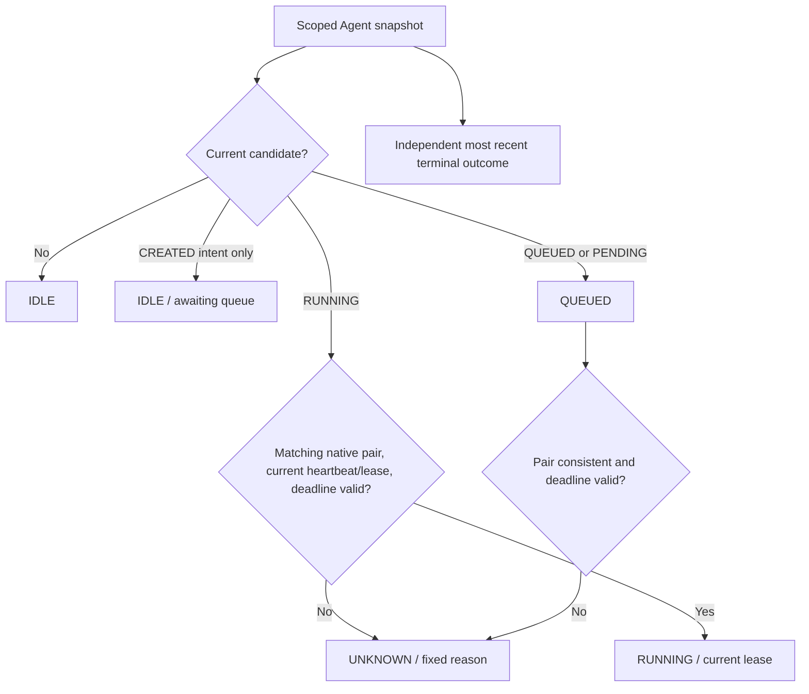
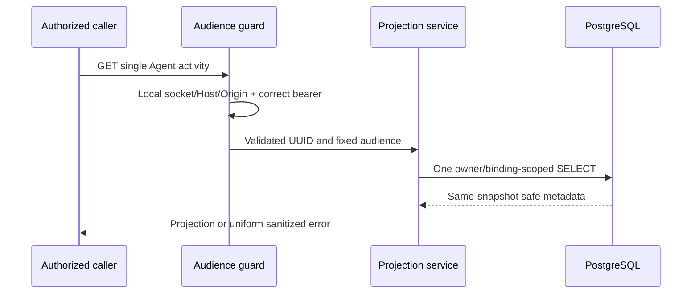

# T03 — Backend Agent Activity Projection

Date: 2026-10-24 (Asia/Bangkok). Current implementation is backend-only: safe activity projection, operator and city-read GET APIs, separate local read credential, consistent SQL and tests. No browser client, polling, NPC indicators/inspector, scheduling, recovery or new runtime is added. T04–T10 remain planned. Final executed verification appears below.

## Source and authority

The service derives facts from existing agents/tasks/executions and enabled `city_agent_bindings`. Task statuses remain CREATED/QUEUED/RUNNING/COMPLETED/FAILED/CANCELLED; Execution statuses remain PENDING/RUNNING/SUCCEEDED/FAILED/CANCELLED/TIMED_OUT. Agent availability remains ACTIVE/DISABLED/ARCHIVED. Neither provider responses, audit ordering nor NPC movement determine runtime state. No new lifecycle enum, projection table, database migration or cache is introduced.

`AgentActivityProjectionService` validates scope/query, invokes `AgentActivityRepository`, maps selected fields and returns a bounded DTO. The repository executes **one parameterized SELECT** per page using PostgreSQL CTEs and aggregates. `activity.mapper.ts` is a pure mapping function; its only runtime-policy dependency is the existing exported native lease-duration constant, not a coordinator or provider invocation. No status, binding, event or result is written by a read.



## DTO contract

Single reads return one `AgentActivityProjection`. Batched reads return `{schemaVersion:1, observedAt, items, nextCursor}`. All timestamps are UTC ISO strings; absent optional facts are null, not guessed. Each item contains:

| Field | Meaning |
| --- | --- |
| schemaVersion | 1; presentation contract, not event schema/version or a DB lifecycle enum |
| agentId, name, agentType, agentVersion | Registry identity and bounded display name/type/version; no descriptions/configuration/capabilities |
| availability | Registry ACTIVE/DISABLED/ARCHIVED, independent of work or provider connectivity |
| npcId, bindingId | Supported enabled PASSIVE binding in city elyqreth; null if none. No automatic binding/NPC creation |
| activityStatus | IDLE, QUEUED, RUNNING or UNKNOWN for current facts only |
| currentTask | Representative `{id,status,version}`; may be CREATED intent without execution, not proof of active work |
| currentExecution | Representative latest attempt `{id,status,version,attemptNumber}` or null; raw valid persisted status remains visible even when current activity is UNKNOWN |
| activeExecutionCount | Number of persisted PENDING plus RUNNING attempts across accessible Tasks; a count of records, not a count of confirmed live processes |
| queuedTaskCount, createdTaskCount | Persisted Task counts, not queue scheduling/progress guarantees |
| recentOutcome | Latest terminal attempt, or terminal Task without attempts: taskId, nullable executionId/executionStatus, COMPLETED/FAILED/CANCELLED/UNKNOWN, finishedAt |
| lastExecution | Most recently created attempt reference/status; unrelated Task attempt numbers are not globally comparable |
| lastActivityAt | Maximum persisted Agent/Task/Execution updatedAt in scope; includes registry changes and heartbeat updates, not proof of new model/tool work |
| observedAt | Database statement observation time; not event occurredAt, process liveness or a distributed trace timestamp |
| requiresAttention, statusReason | Closed safe uncertainty/reason fields; no raw provider/database/status_reason/error text |

No prompts, Task input/context, arbitrary metadata, tool arguments, results, provider models/endpoints/keys, runtime snapshots, private lease owner/token or stacks are fetched into the DTO. Versioned output is explicitly selected and runtime-validated; TypeScript types alone are not the enforcement. Response serialization has a 64 KiB UTF-8 cap and fails safely rather than silently truncating.

## Current selection and outcomes

For each scoped Agent, order relevant Tasks by: latest attempt RUNNING first; Task RUNNING without such an attempt next; PENDING/QUEUED next; CREATED last. Within that priority, earliest Task creation time then Task UUID selects a stable representative. Latest attempt **within a Task** is highest attemptNumber, then UUID. Count all active attempts across Tasks, including external authority; native single-running uniqueness does not constrain every external record.

Recent outcome orders terminal Execution finishedAt descending, then UUID. A terminal Task with no attempts participates with its completedAt and Task UUID. Last Execution orders createdAt descending then UUID. These tie-breaks are explicit and independent of database physical row order. They are bounded representative views, not execution-history pages.



Historical success/failure/cancellation alone always leaves **current activity IDLE**. There is no timed backend celebration, implicit retry or current-state expiry. The future frontend may use the outcome identity/timestamp for a transient badge; this service never rewrites a terminal state to idle.

| Fact | Mapping |
| --- | --- |
| No work | IDLE / NO_ACTIVE_WORK |
| CREATED intent only | IDLE / AWAITING_QUEUE |
| QUEUED Task or PENDING matching attempt | QUEUED / PERSISTED_QUEUED |
| Matching RUNNING native Task/Execution with unexpired lease, heartbeat not future/older than existing native lease window and unexpired deadlines | RUNNING / CURRENT_LEASE; still a persisted lease, not proof of a live OS process |
| Missing/expired lease or missing/stale/future heartbeat | UNKNOWN / LEASE_UNVERIFIED; recorded RUNNING reference retained |
| Recorded external RUNNING | UNKNOWN / EXTERNAL_LIVENESS_UNVERIFIED; no implemented external freshness protocol is invented |
| Elapsed selected Task/Execution deadline | UNKNOWN / DEADLINE_EXPIRED; no inferred TIMED_OUT write |
| Mismatched/unsupported relevant state, missing required running attempt, quarantine/reconciliation uncertainty | UNKNOWN / INCONSISTENT_STATE |
| SUCCEEDED outcome | recentOutcome COMPLETED |
| FAILED/TIMED_OUT outcome | recentOutcome FAILED; actual Execution TIMED_OUT remains distinct |
| CANCELLED outcome | recentOutcome CANCELLED; no claim remote computation stopped |
| FAILED/CANCELLED Task without an attempt | Valid Task-only recent outcome |
| COMPLETED Task without an attempt or conflicting terminal pair | UNKNOWN outcome/attention; do not fabricate successful execution |

Availability never overwrites recorded work: a disabled/archived Agent may still show a recorded running pair. Counts refer to all persisted attempts; liveness classification concerns the selected representative. Historical prior failures can coexist with newer work. Missing/foreign references are excluded by owner/route joins; normal orphaned records are prevented by existing composite foreign keys. Unsupported/malformed relevant data is UNKNOWN or a sanitized unavailable response, not a repair or success claim.

## API reference and credential audiences

| Method / route | Credential and visibility | Response |
| --- | --- | --- |
| GET `/api/v1/agents/:id/activity` | Existing local **operator** bearer, fixed owner; unbound Agents allowed | Single projection; missing/foreign both 404 |
| GET `/api/v1/agents/activities` | Same operator bearer, owner-scoped | Batched projections |
| GET `/api/v1/cities/elyqreth/agents` | Distinct **city-read** bearer, fixed owner/city, supported enabled PASSIVE bindings only | Same batched DTO |
| GET `/api/v1/cities/elyqreth/agents/:agentId/activity` | Same city-read bearer and binding restriction | Single projection; unbound/foreign/missing uniformly 404 |

The static operator activities route is registered before the existing `agents/:id` route to prevent UUID-route collisions. Existing API contracts remain intact. The operator and city routes are two access audiences using one service/query/DTO, not competing projections. T01 described only city-bound reads; the latest T03 requirements additionally require owned **unbound** Agent queries, hence operator routes. T01's history/result/audit facade extensions are deferred to the inspector slice; T03 does not expose those larger payloads prematurely.

Batch query: `limit` integer-string 1–20 (default 20), `after` UUID keyset cursor, optional `ids` comma-separated unique UUIDs (max 20, max 739 characters), optional `boundOnly=true|false`. Page order is Agent UUID ascending. Cursor is a validated UUID, following T02 keyset conventions; it is not an authorization token or globally consistent stream cursor. Unknown/repeated/nested parameters reject with 400. Single reads accept no query fields. For explicit IDs, **any** inaccessible/missing/unbound city Agent rejects the entire set with the same 404; it never returns a partial existence oracle. IDs are checked before cursor filtering. City audience enforces bound-only even when `boundOnly=false` is supplied.



```mermaid
sequenceDiagram
  participant U as Authorized caller
  participant S as Batch projection
  participant D as PostgreSQL
  U->>S: GET page, max 20 / optional explicit IDs
  S->>D: One parameterized CTE statement
  D->>D: Scoped page + counts + ranked representatives
  D-->>S: At most limit+1 candidate DTO facts
  S->>S: Reject missing requested set; validate/map/byte-cap
  S-->>U: items, shared observedAt, nextCursor
```

## Configuration and security

Existing configured database, registry owner and operator token are required. Optional new API environment settings:

```env
CITY_READ_ENABLED=false
# When explicitly enabled, provision a DISTINCT random 32–128 character base64url/hex-style token.
# CITY_READ_TOKEN=...
# CITY_READ_CITY_ID=elyqreth
```

Enabled city reads require development/test, loopback API host and existing registry scope; production/default disabled operation remains closed. Token alphabet is `[A-Za-z0-9_-]`, length 32–128, and equality with the operator token is rejected. Only elyqreth is supported. No runtime or provider enablement is needed. No token is built into frontend code, URLs or public config. Shared socket/Host/exact Origin checks were factored from existing LocalAccessGuard and are reused by both audiences; timing-safe credential comparison and sanitized errors remain. City token cannot authenticate Agent writes, Task execution/cancellation or existing operator reads. Operator token is not a fallback on city routes.

This is a narrow local-development audience, not production authentication, tenancy or membership. The authenticated owner is server-derived; no client owner/provider/tool claim is accepted. Frontend connect/token handling belongs to T04, not this task. External/LAN deployment remains blocked pending production controls.

## Query consistency, observability and limits

One SELECT means a single PostgreSQL statement MVCC snapshot covers Agent, binding, Tasks and Executions. A lifecycle transaction or binding removal committed after that snapshot can appear only on the next read. Reads do not take lifecycle write locks, wait for model/tool activity or mutate stale records. ObservedAt is statement time, not a promise of perfectly instantaneous state. Pagination pages are independent snapshots and may change during a sweep; no cross-page snapshot/replay guarantee is claimed.

The SQL bounds output to page+one lookahead, scopes metadata by those Agent IDs and uses set-based task/attempt aggregates/ranking. Node does not load full history, input or result bodies, and there is no per-Agent application query loop. Database work still depends on historical metadata volume; existing owner/Agent, Task/attempt and enabled-binding indexes are reused. No new index is justified by the current measured fixtures. Database statement timeouts remain existing configuration, not new background infrastructure.

Structured `projection.started`, `projection.completed`, `projection.failed` observations record bounded counts, audience, duration and fixed safe error categories. Existing AsyncLocalStorage requestId crosses guard/service/log calls. Inconsistency is a count/DTO reason, not raw diagnostics. Telemetry failures cannot invalidate a valid read. No payloads/keys/prompts/arguments/results are logged and no metrics endpoint or high-cardinality metric labels are added. Reads do not append lifecycle/audit events.

## Verification

**T03 COMPLETE for the existing local-development access scope.** Actual verification on 2026-10-24:

| Executed command / check | Outcome |
| --- | --- |
| npm.cmd run check:api | PASS strict backend noEmit typecheck |
| npm.cmd run build | PASS backend build |
| node --test apps/api/test/activity.test.cjs | 9/9 PASS; rerun against final compiled source, including failed telemetry-sink handling |
| Focused SQL/HTTP name-filter run | Initial 4/5 passed; one test incorrectly compared observation times from separate reads. Corrected that assertion (all state fields still compared); expanded cases passed 6/6 |
| npm.cmd run verify:phase1 | **PASS, exit 0**: actual syntax/static/noEmit lint, backend build, frontend build, migration journal check, 54 city tests, 190 backend tests, 102 isolated PostgreSQL tests and browser smoke |
| node --test --test-name-pattern "P3 T03" apps/api/test/database.integration.cjs | Final expanded security/SQL checks 6/6 PASS, including default/production closure and city-token denial across operator/control route families |
| Frontend TypeScript / dedicated ESLint / formatter | NOT APPLICABLE: vanilla JS frontend and no configured ESLint/formatter script; actual repository static/type/build commands above passed |
| Live Ollama/OpenAI inference | NOT RUN, not needed for read projection; standard regressions use controlled transports/fake providers |

All completed suites had zero failed/skipped tests in the final runs. The existing Docker harness owns random labelled disposable PostgreSQL containers/volumes, uses fresh/repeated migrations and populated upgrade/restart checks, and never resets development/production data. Real HTTP tests use actual guards, not mocked authorization. A cancellation barrier holds an actual lifecycle transaction before commit: concurrent projection reads see the old coherent QUEUED/PENDING pair; after commit they see IDLE plus CANCELLED recent outcome. Read queries leave event counts unchanged.

Browser smoke passed on Chrome 155.0.8059.85: 63 resource requests, zero exceptions, existing city Canvas/population, camera/panels, simulated mission controls and mobile reload. No Phase 3 browser integration was claimed or added; this is regression smoke, not exhaustive visual/FPS acceptance. Pure tests cover state/outcome separation, lease/deadline uncertainty, missing/foreign references, strict filters, separate credentials and safe logs. Owned-container tests cover actual SQL/HTTP, multiple external active attempts, history, bindings, deterministic selection, committed/uncommitted cancellation and query counts for 1/10/50/100 Agents. Persistence fixtures are test-only, not claims that fake providers performed live work. Live provider inference is not required or requested for this read-only task.

## Measured query observations

Final continuation focused fixture: 100 owned Agents, 2,000 failed historical Tasks without attempts and 100 CREATED Tasks. No model calls or results. Measured elapsed values cover service/query/mapping/log observations across the requested pages, excluding HTTP/auth/network and fixture setup.

| Agents retrieved | Pages / SQL statements | Local elapsed ms |
| --- | --- | --- |
| 1 | 1 / 1 | 8.694 |
| 10 | 1 / 1 | 6.968 |
| 50 | 3 / 3 | 22.228 |
| 100 | 5 / 5 | 38.175 |

Page size remains at most 20; 50/100 are paginated reads, not unbounded batch requests. The same counter wraps the real Drizzle execute method, so counts measure application database round-trips rather than estimates. EXPLAIN JSON root was Result with estimated cost 33.58 on this small fixture. This is a planner estimate and one bounded local sample, not a production latency SLO, large Execution-history benchmark or capacity claim. Execution-history correctness is covered separately by multiple-attempt/active fixtures. Statement timeout and historical metadata volume remain practical limits; no Redis/cache/index migration was added.

## Continuation recovery and final checklist

The connection interruption did not roll back the implementation. Contracts, mapper, one-statement repository, service, separate credential guards/configuration, operator/city controllers and preceding verification were already present. No production implementation was regenerated or replaced during continuation.

| Requirement group | Recovered status | Final status |
| --- | --- | --- |
| DTO, mapping, deterministic selection, current versus recent outcome | COMPLETE | COMPLETE |
| Read-only service, SQL batching, binding references, single/batch APIs | COMPLETE | COMPLETE |
| Validation, authentication/ownership, snapshot consistency, stale/UNKNOWN handling, structured observations | COMPLETE | COMPLETE |
| Unit, SQL, HTTP, performance and full regression evidence | COMPLETE | COMPLETE; added explicit actual HTTP RUNNING assertions and genuinely equal Task timestamp tie-breaking |
| Final documentation, inventory and preservation audit | PARTIAL | COMPLETE |
| Missing implementation/dependency | None | None |

Continuation reran `npm.cmd run check:api` (PASS), `node --test apps/api/test/activity.test.cjs` (9/9 PASS), and the focused real PostgreSQL/HTTP command (6/6 PASS). The first continuation SQL attempt was BLOCKED at setup by the stopped Docker Linux engine; the installed Docker Desktop was started hidden and the same owned disposable suite passed. No development database was used or reset. The preceding aggregate PASS (190 backend / 102 PostgreSQL / 54 city, builds/migrations/browser) is recovered executed evidence, not a claim that all those checks were rerun again during continuation.

No applicable AGENTS.md was found. Git status and git diff report absent Git metadata; there is no clean-tree or commit-provenance claim. The saved pre-T03 file inventory was used for preservation instead. No commit/push/deployment was performed.

## Remaining limits

External running records have no implemented trusted freshness adapter, so remain explicitly unverified with recorded statuses/counts intact. A current native lease/heartbeat can precede a crash and cannot prove remote computation or an OS process is alive. Reads do not perform reconciliation/recovery or terminal finalization. Pages are independent snapshots; refresh/disconnect handling belongs to T04 onward. Local read bearer is not production user/tenant authentication; external production exposure remains blocked. History/result/audit inspector facade endpoints and result disclosure policy remain planned for T07, not silently counted as T03 completion.

## T03 file manifest and preservation

Compared with the recovered pre-T03 SHA-256 inventory: **15 existing files modified, nine created, zero removed**. All **146 protected city source/assets, existing runtime/Task/Execution/lifecycle/event sources, migrations and Phase 1/2 documents are unchanged**. Binding implementation remains unchanged; CityModule registers the new read services/controllers. Schema, lockfile, package scripts, Compose and CI are unchanged. The environment example adds optional disabled-by-default city-read settings; no actual credential file was changed.

Created:
- apps/api/src/city/activity.contract.ts
- apps/api/src/city/activity.controller.ts
- apps/api/src/city/activity.mapper.ts
- apps/api/src/city/activity.repository.ts
- apps/api/src/city/activity.service.ts
- apps/api/src/city/city-read.configuration.ts
- apps/api/test/activity.integration.cjs
- apps/api/test/activity.test.cjs
- docs/ai-agent-platform/phase-3/agent-activity-projection.md

Modified:

- README.md
- docs/ai-agent-platform/README.md
- apps/api/test/database.integration.cjs
- docs/ai-agent-platform/phase-3/activity-api.md
- docs/ai-agent-platform/phase-3/decisions.md
- docs/ai-agent-platform/phase-3/architecture.md
- docs/ai-agent-platform/phase-3/implementation-plan.md
- docs/ai-agent-platform/phase-3/security.md
- docs/ai-agent-platform/phase-3/README.md
- apps/api/src/common/local-access.guard.ts
- apps/api/src/agents/agents.module.ts
- apps/api/src/agents/agents.controller.ts
- apps/api/src/city/city.module.ts
- apps/api/src/config/configuration.ts
- apps/api/.env.example

Next task: **Phase 3 T04 — Frontend Runtime API Client & State Synchronization**. Not started.

