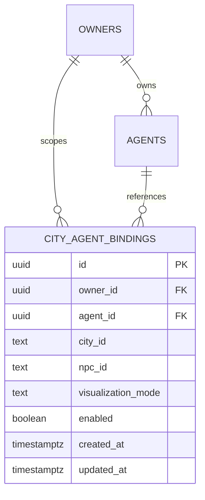
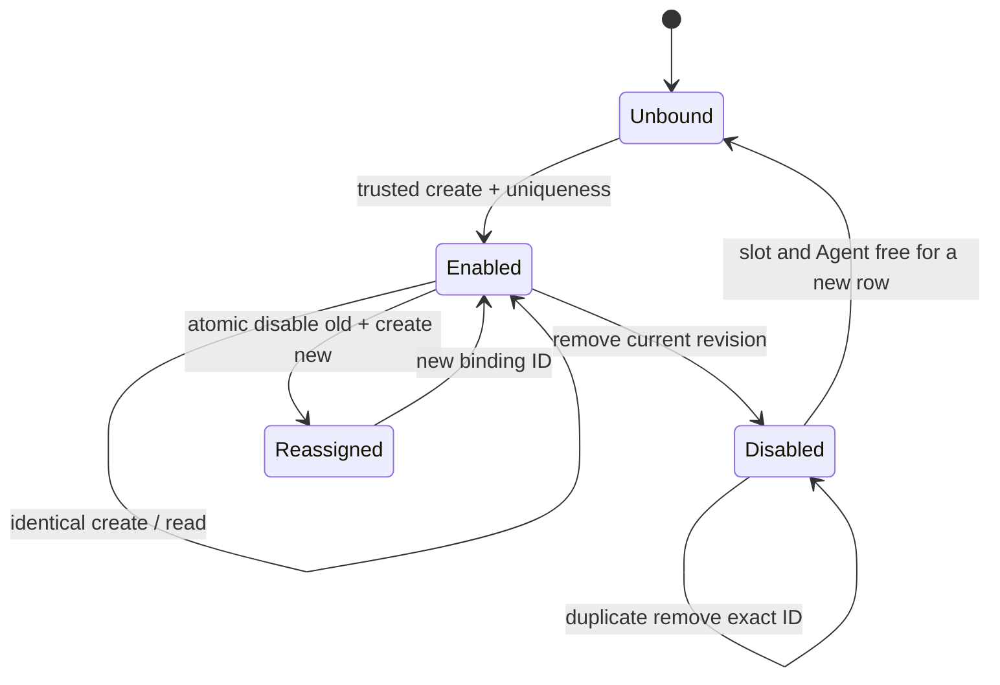

# T02 — Implemented Agent/NPC identity mapping

Date: 2026-10-24 (Asia/Bangkok). Scope: trusted local identity management and stable presentation slots only. No activity projection, polling, browser authentication, hydration, indicators or runtime inspector is implemented. T03–T10 remain planned.

## Actual infrastructure and persistence

The existing `city_agent_bindings` table already shipped in Phase 1 migration 0000, with identity/timestamp triggers in 0001. T02 reuses it through `AgentNpcBindingRepository`, `AgentNpcBindingService` and `CityModule` in the existing Nest application. No second backend/ORM/table or migration is needed. Adding another table or repeating constraints would be redundant; this is the deliberate T01-compatible interpretation of the task's suggested migration step. Existing migrations remain unchanged and fresh/populated migration regression tests verify them.



The ER cardinality includes disabled historical rows. Enabled rows are one-to-one per owner/city through `city_agent_bindings_agent_active_idx` and `city_agent_bindings_npc_active_idx`. The owner/city/NPC lookup index, Agent+owner composite FK with RESTRICT deletion/update, mode checks and timestamps already exist. One Agent may have several disabled historical bindings, but only one enabled binding in this city. Other cities/legacy NPC keys remain stored, but this service only manages configured contract city `elyqreth` and known slot identifiers.

## Stable NPC identities

`dist/js/npc-identity.js` and the backend catalog declare manifest version 1 with `resident-slot-001` through `resident-slot-020`. A test compares actual frontend/backend exports. The four original constructor entries explicitly carry slots 001–004; their names, positions, roles and numeric movement IDs do not determine those keys. A resident's `npcId` is immutable. Extra locally created residents have `npcId:null`; decorative/transit/service citizens remain unchanged and unbound. An explicit duplicate/unknown slot is rejected before spawning or allocating a numeric ID.

Slots 005–020 are reserved for later explicitly provisioned avatars. Backend validation proves the key belongs to the trusted versioned presentation catalog, **not** that a browser currently has a rendered resident. No network/reload hydration or automatic extra-avatar spawn exists until T04/T05. Binding create/remove does not create/delete an NPC or execute a Task. Simulation reset, movement, removal, missions, sprites and inspection retain their existing behavior.

## Contracts and service operations

All commands reject unknown fields, malformed UUIDs, display names, numeric NPC IDs and uncataloged keys. Commands cannot supply owner, provider, model, permissions or coordinates. Responses contain only id/agentId/cityId/npcId/enabled/mode/timestamps/revision/manifestVersion, never owner credentials, Task/Execution payloads or ORM objects.

| Operation | Contract and behavior |
| --- | --- |
| create | `{agentId,npcId}`; existing same-owner Agent required. ACTIVE/DISABLED accepted; new ARCHIVED binding rejected. Same enabled PASSIVE pair returns the existing row without another audit write; any conflicting Agent/slot fails. |
| byAgent / exists | Existing owner-scoped Agent UUID; enabled binding/null or boolean. Foreign and absent Agent both NOT_FOUND. |
| byNpc | Cataloged slot; enabled owner/city-scoped binding or null. No foreign identity disclosure. |
| list | `{limit?,after?,includeDisabled?}`; default/max 20, UUID keyset cursor, ascending binding ID; enabled only by default. Include-disabled is an explicit trusted internal option. Returns items/nextCursor. |
| remove | `{bindingId,revision}`; soft-disable exact row. Enabled row requires current revision; repeating removal of the already disabled ID returns that row without a second mutation/audit. A new replacement row is never affected by an old-ID retry. |
| reassign | `{bindingId,revision,agentId,npcId}`; transactionally disable old and create target; conflicts roll back both records and command audit. Identical current association is a no-op. Stale/disabled source conflicts. |

Revisions encode the exact UTC PostgreSQL `updated_at` microseconds as `v1.` plus base64url text. Timestamp triggers increment monotonically even within one millisecond. Display timestamps use standard ISO serialization, but concurrency checks never round-trip through JavaScript Date precision. The binding row is locked during mutation, and all service writers share an owner/city PostgreSQL transaction advisory lock. Existing uniqueness/FK constraints remain the final protection against conflicting SQL writers; application prechecks alone are not authority. No in-memory mutex, model request, animation wait or long-running transaction is involved.

Accepted create/disable mutations append existing `command_audit` entries in the same transaction (`city.binding.created`/`city.binding.disabled`, resource type `city_binding`, safe manifest version only). These are command observations, not new lifecycle events. Idempotent no-ops append nothing. Reassignment preserves the old disabled row and writes both accepted mutation audits atomically. The binding table itself remains mutable, not event-sourced/append-only history.



## Authorization and API decision

Following T01, **no mapping REST routes are added**. Management is through a trusted internal Nest service/local CLI, not an unauthenticated control API. The caller's authority is the local operator's OS/application context, not an arbitrary Task or browser capability. Service and CLI both require configured database/registry owner, development/test environment and loopback API host. The CLI checks before opening the application; service methods independently enforce the same boundary. It does not require runtime execution or any provider configuration. Production/default-disabled use fails closed.

This is the existing local-development trust model, not multiuser authentication. Anyone controlling the local process/configuration is inside the trusted boundary. Every query/mutation independently scopes owner/city; the command cannot select a different owner. Foreign binding IDs cannot be removed. Existing HTTP authentication, runtime control and Task/Execution APIs remain unchanged. Actual HTTP tests verify GET/POST/DELETE on a would-be mapping route remain 404 with or without a registry bearer. API mutation tests are therefore NOT APPLICABLE, not claimed as implemented endpoints.

Stable error codes: INVALID_COMMAND, ACCESS_DENIED, NOT_FOUND, CONFLICT, AGENT_UNAVAILABLE, PERSISTENCE_UNAVAILABLE. Public serialization uses fixed safe messages; no query/parameters/driver diagnostics/stack or credentials are printed. SQL uniqueness/serialization/deadlock/FK races normalize to CONFLICT, other persistence failures to PERSISTENCE_UNAVAILABLE; no automatic retry.

## Agent lifecycle and deletion

The Agent Registry has no public delete or ownership-transfer operation. Ownership is immutable in PostgreSQL. Existing Agent disable/archive retains all bindings and histories; an existing identical archived association remains readable/idempotent, but cannot create a new association after removal. Physical Agent deletion is RESTRICTed while any binding row references it, including disabled rows. No cascade removes Tasks, attempts, results or audit events. Binding removal does not cancel work, change Agent status, move or delete residents, or reset the city. Legacy WORK_ACTIVITY rows can be read safely but are not newly created or silently converted by this PASSIVE-only service.

## Local invocation

Provision a real owner/orchestrator/Agent using existing trusted setup/Agent Registry procedures. Configure the ignored API environment with `NODE_ENV=development`, `API_HOST=127.0.0.1`, `DATABASE_URL`, suitable `DATABASE_SSL_MODE`, `AGENT_REGISTRY_ENABLED=true`, `AGENT_REGISTRY_OWNER_ID` and the existing strong `AGENT_REGISTRY_TOKEN`. No key belongs in source or command arguments. PostgreSQL remains the existing optional Compose service; use normal documented migration setup, never reset development data.

Run from project root (replace uppercase placeholders with existing IDs/revision; retain quoting around opaque revision):

```sh
npm run city:bindings -- create --agent-id AGENT_UUID --npc-id resident-slot-001
npm run city:bindings -- by-agent --agent-id AGENT_UUID
npm run city:bindings -- by-npc --npc-id resident-slot-001
npm run city:bindings -- list --limit 20
npm run city:bindings -- remove --binding-id BINDING_UUID --revision "REVISION_FROM_RESPONSE"
npm run city:bindings -- list --include-disabled true
npm run city:bindings -- reassign --binding-id ENABLED_BINDING_UUID --revision "CURRENT_REVISION" --agent-id OTHER_AGENT_UUID --npc-id resident-slot-002
```

No HTTP listener opens for the command. It closes the application/database pool, prints only a safe response and returns nonzero on error. Does not bootstrap Agents, invoke providers, start Tasks, grant tools or hydrate the browser. Reassignment example requires an enabled source and free target; do not use the already removed source from the preceding example.

## Verification record

**T02 COMPLETE for the existing trusted local-development scope.** Final commands and actual outcomes:

| Command / check | Actual result |
| --- | --- |
| npm.cmd run lint | PASS, including final-source rerun; existing city JS syntax checks and strict backend noEmit typecheck. No ESLint script is configured. |
| npm.cmd run verify:phase1 | Static checks, API build, frontend build, migration journal check, 54 city and 181 backend tests passed; aggregate then stopped because Docker Desktop Linux engine was unavailable. Aggregate exit was nonzero, not an all-green claim. |
| npm.cmd run test:api | Final source: 181/181 PASS, zero failures/skips, including eight focused binding contract/service/CLI/catalog tests. Includes Agent/runtime/provider/tool/lifecycle/API regression. |
| npm.cmd run test:db | After starting installed Docker Desktop: first 95/96, one new history fixture failed because its orchestrator was disabled. Corrected fixture, retained lifecycle validation. Final fresh disposable run 96/96 PASS, zero failures/skips, including seven T02 real PostgreSQL cases. |
| npm.cmd run test:browser | PASS, Chrome 155.0.8059.85, 56 resource requests, zero exceptions; Canvas/population, camera/panels, simulated mission controls and mobile reload. Smoke coverage, not exhaustive visual/FPS acceptance. |
| Mapping REST mutation API tests | NOT APPLICABLE: no mapping routes by T01 design. Real HTTP verifies would-be GET/POST/DELETE routes return 404 with or without bearer; existing HTTP security regressions pass. |
| Frontend TypeScript typecheck | NOT APPLICABLE: frontend is vanilla JS. Existing JS syntax/static checks, 54 city tests and production frontend bundle passed. |
| Live provider tests | NOT RUN, not needed: no LLM inference introduced or requested. |

The real CLI child process was exercised against the owned isolated database, without runtime/provider configuration; restart tests use a newly created Nest application/pool, not in-memory repository state. Existing harness also verifies a real PostgreSQL restart, fresh/repeated migrations, populated upgrades and history constraints. Test data is confined to generated labelled disposable containers/volumes; no production/development database was reset. Focused suites: `node --test apps/api/test/city-bindings.test.cjs`, `node --test tests/npc-identity.test.js`; real SQL tests are registered by the existing `npm run test:db` owned-container harness, never an arbitrary database URL. Full existing regression entry remains `npm run verify:phase1` despite its historical name. No provider request is required.

## Remaining boundaries

Frontend reload tests establish stable slot initialization and backend restart tests establish durable associations. They do not claim the browser is already fetching/reconciling those associations. No Phase 3 T03–T10 features, city read token/projection API, polling, status overlay, inspector changes or extra-avatar lifecycle was introduced. Public production identity/tenant authorization remains a separate blocker. There is no NPC database or proof of a currently rendered entity beyond trusted catalog membership.

## Files and preservation

Inventory comparison (Git metadata is unavailable): **12 existing files modified, 10 created, zero removed**. All 116 protected existing runtime/Agent/Task/Execution/lifecycle/event/migration/asset and Phase 1/2 documentation files are unchanged. The only changed city source is explicit immutable identity metadata in simulation.js plus the new pure manifest; no renderer, movement, activity, sprites, camera, UI or theme source was altered. Dependency versions/lockfile, Compose and CI are unchanged.

Created:
- tests/npc-identity.test.js
- docs/ai-agent-platform/phase-3/agent-npc-bindings.md
- dist/js/npc-identity.js
- apps/api/test/city-bindings.test.cjs
- apps/api/test/city-bindings.integration.cjs
- apps/api/src/city/local-command.ts
- apps/api/src/city/city.module.ts
- apps/api/src/city/binding.service.ts
- apps/api/src/city/binding.repository.ts
- apps/api/src/city/binding.contract.ts

Modified:

- package.json
- README.md
- apps/api/package.json
- dist/js/simulation.js
- docs/ai-agent-platform/README.md
- apps/api/test/database.integration.cjs
- docs/ai-agent-platform/phase-3/README.md
- docs/ai-agent-platform/phase-3/implementation-plan.md
- docs/ai-agent-platform/phase-3/identity-mapping.md
- docs/ai-agent-platform/phase-3/decisions.md
- docs/ai-agent-platform/phase-3/architecture.md
- apps/api/src/app.module.ts

Documentation validation checked 13 current root/platform/Phase 3 documents: zero missing local links or unbalanced fences. No commit, push, deployment, tag or release was performed. Next task: **Phase 3 T03 — Backend Agent Activity Projection**; not started.

