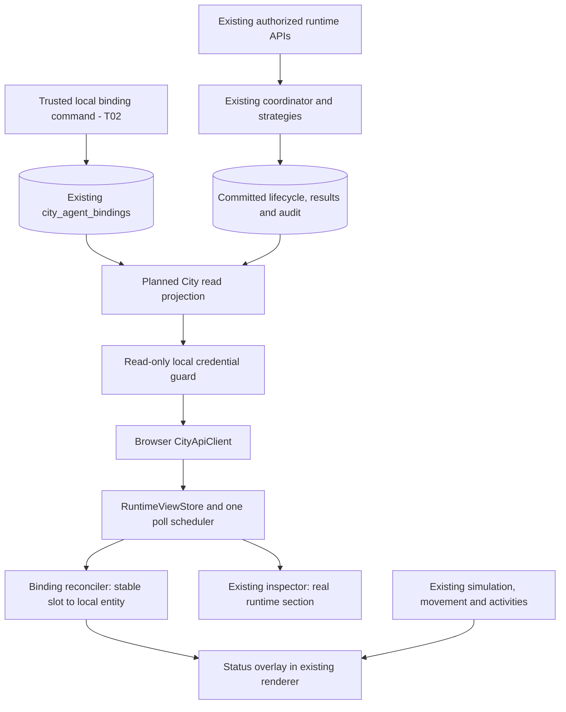

# Phase 3 architecture — planned

**Phase 3 T08 COMPLETE (2026-10-25):** [Multi-Agent synchronization and reconnection](multi-agent-synchronization.md) hardens existing shared REST polling, same-identity version checks, reentrant refresh coalescing and completion suppression. No new transport/backend state machine. T09/T10 remain planned.

**Phase 3 T07 COMPLETE within city-read contracts (2026-10-25):** [Agent inspection implementation](agent-inspection.md) extends the existing inspector using authorized city projection references and its latest recorded outcome. Full operator history/results/audit access is not broadened. T08–T10 remain planned.

**Phase 3 T06 COMPLETE (2026-10-25):** [NPC status visualization](npc-status-visualization.md) adds read-only Canvas markers and a compact runtime section in the existing NPC inspector. T07 detailed history/results and T08–T10 remain planned. See the implementation guide for verification and limitations.

**T05 implemented and verified (2026-10-24):** [NPC Runtime Binding](npc-runtime-binding.md) derives indexed read-only associations from T04 and existing immutable NPC slots. Missing NPCs remain unresolved; no spawning, rendering or inspector change is added. Verification passed 96 frontend tests (19 new), 190 backend tests, 103 PostgreSQL tests, builds/static checks and browser smoke, plus final focused/type/build reruns. T06–T10 remain PLANNED.

Earlier checkpoints/plans below are historical. The latest T05 scope keeps absent NPCs unresolved and does not implement the original proposed extra-avatar provisioning.

**T04 implemented and verified (2026-10-24):** [Frontend runtime integration](frontend-runtime-integration.md) adds a typed city-read client, frozen store/read facade and bounded synchronization. Final checks passed 77 frontend tests (23 new runtime tests), 190 backend tests, 103 PostgreSQL tests, builds/static checks and browser smoke, with final focused compatibility/build reruns. T05–T10 remain PLANNED; no NPC binding/rendering or backend production source changed.

The original design/targets below remain historical. The implementation guide defines current T04 APIs/state and measured test evidence; no future NPC/inspector or performance target is claimed complete.

**T03 implemented and verified (2026-10-24):** [Backend Agent Activity Projection](agent-activity-projection.md) adds one-snapshot batched/single read models, separate city-read access, operator reads and explicit current-versus-recent outcome semantics. Full verification passed 190 backend, 102 PostgreSQL and 54 city tests, builds/static checks and browser smoke. T04–T10 remain PLANNED; no frontend code or database migration changed.

The T01 design below is historical. The implementation guide defines current routes/DTOs; history/result/audit inspector facade extensions remain deferred to T07 under the latest activity-only T03 scope.

**T02 implemented and verified (2026-10-24):** [Agent/NPC binding implementation](agent-npc-bindings.md) provides trusted local create/read/remove/reassign operations over existing PostgreSQL storage, safe revisions and stable NPC slots. Final checks: 181 backend, 96 PostgreSQL and 54 city tests, builds/static checks and browser smoke passed through individually executed commands. No mapping REST mutation API, hydration or status synchronization was added; T03–T10 remain PLANNED.

The original T01 design below remains historical; the implementation guide defines the verified T02 behavior.

## Authority and integration boundary

PostgreSQL/lifecycle services remain authoritative for Agent/Task/Execution/results/audit. A new small read-only City module queries committed facts and returns versioned safe projections. It never calls execute/cancel or provider/tool adapters. A future City binding service manages the existing table through a trusted local operator command, not through rendering or public writes.

No status read mutates lifecycle or repairs a stale Execution. A crashed/quarantined runtime remains an operator concern; city displays uncertainty and recorded facts. No queue/supervisor/WebSocket server is needed. Projection queries have short read-only consistent snapshots, never locks spanning client/model operations.

## Proposed frontend ownership

Keep vanilla modules; do not add a framework/store dependency. Suggested future files under `dist/js/runtime/` (names may be adjusted without duplicating responsibilities):

| Module | Responsibility | Must not own |
| --- | --- | --- |
| city-api-client.js | Fixed configured loopback API origin, GET allowlist, runtime response/size/schema validation, AbortSignal and sanitized errors | Providers, runtime mutation, permanent credentials |
| runtime-store.js | Map keyed by Agent UUID; binding map by stable slot; last successful snapshot, refresh generation and freshness; change subscriptions | Simulation progress or lifecycle commands |
| sync-controller.js | Single-flight polling, timeout/backoff/visibility, abort/dispose on disconnect | A request per NPC or animation frame |
| npc-binding.js | Reconcile committed enabled bindings to local slot/entity references, bounded resident creation and clean disposal | Name-based identity, world position persistence or backend status writes |
| runtime-indicators.js | Pure read of small presentation view model, shape/text/optional subtle pulse | fetch, permissions, movement transitions |
| runtime-inspector.js | Populate runtime subsection of existing inspector; fetch details only for selected authorized Agent/Execution | Second competing inspector or automatic result/prompt download |

`app.js` composes the client/store/scheduler once only after explicit connect. Existing `Simulation`, `Citizens`, GameLoop and scene remain owners of city behavior. The store is not serialized into the debug city-state DOM, activity log or local mission progress. A resident's existing state fields are not overwritten; runtime association is held in the reconciler/sidecar. Network changes notify a projection revision; render/UI updates read cached models, not whole-response cloning per frame.

Selection uses the existing session entity ID/type; a lookup translates it to a stable NPC slot and then Agent UUID. Async inspector responses must match selection generation, binding identity and auth generation before application. Escape all backend text; no HTML/Markdown execution, result URLs, provider endpoint links or raw JSON innerHTML.

## Initialization and disposal

Standalone city starts exactly as before with four functional residents, decorative citizens and simulated missions. Runtime integration is disabled by default. Explicit connect creates only the integration scope; initial complete snapshot reconciles eligible mappings. No Agent is created from city residents. The first four stable slots attach to their explicit initializer entries; extra manifest slots create residents through existing movement/activity initialization only when enabled mappings exist. See [identity rules](identity-mapping.md).

Disconnect/auth failure discards credential and sensitive data, aborts requests, removes runtime associations/overlays and removes only integration-owned extra residents using existing cleanup methods. It preserves original residents and simulation. Dispose scheduler/listeners/store on page teardown; repeated connect must not duplicate managers. Reset/pause/speed affect the existing simulation only; a paused city may still display fresh runtime status. No automatic scheduling or control is added.

## Future boundary

Normalized activity includes Agent identity/availability, raw Task/Execution statuses and source timestamps; it does not infer activity from provider responses. Future external orchestrators may supply multiple active Executions per Agent, so projection supplies active counts and deterministic representative selection rather than assuming native single-running constraints universally. Future transport can deliver invalidation hints to the same store; full authoritative refresh remains recovery. No future external framework or event type is required now.
