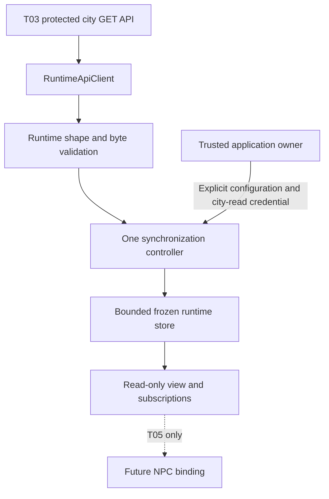
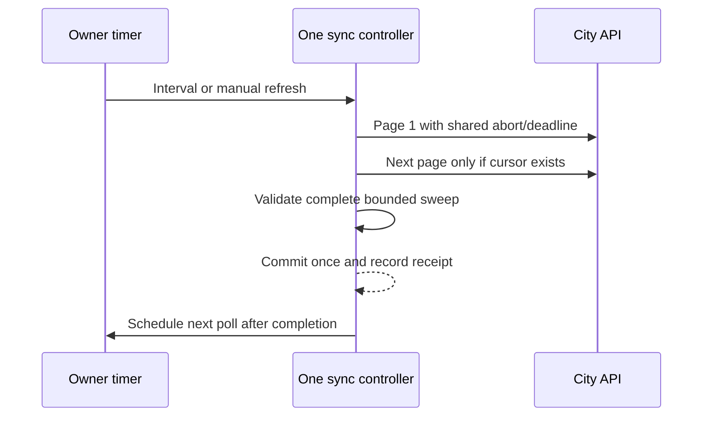
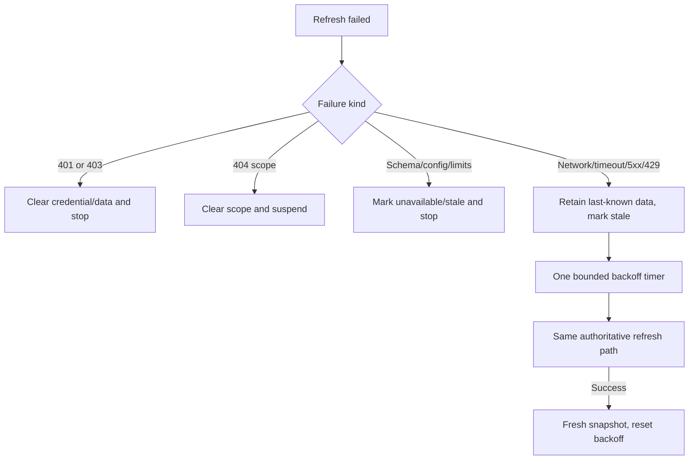

# T04 — Frontend runtime client and state synchronization

Date: 2026-10-24 (Asia/Bangkok). This slice adds a nonvisual browser integration boundary. No NPC association/spawn, movement, rendering, indicators, inspector or backend execution functionality is added. T05–T10 remain planned. Final verification evidence is recorded below.

## Repository decisions and modules

The existing city is vanilla JavaScript/Canvas, served directly from root `dist/` or built by Vite. It had no backend API client, frontend session mechanism or state library. T04 therefore uses browser-native ES modules, fetch and AbortController, with explicit local configuration and **strict checked JSDoc plus .d.ts wire contracts**, preserving direct static-browser compatibility. No React/state framework, SDK, dependency installation or emitted frontend TypeScript is introduced.

| File under `dist/js/runtime/` | Ownership |
| --- | --- |
| contracts.d.ts | Actual T03 wire types, bounded query/options and read-only snapshot types |
| validation.js | Safe fixed errors, response validation/normalization and scope validation |
| api-client.js | Fixed city GET paths, local origin policy, private volatile credential, request deadline/cancellation, byte-bounded JSON |
| runtime-store.js | Frozen Agent-keyed snapshots, subscriptions, structural sharing and confirmed removal tracking; no network or credentials |
| sync-controller.js | One page-sweep owner, generation fences, timers/backoff, visibility/auth/scope lifecycle |
| index.js | Factory and one disabled page singleton; separate read-only `view` for T05 |

`app.js` imports the disabled singleton and disconnects it on pagehide and Vite hot disposal. No connection UI or refresh button is added. Integration starts only when trusted application code explicitly calls connect. Existing renderer/GameLoop/Simulation/inspector never receive HTTP logic or runtime data in this slice. Additional subscribers never create additional polling controllers.



## Exact T03 compatibility

The browser client consumes **only** these existing routes:

- GET `/api/v1/cities/elyqreth/agents/:agentId/activity` via `fetchActivity(agentId,{signal})`.
- GET `/api/v1/cities/elyqreth/agents` via `fetchPage({limit?,after?,ids?},{signal})`.

It never uses the broad operator `/api/v1/agents` audience. City is fixed to elyqreth. Page limit is 1–20, default 20; optional unique UUID scope max 20 is encoded as the actual comma-separated `ids` query. `after` and `nextCursor` are validated UUID keyset values, not event cursors. A batch is `{schemaVersion:1,observedAt,items,nextCursor}`; a single response is one projection. HTTP 200 is required; 206/other partial-success forms cannot masquerade as a complete page.

Projection fields exactly mirror T03: Agent identity/name/type/version/availability, nullable npcId/bindingId, currentTask/currentExecution references, activeExecutionCount/queuedTaskCount/createdTaskCount, recentOutcome, lastExecution, lastActivityAt, observedAt, requiresAttention and statusReason. Current activity is IDLE/QUEUED/RUNNING/UNKNOWN; historical COMPLETED/FAILED/CANCELLED is a **recent outcome**, not a new current activity state. No invented progress, execution timestamps or provider fields are added.

Nullable absent reference fields normalize to null when safe; malformed required data, unknown enums/schema versions, invalid UTC timestamps, inconsistent RUNNING references, wrong single-Agent identity, out-of-scope batch identities or malformed ordering/cursors fail as SCHEMA. Backend-provided UNKNOWN and attention reasons are retained. Unknown extra fields are not copied into state; prototype pollution keys reject. JSON names remain plain strings, never HTML or executable code. Neither client validation nor state performs lifecycle transitions.

Each response is streamed with a 64 KiB decoded byte cap, fatal UTF-8 decoding, JSON content-type/shape checks and no raw body diagnostics. Errors use fixed safe messages/codes, never HTTP bodies, provider objects or network exception text. HTTP 401/403/404/429/5xx map to AUTH_REQUIRED/FORBIDDEN/NOT_FOUND/RATE_LIMITED/SERVER; malformed request/response and cancellation/deadline remain distinct. Redirects reject; credentials are omitted; cache is disabled; referrer policy is no-referrer.

## Configuration and authorization

No frontend backend-origin/session configuration existed to reuse. Base URL and city-read credential are therefore explicit **runtime inputs**, not hardcoded addresses, VITE_ variables, URL parameters or persistent settings. Base URL must be an http(s) loopback origin with no credentials/path/query/hash; the serving page origin must also be loopback http(s). This follows the accepted local-development scope and fails closed for a LAN/public page.

Backend setup remains documented T03: configured database/registry owner, `CITY_READ_ENABLED=true`, a strong **distinct** `CITY_READ_TOKEN`, and exact frontend origin in `CORS_ORIGINS`. No provider/runtime enablement is needed. Use an explicit loopback Vite bind, e.g. `npm run dev:web -- --host 127.0.0.1`, and configure the API for the actual origin/port. The existing Vite standalone hosting configuration/proxy is unchanged. Browser CORS may report an origin-policy denial as NETWORK rather than exposing HTTP 403; it must be fixed operationally, not bypassed with wider credentials or wildcard CORS.

Only the new city-read token belongs in the client; operator and OpenAI/Ollama credentials never do. There is no existing frontend login to reuse and T04 does not implement a new identity platform. Token stays in a private client field, not the store, DOM/debug state, JSON serialization, logs, browser storage or frontend bundle. The application must obtain/provide it through a trusted local interaction outside NPC rendering; no credential-entry UI is implemented in T04. Do not paste credentials into public consoles, URLs or generated source.

Conceptual application-owner composition (variable values are supplied by trusted local code; this is not an automatic boot command):

```javascript
import {runtimeIntegration} from './runtime/index.js';
const unsubscribe = runtimeIntegration.view.subscribe(snapshot => {
  // Nonvisual consumer: inspect loading/error/freshness before using Agent data.
});
runtimeIntegration.connect({baseUrl: approvedApiOrigin, pageOrigin: location.origin,
  token: cityReadCredential, agentIds: optionalAuthorizedSubset});
await runtimeIntegration.refresh();
// Later: unsubscribe(); runtimeIntegration.disconnect();
```

Changing identity/credential means calling connect again: old requests abort, generations invalidate and protected caches clear **before** the new connection. setScope changes the optional Agent subset, clears previous identities and fetches anew with the same credential; it does not grant authorization. An explicit empty Agent subset clears and pauses locally without broadening to all Agents or inventing a backend observation timestamp. The standalone client's fetchPage rejects an empty ids filter rather than issuing an ambiguous unfiltered request. Backend owner/binding checks remain authoritative. An invalid connection clears previous data and returns a fixed configuration error.

```mermaid
sequenceDiagram
  participant Owner as Trusted owner
  participant Sync as Sync controller
  participant Client as Private client
  participant Store as Read store
  Owner->>Sync: Explicit connect with city credential
  Sync->>Store: Clear previous scope
  Sync->>Client: Store credential privately; issue scoped GET
  Client-->>Sync: HTTP 401 or 403
  Sync->>Client: Abort and erase credential
  Sync->>Store: Empty AUTH_REQUIRED snapshot
  Sync->>Sync: Remove listeners/timers; no retry
```

## State and T05 contract

`createRuntimeIntegration(options)` creates an independently testable owner. `runtimeIntegration` is the single existing page owner. Consumers receive `runtimeIntegration.view`, frozen to expose **only**:

- `getSnapshot()` — immutable RuntimeSnapshot.
- `getAgent(agentId)` — current cached projection or undefined when absent/pending-removal.
- `getByNpc(npcId)` — cached projection lookup only; it does not bind a resident.
- `subscribe(listener)` — immediate snapshot and subsequent changes; returns unsubscribe.

Owner-only connect/disconnect/setScope/refresh/dispose are not on view. Do not create a separate factory/poller per NPC or subscriber. T05 must read freshness, missing IDs and error/loading state; raw backend RUNNING in an old snapshot does not mean confirmed current work.

Snapshot fields: phase (DISCONNECTED/LOADING/READY/REFRESHING/ERROR/AUTH_REQUIRED/PAUSED), frozen activitiesByAgentId, missingAgentIds, loading, refreshing, safe error/null, freshness (fresh/stale/unknown), stale, lastObservedAt and lastSuccessfulSyncAt. No credential or transport instance is exposed. Reference records and nested values are frozen; identical projections reuse existing references. Timestamps genuinely change per server observation, so new objects then are appropriate. There is no per-frame state update or render dependency.

Store is bounded by complete sweeps and selected scope, not a conversation/audit cache. Observer exceptions cannot break other consumers or synchronization; dispose clears observers. Repeated connect/disconnect cleans timers/listeners without duplicating subscriptions. disconnect leaves application subscriptions available for a later explicit reconnect; dispose permanently releases the owner. The app page lifecycle disconnects on navigation/HMR.

## Synchronization and removal semantics

Default scope is all accessible **city-bound** Agents, not all registered Agents or NPCs. Optional Agent UUID subset follows T03's whole-set access rule. A cycle fetches pages sequentially into a private buffer, validates ordering, unique Agent/binding/NPC identities and requested scope, then commits once when nextCursor is null. Never delete unseen Agents or expose partial results when a page fails. A bounded cycle permits at most five pages / 100 Agents, page size at most 20; the current backend's twenty supported slots normally fit one page. Repeated/invalid cursors, mixed duplicate bindings or exhausted limits stop safely. Pagination pages are separate backend snapshots, not one global DB snapshot.

When an Agent disappears from a complete successful sweep, mark it pending-removal and make getAgent/getByNpc return undefined immediately. Retain last-known metadata only for reconciliation; a second complete absence removes it. A failed/partial cycle is not another absence confirmation. Raw snapshot iteration must respect missingAgentIds; T05 should prefer lookup methods. Reappearing Agents reset the absence count. Binding changes replace the cached association; no visual entity is created or removed here.

For explicit IDs, backend 404 may mean any member became inaccessible. Clear the whole requested snapshot and suspend; never broaden to all Agents or guess another identity. HTTP 401/403 immediately clear every protected entry and credential. Network errors retain authorized last-known metadata in volatile memory, explicitly stale, until a successful refresh, scope/auth change or disconnect; offline data is not permanently stored.

```mermaid
stateDiagram-v2
  [*] --> DISCONNECTED
  DISCONNECTED --> LOADING: Explicit connect
  LOADING --> READY: Complete valid sweep
  READY --> REFRESHING: Poll or manual refresh
  REFRESHING --> READY: Complete valid sweep
  REFRESHING --> ERROR: Safe failure; retain stale snapshot if permitted
  ERROR --> REFRESHING: Bounded recoverable retry
  READY --> PAUSED: Hidden tab
  PAUSED --> REFRESHING: Visible
  REFRESHING --> AUTH_REQUIRED: 401/403; clear scope and token
  AUTH_REQUIRED --> LOADING: Explicit reconnect only
  READY --> DISCONNECTED: Disconnect
```



## Polling, freshness and cancellation

| Trusted option | Default / bounds |
| --- | --- |
| intervalMs | 2000; 1000–60000; scheduled **after** previous completion |
| timeoutMs | 5000; 100–30000; total sweep deadline, also standalone client request cap |
| staleMs | 6000; 1000–120000 and at least polling interval |
| unknownMs | 30000; 2000–600000, greater than stale threshold |
| pageSize / maxPages / maxAgents | 20 / 5 / 100, bounded to those maxima |

Manual refresh uses the same controller/normalization and coalesces with a current sweep. No logical overlap or automatic queue of manual refreshes. One AbortSignal spans every page; time is not reset on model-style/page continuation. Client operations race cancellation/deadline even if a mocked transport ignores signals. Generation checks prevent late responses from an old credential/scope/visibility generation overwriting newer data. Client abort listeners, timers and streaming readers are cleaned up; late responses are discarded/cancelled. This cancels read requests only, never backend execution.

Backend `observedAt` is preserved per Agent. lastObservedAt is the earliest page observation in the complete sweep. Frontend `lastSuccessfulSyncAt` records local receipt wall time. Freshness ages from monotonic receipt time, independent of backend clock or animation/simulation speed. At six seconds without success, freshness becomes stale even during a slow request; at thirty seconds it becomes unknown. Backend activityStatus never changes merely because time passes. A failed request or hidden tab marks data stale immediately. Future visuals must suppress active emphasis when stale/unknown; T04 adds no visual behavior.



Hidden tabs abort reads and stop polling. Returning visible initiates one full refresh. The online event is only a hint; it neither declares data fresh nor bypasses an existing retry timer. Browser globals are guarded; importing pure modules under Node/SSR starts no requests or timers. Shutdown/dispose prevents further work even if an old transport eventually responds.

## Failure recovery

Network/timeouts/5xx back off 2, 4, 8, 16, then at most 30 seconds, with bounded ±20% jitter. Retry-After on 429 is honored up to 60 seconds. Successful sync resets the failure count. Authentication/forbidden stops and erases credentials; 404 clears unavailable scope and stops. Configuration/validation/schema/version/page-limit failures stop automatic retry and require explicit owner action/reconnect. No rapid retry loops, provider fallback, durable background jobs, SSE or WebSocket connection exists.



## Verification and limitations

**T04 COMPLETE for the existing local-development read scope.** Actual checks on 2026-10-24:

| Executed command / check | Actual outcome |
| --- | --- |
| npm.cmd run check:runtime:web | PASS strict checked JSDoc/.d.ts frontend runtime contracts, including final-source rerun |
| node --test tests/runtime-api.test.js tests/runtime-sync.test.js | Focused frontend suites passed; final full frontend suite below includes 23 new tests |
| npm.cmd run verify:phase1 | PASS, exit 0: expanded recursive JS checks, new frontend typecheck, backend typecheck/build, frontend bundle, migration checks, 76 frontend tests at that checkpoint, 190 backend tests, 103 PostgreSQL tests, browser smoke |
| npm.cmd test | Final source after explicit empty-scope/partial-response hardening: 77/77 PASS (54 existing city tests + 23 runtime client/store/sync tests), zero failures/skips |
| npm.cmd run build:web | Final-source rerun PASS; disposable production bundle, 41 modules transformed; city source is not overwritten |
| npm.cmd run lint | Final-source rerun PASS; existing syntax/static/backend noEmit plus new frontend runtime typecheck. No configured ESLint/formatter is claimed |
| node --test --test-name-pattern "P3 T04" apps/api/test/database.integration.cjs | Final actual frontend-to-Nest HTTP/PostgreSQL compatibility rerun: 1/1 PASS using the owned disposable database |
| Browser smoke within aggregate | PASS Chrome 155.0.8059.85, 113 resource requests, zero exceptions; shared singleton is DISCONNECTED and no API requests occur by default |
| Live providers | NOT RUN; no real model inference is required/requested |

Tests use existing Node discovery, fake timers/visibility, mocked response streams and the actual integration factory. The owned PostgreSQL harness exercises this real frontend client/controller through authenticated NestJS HTTP, including RUNNING state, real lifecycle cancellation, binding removal and auth failure. The browser smoke also checks existing Canvas/NPC population, camera/panels, simulated mission controls and mobile reload. It is smoke evidence, not exhaustive visual/FPS acceptance.

Testing exposed an unhandled rejection for an already-aborted caller before the fetch race was attached; cancellation is now handled inside the raced operation and its regression passes. One initial visibility assertion also incorrectly issued an extra manual refresh after resume; the test now verifies the single automatic resume refresh directly. No tests were skipped or weakened to accept unsafe state. Tests also cover 100 reconnect cycles, retained snapshot handling, two-sweep removal, true zero-Agent scope, partial-page rejection and cross-page binding ambiguity.

This is local-development read integration, not production login/tenant sessions. In-memory credentials remain exposed to compromised page code/extensions; no general XSS/DLP guarantee or secure memory zeroization is claimed. Consumers must discard any retained old snapshot copies on auth/scope changes; the library cannot revoke references held by arbitrary application code. Polling can miss short-lived transitions, paging is not globally atomic, abort cannot retract a read already processed remotely, and stale data is last-known metadata rather than liveness. No runtime connection UI or NPC consumer is implemented; trusted application code must explicitly connect. Those limits do not authorize moving provider calls or lifecycle mutations into the browser.

## Files and preservation evidence

Git metadata is absent, so no clean-working-tree or commit-diff claim is possible. SHA-256 comparison against the saved pre-T04 inventory found **14 existing files modified, 11 created, zero removed**. All **154 protected backend production/runtime/history/migration, city asset and movement/rendering/lifecycle/theme files are unchanged**. The existing app entry only adds nonvisual integration import/pagehide/HMR cleanup. Backend changes are test-only HTTP compatibility coverage. Dependency versions/lockfile, Compose, API schemas and CI workflow remain unchanged; the existing verification workflow now includes the new frontend typecheck through its lint script.

Created:
- tsconfig.runtime-web.json
- tests/runtime-sync.test.js
- tests/runtime-fixtures.js
- tests/runtime-api.test.js
- docs/ai-agent-platform/phase-3/frontend-runtime-integration.md
- dist/js/runtime/validation.js
- dist/js/runtime/sync-controller.js
- dist/js/runtime/runtime-store.js
- dist/js/runtime/index.js
- dist/js/runtime/contracts.d.ts
- dist/js/runtime/api-client.js

Modified:

- scripts/check.mjs
- scripts/browser-smoke.mjs
- package.json
- README.md
- dist/js/app.js
- docs/ai-agent-platform/README.md
- apps/api/test/activity.integration.cjs
- docs/ai-agent-platform/phase-3/testing-performance.md
- docs/ai-agent-platform/phase-3/synchronization.md
- docs/ai-agent-platform/phase-3/security.md
- docs/ai-agent-platform/phase-3/README.md
- docs/ai-agent-platform/phase-3/implementation-plan.md
- docs/ai-agent-platform/phase-3/decisions.md
- docs/ai-agent-platform/phase-3/architecture.md

Fifteen current root/platform/Phase 3 documents passed local-link and fenced-block checks with zero issues. No commit, push, deployment, tag or release was performed. Next: **Phase 3 T05 — NPC Runtime Binding**; not started.

