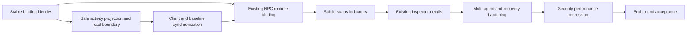

# Phase 3 implementation roadmap - T01-T10 complete for local development

**Final status (2026-10-25): ACCEPTED WITH LIMITATIONS.** See [T10 acceptance](acceptance.md) for actual verification, inventory, release blockers and known limitations. Public production exposure remains blocked. Earlier checkpoint statements below are historical.

**T05 implemented and verified (2026-10-24):** [NPC Runtime Binding](npc-runtime-binding.md) derives indexed read-only associations from T04 and existing immutable NPC slots. Missing NPCs remain unresolved; no spawning, rendering or inspector change is added. Verification passed 96 frontend tests (19 new), 190 backend tests, 103 PostgreSQL tests, builds/static checks and browser smoke, plus final focused/type/build reruns. T06–T10 remain PLANNED.

**T04 implemented and verified (2026-10-24):** [Frontend runtime integration](frontend-runtime-integration.md) adds a typed city-read client, frozen store/read facade and bounded synchronization. Final checks passed 77 frontend tests (23 new runtime tests), 190 backend tests, 103 PostgreSQL tests, builds/static checks and browser smoke, with final focused compatibility/build reruns. T05–T10 remain PLANNED; no NPC binding/rendering or backend production source changed.

**Historical T03 checkpoint (2026-10-24):** [Backend Agent Activity Projection](agent-activity-projection.md) adds one-snapshot batched/single read models, separate city-read access, operator reads and explicit current-versus-recent outcome semantics. Full verification passed 190 backend, 102 PostgreSQL and 54 city tests, builds/static checks and browser smoke. T04–T10 remain PLANNED; no frontend code or database migration changed.

T01 delivered architecture; T02-T09 implementation and hardening are verified, and T10 final acceptance is complete within the approved local scope. No subsequent phase is automatically enabled.

## T02 — Agent-to-NPC Identity Mapping

**COMPLETE:** [Verified implementation and actual commands](agent-npc-bindings.md). Existing table/constraints were sufficient, so no duplicate model or migration was added; revisions preserve exact database microseconds. No REST mapping writes were required by the selected architecture. Original scope follows.

- **Objective/scope:** make the existing binding table useful without connecting execution to animation. Explicit owner/city/manifest slot identity; create/disable/reassign service and minimal trusted local operator command. No automatic production fixtures.
- **Dependencies:** this plan and existing schema/local access/persistence; production exposure still closed.
- **Backend changes:** small `apps/api/src/city/` binding service/module, catalog validation, expected opaque revision, deterministic transaction locks and existing uniqueness/FK use. Local command follows existing runtime CLI lifecycle, fails outside development/test. Audit command safely if existing command audit contract permits; document actual guarantee.
- **Frontend changes:** minimal versioned slot manifest and explicit stable slot initialization for four original functional residents, separate from numeric movement IDs; pure lookup contract tests. No fetch/indicator/new spawn pipeline yet. Decorative residents unchanged.
- **Data model:** reuse city_agent_bindings, PASSIVE only. No planned migration; prove revision precision safely; new forward migration only with evidence and upgrade tests if necessary.
- **API changes:** none; no public writes.
- **Tests:** actual SQL owner/FK/unique/concurrent reassignment/rollback/idempotent same binding, fresh/restart persistence; manifest matches backend allowlist; rename/reorder unrelated residents does not change keys; no names used as identity.
- **Acceptance:** stable enabled one-to-one mapping survives reload/restart; conflicting writes reject atomically, existing city still starts unchanged in standalone mode; no Agent is created from an NPC.
- **Exclusions:** activity projection, synchronization, rendering, lifecycle writes, execution controls.

## T03 — Backend Agent Activity Projection

**COMPLETE:** [Verified projection implementation](agent-activity-projection.md). Latest T03 instructions focus on activity only: two operator reads support unbound owned Agents, while two city reads enforce enabled supported bindings with the distinct read credential. One SQL statement/page, no migration. History/result/audit inspector facade and text disclosure controls are explicitly deferred to T07.

- **Objective/scope:** safe batched read model plus the required local **city-read-only** credential boundary before browser data access. This access prerequisite is brought into T03, not postponed to security review.
- **Dependencies:** T02 storage/catalog; current owner/guards, Task/Execution/results/events and read consistency.
- **Backend changes:** City projection/read service/controller and read-only guard; shared existing loopback/Host/Origin policy with separate credential, fixed owner/city and explicit DTOs. Four current activity GET routes in [implemented API reference](agent-activity-projection.md), bounded set-based queries and sanitized projection DTOs. No result endpoint or disclosure opt-in in this activity-only slice. No new identity platform or duplicate runtime service.
- **Frontend changes:** none except shared response fixtures/contracts as needed, no integration enabled.
- **Data model:** none by default; measure EXPLAIN before justified forward index addition. No projection table/event transport/worker.
- **API changes:** operator single/batch activity and city-bound single/batch activity; Task/attempt history, result and task audit facade reads remain T07. Existing endpoints/permissions remain compatible; city token never authorizes existing control operations.
- **Tests:** real SQL consistent projection, statuses/availability/unknown/expired lease/multiple active representatives, foreign chains, complete bounded pages, secret-field exclusion, token audience and production fail-closed, no-result/prompt disclosure and byte limits, query-count tests.
- **Acceptance:** one request supplies up to 20 correct projections without per-Agent queries; city reads operate only in configured local read scope; all mutation attempts with city token fail. No prompt/config/token leakage.
- **Exclusions:** browser UI, state mutations/recovery, SSE/WebSockets, provider calls.

## T04 — Frontend Runtime API Client & State Synchronization

**COMPLETE:** [Verified T04 implementation](frontend-runtime-integration.md). Native JS modules with strict checked JSDoc/.d.ts preserve static browser compatibility; explicit connect uses T03 city-read credentials. Polling is separate from GameLoop, with bounded complete sweeps, cancellation/generation checks, visibility and auth cleanup. No new frontend UI, NPC binding, status indicator or inspector was implemented. Original scope follows.

- **Objective/scope:** explicit local connect/disconnect, safe GET-only client, bounded store and initial single-flight poller including baseline stale/auth/visibility behavior.
- **Dependencies:** T03 exact DTO/access contracts; loopback frontend startup and exact CORS configuration documented/tested before entering credential.
- **Backend changes:** only narrowly necessary compatibility fixes with regression tests; do not relax security.
- **Frontend changes:** proposed runtime client/store/sync modules, volatile city credential and runtime connection controls; no framework dependency. One lifecycle owner in app.js, independent of GameLoop/simulation pause/speed.
- **Data model:** in-memory view models only, no credential/runtime persistence.
- **API changes:** consume T03, no provider/control request or new backend API.
- **Tests:** strict response size/schema validation, approved origin, no redirects/storage/logging, cancellation/disposal, request generation isolation, one in-flight poll, bounded retry, 401 wipe and hidden-tab handling using fake clock/fetch.
- **Acceptance:** standalone mode requests nothing; explicit connect obtains a safe batched snapshot; failure never masquerades as empty/fresh data; reconnect does not duplicate timers/listeners.
- **Exclusions:** NPC binding/rendering, result auto-download, auth platform, runtime execution.

## T05 — NPC Runtime Binding

**COMPLETE:** [Verified T05 implementation](npc-runtime-binding.md). Latest explicit instructions supersede the original extra-avatar proposal: no NPC creation/removal is performed. Missing catalog slots stay UNRESOLVED_NPC until the existing trusted lifecycle explicitly supplies a resident. Read-only sidecar views are ready for T06; no visual state/inspector feature is implemented.

- **Objective/scope:** reconcile store bindings to existing resident entities without changing movement semantics.
- **Dependencies:** T02 manifest and T04 store; T03 consistent bounded snapshots.
- **Backend changes:** none expected.
- **Frontend changes:** sidecar reconciler using stable slots, existing add/remove collection notifications, unresolved missing slots, explicit lifecycle reattachment and full sidecar cleanup. Do not change Citizens spawning or decorate temporary visitors as real Agents.
- **Data model/API:** no new persistence/API; server associations remain authoritative, session entity references remain local.
- **Tests:** attach/reassign/unbind, duplicate snapshots, explicit removal, partial failed sweeps, unknown slot, reload, extra resident cleanup and no cross-Agent sidecars; simulation reset/mission still separate.
- **Acceptance:** one stable slot produces at most one avatar; refresh/reconnect cannot duplicate it; existing resident names/roles and paths are not used as backend identity or status.
- **Exclusions:** new renderer/movement, path/position persistence, automatic Agent registration.

## T06 — NPC Status Visualization

**COMPLETE, verified 2026-10-25:** [T06 guide](npc-status-visualization.md). Latest T06 scope also includes the compact existing-inspector runtime section; T07 owns remaining detailed history/results. No resident-list labels or movement changes were necessary. Verification is recorded in the guide.

- **Objective/scope:** minimal cached runtime indicators matching Icy White, with accessibility and explicit simulation separation.
- **Dependencies:** T05 validated bindings and freshness metadata.
- **Backend changes:** none expected.
- **Frontend changes:** pure overlay and resident-list labels within existing TownRenderer/UI; static shape/text plus reduced-motion optional pulse; transient terminal badges use monotonic expiry/outcome keys. Label existing simulated mission status clearly when connected.
- **Data model/API:** presentation only; no new lifecycle enum or writes.
- **Tests:** all projected states, stale/disabled/unknown combinations, hidden/offscreen culling, no replay on initial/reconnect, pulse expiry, accessible DOM/status/reduced-motion, no change to movement/renderer palette invariants.
- **Acceptance:** fresh backend fact drives indicator; simulation motion/progress is never represented as model activity; no dependence on provider or network per frame.
- **Exclusions:** sprite generation, city palette/map redesign, movement-to-buildings, fake conversations/progress.

## T07 — Agent Inspection & Execution Details

**COMPLETE within available city-read contracts, verified 2026-10-25:** [T07 inspector guide](agent-inspection.md). The latest T07 scope explicitly prefers available safe contracts and forbids broadening history access. Implementation uses bounded city-projection references and one latest outcome, with honest missing result/duration/full-audit disclosures. The earlier proposed detail facade below was not implemented; it requires a separate authorization/disclosure review.

- **Objective/scope:** enrich the existing inspector, not create another UI.
- **Dependencies:** T03 safe projection/read credential and T04–T06 selection/store/binding; implement the planned detail facade within this slice.
- **Backend changes:** implement the planned city Task/attempt summary, explicitly permitted stored-result and safe audit detail facade using existing services, parent-chain ownership and default-off text disclosure; keep response bounds and security tests.
- **Frontend changes:** compact runtime identity/status/freshness section; expandable Task/attempt/audit history; explicit result request and disclosure states. Render all remote content as plain text; selected-generation guards.
- **Data model/API:** extend the T03 city-read facade with the planned T01 scoped detail GET routes; history remains keyset-paged, no unbounded browser result cache.
- **Tests:** loading/stale/unavailable/auth wipe, foreign parent access, switching selection mid-fetch, malicious text, result size/privacy policy, keyboard navigation and original local controls labelled simulation-only.
- **Acceptance:** selected resident resolves the correct Agent/Task/Execution, with persisted outcome/history and safe timestamps, no prompt or secret exposure; no run/cancel controls.
- **Exclusions:** second inspector, chat UI, provider settings, arbitrary JSON/raw diagnostic rendering.

## T08 — Multi-Agent Synchronization & Reconnection

**COMPLETE, verified 2026-10-25:** [T08 synchronization guide](multi-agent-synchronization.md). Existing polling/generation and auth/freshness policy are preserved. Added same-identity version regression rejection, reentrant single-flight safety, retryable cross-page binding reconciliation and bounded transient-omission completion suppression. No backend/API/transport changes or selected-detail requests were needed; T07 remains projection-only. Verification is recorded in the guide.

- **Objective/scope:** harden already safe baseline synchronization for 1/5/20 Agents; do not delay initial authorization/staleness/disposal until this slice.
- **Dependencies:** T04–T07 working integration.
- **Backend changes:** bounded query/performance corrections justified by populated tests; no new transport.
- **Frontend changes:** simultaneous changes, confirmed disappearance, reassignment, restart/reconnect/visibility/auth lifecycle, bounded state and selected-detail cache, no duplicate avatars/timers.
- **Data model/API:** no new baseline changes; preserve cursor and complete-sweep semantics, no global event-delivery promise.
- **Tests:** barrier-held concurrent work, auth change isolation, API restart, execution finishing during absence, late out-of-order responses, 100 reconnect cycles and 20 Agents without per-NPC polling.
- **Acceptance:** at most two in-flight reads, no stale RUNNING shown as live, no cross-Agent leakage and correct authoritative recovery; simulation remains usable offline.
- **Exclusions:** multi-agent collaboration/execution engine, unbounded populations, SSE/WebSockets/distributed subscriptions.

## T09 — Security, Performance & Regression Verification

**COMPLETE — PASS WITH LIMITATIONS, verified 2026-10-25:** [T09 verification report](security-performance-verification.md). Focused parser dependency/error-classification hardening, actual Node/Chrome/SQL performance and cleanup evidence, preserved local authorization and Docker regression checks. No new activity APIs, state machine or city behavior. Final acceptance remains T10.

- **Objective/scope:** evidence-based stabilization of existing Phase 3 slices; fix confirmed scoped defects.
- **Dependencies:** T02–T08 and Phase 2 regression infrastructure.
- **Backend/frontend changes:** only confirmed fixes, each with regression tests; inspect credentials/owner/chain checks, safe DTOs, dependency and renderer boundaries.
- **Data model/API:** none assumed; document justified corrections/compatibility impact explicitly.
- **Tests:** full access/privacy matrix, secret markers and XSS, read token versus writes, effective loopback/CORS, query plans/counts, bounded recorded performance targets, original city tests/browser smoke, runtime/provider/tool/cancellation/audit regression and isolated PostgreSQL.
- **Acceptance:** no unresolved critical/high supported-scope security defect; privacy/budget/ownership tests pass; targets measured and deviations explicitly resolved. Production identity remains a distinct blocker, not silently approved.
- **Exclusions:** new features, production identity platform, load-test services or paid provider stress.

## T10 — End-to-End Acceptance Review & Documentation

**COMPLETE - ACCEPTED WITH LIMITATIONS (2026-10-25):** [Final acceptance report](acceptance.md). Combined native Chrome/API/PostgreSQL verification passed, including real execution/cancellation/failure/timeout, reconnect, reload, credential revocation and unbinding. Approved scope is local development; public production release remains blocked.

- **Objective/scope:** validate real runtime → read projection → existing city/inspector, finalize evidence and decide ACCEPTED / ACCEPTED WITH LIMITATIONS / NOT ACCEPTED for an explicit deployment scope.
- **Dependencies:** T09 and all preceding slice checks.
- **Backend/frontend changes:** only confirmed acceptance defects; no new feature scope.
- **Data model/API:** verify fresh/populated migration compatibility if any forward migrations were added; no developer/production reset.
- **Tests:** actual protected HTTP, PostgreSQL, browser and fake-provider barriers observe RUNNING/COMPLETED/FAILED/CANCELLED/TIMED_OUT; mapped identities, output/history/audit, refresh/reconnect/offline and independence of city simulation. Execute existing aggregate/build/regression commands and focused Phase 3 tests; label any optional live probe separately.
- **Acceptance:** traceable T02–T09 matrix and actual commands/counts; source/assets regression evidence, measured targets, known limitations and blockers; no production claim without real access controls. Missing mandatory SQL/browser integration prevents full local acceptance.
- **Exclusions:** Phase 4 features, automatic commit/tag/release/deployment, all transport/orchestrator/runtime expansion excluded by T01.

## Phase-wide exclusions and future gates

No new runtime/coordinator/provider/tool implementation, autonomous scheduling, external execution, broker, Redis, workers, SSE/WebSockets/streaming, new sprites/maps/buildings/roads/weather/railway, memory/RAG, multi-agent communication or Hermes/LangGraph/CrewAI/Qyvra integration. Future adapters normalize activity on the backend; the city never acquires execution authority. Production identity/tenant/session and crash recovery planning are separate release gates, not excuses to bypass current controls.
