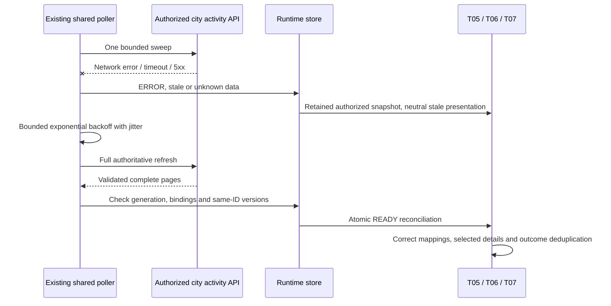

# T08 — Multi-Agent Synchronization & Reconnection

**COMPLETE — verified 2026-10-25.** This slice hardens existing observation and reconciliation only. It does not add collaboration, orchestration, a new transport or a new lifecycle state. T09/T10 remain planned.

## Audited architecture

One vanilla-JavaScript T04 controller owns authenticated REST polling for the page. It feeds a frozen normalized store, T05 stable-slot/object-identity binding indexes, T06 shared status definitions/Canvas markers, and the T07 existing NPC inspector. The backend uses one PostgreSQL SELECT snapshot per activity page and existing city-read authorization. No applicable AGENTS.md was found. No Git metadata is available in the workspace; a pre-change SHA-256 inventory is used to check preservation.

Existing behavior retained: foreground polls two seconds **after completion**, a five-second whole-sweep budget, single flight, at most five pages/100 records with at most 20 per page, request aborts, generation isolation, conservative missing-record reconciliation, 6-second stale/30-second unknown thresholds, bounded jittered backoff, auth cleanup, visibility pause/resume and immutable validated responses. The actual stable NPC catalog supports 20 Agent-linked slots, normally served in one page. Ordinary NPCs remain backend-independent.

## Invariants

1. Backend committed state is authoritative. No client outcome, progress, movement destination or runtime transition is manufactured.
2. Associations use validated Agent/binding IDs and immutable NPC slots through T05. One Agent's references never become another's selection.
3. Each connection/scope/visibility generation rejects results from older generations, even if the old transport ignores abort and returns last.
4. A single logical sweep runs at once, including synchronous subscriber reentry. Only complete validated sweeps publish state.
5. Versions are compared only for the same Agent, Task or Execution ID. An unrelated Agent or new attempt may validly start at version 1.
6. Failed reconciliation never resets successful-receipt freshness or announces READY. It retains explicitly stale data under existing policy.
7. No poll, subscription or network request is owned by an NPC or animation frame.
8. Duplicate snapshots do not spawn NPCs, accumulate timeline items or restart the same completion deadline.
9. Authorization loss clears credentials, protected associations and selection; stale network data does not mean execution failure.

## Update ordering

T03 already supplies monotonic persisted `agentVersion`, `currentTask.version`, and `currentExecution.version`, plus stable IDs. T08 validates an entire incoming sweep against its previous retained records **before** modifying missing counters or publishing. A lower version for the same persisted ID rejects the whole sweep as safe `STALE_SNAPSHOT`. The retry uses existing bounded backoff; a later coherent sweep restores READY. Other rows are not partially committed, preserving atomic frontend binding validation.

These versions are not a complete Agent activity revision: Agent version does not advance for every child execution; current Task/Execution may disappear or be replaced; bindings have identities rather than exposed version counters. Across those changes, ordering relies on existing single-flight, `cache:no-store`, sequential reads of the configured authoritative primary database and connection generation checks. No replica/cache/multi-region ordering is claimed. A restored database that rolls back versions requires an explicit trusted reconnect/scope reset; the client does not silently discard its regression guard.

Neither observation timestamps nor version numbers across unrelated IDs are used as a global ordering clock. PostgreSQL `observedAt` remains an observation time, not a replay cursor or monotonic sequence. Tests accept a newer request with different identities and a backwards wall-clock observation, without comparing unrelated versions.

The controller now installs its in-flight Promise before notifying LOADING/REFRESHING subscribers. Reentrant refresh calls coalesce rather than opening another sweep. It also rechecks generation after publishing READY, because an observer may synchronously disconnect or replace authorization scope; the old completion cannot alter the new connection's receipt clock or counters.

## Reconnection and authoritative reconciliation



Recovery is **snapshot-first polling**, not event subscription/replay. The client always reacquires the current authorized projection after outage/restart. There is no buffered event stream and no gap-free replay guarantee. Intermediate transitions can be missed; the current state/latest recorded outcome is restored without inventing the intervening history. A provider failure appears only if persisted runtime state says so, independently of HTTP connectivity.

Complete successful sweeps reconcile additions, changed bindings and outcomes. A first omitted Agent is unavailable immediately but its old authorized record remains internally for one confirmation sweep. A second complete omission removes it. Failed/partial sweeps never count as absence. A missing explicit authorized ID set that returns 404 clears the scope and suspends rather than guessing broader access.

Each page is one database snapshot; separate keyset pages are not one cross-page transaction or instantaneous whole-city snapshot. Duplicate/ambiguous IDs or bindings never publish a mixed association. A cross-page binding conflict may be a legitimate reassignment between page reads: it uses retryable `STALE_SNAPSHOT`, discards the whole partial sweep and starts again after bounded backoff. Within-page malformed identities/order still fail strict schema validation and suspend. Persistent cross-page conflicts stay stale with bounded retries, never an ambiguous binding. No read transaction is held across polling cycles.

## Health and resource policy

| Existing state | Meaning |
| --- | --- |
| DISCONNECTED | Explicitly disabled or disconnected; protected data cleared |
| LOADING | Initial authoritative reconciliation in progress |
| REFRESHING | Shared refresh in progress; existing freshness still applies |
| READY + fresh | Last complete validated reconciliation succeeded; not proof of live process |
| ERROR + stale/unknown | Refresh failed or could not reconcile; last-known data is not live |
| PAUSED | Hidden tab or empty scope; no hidden polling |
| AUTH_REQUIRED | Credential revoked/expired; stop, erase data and require explicit trusted reconnect |

Transient retry delay is 2/4/8/16/30 seconds capped with ±20% jitter; Retry-After is bounded to 60 seconds. Online events are hints and do not bypass an existing pending timer or an in-flight request. Repeated hints cannot cause storms. Schema/configuration/validation/limit failures suspend pending explicit correction; 401/403 clear credentials and detach listeners. A successful refresh is required before returning healthy.

Hidden tabs abort their active read, stop polling and mark data stale. Visibility resume starts one authoritative reconciliation. Monotonic receipt age drives stale/unknown handling, independently of simulation pause/speed or backend wall clock. Timers, AbortSignal listeners, browser online/visibility listeners and subscriptions use existing cleanup on disconnect/dispose; tests exercise 100 connect/disconnect cycles. There is no cleanup worker.

## NPC and inspector integration

Status lookup remains keyed to each actual registered NPC instance. Running A, idle B, failed C and a new execution for D do not share status or execution details. Reassignment changes the authorized association without recreating NPCs. T07 historical selection remains scoped to the same NPC/Agent/binding identity and only existing authorized references; the timeline replaces its single recent outcome rather than accumulating events.

T08 preserves existing completion-suppression keys through the first uncertain missing sweep, while displaying no valid association for that missing record. This prevents a transient omission from resetting a previously observed completion deadline. Retention is bounded by currently retained authorized T04 records. Confirmed removal, auth loss and scope changes clear those keys. No persistent cross-user outcome cache is introduced. As before, explicit reconnection after clearing all authorization can show a genuinely recent outcome within the existing five-second timestamp policy; there is no durable browser effect ledger across scopes/reloads.

The existing inspector distinguishes stale sync from execution failure and refreshes after reconciliation without an independent fetch. Switching selection during outage uses that NPC's own latest authorized binding; no selection response races exist because T07 consumes the same read view and makes no detail requests. Unbound/decorative residents, camera, sprites, movement, animations and rendering algorithms remain unchanged.

## Security and limitations

No credential, ownership, endpoint or server authorization boundary changed. Tokens remain private/volatile; unknown raw transport diagnostics are normalized. Responses still pass strict schema, size, ID, cursor and binding validation before use. Existing local-only deployment restrictions and production identity limitations remain. No provider call, direct browser inference or new execution behavior is introduced.

No benchmark of FPS, memory or live-provider throughput is claimed. The new controlled test uses 20 existing/test-created functional residents, one batch per cycle and unchanged object/position/animation references; existing city tests/browser smoke cover ongoing movement and camera behavior. Larger linked populations require a separately reviewed catalog and query strategy. No backend version/schema change is needed for the currently serialized primary-database transport.

## Verification

Focused tests: `tests/multi-agent-sync.test.js`, plus existing T04 synchronization, T05 binding, T06 presentation and T07 inspection suites. Controlled clocks/transports exercise regression rejection, independent identities, backwards timestamps, 20-Agent updates, missed changes after outage, reassignment/removal, duplicate outcomes, reentrant subscribers, stale generations and retry/resource bounds.

Browser smoke extends the existing test-only transport fixture with two independently changing Agents, selected-Agent isolation, a network outage, switching NPC selection while disconnected, automatic backoff recovery and authoritative missed-outcome reconciliation. It does not create production records or make live provider calls. Actual PostgreSQL tests separately verify runtime concurrency, restart durability and city API/client compatibility. Browser mock recovery is not a claimed live backend restart.

An additional real HTTP restart test is registered through the existing isolated PostgreSQL activity harness in `apps/api/test/multi-agent-reconnect.integration.cjs`. It creates two authorized test Agents/bindings, consumes actual protected HTTP responses through T04/T05/T06 and reads T07 selection, closes the Nest server, verifies connection-error staleness, persists a missed outcome in the owned test database, restarts Nest at the same loopback origin with the same trusted configuration, commits a real lifecycle cancellation, then advances the retry clock and joins the resumed request. It verifies authoritative outcome reconciliation, stable bindings, selected-Agent isolation and cleanup. These are trusted persistence fixtures and a real cancellation transaction, not a claim of live provider execution. No production database URL is consumed by the harness.

Run `npm run verify:phase1` for the existing full workflow, or `node --test tests/multi-agent-sync.test.js tests/runtime-sync.test.js tests/npc-runtime-binding.test.js` for focused checks. The latter passed 45 tests, including 10 new T08 tests. Actual full-workflow outcomes are recorded below after verification.

### Actual verification results

| Command/check | Result |
| --- | --- |
| Focused synchronization/binding command above | PASS, 45 tests, no skips/failures |
| `npm run verify:phase1` final run | PASS, exit 0 |
| `npm run lint` within final workflow | PASS, recursive JavaScript syntax checks, strict frontend runtime types, backend typecheck |
| `npm run build` and `npm run build:web` | PASS, Nest build and disposable frontend production bundle |
| `npm run db:check` | PASS, migration journal unchanged/valid |
| `npm test` within final workflow | PASS, 124 frontend tests |
| `npm run test:api` within final workflow | PASS, 190 backend tests |
| `npm run test:db` within final workflow | PASS, 103 existing real PostgreSQL tests |
| `npm run test:browser` within final workflow | PASS, Chrome 155.0.8059.85, 125 resource requests, zero exceptions |
| Additional real HTTP restart integration command below | PASS, 1 selected test in separate isolated PostgreSQL run, no skips/failures |

The final full workflow completed the 103-test SQL suite before the additional restart test was registered. The new restart scenario was therefore verified separately, not claimed as part of that aggregate's SQL count. Its actual command, from `apps/api`, was:

```powershell
node --test --test-name-pattern='P3 T08 real HTTP server restart' test/database.integration.cjs
```

The first aggregate run exposed an old disposal fixture that artificially decreased Agent version 2 to 1 after disposing its binding observer. Its post-dispose update now uses version 3, preserving the original observer-isolation assertion while following the new rule. The full workflow was rerun successfully. The restart test's first run asserted READY before real socket I/O had finished; it now explicitly joins the automatically resumed request after the fake clock triggers it, and the rerun passed. No polling sleep was added to that test.

Temporary logs: `elyqreth-p3-t08-verification.log` (initial fixture failure), `elyqreth-p3-t08-verification-final.log` (successful aggregate), `elyqreth-p3-t08-restart.log` (initial test synchronization failure), and `elyqreth-p3-t08-restart-final.log` (successful real HTTP restart test). These are local OS-temporary artifacts. Live Ollama/OpenAI calls were NOT RUN. No FPS, heap growth or full browser-to-provider restart measurement is claimed.

### Files changed and preservation

Created:

- `tests/multi-agent-sync.test.js`
- `apps/api/test/multi-agent-reconnect.integration.cjs`
- `docs/ai-agent-platform/phase-3/multi-agent-synchronization.md`

Modified:

- `dist/js/runtime/sync-controller.js`, `runtime-store.js`, `validation.js`, `contracts.d.ts`, `npc-status.js`
- `tests/runtime-sync.test.js`, `tests/npc-runtime-binding.test.js`
- `apps/api/test/activity.integration.cjs` (reuse its fixture/configuration and register the new isolated restart scenario)
- `scripts/browser-smoke.mjs`
- Root `README.md`, `docs/ai-agent-platform/README.md`
- Phase 3 `README.md`, `architecture.md`, `decisions.md`, `synchronization.md`, `testing-performance.md`, `implementation-plan.md`

The pre-change inventory confirms 278 existing files unchanged, including backend production source/schema/migrations, T02–T05 identity/API/binding modules, T07 inspector implementation, renderer, simulation/movement, styles and sprites/assets. No inventoried files were removed. No dependency, database schema, endpoint, provider or production infrastructure changed. No commit, push, tag, release or deployment was performed.

Next: **Phase 3 T09 — Security, Performance & Regression Verification**. It remains planned and is not started by T08.
