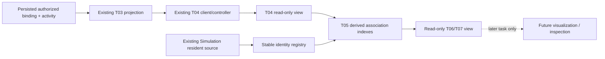
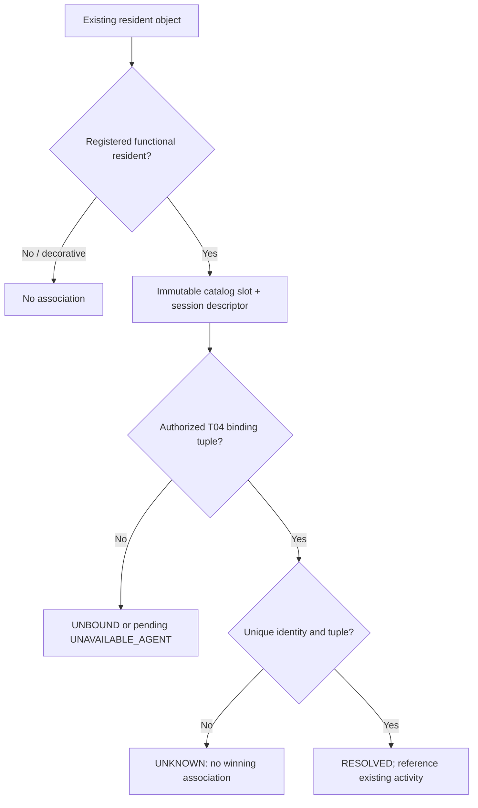
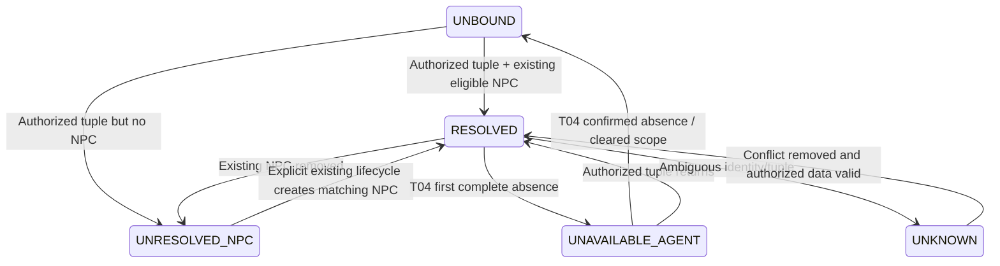
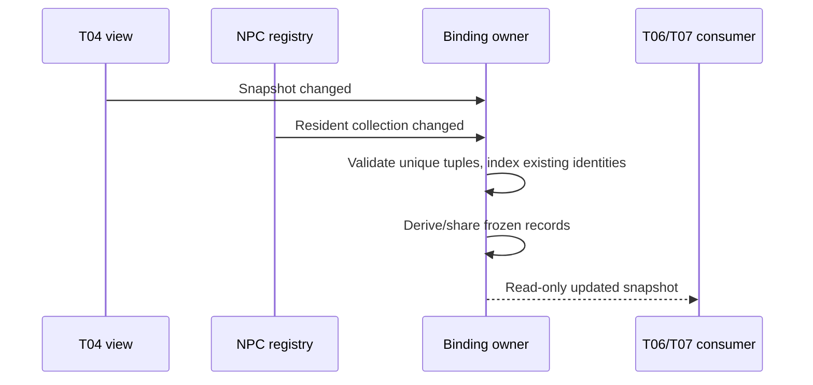

# T05 — NPC Runtime Binding

Date: 2026-10-24 (Asia/Bangkok). This slice associates existing functional NPC identities with authorized T04 activity. It does not render status, change inspection, spawn/despawn residents, execute Tasks or mutate backend bindings. T06–T10 remain planned. Verification and actual file accounting follow below.

## Audited infrastructure and scope decision

T02 supplies immutable `resident-slot-001` through `resident-slot-020`; four original residents have slots 001–004. Numeric `id` is session-local movement/selection identity, not a backend Agent ID. The existing Simulation owns functional resident add/remove behavior. Citizens owns separate decorative/transit/staff populations and must remain outside Agent association.

T03 returns safe Agent UUID/binding UUID/npcId and activity from authoritative PostgreSQL. T04 validates/synchronizes those facts and provides a read-only view, missing-entry tracking, loading/error/freshness, generation fences and credential cleanup. There is no separate binding REST API to fetch and no new transport in T05.

The original T01 roadmap considered provisioning extra avatars. The explicit T05 request instead requires missing NPCs to stay unresolved. **No automatic NPC creation or removal is implemented**, including for reserved slots 005–020. Explicit existing Simulation creation can later make a slot available; reload normally recreates the original four. Neither backend binding removal nor an NPC disappearance deletes the other system's entities/history.

## Components and authority

| File | Responsibility |
| --- | --- |
| `runtime/npc-binding.contracts.d.ts` | Read-only source, NPC descriptor, association record and derived snapshot contracts |
| `runtime/npc-registry.js` | Functional-resident identity index, conflict detection, weak object lookup, collection lifecycle subscription |
| `runtime/npc-runtime-binding.js` | Derived Agent/NPC/binding indexes and read facade; subscribes to T04 and the registry only |
| `simulation.js` | Minimal collection notification hook for existing add/remove methods; movement/update/render policies untouched |
| `app.js` | Composes one owner with the existing Simulation and T04 view; exports a read-only view and disposes on HMR |



No entire activity snapshot is cloned into another store: the binding snapshot references the current T04 RuntimeSnapshot, and each valid association references its existing immutable AgentActivity. No fetch, timers, coordinator/provider/tool calls or persistence operations exist in this layer. All execution status remains backend-owned; association state is not a Task/Execution state machine.

## Identity resolution and eligibility

The registry accepts objects from the trusted functional resident source only. It indexes a supported own npcId property only if it is nonwritable and nonconfigurable, matching T02 initialization. It ignores names, positions, appearance, role, sprite, and arbitrary local agentId/bindingId metadata. Numeric resident IDs must be positive safe integers. Decorative objects are excluded even if they claim a stable slot. Unbound functional residents still have a read-only session descriptor and no Agent association.

An entity lookup uses a WeakMap membership check, not caller-supplied matching fields; a clone/impostor with the same IDs cannot resolve. Duplicate numeric IDs or stable slots fail closed. Runtime tuples must be keyed by the same canonical Agent UUID and carry either no binding or a valid binding UUID/catalog slot pair. Duplicate binding IDs/slots or malformed tuples cannot choose an arbitrary winner; all conflicting associations become UNKNOWN. No random identity, name fallback or coordinates are generated.



## Contracts and T06/T07 read interface

`createNpcRuntimeBindings(runtimeView, residentSource)` returns a trusted owner with `view`, `reconcileNpcs()` and idempotent `dispose()`. Prefer passing only `view` into future visualization/inspection at application composition, instead of importing the app entry back into rendering modules. The app's named `npcRuntimeBindingView` export is the same read facade used by smoke tests. No owner control, credential, transport or mutable resident object is returned by the view.

| Read method | Meaning |
| --- | --- |
| getByAgent(agentId) | Authorized association record, including unbound/unresolved; undefined if absent/inaccessible |
| getByNpc(npcId) | Record for an existing stable NPC or authorized unresolved slot; undefined for unknown/nonexistent unassociated slot |
| getForEntity(entity) | Registered resident-object lookup; decorative/unregistered impostor returns undefined |
| getActivityForNpc(npcId) | Existing T04 activity only for a RESOLVED association; otherwise undefined |
| isLinked(npcId) | Identity is RESOLVED, independently of freshness or backend availability/activity |
| listLinked() | Cached stable-slot-ordered RESOLVED records only; no scan or NPC creation |
| getSnapshot() | Frozen `{disposed,runtime,byAgent,byNpc,linked,unresolved}`; runtime is the current T04 snapshot reference |
| subscribe(listener) | Immediate/current derived snapshots; returns unsubscribe; consumer exceptions are isolated |

Each record exposes nullable agentId/npcId/bindingId, association state/reason, nullable frozen `npc:{entityId,npcId,ambiguous}`, nullable activity reference, T04 freshness, backend observedAt and frontend lastSuccessfulSyncAt. It contains no coordinates, paths, animator, provider secrets, raw prompts or tool arguments. Descriptors/records/maps/lists are frozen. Unchanged records share references; getters do not mutate NPCs, request data or rebuild indexes.

Example of a future **read**, not implemented rendering:

```javascript
const link = bindingView.getForEntity(existingResident);
if (link?.state === 'RESOLVED') {
  const backendActivity = link.activity;
  const fresh = link.freshness === 'fresh';
  // T06 must consider freshness and backend UNKNOWN before any active emphasis.
}
```

Do not use a true isLinked result as evidence that an Agent is executing. T06 must consider association state, T04 freshness/loading/error and the raw backend activity independently. Backend UNKNOWN remains UNKNOWN; it does not invalidate an otherwise known identity relationship.

## Association states

| State | Meaning / data |
| --- | --- |
| RESOLVED | Unique authorized tuple and currently registered NPC descriptor; activity reference retained |
| UNRESOLVED_NPC | Authorized binding exists but the NPC does not; nullable descriptor, no auto-spawn |
| UNBOUND | No authorized association available, or Agent has no binding; not a universal claim about unseen backend data |
| UNAVAILABLE_AGENT | Existing NPC corresponds to a T04 pending-removal entry; no Agent ID/binding ID/activity is exposed by that record |
| UNKNOWN | Duplicate/invalid identity or binding; no arbitrary winning Agent/usable activity for NPC lookup |

Reasons are closed identifiers: NONE, NO_AUTHORIZED_BINDING, NPC_NOT_PRESENT, DUPLICATE_IDENTITY, DUPLICATE_BINDING, INVALID_BINDING and PENDING_REMOVAL. These do not add backend enums or reinterpret Agent ACTIVE/DISABLED/ARCHIVED. Disabled/archived availability and failed/cancelled/unknown Execution outcomes are simply T04 data, not instructions to remove or move a resident.



Freshness is orthogonal: RESOLVED can carry stale/unknown freshness; a network error is not deletion, failed execution or automatic identity loss. Backend UNKNOWN activity can be carried by RESOLVED. No indicator/animation is created here.

## Lifecycle and reconciliation

Simulation now exposes getResidents/subscribeResidents. Its existing add/remove methods notify collection observers; initialization produces the same four residents with the same numeric-ID rules, roles, spawn behavior and movement initialization. Existing onChange/UI notification behavior remains intact. Movement, animation, mission progression/reset/pause/speed, decorative spawning and renderer do not publish to this new collection channel. A read never invokes add/remove.

The registry maintains indexes on collection events. Reconciliation runs on those events and T04 snapshot notifications, not animation frames or per-NPC requests. A trusted owner may call reconcileNpcs after exceptional tooling that changes the resident collection directly; normal application code must use existing lifecycle methods. No timer retries scan for missing NPCs.



T04 first-missing entries are excluded from Agent lookup immediately; NPC lookup becomes UNAVAILABLE_AGENT without the old Agent reference. T04 owns the second-complete-sweep confirmation. A new authorized reassignment to the same slot takes precedence over the old pending record without duplicating NPCs. Temporary network failure keeps valid identity but stale freshness. Authentication/owner scope clear drops associations immediately because T04 data is empty; no T05 fallback cache restores old mappings. Old transport generations remain T04's responsibility and are tested through the actual controller.

Removing a functional NPC leaves the backend tuple intact and UNRESOLVED_NPC. Repeated hydration does not respawn it. An explicitly created eligible resident with that stable slot reattaches; no existing movement/animation object is replaced by reconciliation. Reload reconstructs normal session residents and reuses the same backend Agent/NPC/binding tuple. Missing reserved slots remain unresolved across reloads. Backend restart recovery uses T04's existing authoritative refresh; T05 does not invent new IDs or execution recovery.

## Cleanup and security

dispose unsubscribes runtime/resident observers, clears lookup caches/listeners and releases source/credential-free runtime references. Retained disposed facades expose `disposed:true` and no previous associations. An already-queued notification cannot repopulate a disposed owner. Disposal does not disconnect shared T04 consumers; the app HMR owner disposes T05 and disconnects T04 separately. Pagehide disconnects T04, clearing associations while retaining the page's resident source for safe back/forward restoration; no network loop belongs to T05.

Authorization is inherited from the validated T04 view and enforced server-side by T03. This layer does not accept an Agent UUID from NPC metadata as authority. It creates no backend bindings, NPCs, Tasks, tools or provider requests. Unknown/cross-scope lookups reveal no extra identities. Snapshot references retained by arbitrary consumer code cannot be revoked; consumers must discard them on auth/scope/dispose changes, as with T04. This does not add production identity/tenant controls; external production exposure remains blocked.

Decorative citizens never require backend configuration, credentials or database records. They remain outside the registry, rendering and inspection unchanged. Ordinary unbound functional residents continue normal simulation behavior. Bound Agents without an available visual entity remain valid backend Agents with activity in T04. The current T03 city audience normally omits Agents with no backend binding; T05 does not fetch operator APIs to discover them. If an authorized view supplies an unbound activity, it is handled safely as UNBOUND.

## Verification and performance

**T05 COMPLETE for the existing local-development scope.** Actual verification on 2026-10-24:

| Executed command / check | Actual result |
| --- | --- |
| npm.cmd run check:runtime:web | PASS strict checked JS/.d.ts contracts, including registry and binding layer |
| node --test tests/npc-runtime-binding.test.js | Final focused run 19/19 PASS, zero failures/skips |
| npm.cmd run verify:phase1 | PASS, exit 0: recursive frontend syntax/static checks, frontend runtime/backend typecheck, builds, migration check, **96 frontend tests**, **190 backend tests**, **103 isolated PostgreSQL tests**, browser smoke |
| npm.cmd run lint | Final-source rerun PASS; actual repository checks, not a claim that a separate ESLint/formatter exists |
| npm.cmd run build:web | Final-source rerun PASS in disposable output; source dist is preserved |
| Browser smoke in aggregate | PASS Chrome 155.0.8059.85, 72 resource requests, zero exceptions. The new sidecar is shared and indexes four original UNBOUND slots without API requests or new NPCs |
| Live providers | NOT RUN, not required: no inference or provider changes |

Nineteen new tests cover resolution, missing/duplicate/malformed identities, removal/reassignment, reload, auth clearing, stale/UNKNOWN, actual Simulation lifecycle, decorative preservation, observer cleanup and actual T04 synchronization without another poller. The 77 existing frontend tests, including T04 races/cancellation and city/NPC regressions, also pass. A final disposal guard additionally rejects notifications queued before unsubscribe; final focused/type/build checks cover that source. No backend production file, database schema or migration changed.

Network outage/restart recovery is exercised with controlled fake responses; real PostgreSQL restart/runtime/API regression remains the existing owned-container aggregate harness, not a claim of a new live browser-to-database visualization workflow. Browser regression covers Canvas/population, camera/panels, river/NPC movement, simulated missions and mobile reload; it is not exhaustive visual/FPS acceptance.

Indexing is O(N) for a resident collection change. Association reconciliation is O(A + N), plus bounded list sorting, for A authorized activities/N resident descriptors. Entity/Agent/NPC lookups use WeakMap or direct indexed keys, and listLinked returns a cached array. Activities are referenced, not deep-cloned; stable record values preserve object identity. No per-frame index reconstruction, global scans per NPC lookup or per-NPC polling occurs.

The persisted/validated manifest supports at most twenty linked slots. A 100-linked-NPC benchmark is **NOT APPLICABLE** without changing that contract; the tests instead measure 20 linked among 100 total functional resident descriptors. These are local indexing observations only, not rendering/FPS or production-capacity measurements. T06 will separately implement and verify indicators without conflating identity with activity.

Final focused local observations (synthetic identity descriptors; hydration timing includes fixture normalization/T04 store commit plus T05 reconciliation, and lookup timing includes test assertions):

| Linked / total residents | Hydrate + reconcile ms | 10,000 indexed lookups ms | Source scans during lookups |
| --- | --- | --- | --- |
| 1 / 1 | 0.100 | 1.326 | 0 |
| 5 / 5 | 0.258 | 0.844 | 0 |
| 20 / 20 | 0.383 | 0.985 | 0 |
| 20 / 100 | 0.390 | 0.988 | 0 |

These are single-run warmup/cache-dependent observations, not latency thresholds, real city population measurements or statistical performance guarantees. A separate test executes 300 actual Simulation movement updates and 10,000 binding lookups with no extra resident-source reads or binding reconstruction.

## Files and preservation evidence

Git metadata is absent; git status cannot establish a clean tree or commit diff. A saved pre-T05 SHA-256 inventory found **14 existing files modified, five created, zero removed**. All **198 protected existing backend files/tests/migrations, city assets, renderer/movement/citizen/theme systems and Phase 1/2 documents are unchanged**. Earlier Phase 3 implementation guides also remain unchanged. Existing simulation changes are collection-observer hooks only; npc-identity.js adds a type annotation without behavior change. No dependency, package script, schema, Compose or CI change was needed.

Created:
- tests/npc-runtime-binding.test.js
- docs/ai-agent-platform/phase-3/npc-runtime-binding.md
- dist/js/runtime/npc-runtime-binding.js
- dist/js/runtime/npc-registry.js
- dist/js/runtime/npc-binding.contracts.d.ts

Modified:

- scripts/browser-smoke.mjs
- README.md
- docs/ai-agent-platform/README.md
- dist/js/simulation.js
- docs/ai-agent-platform/phase-3/testing-performance.md
- docs/ai-agent-platform/phase-3/security.md
- docs/ai-agent-platform/phase-3/README.md
- docs/ai-agent-platform/phase-3/implementation-plan.md
- docs/ai-agent-platform/phase-3/identity-mapping.md
- docs/ai-agent-platform/phase-3/decisions.md
- docs/ai-agent-platform/phase-3/architecture.md
- dist/js/runtime/contracts.d.ts
- dist/js/npc-identity.js
- dist/js/app.js

Sixteen current root/platform/Phase 3 documents passed local-link and fenced-block checks with zero issues. No commit, push, tag, release or deployment was performed. Next: **Phase 3 T06 — NPC Status Visualization**; not started.

