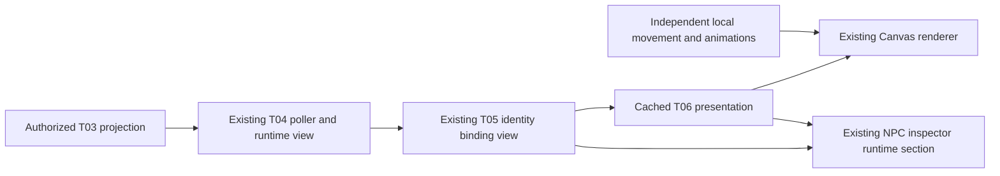

# T06 — NPC Status Visualization

**COMPLETE — verified 2026-10-25.** T06 adds presentation only, including the compact runtime section requested in the latest T06 scope. T07 execution history/results/details remain planned. It preserves T02–T05 identity, authorization, synchronization and NPC simulation boundaries.

## Architecture



`npc-status.js` owns the checked JavaScript presentation definitions and the presentation owner. `npc-status-drawing.js` renders reusable Canvas primitives. `npc-runtime-inspector.js` serializes an explicit allowlist of escaped projection fields. `app.js` injects the presentation into the existing renderer; the renderer never imports app.js, transport or provider modules.

The presentation owner subscribes once to T05. There is no fetch, polling loop, extra GameLoop, DOM listener or timeout in the presentation. T04 remains explicitly connected by the trusted application owner and disabled by default. No production fake activity or browser credential-entry UI is introduced.

## Central status mapping

| Projection/binding | Presentation | Marker |
| --- | --- | --- |
| Unbound/decorative/missing visual NPC | No runtime overlay | None |
| Resolved, fresh, ACTIVE, IDLE | Idle | Original NPC appearance |
| Resolved, fresh, ACTIVE, RUNNING | Running (persisted state) | Icy `>` square and small pulsing underline |
| Resolved, fresh, ACTIVE, QUEUED | Waiting | Icy `=` square |
| IDLE with recent COMPLETED outcome | Recently completed, bounded below | Soft green `+` square |
| IDLE with FAILED outcome | Last outcome failed | Restrained pink `!` square |
| IDLE with CANCELLED outcome | Last outcome cancelled | Muted `-` square |
| Stale T04 data | Stale connection data | Muted `~` square |
| Unknown freshness/activity or ambiguous binding | Unknown activity | Muted `?` square |
| Disabled/archived Agent or pending inaccessible association | Association unavailable | Muted `?` square |

Freshness and binding uncertainty take precedence over activity/outcomes. Active current work takes precedence over historical outcomes. Availability is separate from lifecycle. No OFFLINE backend state, fabricated progress or process liveness is inferred. Unsupported current states fall back to UNKNOWN. The historical failure/cancellation marker remains until superseded by authoritative activity/outcome or binding removal; its inspector label explicitly says **last outcome**.

## Completion and animation

A stable outcome key combines execution/task ID, outcome status and finishedAt. At first observation its remaining display duration is `max(0, 5000 - (observedAt - finishedAt))` milliseconds. Invalid/future timestamps suppress the effect. This anchors age to two backend timestamps instead of comparing server time to the browser clock. A monotonic local deadline expires the marker; repeated observations of that same outcome never reset it. Historical outcomes older than five seconds do not flash on reload. If polling misses a short event, no fake transition is reconstructed. The inspector still shows the actual recent outcome after its marker expires.

No animation timers are created. The existing draw loop supplies monotonic time for a subtle 12-pixel RUNNING accent; all other markers are static. `prefers-reduced-motion` disables that pulse, including changes to the media query preference. Simulation pause/speed do not alter backend status or presentation deadlines.

## Rendering and inspection

Markers use a 16 CSS-pixel dark square with a light border and distinct glyph above the sprite/local mission progress marker. Size stays constant across camera zoom. Hidden and offscreen markers skip drawing. They do not affect hit testing, sprites, navigation, depth, movement or camera controls. Idle/unbound NPCs keep their original appearance. Existing environment palettes and assets are unchanged.

The **same NPC inspector** keeps all local simulation fields and adds a clearly separated Agent runtime section for bound/uncertain associations. It shows registered Agent name/ID, availability, presentation/current activity, supported current Task/Execution IDs and Task status, recent outcome/execution status, backend activity/observation times, freshness and last successful frontend sync. Raw ISO timestamps remain labeled by source; no browser clock is presented as backend execution time.

The projection has no task summary, result content or safe diagnostic message. These are not invented or fetched. Failures display only contract statuses. All backend strings are HTML-escaped; no provider response, credential, raw prompt, tool argument, diagnostic or exception is serialized. Ordinary/decorative inspection remains unchanged. No backend controls are added.

## Reconciliation, security and cleanup

T05 `getForEntity` validates registered object identity and immutable NPC slots. The presentation never trusts local NPC Agent metadata. On a temporary network error, the last authorized association remains but T04 freshness produces a neutral marker. Refresh restores the current authoritative status. The first confirmed missing sweep yields unavailable association with redacted Agent data; confirmed removal clears overlays and inspector fields. Authentication/scope clearing immediately removes authorized associations through the existing T04/T05 path.

Outcome state is bounded by currently linked bindings, not all historic Executions. It is removed when bindings disappear. HMR disposes presentation before bindings; pagehide uses existing runtime disconnect, preserving BFCache-compatible city state. No additional subscriptions remain after presentation disposal. Consumers must not retain old authorized snapshots after scope changes.

Existing local-only access restrictions remain: this does not add production identity/tenant authentication, enable remote city exposure, or put provider credentials in the browser. No actual LLM calls are needed for testing.

## Performance and verification

Lookups are existing T05 indexed lookups and shared frozen visual definitions, without per-frame activity cloning or resource construction. Only binding updates scan current linked bindings. One bounded outcome entry is retained per binding; the current catalog supports 20 linked slots. Tests perform 10,000 frame lookups against the same cached definition. This is not a measured FPS or large-population rendering benchmark.

Run:

```powershell
node --test tests/npc-status.test.js
npm run lint
npm test
npm run build:web
npm run test:browser
npm run verify:phase1
```

The focused tests cover status/unknown/availability mapping, failure versus staleness, monotonic completion expiry and replay prevention, historical/future timestamp suppression, stale recovery, reassignment/removal, missing NPCs, movement preservation, inspector field allowlisting/HTML escaping, constant-size shape/text drawing, reduced motion, stable frame references and disposal. Existing T04/T05 suites cover synchronization, authorization scope, race protection and identity isolation.

### Actual verification results

| Command | Result |
| --- | --- |
| `node --test tests/npc-status.test.js` | PASS, 8 focused tests |
| `npm run lint` | PASS, recursive syntax checks, strict frontend runtime TypeScript and backend typecheck |
| `npm test` | PASS, final 104 frontend tests, no skips/failures |
| `npm run build` | PASS, NestJS backend build |
| `npm run build:web` | PASS, final disposable production build, 46 modules; maintained dist source preserved |
| `npm run db:check` | PASS, existing migration journal valid |
| `npm run test:api` | PASS, 190 backend tests, no skips/failures |
| `npm run test:db` | PASS on rerun, 103 isolated real PostgreSQL tests, no skips/failures |
| `npm run test:browser` | PASS, final Chrome 155.0.8059.85 run, 97 resource requests, zero exceptions; runtime-ID wrapping assertion also passed |

`npm run verify:phase1` initially passed static checks, both builds, migration check, 103 then-current frontend tests and 190 backend tests, but stopped at PostgreSQL setup because Docker Desktop was not running. The installed Docker Desktop was started; the isolated SQL suite then passed. The aggregate command itself is **not** reported as passing. The eighth focused test, final 104-test frontend run, final lint/build and final browser run were executed separately. The original sandbox browser attempt also could not load Vite's config; the approved local workflow executed outside that restriction.

Logs are local temporary artifacts: `elyqreth-p3-t06-verification.log`, `elyqreth-p3-t06-frontend-final.log`, `elyqreth-p3-t06-db-final.log` and `elyqreth-p3-t06-browser-final.log` in the OS temporary directory. A local `elyqreth-p3-t06-runtime.png` screenshot was inspected for the existing palette, visible marker and distinct runtime inspector section. This is a single screenshot review, not a visual regression baseline or exhaustive accessibility/zoom audit. Markdown links/fences were checked across 17 documents with no issues.

Browser smoke uses a **test-only mocked transport** installed by the browser harness, then explicitly connects the real T04 singleton. It verifies the actual T05-to-renderer/inspector path for running, waiting, completion, failure, stale data, recovery and removal, including Canvas glyph drawing and escaped Agent names. It then disconnects and checks camera controls, simulated missions, animations and mobile reload. No fake event path exists in production code, and no provider/backend request is made by this fixture. This is deterministic browser integration, not live provider or full backend-to-browser verification.

### Files

Created:

- `dist/js/runtime/npc-status.js`
- `dist/js/runtime/npc-status-drawing.js`
- `dist/js/runtime/npc-runtime-inspector.js`
- `tests/npc-status.test.js`
- `docs/ai-agent-platform/phase-3/npc-status-visualization.md`

Modified:

- `dist/js/app.js`, `dist/js/renderer.js`, `dist/style.css`
- `scripts/browser-smoke.mjs`
- `README.md`, `docs/ai-agent-platform/README.md`
- Phase 3 `README.md`, `architecture.md`, `decisions.md`, `implementation-plan.md`

There is no Git metadata in the supplied workspace, so working-tree provenance cannot be established with git status/diff. A pre-change SHA-256 inventory confirms 277 existing tracked-by-inventory files are unchanged, including backend production/test/migration sources, T02–T05 runtime modules, movement, simulation, sprites and other assets. No files were removed, and no database schema, dependency or API changed. No commit, push, tag or deployment was performed.

## Limitations and next boundary

- Polling samples state; very short execution outcomes can be missed.
- Persisted RUNNING never guarantees an alive process; T03 UNKNOWN and T04 freshness are preserved.
- No visual-diff baseline, measured FPS budget, long-duration soak or exhaustive manual zoom/overlap review is claimed.
- No connection UI or automatic runtime activation; standalone city remains backend-independent.
- T07 can extend the same inspector with authorized detailed history/results, with a separately reviewed disclosure boundary. T08–T10 remain planned.
