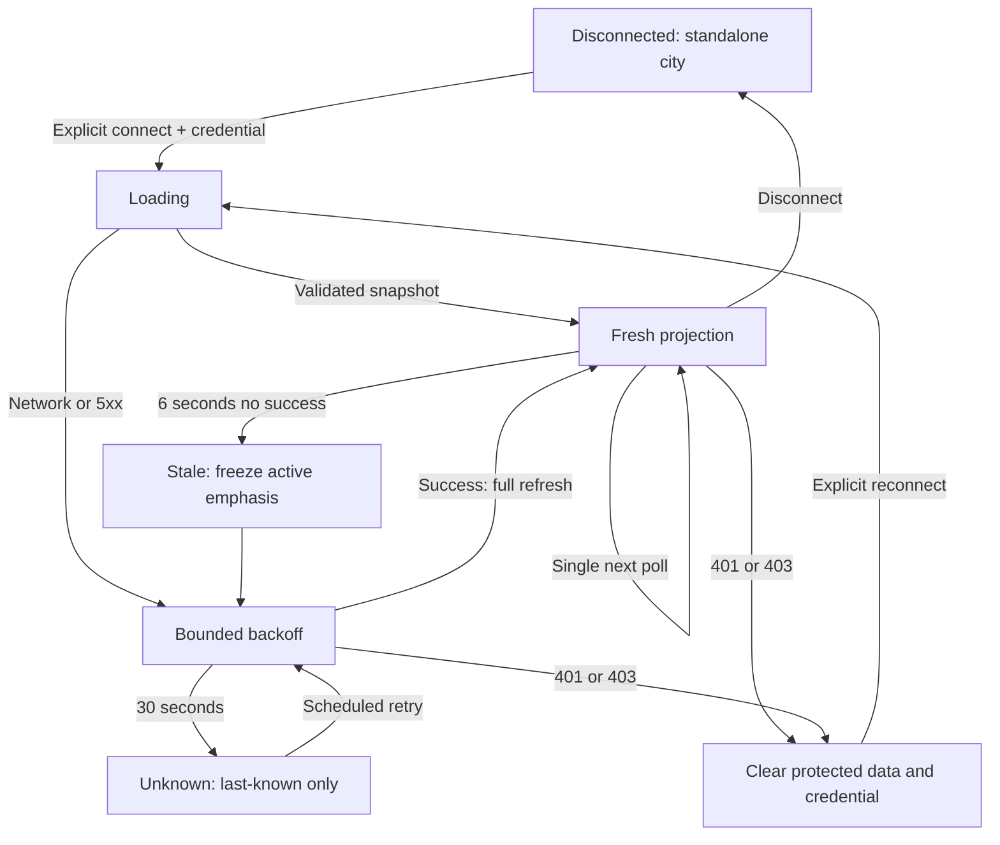

# Synchronization and reconnection — planned

**Phase 3 T08 COMPLETE (2026-10-25):** [Multi-Agent synchronization and reconnection](multi-agent-synchronization.md) hardens existing shared REST polling, same-identity version checks, reentrant refresh coalescing and completion suppression. No new transport/backend state machine. T09/T10 remain planned.

**T04 implemented and verified (2026-10-24):** [Frontend runtime integration](frontend-runtime-integration.md) adds a typed city-read client, frozen store/read facade and bounded synchronization. Final checks passed 77 frontend tests (23 new runtime tests), 190 backend tests, 103 PostgreSQL tests, builds/static checks and browser smoke, with final focused compatibility/build reruns. T05–T10 remain PLANNED; no NPC binding/rendering or backend production source changed.

The original design/targets below remain historical. The implementation guide defines current T04 APIs/state and measured test evidence; no future NPC/inspector or performance target is claimed complete.

## Transport decision

| Option | Complexity/resources | Reliability and access | Phase 3 decision |
| --- | --- | --- | --- |
| REST polling | Existing browser fetch/Nest HTTP; one bounded batch each interval; repeated query cost | Stateless authenticated requests, full refresh heals gaps; misses short intermediate transitions | **Selected** for 1–20 linked Agents; predictable requests and simplest existing-compatible boundary |
| SSE | One-way channel, server connections, heartbeat/backpressure/retention and proxy configuration | Native EventSource cannot attach the existing bearer header; fetch streaming or different credential design needed. Reconnect alone is not replay authorization or durability | Deferred; justify only if measured polling latency/load fails requirements |
| WebSockets | Bidirectional sessions, origin/auth refresh, subscriber limits and heartbeat lifecycle | Requires scoped subscriptions, resumable history/snapshot and reconnect protocol; not currently implemented | Deferred; no current bidirectional city control requirement |

Do not install a transport framework in Phase 3 merely for future interactivity. Existing durable events can later drive invalidation, but no streamPosition becomes a transport delivery guarantee automatically.

## Poller state machine

Single owner per connected city, independent from animation/simulation time. Foreground refresh target 2 seconds **after previous completion**; timeout 5 seconds; no overlapping batch requests. At most one additional selected-detail GET, for total two concurrent requests per page. Cancel previous detail when selection changes; do not cancel another resident's runtime execution. Send Authorization and bounded X-Request-Id only to the fixed approved API origin, cache:no-store, credentials omitted, redirects rejected.

Mark data stale after 6 seconds without a successful validated snapshot using performance.now since receipt, including while a request hangs. Stale RUNNING becomes “Last known running — stale”, with active pulse stopped. At 30 seconds disconnected display UNKNOWN/unavailable with last-seen timestamp; retained last-known data is not claimed current. Missing/invalid schema is a failed refresh, not an empty city.



Network/5xx backoff: 2, 4, 8, 16, then 30 seconds capped, ±20% jitter, one pending timer. Respect bounded Retry-After on 429 up to 60 seconds; no immediate retry storm. 400/schema/version mismatch stops repeated requests and shows a compatibility error until explicit reconnect; 404 for configured city stops rather than guessing another endpoint. Selected-resource 404 clears details, schedules normal authoritative refresh and leaks no existence information.

On hidden tab, abort pending poll/detail and stop periodic refresh; retain explicitly stale data and do not display continuing active animation. On visible, immediately perform one full refresh, reset generation and resume schedule after success/backoff. browser online event is only a hint: schedule at most one refresh, never set Fresh without a response. Backend restart needs no new subscription; fetch latest projection and history.

```mermaid
sequenceDiagram
  participant T as Visibility/network
  participant S as Sync controller
  participant A as Authorized City API
  participant B as Binding reconciler
  T->>S: Connection lost / page hidden
  S->>S: Abort fetch, clear timer, mark stale
  T->>S: Visible / retry due
  S->>A: Fresh full snapshot request
  A-->>S: Committed latest projection
  S->>S: Check auth and request generation; replace safely
  S->>B: Reconcile by stable binding + slot
  B-->>S: Reuse existing avatar; no duplicate spawn
```

Revisions/order: ignore responses from an older connection/request/selection generation even if they arrive last. Within current complete snapshot use each binding identity/revision; a reassignment resets outcome suppression and old selection. Never compare unrelated Task versions globally. Do not infer missing rows until complete successful sweep; confirm disappearance with a second full sweep before removing linked identity. With 20 slots this is a single page; keyset pagination is future-compatible, not a multi-page atomic snapshot promise.

Terminal badges use latestOutcome ID plus terminal version/time. First connection/reconnect renders durable latest outcome in inspector without replaying success pulses. A newly observed terminal identity during a fresh connection gets a 5-second success/cancel badge or 10-second failure badge, measured with monotonic time. After expiry show baseline idle/availability; retain durable outcome details. Outcomes entirely between polls may only appear as latest history, which is correct. No fake replay execution or progress.

Dispose timers, fetch controllers, visibility/online listeners and detail subscriptions on disconnect/auth expiry/navigation. Drop all data across credential/owner changes. Bounded store holds only current 20 projections, visible detail page and limited outcome suppression keys, not an unbounded event/conversation cache.
