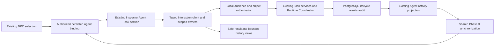

# Phase 4 T10 - Final acceptance review

Review date: **2026-10-27, Asia/Bangkok**. Scope: the approved **single-backend, trusted, loopback local-development/test Interactive AI City**, as established by P4-ADR-002/003. This is not acceptance of public production, multi-tenant access, detached execution or autonomous crash repair.

## Decision and evidence boundary

**Decision: READY for the approved local scope.** Phase 4 can close in that scope after the verification recorded below. Public production release remains blocked by [P4-R01](risk-register.md); remote CI is not asserted green. No version, tag, release, deployment or Git history operation is performed. Phase 5 remains PLANNED.

The actual repository, backend/frontend implementations, T01-T09 artifacts and newly executed T10 checks were reviewed. No applicable AGENTS.md was found in the workspace/accessible ancestors. Git metadata is absent, so current branch/status/diff/untracked classification cannot be obtained. A 406-file maintained-source hash inventory protects prior work. Historical [Phase 1](../phase-1-acceptance.md), [Phase 2](../phase-2/acceptance.md) and [Phase 3](../phase-3/acceptance.md) acceptance records are preserved, not rewritten as fresh T10 evidence.

See [machine-readable command results and preservation inventory](verification-evidence/t10-verification.json), [native interaction report](verification-evidence/t10-interaction-browser.json), [separate city/runtime report](verification-evidence/t10-city-browser.json), [accessibility checks](verification-evidence/t10-accessibility.json) and [bounded interaction profile](verification-evidence/t10-load.json). Retained T08/T09 measurements are labelled historical where reused; compilation alone is not acceptance.

## Task inventory

| Task | Status | Implemented evidence | Verification / remaining issue |
| --- | --- | --- | --- |
| T01 Architecture and plan | COMPLETE | `architecture.md`, `api-contracts.md`, `implementation-plan.md`, P4-ADR-001..008 | Actual scope reconciled here; proposal/checkpoint language linked to current implementation. No new architecture platform. |
| T02 Backend contracts | COMPLETE | `apps/api/src/interaction/`, existing Agents/Tasks/Executions/runtime services; `0004_agent_execution_history.sql` | Actual HTTP/PG capability, ownership, validation, idempotency/recovery and compatibility tests. No production user/tenant identity claim. |
| T03 Typed API client | COMPLETE | `dist/js/runtime/interaction/{api-client.js,contracts.d.ts,validation.js,errors.js}`, shared `runtime/http-transport.js` | Strict runtime-web typing, native contract compatibility, errors/abort/credential-generation tests. No generated OpenAPI system exists. |
| T04 Inspector Task form | COMPLETE | `dist/js/agent-task-panel.js`, `submission-owner.js`, existing inspector composition | Native Save/Agent targeting/double-submit/error tests, unbound/decorative regression and persisted Task checks. Save is not Start. |
| T05 Lifecycle controls | COMPLETE | `lifecycle-owner.js`, native panel controls and confirmation | Actual Start/cancellation/version/race/reload checks; T10 strengthens post-confirmation focus handling. |
| T06 Results/history | COMPLETE | `results-owner.js`, `result-presentation.js`, `execution-results-view.js` | Native safe output, 10+2 cursor pagination, historical association and disclosure tests. No arbitrary JSON/HTML renderer. |
| T07 State/synchronization | COMPLETE | `session.js`, `recovery-journal.js`, existing Phase 3 facade/binding owner | Stable IDs, stale versions, selection/close, token changes, reload, scoped invalidation and no mutation replay verified. No automatic cross-server identity pinning is claimed. |
| T08 Hardening | COMPLETE | `interaction-hardening.md`, scoped DOM/focus styles, HTTP object isolation and profiling harness | Actual configured-owner isolation, keyboard/AX, sampled contrast and bounded load/cleanup. Manual AT certification and production quotas are not delivered. |
| T09 E2E/reliability | COMPLETE | Native `interaction-reliability.integration.cjs`, controlled runtime child, browser helper, `test:interaction:e2e` and CI tier | Actual committed-response loss, offline/reload, failure/deadline, hard crash/restart, revocation/binding removal and exact SQL/mutation counts. No recovery worker. |
| T10 Final acceptance | COMPLETE | This report, current operations/API/workflow guide, risk register, unreleased notes, updated README/index/roadmap and final evidence | Required local functional/security/correctness checks verified; no unresolved local acceptance blocker. Production/remote/manual limitations remain explicit. |

## Architecture conformance

| Boundary | Actual conformance |
| --- | --- |
| Execution authority | Controllers authorize and validate, existing TasksService/RuntimeApiService call the existing Runtime Coordinator and transactional lifecycle/result/audit services. No frontend strategy/provider invocation or second engine. |
| Agent/NPC identity | Stable persisted Agent/binding/NPC IDs; backend owner/allow-list/current enabled PASSIVE binding checks and mutation-time locking. No inference from display names/positions or duplicate NPC creation. |
| Presentation | Existing NPC inspector/Residents/canvas selection is extended; City Hall simulation, movement, animation and camera remain separate. Task input cannot choose provider, strategy, owner, tool or credentials. |
| Observation | Existing Phase 3 batched GET projection and shared scheduler drive Agent activity/NPC markers. Execution reads serve detail/results; historical status does not replace Agent-wide activity. |
| State | Backend statuses/versions remain authoritative. Frontend pending action, drafts, selections, confirmations, history position and freshness are separate. Resource-specific versions/generation fences ignore obsolete responses. |
| Resources | Page-owned vanilla owners and one interaction client; no new state library/transport, per-frame network request or per-NPC poller. Obsolete reads/timers/subscriptions are cleaned up. |

The approved T01 plan was refined by actual contracts: Task Save and synchronous Start remain separate; Agent history uses the added bounded keyset route; only two safe result types are supported; reload recovery stores identifiers rather than private payloads. The current journal is 20 locators/30 minutes, superseding T01's earlier proposal. There is no frontend account login, event stream/replay, worker, broker, Redis, full user-visible audit feed or detached execution.

One stronger T01 suggestion is not automated: the UI permits explicit approved loopback origin configuration but does not negotiate a shared backend identity fingerprint between read and interaction audiences. Accepted operation configures the same reviewed backend for both; changing Phase 3 connection clears scope. This is recorded in P4-R08 rather than described as implemented origin pinning. These are documented boundaries, not grounds to weaken backend authorization.

## Actual interaction/API contracts

All routes are on the configured loopback API and use the existing explicit Bearer capability. The full [wire contract](interaction-api.md) and [typed client reference](frontend-interaction-client.md) remain authoritative; no Swagger/OpenAPI generator or new route is invented for T10.

| Operation | Actual route / contract |
| --- | --- |
| Activity/binding observation | City-read GET `/api/v1/cities/elyqreth/agents`, existing projection/read-only binding view |
| Agent eligibility | GET `/api/v1/agents/:id`; safe Agent fields plus contextual `actionEligibility` |
| Save Task | POST `/api/v1/tasks`; `{agentId,input:{instruction,context?},idempotencyKey}`; UI sends instructions only; new 201 / compatible replay 200 / conflicting payload 409 |
| Task/status | GET `/api/v1/tasks/:taskId` and `/status`; safe Task/reference/version and latest Execution ID |
| Start | POST `/api/v1/tasks/:taskId/execute`, `{}` and quoted Task `If-Match`; synchronous authoritative final response or safe error/uncertainty |
| Execution detail | GET `/api/v1/tasks/:taskId/executions/:executionId`; exact identity, enum, versions, timestamps, safe error/result metadata and context-specific action hints |
| Cancel | POST `/api/v1/tasks/:taskId/executions/:executionId/cancel`; `{taskVersion}` plus Execution `If-Match`; persisted acknowledgement/race winner, no client transition |
| Result | GET same Execution path plus `/result`; PENDING/AVAILABLE/UNAVAILABLE and safe text/statistics or null; explicit text-disclosure restriction |
| Agent history | GET `/api/v1/agents/:agentId/executions?limit=10&before=...`; bounded newest-first keyset snapshot, backend maximum 20, no per-row result fanout |
| Lost Create recovery | GET `/api/v1/tasks/lookup?agentId=...&idempotencyKey=...`; exact authorized Task or null; no unbounded history search |

Actual Agent statuses are ACTIVE/DISABLED/ARCHIVED; Task statuses CREATED/QUEUED/RUNNING/COMPLETED/FAILED/CANCELLED; Execution statuses PENDING/RUNNING/SUCCEEDED/FAILED/CANCELLED/TIMED_OUT. Agent activity is IDLE/QUEUED/RUNNING/UNKNOWN with a separate recent outcome. UI pending/unknown-network states are not backend lifecycle states. Backend idempotency keys remain owner-scoped Task-lifetime records; a journal's expiry does not expire backend idempotency.

## Functional and E2E acceptance matrix

| Workflow / category | Result | Actual evidence and boundary |
| --- | --- | --- |
| A - Select linked NPC and Save Task | PASS | Native existing inspector -> typed client -> authenticated real HTTP -> PostgreSQL; exact IDs, duplicate submit guard and saved-not-started feedback |
| B - Start and monitor | PASS | Genuine rule-based execution through existing coordinator; RUNNING projection and exact result identity; controlled real runtime fault/deadline produce FAILED/TIMED_OUT |
| C - Cancel | PASS | Native exact-target confirmation, duplicate protection, Back/Escape and post-confirmation focus, HTTP/SQL race/lost-ack reconciliation; no automatic retry |
| D - Results/history | PASS | Safe stats/untrusted text, unavailable outcomes, actual cursor pagination, historical detail selection and current/Agent identity isolation |
| E - Network/reload recovery | PASS | Real Chrome offline, response-stage loss after actual commits, same-key/exact-reference GET recovery, active reload and explicit reauthorization; exact mutation counts |
| F - Independent Agents | PASS | Two existing authorized coordinator instances genuinely active against PG; independent projection, inspection, history/results and failure/cancel outcomes; no collaboration engine |
| Hard API/runtime crash | PASS for documented behavior | Actual process hard kill/restart preserves IDs; real lease expiry yields UNKNOWN, persisted RUNNING remains fenced; no result/terminal fabrication or redispatch |
| Database restart | PASS | Actual isolated PostgreSQL restart preserves committed records and migration journal; no claim of active external side-effect resumption |
| Auth/ownership | PASS locally | Anonymous/wrong/read-token denial, actual configured-owner isolation, Task/Execution membership, result/history/recovery access and real token revocation/401 cache purge |
| Worker/broker/Redis / production tenants | NOT APPLICABLE to approved scope | No such implementation is claimed; production identity remains a public-release blocker |
| Accessibility | PASS for checked criteria | Native keyboard/AX, labels/status, confirmation/focus, reduced-motion, reflow/target checks and sampled token contrast. No formal WCAG/manual AT certification |
| Performance/resources | PASS for bounded observations | Shared batching, scoped detail reads, bounded pages/results/cache/journal; repeated identical updates do not rewrite panel text; cleanup/profile evidence is not a production SLA or long soak |
| Phase 1-3/city regression | PASS | Backend unit/real SQL compatibility plus separate native queued/concurrent/cancel/failure/timeout/restart flow; Canvas/movement/environment/camera/mobile smoke and source/assets preservation |
| Remote CI/deployment | NOT VERIFIED / NOT PERFORMED | Local CI-equivalent checks only; workflow configured, not remotely declared green; no release/deploy |

## Security, accessibility and performance review

Local access is authenticated by separate configured capabilities, not an invented user identity. Owner/Agent/Task/Execution membership and current binding are enforced on the server; creation replay/admission/cancellation recheck authorization inside the existing transaction. A valid NPC binding grants no broader registry/tool/provider privilege. DTOs and input/body limits reject ownership/provider/tool overrides and common secret/control-character patterns. Results expose only allow-listed fields; output/names use safe text rendering and do not execute HTML, navigate model links or fetch external resources. Credential loss clears/fences protected state; operation-level denial does not cancel another Agent's pending work. No Critical/High local-scope authorization defect was found by review and executed tests.

The [T08 hardening review](interaction-hardening.md) records the relevant WCAG 2.2 keyboard, focus, semantic, contrast, target and reflow review. T10 strengthens actual post-cancellation focus coverage and fixes the confirmed asynchronous case. Automated Chrome AX semantics are not a manual screen-reader pass. Icy White/dark architectural surfaces, sprite/map/railway/water code and assets are unchanged by T10.

The existing shared poller remains after-completion sampling (normally 2 seconds), bounded sweep deadlines, stale/unknown thresholds and retry backoff. No strict global ordering is inferred from client receipt times. History/result sizes and selection lifetimes remain bounded; terminal outcomes are not active work. Current native request counts and profile measurements are included in the evidence. Historical T08 text-node mutation improvement (600 to zero for 100 identical updates) and sampled frame/heap results remain labelled observations, not guaranteed throughput. T10's fresh profile/cleanup checks likewise make no long-duration leak or GPU memory claim.

## T10 findings and corrections

| Finding | Severity / cause | Correction / evidence |
| --- | --- | --- |
| Reliability test intermittently missed Start | Medium test reliability; separate readiness check/CDP click allowed a shared refresh to disable the button between them, leaving a valid Task CREATED and zero dispatch | Readiness check and one click now occur atomically in the same browser evaluation. No mutation replay added; exact five Task POSTs/four execution POSTs and SQL assertions remain. Native workflow rerun passes. |
| Focus left inspector after Confirm cancellation | Medium accessibility; both return controls can be disabled while authoritative reads are pending | Stable Task heading fallback when Cancel and Refresh are disabled. Native assertion first failed, then passed in affected workflows; existing Back/Escape behavior retained. |
| Initial final rollup stopped at Docker setup | Environmental; Linux engine unavailable after successful lint/build/migration/unit prefix | Started installed engine, resumed remaining actual PostgreSQL/browser/E2E checks. Initial command failure is retained, not relabelled a passing rollup. |
| Active docs still described future UI/session work | Low documentation drift across dated checkpoints | Current runbook, acceptance/risk/release notes and indexes supersede historical planning text. Earlier task/Phase 1-3 evidence is preserved. |

No application endpoint, migration, runtime lifecycle, provider, tool, NPC movement/rendering framework or Phase 5 functionality is added. The stronger single-backend origin-pinning suggestion remains a disclosed deployment constraint, not a claimed fix.

## Verification commands and actual outcomes

See `verification-evidence/t10-verification.json` for exact invocations, exit codes, counts, source-preservation checks, local log hashes and evidence provenance. The initial `verify:phase1` command exited 1 at the Docker-dependent setup hook; its completed prefix passed JS/type/lint checks, backend/frontend production builds, migration consistency, 209 frontend and 198 backend units. No database application assertion was executed by that failed setup.

After Docker became healthy, `npm.cmd run test:db` passed all 122 actual PostgreSQL/API cases and normal native browser cases. After T10's focused UI/test corrections, the 18 affected Phase 4 compatibility/security/native cases were rerun. `npm.cmd run test:interaction:e2e`, `npm.cmd run test:city:e2e`, native hardening browser, final lint/build and bounded profiling outcomes are individually recorded. Unchanged foundation tests are not repeatedly rerun merely to change the wrapper exit code. All mandatory local components have executed passing evidence; no remote workflow status is fabricated.

Final documentation validation checked 22 Markdown files, 253 local links/anchors and balanced fences with no failures. The 19 Mermaid blocks include one new integration diagram whose source was reviewed; no Mermaid renderer/parser is installed, so rendered diagrams are not claimed verified. The 406-file preservation comparison found only the three described UI/test source edits and documentation changes; no baseline file was removed. Post-test inspection found zero owned containers, volumes, browser or runtime child processes.

Fresh performance observations: 100 identical native panel updates caused zero text mutations and zero additional requests. Controlled owner profiling at 1/5/20 Agent scopes (200 selections each) measured p95 selection durations of approximately 0.051/1.718/1.035 ms respectively. These synthetic selection timings are not Canvas FPS or backend capacity measurements. All 100 create/select/history/dispose cycles left zero timers; forced-GC heap checkpoints moved from 8,330,544 to 8,155,424 bytes. This short experiment supports cleanup behavior, not a proof of leak freedom.

## Documentation and operational closure

[Operations](operations.md) describes actual infrastructure/configuration, privileged registry/runtime/binding provisioning links, trusted read bootstrap, separate interaction connection, Save/Start/Cancel/results/history and recovery/troubleshooting. [API reference](interaction-api.md) and [client reference](frontend-interaction-client.md) remain actual contracts; T01 proposals are marked historical. [Unreleased notes](release-notes.md) summarize compatibility and limitations without inventing a version or deployment. [Final risks](risk-register.md) retain severity, impact, mitigation, evidence and follow-up/blocking classification.

Root README, platform index, phase index, architecture/ADR checkpoints and roadmap reflect the current local decision. Phase 4 is COMPLETE only in this reviewed scope. Phase 5 is PLANNED; no next-phase implementation starts automatically. The repository owner must still review the actual Git diff/branch and run hosted CI before any separately authorized release.

## Phase 5 readiness

The registry has owned stable IDs and lifecycle/version rules; Task/Execution contracts have safe typed reads, persistence/idempotency and native admission/finalization; NPC mapping and multi-Agent observation remain stable; durable events/correlation provide an observability base. These support a **separate architecture planning task** for Multi-Agent Collaboration and Orchestrator Integration, not immediate integration.

Prerequisites include an explicit deployment/identity scope, delegation and ownership model, external-orchestrator contract/lifecycle mapping, native vs external authority boundaries, concurrency/admission policy, side-effect idempotency, crash reconciliation/durable execution requirements, data disclosure/tool permissions and bounded audit/transport scaling. Review P4-R01..R09 before choosing an integration. No Hermes, LangGraph, CrewAI, Qyvra or other orchestrator is selected or implemented here.
