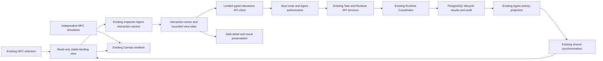
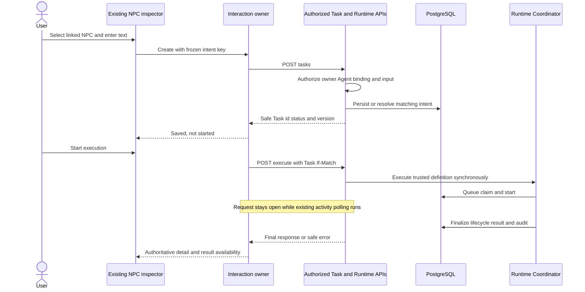
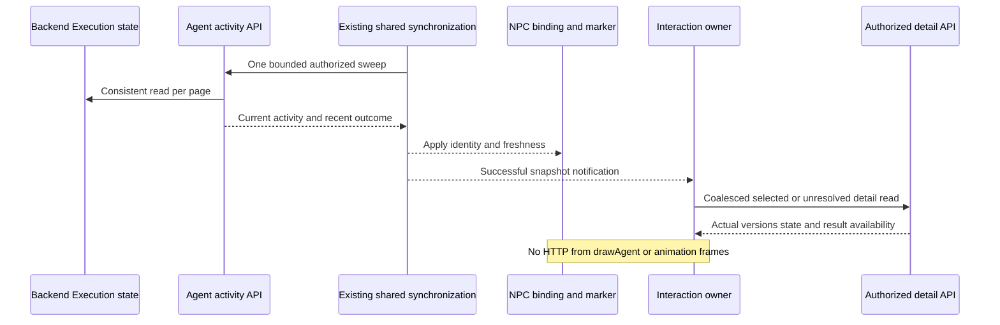
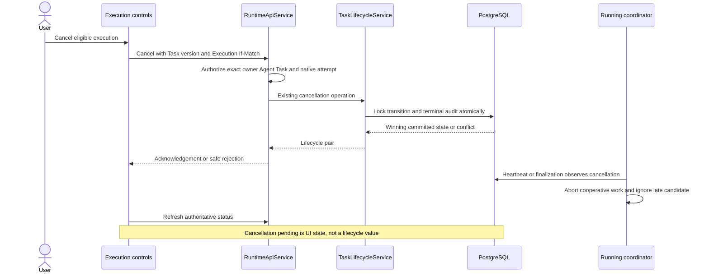
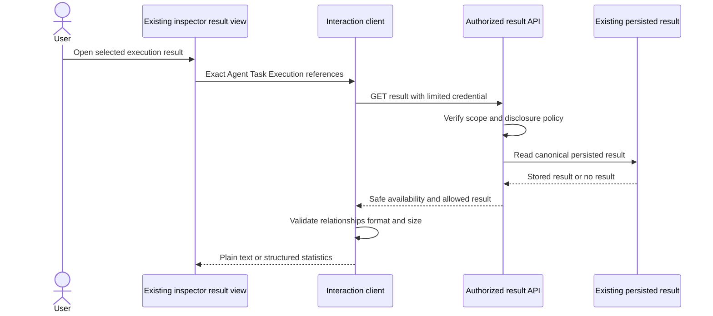
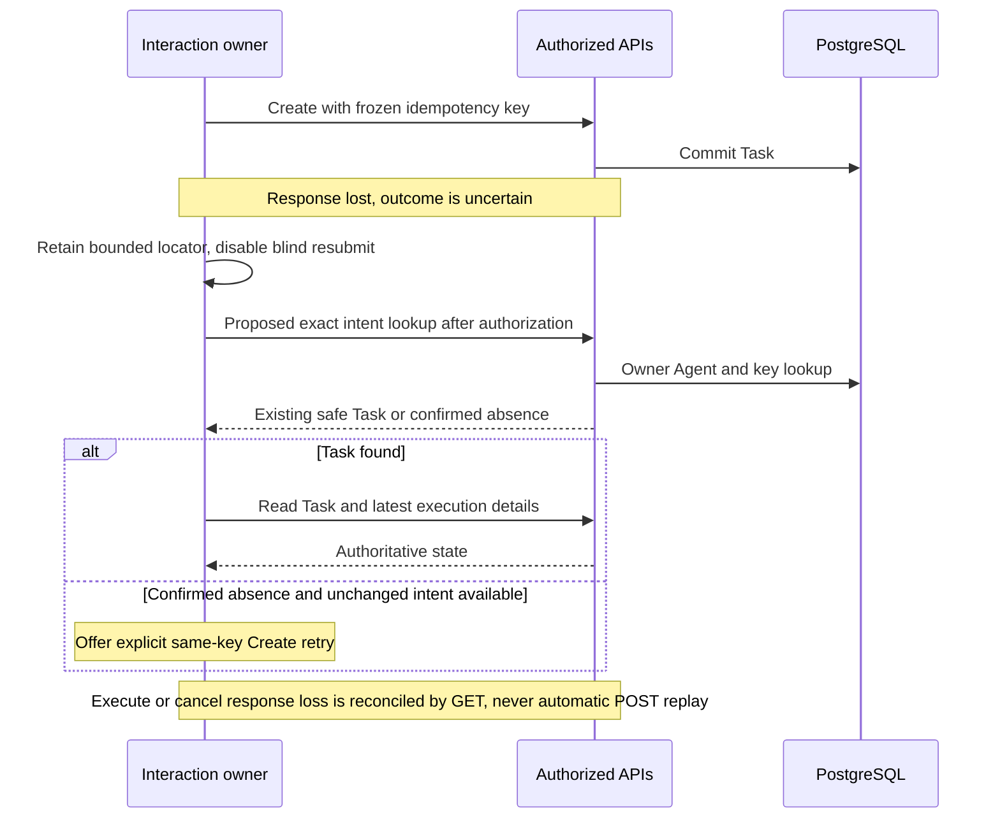

# Phase 4 interaction architecture and workflows

**Current T10 reference:** [Final acceptance](acceptance.md), [current operation](operations.md) and [risks](risk-register.md) describe the completed Phase 4 local implementation. The original planning/task-date statements below remain historical scope/evidence and do not mark current UI/recovery work as missing.

Status: **T01 historical design**; no application components were implemented by T01. Current T02-T09 implementation/verification records are linked below. [Actual contracts and gaps](api-contracts.md), [security/recovery](security-reliability.md), and [roadmap](implementation-plan.md) define dependencies.

Current checkpoint: T02-T08 are implemented and T09 E2E/reliability verification is complete for the approved local scope. See the [client](frontend-interaction-client.md), [Task UI](task-submission-ui.md), [lifecycle](execution-lifecycle-controls.md), [results/history](execution-results-history.md), [state/recovery](interaction-state-synchronization.md) and [hardening audit](interaction-hardening.md) and [E2E/reliability verification](end-to-end-reliability.md). The remaining proposal language below records T01 design intent; the implementation records govern actual contracts and limits.

## Ownership and integration

Extend the existing inspector composition in `dist/js/app.js`, not Simulation/Movement/GameLoop. Resolve selection through `npcRuntimeBindingView.getForEntity(actualNpc)` and verify the current immutable slot, binding ID and Agent UUID. The interaction owner receives this trusted association; DOM attributes are only an action identifier and must be checked against current selection. Ordinary residents/decorative citizens get no empty interaction section and no extra requests.

Use the existing runtime facade for NPC observation. Interaction transport has its own limited credential because city-read remains GET-only; no broad operator credential is ever supplied by the UI. A small local connection dialog can accept approved loopback origin, city-read token and separate interaction token, with an explicit disconnect action. Label this “local access,” not account login. No token appears in URLs, browser persistence, bundles, diagnostics or entity metadata. Read-only mode still works without an interaction capability. Both capabilities target the same approved API origin; changes clear interaction state before any new request. No automatic connection on module import.

Keep the existing simulation task form/local four-stage mission. Add an explicitly labelled **Agent Task** section and Create/Start actions inside the selected linked NPC inspector. Do not route the old simulated mission form to the backend or reinterpret remove-resident/simulate-error as registry controls. Preserve pixel scale, dark surfaces and Icy White (#F2F9FF) styling.

## Presentation modules

Names below are conceptual ES modules/functions, not React components or new frameworks. Likely files live under `dist/js/runtime/interaction/`, composed by app.js with declarations included in the existing runtime-web typecheck.

| Component | Inputs/outputs and responsibilities | Loading/errors/access |
| --- | --- | --- |
| LocalAccessDialog | Approved origin and volatile audience credentials -> explicit connection/disconnect | Label credentials, no autocomplete persistence; validate loopback; fixed safe connection errors; no operator-token field |
| AgentInteractionSection | Current binding, activity freshness, interaction view -> commands to owner | Reuses inspector; show read-only/disabled explanations; never renders fields from unrelated selection |
| AgentTaskForm | Per-Agent draft -> immutable validated intent | Label instruction/optional context, counters and field errors; disable duplicate Create; no provider/tool/model fields |
| ExecutionActionControls | Authoritative Task/Execution versions and capability -> explicit Start/Cancel intent | Pending is request state; conflicts trigger reads; stale/unknown authorization disables mutations |
| ExecutionStatusView | Detail DTO and freshness -> real lifecycle/uncertainty text | Separate Task and Execution status; no percentage or invented streaming; safe unavailable state |
| ExecutionResultView | Authorized result envelope -> structured stats/plain text | Lazy load, finite preview/expand, generic error or unsupported format; no raw HTML/SDK output |
| AgentExecutionHistory | Authorized Agent ID, page/cursor and selection -> bounded history navigation | Load on expansion; newest-first proposed endpoint; empty/error/retry; no fan-out over Tasks |

Use labelled buttons, field-associated errors, aria-live polite submission feedback, status text in addition to colors, visible focus and keyboard operation. Opening Agent Task moves focus to its heading/input; closing returns focus to its action. No focus stealing on polls. Dialog Escape closes only the dialog; it does not cancel execution. Editing fields must not trigger global city shortcuts; wheel/pointer events inside scrollable inspection content must not move the camera. Wrap long UUIDs/text and preserve mobile scrolling. These are T04/T08 implementation and browser-test obligations.

## Primary journey

1. Trusted local operator configures reviewed Agents/runtime bindings and grants limited interaction access. The user explicitly connects authorized local audiences.
2. User selects an existing linked NPC; the existing inspector retains simulation information and adds eligible Agent actions.
3. User enters text, receives frontend validation, then chooses **Create Task**. Freeze the exact payload/key and disable duplicate submission.
4. Backend rechecks owner/Agent grant/binding/input and returns a CREATED Task or idempotent replay. Show “Task saved; not started.” Persist only minimal recovery identifiers, not the input, where supported.
5. User explicitly chooses **Start execution** with the current Task version. Hold the synchronous request at application scope. Show “Start request pending” until a backend Task/Execution fact is available; this is not a lifecycle state.
6. The existing activity poller observes queued/running/terminal persisted activity and drives NPC markers. The interaction detail cache reads the relevant Task/Execution using the same authoritative identifiers.
7. When the execute response or subsequent reconciliation reports terminal state, refresh the authorized result/detail and show it in the existing inspector. Request Cancel only for an eligible current native attempt.

## State boundaries and navigation

| State | Owner and lifecycle |
| --- | --- |
| NPC selection | Existing app/renderer selection; no backend state mutation |
| Agent activity | Existing Phase 3 immutable runtime store; no duplicate lifecycle store |
| Draft/intent | Interaction owner keyed by access generation + Agent ID, not local NPC numeric ID. Draft -> editing/frozen-create intent; at most 10 drafts, 15-minute idle expiry, memory-only private text |
| Request operations | One Create/Start/Cancel in flight per relevant intent/Task; generation fence and immutable Task/Agent references; execute Promise owned by application, not selected panel |
| Details/results | Validated authoritative DTO cache keyed by origin/access generation/Agent/Task/Execution; at most 20 summaries and 3 results, 192 KiB total result bodies, 5-minute idle expiry |
| History | One Agent page at a time, default 10/max20; changing Agent replaces page, selecting execution never rewrites history with a different live execution |
| Recovery locators | Bounded per-tab journal: origin, Agent/Task/Execution IDs, intent key and expiry only. Never a credential, input, result, status authority or permission claim. [Recovery rules](security-reliability.md#failure-recovery-matrix) apply. |

Switching NPC retains legitimate drafts/operation references in the same authorized page scope but immediately changes rendered scope. A late A response may update A's cache, never B's visible inspector. Scope generation mismatch discards it. Do not abort a running execute request merely because the user selects B, closes the inspector, changes tabs or hides history. Abort obsolete GETs; queue/coalesce refreshes; explicit full disconnect/navigation can close execution transport and must disclose cancellation risk. Unknown state is reconciled, not reset to CREATED or automatically retried.

Cache eviction must not discard unresolved intent keys or active operation references to make space. If the bounded pending/recovery capacity is exhausted, explain it and prevent another Create until the user resolves existing uncertainty. Result summaries can be evicted and reloaded through authorized APIs; silently forgetting an uncertain mutation is not a valid memory optimization.

On binding removal/reassignment clear the old NPC association and protected selected details immediately after confirmation, retain only a sealed pending operation long enough for authorized reconciliation if permission remains; deny display/action after access loss. Do not attach A's Task to a newly bound B. On credential/owner/origin change erase drafts, cached details/results and recovery locators before showing the next scope. On pagehide clear credentials/private text; minimal locators may remain for explicit reauthorization after reload.

## Monitoring through the existing scheduler

Use the existing foreground poller: 2-second interval after completion, visibility pause, 5-second activity sweep budget, stale after 6 seconds and unknown after 30. Do not apply that 5-second budget to Start. The interaction owner subscribes once to completed snapshot changes; it requests at most one serialized/coalesced detail refresh for the selected or pending operation per successful sweep. Duplicate snapshot/status does not repeat result/history fetches or effects. While the inspector is closed, only a genuinely unresolved owned operation needs a detail read; hidden-page automatic reads pause. Manual refresh and post-mutation refresh join existing pending work. History/results are lazy/manual or loaded once after a newly observed terminal reference, not every NPC poll.

If the city-read connection is unauthenticated/stale, present that separately from execution failure. Require revalidated authorization and detail/version before mutations; there is no confirmation of liveness from the renderer. T07 implements the combined state lifecycle; T03 supplies primitives and T04/T05 consume them through that shared owner rather than temporary competing pollers.

## Cancellation and results

## Alternative paths and recovery

| Condition | UI path |
| --- | --- |
| Unbound/decorative NPC | Existing inspector only, no Task request |
| DISABLED/ARCHIVED Agent | Authorized history can remain readable; Create/Start disabled with reason |
| Unauthorized/removed association | Clear protected interaction state and disable commands; generic unavailable message |
| Invalid input | Keep editable draft and focus first error; no request or lifecycle invention |
| Capacity/version conflict | Refetch authorized facts, preserve saved Task, require explicit user decision; no queue/retry worker |
| Failure/timeout/cancelled | Show actual terminal state and safe summary, not a failed network icon or infinite spinner |
| Network loss | Retain labelled stale facts, freeze uncertain intent, no mutation retry loop |
| Normal NPC/panel navigation | Retain page-scoped drafts and active synchronous request, no cross-selection rendering |
| Page close/reload | Warn pending start may be cancelled by transport loss; after reauthorization reconcile IDs/key, never claim detached execution continues |
| Session/capability invalid | Current implementation has no real login session. Handle 401/403/revocation by clearing interaction access; production sessions remain a separate gate |

