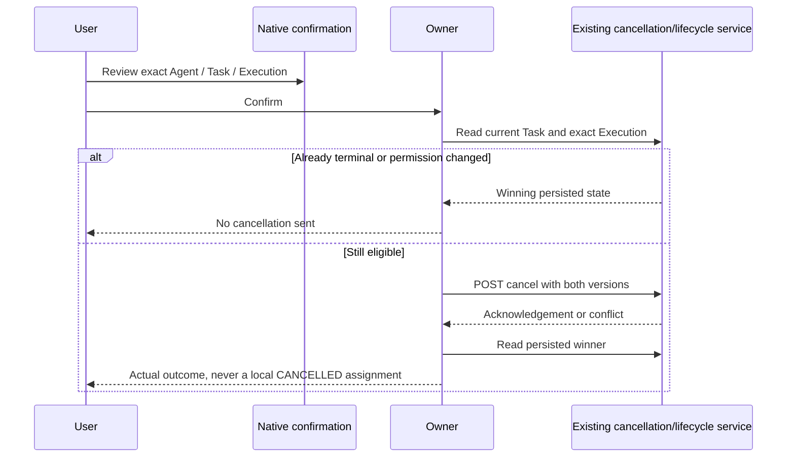

# Phase 4 T05 - Execution lifecycle controls

Current follow-on: [T06 now adds safe results and bounded history](execution-results-history.md). This T05 checkpoint's result/history exclusions below describe its original task scope.

Date: 2026-10-26, Asia/Bangkok. **T05 COMPLETE for approved local interaction scope.** T06-T10 remain planned. This extends the [T04 inspector Task panel](task-submission-ui.md), consumes the [T03 client](frontend-interaction-client.md) and preserves [T02 backend contracts](interaction-api.md). No result/history UI, backend endpoint, migration, provider or simulation behavior is added.

## Repository findings and prerequisites

T02-T04 implementation and evidence are present and accepted for local delegated capability access. The app remains native JS/Canvas, with a persistent inspector, bounded submission journal and a single Phase 3 activity poller. No login/session framework or generated contract system exists. The NestJS RuntimeApiController uses a synchronous execute request with a 30-second server window; T03 allows a 35-second client wait. Closing that HTTP response can request cooperative cancellation. Therefore selection, panel close and ordinary UI navigation must not abort Start. Reload, page close or explicit access disconnect cannot promise execution continuation under this existing transport.

The audit inspected actual Task/Execution enums, lifecycle policies, RuntimeCoordinator, HTTP cancellation/version handling, interaction guard/interceptor/eligibility, activity projection, frontend synchronization/binding/status, inspector and existing test/CI infrastructure. No applicable AGENTS.md or Git metadata was found. A 462-file hash baseline preserves pre-existing work; Git status/diff cannot establish a clean tree.

## Capability matrix

All controls use the separate limited interaction credential, current persisted binding/owner authorization, supported configured runtime and the existing API's advisory hints. Every mutation is revalidated server-side.

| Persisted Task / Execution | Actual meaning and allowed controls |
| --- | --- |
| CREATED / none | Saved, not started. Explicit Start only if Task `canRequestStart`, fresh identity/detail and no unresolved/pending Start. No Cancel Execution without an Execution ID. |
| QUEUED / PENDING | Native queued attempt. Start may resume it only if backend eligibility permits; exact Execution may be cancelled if its hint permits. No public queue API is invented. |
| RUNNING / RUNNING | Persisted work, not proof of provider/process liveness. Start disabled; cancellation may be permitted for the exact Execution. |
| COMPLETED / SUCCEEDED | Terminal persisted success. Neither Start nor Cancel. Result content is not rendered by T05. |
| FAILED / FAILED | Terminal failure; no repeat Start or cancellation. Safe status only. |
| FAILED / TIMED_OUT | Separate Execution timeout; Task remains FAILED. No invented Task TIMED_OUT status. |
| CANCELLED / CANCELLED | Terminal cancellation; no active-work presentation or cancellation control. |
| CANCELLED / none | Valid cancelled Task without an Execution; no Execution action. |
| Missing, malformed, inconsistent, stale or unauthorized details | Last-known details are uncertain/non-actionable, or protected fields are cleared on denial. No invented Execution UNKNOWN enum. Manual refresh or existing activity reconciliation is required. |

**Contract distinction:** Task-only eligibility cannot grant cancellation for a particular Execution. The actual interceptor supplies execution-context `canRequestCancel` on the exact Execution detail. T05 uses that hint, persisted QUEUED/RUNNING Task state, and both versions; it does not require the Task-only `canRequestCancel` flag, which is false without an Execution context. Start uses the Task detail's `canRequestStart`. Disabled/archived activity gates Start; cancellation continues to follow the exact backend grant, which can remain valid for admitted work.

## Owner and UI architecture

`runtime/interaction/lifecycle-owner.js` is an application-owned observation/action sidecar sharing the **same T03 client/credential** as T04. It has no independent connection, timer, poller, provider, execution engine or global Agent state. Entries are keyed by Agent/binding/Task, bounded to 40, and settled non-pending/non-recovery entries can be evicted. Pending or uncertain actions are not silently evicted. Credentials and result bodies are never stored in its snapshots.

The panel retains T04 draft/submission state separately. A saved Task is the explicit control target. Without one (including after reload), an existing authorized current/last/recent projection Task reference can seed a detail read. The owner then obtains the actual latest Execution via Task status. Decorative/unbound NPCs have no controls; missing NPCs create no visual entity. Changing selection dismisses confirmation and changes the view, while an already dispatched Start/Cancel remains pinned to its original references.

The existing panel adds Start Execution, Cancel Execution, Refresh lifecycle, separate Task/Execution statuses, observation receipt/freshness and action feedback. Frontend pending/reading/recovery fields are distinct from backend statuses. A pending Start response does not fabricate RUNNING. The previous saved Task status is replaced in presentation by the matching authoritative detail when available. Terminal outcomes remain terminal references, not ongoing activity. Existing Agent Details and NPC visualization remain Phase 3 consumers.

```mermaid
sequenceDiagram
 participant User
 participant Panel as Existing NPC Task panel
 participant Owner as Lifecycle owner
 participant Client as Shared T03 client
 participant API as Existing NestJS runtime
 participant Sync as Phase 3 activity poller
 User->>Panel: Start eligible saved Task
 Panel->>Owner: Explicit Start, fixed Agent/binding/Task
 Owner->>Client: Re-read Task status/eligibility
 Owner->>API: POST execute with quoted Task If-Match
 Owner->>Sync: Bounded shared refresh
 Note over Owner,API: HTTP stays open; selection close does not abort it
 Sync-->>Panel: Persisted activity/reference changes
 Panel->>Owner: Relevant shared update
 Owner->>API: Bounded Task status and exact Execution GET
 API-->>Owner: Authoritative statuses, versions and eligibility
 API-->>Owner: Final synchronous Start response
 Owner->>API: Read persisted lifecycle; no result UI
```

## Start, cancellation and races

Start sets an action guard synchronously before awaits, preventing double-click/keyboard duplicates. It re-reads Task status before dispatch and verifies the selected binding still matches. The existing empty-body execute request carries the current quoted Task version. No mutation retries automatically. The synchronous response's Task/Execution references are retained; transient result content is not copied into UI/cache. A bounded detail read follows completion or ambiguous rejection.

Cancel first opens a native confirmation dialog naming Agent, Task and Execution. Back/Escape sends no request. Confirm is disabled while details refresh or permission/freshness is unavailable, and can recover when an overlapping read finishes. Selection/binding changes close and clear the target text. Confirmation never silently retargets a new Execution. Before cancellation, the owner re-reads the persisted pair and checks the exact Execution again. The request carries Task version in its body and quoted Execution version in If-Match.



An acknowledgement may contain RUNNING; this remains RUNNING with acknowledgement-pending feedback and no repeated Cancel. Completion can win before confirmation or between read and POST: terminal SUCCEEDED remains SUCCEEDED after the bounded reconciliation. Per-resource monotonic versions and read generations prevent older responses from overwriting newer Task/Execution state. Equal-version contradictions or mismatched references are non-actionable. Versions are never compared across unrelated resources.

## API operations and ordering

| T03 operation | Existing API | Purpose |
| --- | --- | --- |
| `getTaskStatus` | GET `/api/v1/tasks/:taskId/status` | Task lifecycle, version, latest Execution ID and start eligibility |
| `getExecution` | GET `/api/v1/tasks/:taskId/executions/:executionId` | Exact lifecycle/version, cancellation eligibility and safe metadata |
| `executeTask` | POST `/api/v1/tasks/:taskId/execute` | Explicit synchronous Start, empty JSON, quoted Task If-Match |
| `cancelExecution` | POST `/api/v1/tasks/:taskId/executions/:executionId/cancel` | Exact cancellation, body Task version and quoted Execution If-Match |
| Existing shared `runtimeIntegration.refresh` | Existing Phase 3 activity API | Bounded refresh around actions; no new poller |

Task status and Execution detail are separate HTTP reads, not a transaction snapshot. A contradictory pair is labelled uncertain and actions stay disabled until a subsequent refresh. The UI does not mutate or repair backend state. Successful observations include **client receipt time**, never fabricated backend execution time. Activity freshness and exact Execution detail freshness remain distinguishable.

Only the selected Task's details are refreshed on selection, relevant activity/version changes, explicit action/refresh, and existing successful shared synchronization while work/recovery is active. Concurrent detail reads coalesce. There is no per-frame request, per-NPC poller or unbounded page/history traversal. Refreshing one detail pair makes at most two normal GETs; action preflight/final reconciliation are also bounded. No gap-free event replay or atomic multi-request snapshot is claimed.

## Ambiguous outcomes, reload and authorization

Lost Start/Cancel responses, runtime rejection, deadline and conflicts trigger authoritative reads, not POST replay. A committed active/terminal Execution restores its real reference and status. If uncertain Start still has only CREATED (or QUEUED/PENDING), Start remains blocked: absence is not proof that the earlier request could not commit. Refresh can later reconcile it; T05 does not invent a durable Start idempotency guarantee or a recovery endpoint. Cancellation uncertainty is reconciled with a fresh persisted pair before another explicit action can be considered.

Closing or switching the inspector preserves in-flight HTTP operations and their original binding journals. Reload clears volatile credentials and drafts. After explicit reconnection, active/recent projection references can recover the exact persisted Execution without mutation replay (verified in Chrome). A saved unstarted Task not exposed by the projection still needs its existing known reference; durable locator/draft recovery is later T07. Reload/disconnect/page close can cooperatively cancel an active synchronous request; this architectural limitation is disclosed next to controls and is not silently changed into detached execution.

401 clears/fences the whole shared interaction connection and protected state. 403/404 clear that entry's details and stop automatic denied reads until explicit recheck; they do not grant access or imply failed execution. Credential replacement/disposal fences late completions. The backend independently enforces owner, allowed Agent, current supported binding, runtime policy and optimistic versions for every action. Production user/tenant authentication remains unavailable. No raw errors, credentials, prompts, tool payloads, unsafe HTML or result content are rendered.

## Accessibility, visual identity and cleanup

The existing Icy White inspector, dark surfaces, native buttons/dialog, wrapping IDs and responsive scroll layout are reused. Buttons have explicit labels; pending/error feedback is announced via status regions; native modal focus starts on Back. Confirm explains temporary disabled states. Text is rendered through textContent, and the confirmation dialog wraps long Agent names and identifiers. No new animations, sprite changes, camera behavior, entity reconstruction or reduced-motion-sensitive effect is added.

The owner has no periodic resources. T03 bounds individual requests and removes timers/listeners; lifecycle reads coalesce, generation-fence obsolete responses and retain only bounded state. Hot disposal removes subscriptions/dialogs and disposes both owners; explicit disconnect/pagehide clears credentials and fences action responses. Panel close alone does not dispose the shared client or abort Start. No long-duration leak-free claim is made from smoke tests.

## Verification

| Actual command | Outcome |
| --- | --- |
| `npm.cmd run lint` | PASS: game JS syntax, strict frontend runtime-web TypeScript, backend no-emit compatibility |
| `npm.cmd run check:runtime:web` | PASS after lifecycle owner changes |
| `node --test tests/execution-controls.test.js` | PASS: 17 focused deterministic cases |
| `npm.cmd test` | PASS: 172 frontend tests (155 previous cases plus 17 lifecycle cases) |
| `npm.cmd run build:web` | PASS: disposable 55-module Vite bundle; maintained source preserved |
| `npm.cmd run test:browser` | PASS: actual Chrome155, zero exceptions; T04 form, Phase 3 binding/status/inspection/reconnection, city movement/environment/camera and mobile smoke |
| `node --test --test-name-pattern='P4 T05' apps/api/test/database.integration.cjs` | PASS: two isolated PostgreSQL/Nest tests, including actual Chrome native fetch Start/success/confirmation/cancel/selection-close/reload recovery. Two browser executions persist SUCCEEDED and CANCELLED; one owner test recovers a committed lost cancellation response with one cancellation POST and one terminal audit event |
| `node --test --test-name-pattern='P4 T0[345]' apps/api/test/database.integration.cjs` | PASS: six actual HTTP/PostgreSQL compatibility tests, including both T04 and T05 real Chrome workflows |
| `node --test --test-name-pattern='P4 T05 real browser' apps/api/test/database.integration.cjs` | PASS final focused rerun: native lifecycle workflow plus long Agent name / narrow-viewport confirmation overflow check |

Unit coverage includes queued/PENDING eligibility, disabled/unsupported hints, duplicate guards, both versions, close/switch safety, exact cancellation grants, confirmation Back and concurrent read, success/cancel races, terminal states, stale/unbound state, 401/403/404 privacy, generation cleanup, delayed versions, deadlines, lost mutation responses and projection-based reload recovery. The first new fixture test incorrectly omitted its saved Task when returning from selection close; it was corrected to match the actual UI. No backend test or security check was weakened.

Sanitized evidence and complete file inventory: [T05 verification](verification-evidence/t05-verification.json), [native browser report](verification-evidence/t05-live-browser.json). No live paid/local provider requests, full backend regression rerun, FPS/heap endurance or visual-diff suite is claimed. T06 result/history UI, T07 durable recovery and T10 release acceptance remain separate tasks. No commit, push, tag, release or deployment is performed.
