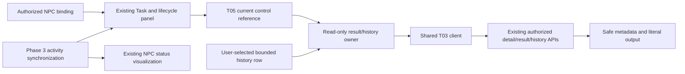
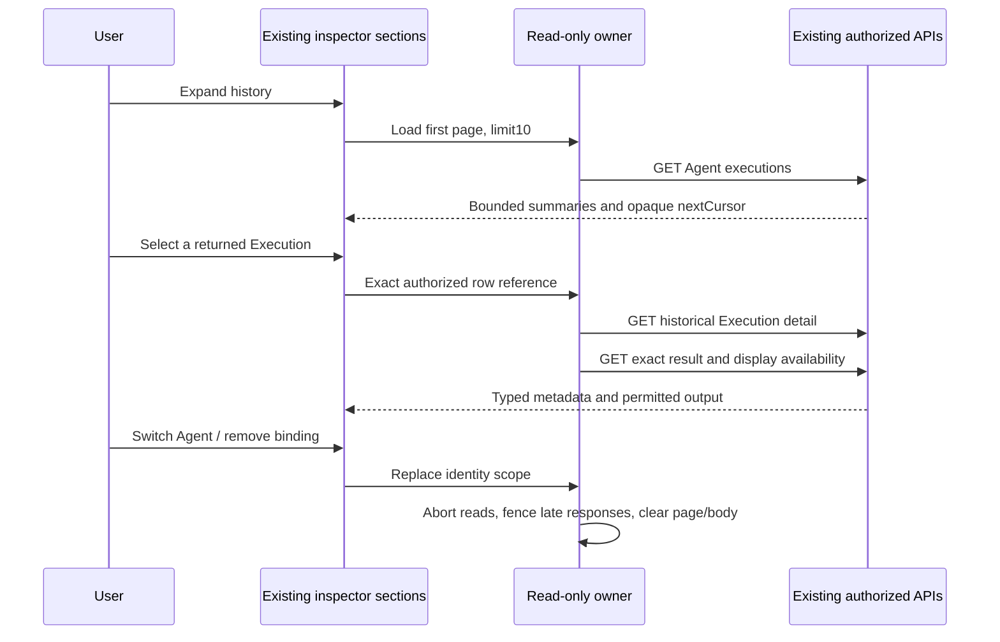

# Phase 4 T06 - Execution results and history

**Follow-on T07:** [Interaction synchronization](interaction-state-synchronization.md) now adds targeted history invalidation and historical version fencing through the existing read owner. This document retains the T06 implementation-date verification record.

Date: 2026-10-26, Asia/Bangkok. **T06 COMPLETE for the approved local interaction scope.** T07-T10 remain planned. This extends the existing [Task panel](task-submission-ui.md) and [lifecycle controls](execution-lifecycle-controls.md), consuming the [T03 client](frontend-interaction-client.md) and [T02 contracts](interaction-api.md). It adds no backend production behavior, result format, lifecycle, provider, tool, migration or simulation system.

## Audit and capability matrix

The existing app is native JS/Canvas with persistent inspector sections, a limited volatile interaction credential and one Phase 3 poller. T02-T05 implementation and verification evidence are present for local delegated access; production person/tenant identity remains unavailable. The audit reviewed actual result persistence/read service, explicit serializers/disclosure filtering, history query/cursor, Task/Execution DTOs, runtime binding/lifecycle owners, selection/UI/theme, tests and CI. No applicable AGENTS.md or Git metadata was found. A 467-file pre-task hash inventory preserves existing work; no clean-tree claim is possible.

| Capability | Actual API / T03 operation | Contract, limits and interpretation |
| --- | --- | --- |
| Execution detail | GET `/api/v1/tasks/:taskId/executions/:executionId` / `getExecution` | Typed Execution detail: IDs, status, attempt, version, ISO timestamps, nullable duration, generic error fields and stored result availability. Used lazily for a selected historical reference. |
| Result | GET `/api/v1/tasks/:taskId/executions/:executionId/result` / `getResult` | `{execution,availability,result,displayReason?}`; availability is PENDING / AVAILABLE / UNAVAILABLE. Exact Agent/Task/Execution reference validation. |
| Structured output | Same result API | Only actual `text.statistics.v1`: codePointCount, wordCount, nonemptyLineCount. Displayed as allow-listed numeric JSON; zero counts are valid. No arbitrary JSON serialization. |
| Plain text | Same result API | Actual `text` format, nonempty, bounded to 65,536 UTF-8 bytes by existing client. Backend configured budgets can be smaller; the client also bounds total HTTP JSON to 128 KiB. Literal text only. |
| Restricted output | Same result API | `DISCLOSURE_RESTRICTED`, nullable result and display UNAVAILABLE can coexist with persisted SUCCEEDED/stored AVAILABLE. Restriction is not execution failure. |
| Failure/cancellation/timeout | Same detail/result API | FAILED, CANCELLED and TIMED_OUT are actual Execution enums. Status-based fixed safe summaries; no raw error, stack, prompt, provider profile or tool payload. |
| Empty/unavailable | Same result API | Explicit nullable result and availability. Blank successful text is invalid under the actual backend/client contract; no synthetic empty success is invented. |
| History | GET `/api/v1/agents/:agentId/executions` / `listAgentExecutions` | Safe Execution summaries and `{limit,nextCursor}`. Server maximum20; UI requests10, one page at a time. Newest-first backend keyset order is preserved. |
| Unsupported format | Client normalization boundary | Unknown or malformed output is rejected as SCHEMA. UI gives a fixed safe fallback; it never renders arbitrary response JSON. |

All reads use the same restricted interaction client as Task submission and lifecycle actions. Backend owner/Agent/current persisted binding permission remains mandatory. The backend joins Task ownership for history and validates exact detail/result scope. Production tenant/person isolation is not invented; this remains the approved fixed-owner, loopback development capability model. History or an NPC label never grants mutation permission.

## UI and module responsibilities

The existing Task section now contains native expandable **Execution result** and **Execution history** sections. Both start closed, so importing/selecting a decorative NPC or leaving these sections closed starts no new result/history requests.

- `execution-results-view.js`: persistent DOM presentation and native details/buttons. Response text enters only textContent/DOM values; static template HTML contains no API interpolation.
- `runtime/interaction/results-owner.js`: one Agent/binding/NPC scope, one selected result/detail, one history page, bounded cursor references and request controllers. It is read-only: no Task/Execution mutation method, provider, new connection, global Activity store or timer.
- `runtime/interaction/result-presentation.js`: explicit display metadata, fixed outcome labels and the two existing output formats. Arbitrary backend objects, errorMessage or provider/tool payloads are never stringified.
- Existing `agent-task-panel.js`: shares the existing T03 client and T05 current reference with the view; preserves Task submission/Start/Cancel. Explicit history viewing disables Start/Cancel presentation until **Return to current Execution**, avoiding accidental control-target confusion. In-flight lifecycle operations are not cancelled by browsing results.

## Current, latest and historical selection

The current pane follows the **T05 control target/latest authorized reference**, which may be terminal; it is not necessarily currently running. Metadata distinguishes Agent, Task and Execution IDs, actual lifecycle status, attempt, created/start/finish timestamps, completed duration and stored result availability. Null timestamps remain unavailable. Duration uses the validated backend value (milliseconds), not a client elapsed-time timer or fake zero.

Selecting a row obtains exact authorized detail/result and pins it as **Selected historical Execution**. A row can itself be nonterminal; the title describes how it was selected, not a fabricated lifecycle state. Later current Task/Execution updates do not replace the chosen historical result. Browsing pages also leaves the chosen result pinned. Returning to current is explicit and restores the T05 reference. Historical data never writes to lifecycle state, Agent activity, NPC status, movement or selection identity.

The owner accepts historical IDs only from its currently authorized page. It does not trust arbitrary Execution metadata on an NPC. Agent/binding change resets mode, page, cursors, result body and metadata, and aborts obsolete reads. Close/unbind/disconnect removes protected DOM text and cached metadata attributes. No sensitive result/history state is persisted to browser storage.

## History and request bounds

History is a snapshot, with an explicit **Refresh history from first page** action. Each page displays at most10 safe summaries with status, Execution/Task IDs and created timestamp; detailed start/finish/output loads only for the selected record. There is no per-row result fan-out, full-history fetch or automatic pagination.

Next/Previous use the actual opaque `before` cursor. No cursor decoding, offset invention, client sorting or UUID tie-breaking is added: backend cursors preserve PostgreSQL microseconds even when wire dates lose that precision. One page replaces the previous page. Repeated IDs across adjacent pages or cursor loops cannot accumulate duplicate history. At most20 page locators are retained; forward browsing stops at page20 (up to200 records per browsing window) and explicitly offers first-page refresh. Bodies for old pages are not retained. End-of-history/empty pages and previous-page navigation are handled without guessing a complete authorized population.

## Availability, errors and synchronization

| Observation | Presentation |
| --- | --- |
| No Execution reference | Clear empty state; no invented ID or result request. |
| PENDING/RUNNING and result PENDING | Backend-pending label; no inferred progress/completion. |
| SUCCEEDED with AVAILABLE | Supported text/statistics output and real terminal metadata. |
| SUCCEEDED with UNAVAILABLE / restricted | Unavailable or explicitly not-disclosed label, distinct from failure. |
| FAILED / CANCELLED / TIMED_OUT | Actual terminal status and fixed safe summary; no invented output/error payload. |
| Network, timeout, server or schema failure | Safe loading/error/retry feedback. Previously validated same-Execution content can remain clearly stale; another reference never inherits it. |
| 403 / 404 | Protected result/detail/history cleared; no automatic denial retry loop. Explicit authorized read refresh can recheck. |
| 401 / credential replacement | Shared interaction scope invalidated/cleared and late responses fenced through existing authentication integration. |

Current metadata reuses T05's validated detail, so a normal current result read adds one GET. Historical selection makes at most a detail GET and a result GET. The result endpoint remains the display authority: stored AVAILABLE is not sufficient permission to render LLM text.

An open current result refreshes on relevant T05 Execution identity/version/status/availability changes and on restoration of fresh binding state. Identical terminal observations do not re-fetch or replay effects. Historical selection refreshes only on explicit read retry/refresh. History remains its labelled snapshot until navigation or refresh. There is no second poller or HTTP in animation frames. Closing a section aborts its unfinished reads; selecting another Agent or disposing aborts/fences all old reads without aborting an unrelated synchronous Start. Pending requests coalesce and loading buttons prevent duplicate navigation.

Temporary stale activity retains only last-known same-scope content and disables read/navigation actions until existing synchronization restores freshness. Failed history reads do not retry on form typing or ordinary rerender notifications. No read failure becomes an execution failure, and no result arrival creates a new lifecycle transition.

## Safe rendering, accessibility and performance

Output is plain text in a focusable, wrapping, bounded scrolling block (220px max-height). HTML, scripts, Markdown, links and external images are not activated. Structured formatting selects only three validated statistic fields, so there is no recursive/unbounded JSON expansion. Backend serializers/disclosure and T03 allow-lists exclude raw credentials, provider profiles, tool arguments/results and unrestricted runtime context. Literal text rendering is not a new general-purpose DLP system; the existing backend display policy remains the boundary.

Native details, labelled buttons, polite status announcements, busy states, visible focus, keyboard-selectable rows, aria-pressed selection, explicit return-to-current and stable pagination controls follow existing conventions. The Icy White/dark theme, narrow inspector scrolling and responsive wrapping remain intact. There are no new animations or reduced-motion-sensitive effects. The result body changes only when its text changes; history rows rebuild only when the bounded page changes. State contains one result up to the existing transport/output limits and one page, not full Agent history. Metadata formatting is fixed-size and never occurs in the city render loop.

No new dependencies, API wrappers, auth stores, lifecycle state machines, renderer or NPC reconstruction is introduced. Subscription/request cleanup is covered with controlled clocks/late responses. Smoke tests do not establish an indefinite memory/FPS guarantee; long-duration profiling remains later hardening.

## Verification and files

| Actual command | Outcome |
| --- | --- |
| `npm.cmd run lint` | PASS: JS syntax, strict runtime-web TypeScript and backend no-emit compatibility |
| `npm.cmd run check:runtime:web` | PASS after read-owner implementation |
| `node --test tests/execution-results.test.js` | PASS: 18 focused cases for formats, empty/error/restricted states, bounds, pagination, selection, stale/late responses, auth, abort cleanup and no rerender retries |
| `npm.cmd test` | PASS: 190 frontend tests, including all 172 existing cases |
| `npm.cmd run build:web` | PASS: 58-module disposable Vite production bundle; maintained dist source preserved |
| `npm.cmd run test:browser` | PASS: real Chrome155, zero exceptions; existing Task form, NPC binding/status/inspection/reconnection, movement/environment/camera/mobile smoke |
| `node --test --test-name-pattern='P4 T06' apps/api/test/database.integration.cjs` | PASS: real PostgreSQL/Nest/Chrome result-history workflow |
| `node --test --test-name-pattern='P4 T0[3456]' apps/api/test/database.integration.cjs` | PASS: seven actual T03-T06 compatibility tests, including Task creation, cancellation/reload and result/history native-browser workflows |

The T06 browser fixture performs12 genuine rule-based executions and two backend LLM-strategy executions using a **fake provider**, not a paid/local model. It verifies numeric JSON, 10/2 pagination, Previous, historical selection, return-to-current, unchanged Agent activity, no per-row result requests, Agent scope/page reset, restricted text withheld, permitted HTML-like text escaped, no external resources activated, long output scrolling and mobile width. It also checks unbound/disconnected DOM cleanup. Original logs remain locally in the temporary directory; sanitized [verification/file inventory](verification-evidence/t06-verification.json) and [native browser report](verification-evidence/t06-live-browser.json) are retained here.

Initial live verification was blocked because Docker Desktop was stopped; starting the installed local engine resolved it and owned disposable tests passed. A review found an initial-failure history retry could follow repeated view notifications; the scheduler was restricted to explicit reads/scope/freshness transitions and a regression test proves50 identical notifications cause no extra request. This was corrected before final verification.

Created: `dist/js/execution-results-view.js`, `runtime/interaction/results-owner.js`, `runtime/interaction/result-presentation.js`, `tests/execution-results.test.js`, this reference and evidence. Modified: existing Task panel integration, scoped CSS, browser helper/API test fixtures, documentation indexes/roadmap/ADR notes. Backend production, migrations, app/renderer/NPC/movement/animation, package/lockfile and historical Phase1-3 documents remain unchanged.

Known limitations: only the two existing formats, no arbitrary JSON/Markdown/tool-output UI; local delegated auth, no production person/tenant identity; explicit bounded history snapshot rather than live/full-history tracking; no durable history/result selection or private payload storage across reload (T07); no live LLM, full backend regression rerun, visual-diff or long-duration profiling. The existing synchronous execution/reload semantics remain T05's documented limitation. No commit, push, tag, release or deployment is performed. Next task: **Phase 4 T07 - Interaction State and Runtime Synchronization**, not begun here.
