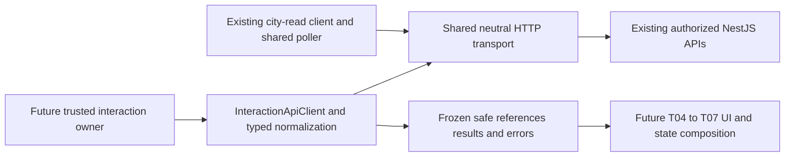

# Phase 4 T03 - Frontend Task and Execution API client

**Current T10 reference:** [Final acceptance](acceptance.md), [current operation](operations.md) and [risks](risk-register.md) describe the completed Phase 4 local implementation. The original planning/task-date statements below remain historical scope/evidence and do not mark current UI/recovery work as missing.

Date: 2026-10-25, Asia/Bangkok. Scope: **data access only**. There is no new inspector, form, button, result/history UI, polling loop, backend endpoint or lifecycle behavior. T04-T10 remain planned. [T02's implemented backend reference](interaction-api.md) is the wire contract; the original [T01 plan](api-contracts.md) is historical where clarified below.

## Audit and prerequisites

The frontend remains vanilla JS/Canvas under maintained `dist/`, with JSDoc and `.d.ts` checked by the existing runtime-web TypeScript configuration. The existing city-read client owns a volatile token and uses native fetch; there is no generated OpenAPI client, generic HTTP library, frontend login, token-storage service or state framework to reuse. T02 is complete for local backend contracts, with fixed-owner/loopback authorization and separate operator, city-read and interaction credentials. Production user/tenant identity remains absent.

The audit inspected actual controllers, serializers, cancellation/version DTOs, result types, cursor codec, error/status mapping, local guard/configuration, frontend client/scheduler and CI. Git status/diff fail because this supplied workspace has no Git metadata. No applicable AGENTS.md was found in the workspace or accessible ancestor locations. Existing changes were preserved using a pre-task maintained-file hash inventory.

## Modules and integration boundary

- `dist/js/runtime/http-transport.js`: extracted neutral loopback origin policy, native fetch, bounded JSON/UTF-8 reading, deadline/abort cleanup and Retry-After parsing. It owns no credentials, retries, cache, scope or UI.
- Existing `runtime/api-client.js`: continues to expose only the fixed city GET audience and the same public methods. Its prior request mechanics now call the shared transport. Existing timer/clock exports remain compatible.
- `runtime/interaction/contracts.d.ts`: readonly Agent/eligibility, Task, Execution, references, result, history, recovery and safe error contracts. Task/Execution lifecycle unions and connection clock/timer types reuse existing frontend declarations. No generated schemas exist to duplicate.
- `runtime/interaction/validation.js`: request validation, frozen submission intent, safe allow-listed response objects, identifier relationships and response coherence checks.
- `runtime/interaction/errors.js`: existing RuntimeApiError message/category conventions plus fixed conflict/runtime-failure categories and a closed backend error-code allowlist.
- `runtime/interaction/api-client.js`: cohesive client with private in-memory interaction credential and in-flight request cancellation/generation fencing.
- `runtime/interaction/index.js`: explicit public data-access exports. Importing it creates no client, request, timer, subscriber or default connection.



The client has no dependency on NPC entities, selection, rendering, sprites, camera or simulation. It does not copy or mutate Phase 3's authoritative activity snapshot. There is no new global store or response cache.

## API capability matrix

All operations use the configured loopback origin and the **interaction credential**. The backend independently authorizes allowed owned Agents and current persisted NPC bindings. Expected Agent IDs below are local response-correlation checks, not new body ownership claims.

| Client operation | Actual HTTP API | Request and response | Semantics |
| --- | --- | --- | --- |
| `getAgent(agentId, options?)` | GET `/api/v1/agents/:id` | Safe Agent identity with required actionEligibility | Reads actual advisory flags; no invented eligibility endpoint or permissions inferred from NPC animation |
| `createTask(intent, options?)` | POST `/api/v1/tasks` | `{agentId,input:{instruction,context?},idempotencyKey}` -> TaskDetail | Accepts 201 new/200 replay; returns actual Task DTO, no fabricated created/replayed field; never starts it |
| `getTask(reference, options?)` | GET `/api/v1/tasks/:taskId` | `{agentId,taskId}` local expected reference -> TaskDetail | Actual status/version/action hints, no input echo |
| `getTaskStatus(reference, options?)` | GET `/api/v1/tasks/:taskId/status` | Same local reference -> TaskDetail plus nullable latestExecutionId | Recover the actual execution reference after uncertain Start |
| `executeTask(reference, taskVersion, options?)` | POST `/api/v1/tasks/:taskId/execute` | JSON `{}`, quoted Task If-Match -> final StartResponse | Synchronous, no 202/background promise or automatic retry; expected Agent is checked against returned Task/Execution |
| `getExecution(reference, options?)` | GET `/api/v1/tasks/:taskId/executions/:executionId` | `{agentId,taskId,executionId}` -> ExecutionDetail | Actual state/version/timestamps, safe failure summary, nullable duration/result information and action hints |
| `cancelExecution(reference, versions, options?)` | POST `/api/v1/tasks/:taskId/executions/:executionId/cancel` | `{taskVersion}` body, quoted executionVersion If-Match -> lifecycle pair | Preserves acknowledgement, nullable execution and actual statuses; never locally marks CANCELLED |
| `getResult(reference, options?)` | GET `/api/v1/tasks/:taskId/executions/:executionId/result` | Exact expected reference -> ResultResponse | PENDING/AVAILABLE/UNAVAILABLE and explicit DISCLOSURE_RESTRICTED retained |
| `listAgentExecutions(agentId, query?, options?)` | GET `/api/v1/agents/:agentId/executions` | `{limit?,before?}` -> one bounded history page | Default10/max20; opaque cursor, newest-first backend order, no automatic page traversal, offset or unsupported filters |
| `findTaskByIntent(agentId, key, options?)` | GET `/api/v1/tasks/lookup?agentId=...&idempotencyKey=...` | Exact existing key -> `{task:Task|null}` | Authorized exact recovery; no resubmission, correlation guessing or unbounded history search |

`options` supports only AbortSignal and a validated optional X-Request-Id. IDs are normalized to lowercase. Unsupported ownership/provider/model/tool/strategy/deadline/header fields are rejected before dispatch. Versions must be positive integers at most 2,147,483,647. No arbitrary URL/request method wrapper is exposed by the interaction client.

## Typed response and safety rules

The client reconstructs and freezes an allow-listed view rather than returning response JSON wholesale. Unknown lifecycle values, malformed eligibility, dates, output formats, oversized payloads, duplicate history execution IDs and mismatched Agent/Task/Execution references reject with SCHEMA. Unknown metadata such as ORM fields, internal runtime context and provider profiles is not returned. Failure summaries use the backend's fixed generic vocabulary, never arbitrary raw error text.

Agent, Task and Execution DTOs are distinct from activity summaries. Detail DTOs require actionEligibility; history, cancellation, recovery and execute envelopes use the backend's base DTOs where hints are absent. The client preserves nullable timestamps/duration/correlation/strategy fields according to actual serialization and validates successful Start identity/correlation/outcome coherence. Result supports `text.statistics.v1`, nonempty plain `text`, optional validated usage and tool invocation count. No HTML rendering or presentation is performed.

Contract clarification: the backend's `safeText` rejects blank/empty text, so a successful blank text envelope is a schema error. Empty/unavailable results are represented by the actual nullable result/availability contract, not invented empty success text. This corrects T01's conditional empty-text assumption without changing the backend. LLM display restriction is separate from stored execution resultAvailability and execution success; it is not shown as runtime failure by this layer. Text remains untrusted presentation data, not a general DLP guarantee.

History wire dates have millisecond precision but cursors preserve PostgreSQL microseconds. The client retains opaque cursors and backend row order; it does **not** re-sort or reject millisecond-tied rows based on UUID ordering. One response is limited to the requested size, and no result/history cache or accumulated pages are created.

## Authentication, scopes and request lifetime

Use the same explicit `authorize` / `clearCredential` pattern as the city client, with a **different** credential. The token is private and memory-only, never a public configuration export, URL, storage item or frontend environment variable. `hasCredential` means only a value is configured, not that backend permission has been confirmed. Caller code must provide only the limited interaction token and validate `getAgent` before exposing controls; a client cannot identify an opaque token's audience locally. Operator credentials do not belong in the browser.

`authorize` replaces the credential and aborts/fences old in-flight requests; `clearCredential`/`dispose` clear it and cancel waits. Pending bodies and late noncooperative fetch responses cannot become successful data under a new scope. A 401 invalidates this client's credential and aborts other old requests. There is no separate login/session/refresh-token system or persistence.

**403 clarification:** T02 also uses 403 for operation-specific ACCESS_DENIED/TOOL_DENIED. It is not proof that the whole credential expired. T03 returns FORBIDDEN and the safe backend code, without aborting another Agent's synchronous execution or invalidating an otherwise valid credential. There is no cached response to retain on denial. Later owners must clear the denied selected data; explicit logout, confirmed scope changes or 401 still clear the full interaction scope. This refines the original generic T01 401/403-purge advice to match the actual API and prevent cross-Agent cancellation side effects.

Do not dispose/recreate this connection merely because the inspector closes or selection changes. Later application-level state ownership must preserve active execute waits and ignore responses belonging to obsolete selected views. This client validates each explicit reference but does not own selected-NPC UI state.

## Timeout, cancellation and errors

Short requests default to 5,000 ms (configurable100-30,000); execute defaults to **35,000 ms** (configurable31,000-60,000), exceeding the current 30-second server HTTP execution window. These are client waits, not new backend budgets. A single timeout covers headers/body, including streams. Caller signals remain caller-owned. Explicit abort is CANCELLED, client deadline is TIMEOUT, HTTP deadline retains status/backend code and source http. Timers/listeners/readers are cleaned on success, failure, timeout, disposal and scope change; late promise rejection handlers remain attached.

Aborting a mutation wait does not prove whether the server acted. In particular, closing the existing execute request can request cooperative backend cancellation; it cannot guarantee immediate provider termination or no billing. No local lifecycle field changes follow a transport abort.

`InteractionApiError` exposes only fixed `code/message`, operation, optional actual HTTP status, safe closed backendCode, validated support requestId, bounded retryAfterMs, local non-sensitive validation issues, source and outcome. Backend messages, stack traces, validation payloads and arbitrary error codes are not retained. Backend field-level validation details are currently disabled; local issues identify field and fixed INVALID_VALUE/TOO_LARGE/UNSUPPORTED_FIELD codes without echoing text. Support IDs cannot contain the currently configured credential.

Relevant categories reuse existing AUTH_REQUIRED/FORBIDDEN/NOT_FOUND/VALIDATION/SCHEMA/NETWORK/SERVER/TIMEOUT/CANCELLED/RATE_LIMITED, adding fixed CONFLICT/RUNTIME_FAILURE. A backend generic409 remains a conflict; the client does not guess whether it was idempotency, disabled Agent, capacity or cancellation solely from that status. Closed backend code and operation remain available. Retry-After is metadata only, clamped to the existing 1-60-second convention. **No request automatically retries**, including GET.

Mutation error outcome is conservative: NOT_SENT before dispatch, UNKNOWN after dispatch, even on an HTTP rejection because a response can be lost or fail during post-commit serialization. Read errors use NOT_APPLICABLE. These are transport/recovery labels, not Task/Execution statuses. Caller must retain its intent/reference before awaiting; errors deliberately carry no private Task payload or idempotency key.

## Idempotency and recovery usage for T04-T07

```javascript
import {InteractionApiClient,createSubmissionIntent}
  from './runtime/interaction/index.js';

// Trusted local connection setup, not a hardcoded credential or UI implementation.
const client = new InteractionApiClient({baseUrl: approvedApiOrigin,
  pageOrigin: location.origin});
client.authorize(interactionCredential);

// Inside a future explicit user action, after authorized identity resolution:
const intent = createSubmissionIntent(agentId, {instruction: enteredText});
// Retain this frozen intent and key while its outcome is uncertain.
const task = await client.createTask(intent);
const reference = {agentId, taskId: task.id};
// A separate explicit Start action:
const finished = await client.executeTask(reference, task.version);
```

`createSubmissionIntent` uses browser CSPRNG `crypto.randomUUID`, preserves original text and deeply freezes its supported plain payload. `createTask` requires an existing key and never generates/replaces one during submission or recovery. The key is a **body field**, not an Idempotency-Key header. Explicit same-intent calls send the same key/payload; durable owner/key/hash atomicity belongs to PostgreSQL, not this client. Keys have the existing Task-lifetime retention; no client expiration/cleanup policy is invented here.

After uncertain Create use `findTaskByIntent(agentId,intent.idempotencyKey)`; null is a current authorized absence observation, not proof about an uncommitted request. Never immediately create a different key. Explicit same-key retry remains the backend-safe path when appropriate. After uncertain Start/Cancel use known Task reference, `getTaskStatus`, exact `getExecution` and `getResult`; do not auto-replay POSTs. Identity/capability changes require an application owner's explicit scope cleanup. Durable draft/journal/UI navigation recovery is later T07, not an implicit store in T03.

Future consumers should share an application-owned connection, keep operation lifetimes distinct from panel selection, consume existing Phase 3 activity updates for NPC status, and trigger bounded refresh through that existing owner after committed actions. Do not add per-NPC polling, HTTP in animation frames, direct provider calls or optimistic lifecycle transitions.

## Tests and limits

Focused tests use existing Node/fake-clock/fetch fixtures for exact requests, idempotency, scalar/UTF-8 limits, fixed versions, error privacy, aborts/deadlines/readers/listeners, credential generations, partial error bodies, opaque history ties and independent403 behavior. Real PostgreSQL/Nest compatibility tests import this **actual frontend client**, exercise the full existing contracts with a real rule-based strategy and fake LLM provider, verify nullable/disclosure variants, cancellation, pagination, recovery, errors and input/error-code parity. They are registered in the existing database suite, not a new framework.

Chrome regression imports the module without a credential, proves no startup API request, and preserves existing city/NPC/inspector/camera/synchronization behavior. Phase 3's real browser/API/PostgreSQL acceptance remains a compatibility check, not a Phase 4 UI workflow. Public production identity, runtime continuation after tab close, backend quotas/recovery, generated OpenAPI, rich output and later UI remain outside this task. Final commands/results are recorded below after verification.

## Verification results

**T03 COMPLETE for local frontend data access.** All required supported operations are implemented and verified. No backend contract mismatch blocks them. Clarifications above address actual generic403 and nonempty-text semantics rather than changing backend behavior.

| Actual command | Outcome |
| --- | --- |
| `npm.cmd run lint` | PASS: maintained game JS syntax, frontend runtime-web strict TypeScript and backend no-emit compatibility check. No separate ESLint/formatter is configured. |
| `npm.cmd run check:runtime:web` | PASS during implementation and after final client changes. |
| `npm.cmd test` | PASS: **142 frontend tests**, including **17 new interaction cases** and all 125 existing regressions. |
| `node --test tests/interaction-api.test.js tests/runtime-api.test.js tests/runtime-sync.test.js` | PASS: **40 focused tests**, including shared-transport regressions and final abort/auth/privacy races. |
| `npm.cmd run build:web` | PASS final disposable Vite production build. Initial sandboxed esbuild invocation was denied ancestor-directory access; the authorized rerun succeeded. Maintained source `dist/` was not overwritten. |
| `npm.cmd run build` | PASS: backend compiled for actual HTTP contract verification; no backend production behavior changed. |
| `node --test --test-name-pattern='P4 T03' apps/api/test/database.integration.cjs` | PASS final run: **2 tests** in owned clean PostgreSQL/Nest environment; actual frontend client consumes all operations, nullability, restricted/allowed LLM output, cursor and quoted-version contracts. Fake LLM only. |
| `npm.cmd run test:browser` | PASS: real Chrome155, **zero exceptions**; module load/credential-free behavior plus existing city/NPC/inspection/camera/synchronization/mobile smoke. |
| `npm.cmd run test:city:e2e` | PASS: existing real Chrome/API/PostgreSQL workflow, **five genuine executions**, concurrency/cancellation/failure/deadline/reconnect/reload/revocation/unbinding compatibility. |

Sanitized evidence: [commands, counts and source preservation](verification-evidence/t03-verification.json), [browser reports](verification-evidence/t03-browser-compatibility.json). Original raw logs remain in the local temporary directory, with hashes recorded in the repository. There are no new runtime/provider strategy implementations or live provider calls. The full backend unit and PostgreSQL suites were not rerun because backend production source is unchanged; focused real contract checks and the existing real integration workflow were executed instead. Hosted CI and a future Phase 4 UI workflow were not run.

## Files changed and handoff

Created:

- `dist/js/runtime/http-transport.js`.
- `dist/js/runtime/interaction/contracts.d.ts`, `api-client.js`, `validation.js`, `errors.js`, `index.js`.
- `tests/interaction-api.test.js`, `tests/interaction-fixtures.js`.
- This client reference and `verification-evidence/t03-verification.json`, `verification-evidence/t03-browser-compatibility.json`.

Modified:

- `dist/js/runtime/api-client.js`: neutral transport reuse; public city-read contract remains unchanged.
- `apps/api/test/interaction.integration.cjs`: two real compatibility tests, no backend source/API change.
- `scripts/browser-smoke.mjs`: test-only credential-free module import check, no runtime connection or UI.
- Root/platform documentation indexes and Phase 4 overview/roadmap/ADR/design status notes: T03 current scope and API clarifications. T04-T10 remain planned.

No app.js/renderer/Simulation/NPC/inspector/CSS/HTML, backend production source, migration, dependency/lockfile, CI or historical Phase 1-3 documentation changes. Source preservation is checked against the pre-task file inventory; Git metadata is absent, so no clean-tree/history claim is made.

Next task: **Phase 4 T04 - NPC Interaction Panel and Task Submission UI**. It must compose this client with existing authorized binding/selection and explicit user actions; it must not silently start execution or use the city-read/operator token for this audience. It is not begun by T03.

## Interrupted-session continuation review

2026-10-26, Asia/Bangkok: resumed from the existing implementation, without regenerating client modules or repeating successful infrastructure tests. Before continuation the final evidence/handoff review was PARTIAL; the implementation and recorded checks were already complete. The review is now complete.

| T03 requirement | Recovered and final status | Evidence |
| --- | --- | --- |
| Capability matrix and typed contracts | COMPLETE | Actual endpoint table, readonly contracts and real HTTP/SQL compatibility tests above |
| Shared HTTP infrastructure and eligibility | COMPLETE | Shared transport, existing Agent endpoint, frontend tests and strict typecheck |
| Task submission and execution start | COMPLETE | Actual frontend client against NestJS/PostgreSQL; version and idempotency request checks |
| Execution details, cancellation and results | COMPLETE | Real lifecycle/result variants and focused acknowledgement/serialization tests |
| Bounded history and submission recovery | COMPLETE | Actual keyset pagination and exact intent lookup, including nullable responses |
| Idempotency, normalized errors, aborts and timeouts | COMPLETE | Focused deterministic transport/privacy/version/race tests; existing backend durable idempotency reused |
| Authentication and scope isolation | COMPLETE for approved local scope | Distinct memory-only capability, generation fencing, 401 invalidation and operation-specific 403 tests |
| Phase 3 compatibility | COMPLETE | Existing frontend regressions plus real browser and five-execution API/PostgreSQL workflow |
| Unit and contract compatibility tests | COMPLETE | 142 frontend cases and two real HTTP/SQL cases; original logs verified |
| Documentation, roadmap and handoff | COMPLETE | References and planned later-task status reviewed; prior validation found 98 local links/anchors valid across 11 files |

Continuation checks confirmed all six stored log SHA-256 values match the original temporary logs, all 444 baseline files still exist, and no protected backend production/migration, historical Phase 1-3 documentation or existing city-rendering file changed. `node --check apps/api/test/interaction.integration.cjs` and `node --check scripts/browser-smoke.mjs` passed. No application source changed during this continuation, so previous successful tests remain applicable. Git status/diff remain unavailable because this workspace has no Git metadata. Full Mermaid rendering remains NOT RUN; source fences and links were checked. There are no missing or blocked operations within the approved local T03 scope.
