# Phase 4 implementation roadmap

**T01-T10: COMPLETE for the approved local-development/test scope. Phase 4: READY in that scope (2026-10-27).** See [final acceptance and evidence](acceptance.md), [current operation](operations.md) and [remaining risks](risk-register.md). This does not accept public production release. Existing per-task scope/evidence below is preserved. Phase 5 - Multi-Agent Collaboration & Orchestrator Integration is **PLANNED**, not implemented; no next task starts automatically.

```mermaid
flowchart LR
  T01[Architecture and contracts plan] --> T02[Access and minimal API gaps]
  T02 --> T03[Typed interaction client and owner primitives]
  T03 --> T04[Existing inspector and Create Task]
  T04 --> T05[Start and cancellation controls]
  T05 --> T06[Safe results and bounded history]
  T06 --> T07[Unified state recovery and synchronization]
  T07 --> T08[Security accessibility performance hardening]
  T08 --> T09[Real workflow reliability tests]
  T09 --> T10[Final acceptance and documentation]
```

## T01 - Architecture and Implementation Plan

Objective: audit accepted foundations and document the interactive city MVP without implementation. Deliverables: this roadmap, overview/audit, architecture/workflows, API/permission contracts, ADRs and testing/acceptance plan. No code, schema, dependency, endpoint, renderer or runtime change. Documentation verification is recorded in [testing and T01 results](testing-acceptance.md).

## T02 - Agent Interaction Contracts and API Gap Resolution

**COMPLETE (2026-10-25):** limited audience and request/transaction authorization, advisory action hints, existing Task/runtime/cancellation/result reuse, exact intent lookup, keyset Agent history with additive index, server display restrictions and retained audit. Verification: 198 backend unit tests, 112 isolated PostgreSQL/HTTP tests and Phase 3 real-browser compatibility; detailed commands and limitations are in the implemented API reference. Frontend client remains T03.

- **Dependency:** T01. **Objective:** establish the safe server boundary before exposing any browser controls.
- **Scope/modules:** `apps/api/src/common/local-access.guard.ts` shared transport helper; new narrowly scoped interaction access policy/configuration; selected `agents`, `tasks`, `executions`, `runtime/http` route guards/DTOs and safe response projections. Existing services/transactions remain execution authority. Specify request-scoped principal, distinct token/Agent allowlist, existing-route permission enforcement, proposed exact intent lookup and Agent execution history. Extend configuration examples/docs only with implemented flags.
- **Backend/data/API:** reuse existing owner/Task idempotency/bindings/result storage. No new table expected. Preserve operator and city-read behavior; static lookup route precedes dynamic task ID. Keyset Agent history uses existing relation joins and exact timestamp precision. Add an index only on measured need through existing migration conventions.
- **Frontend:** contracts/documentation only; no UI or client behavior. Define versioned safe interaction DTOs, server-computed action hints (existing summaries omit native cancellation eligibility), and result disclosure policy for both execute response and result GET. Hints never reserve runtime capacity.
- **Acceptance:** optional audience default-deny; no operator token in browser; all reads/replays/writes reauthorize owned allowed bound Agent; malformed inputs/foreign resources uniformly denied; bounded newest-first history; exact idempotency lookup without input leak; LLM text disabled unless explicitly permitted; no runtime/provider/tool policy from input.
- **Required tests:** guard/config/DTO unit tests, real SQL owner/binding/race/disclosure/history/cursor tests, actual HTTP routes/unknown fields and operator/city regression tests. Include result disclosure via synchronous execute, not only GET.
- **Exclusions:** production identity platform, Agent-management UI, binding writes, new engine/queue, blanket authorization of existing controllers.

## T03 - Frontend Task and Execution API Client

**COMPLETE (2026-10-25):** typed fixed-route client, neutral HTTP transport reuse, frozen idempotent intent, exact reference validation, 35-second execution wait, safe errors, auth-generation fencing and bounded recovery/history. No cache/poller/UI/selection owner. Actual backend compatibility and frontend/browser regressions are recorded in the client reference. A 403 does not automatically invalidate unrelated operations because backend TOOL_DENIED/ACCESS_DENIED are also operation-level errors; blank text is rejected consistently with actual backend validation. State/journal/UI lifetime composition stays in T04-T07.

- **Dependency:** T02. **Objective:** validated request/detail operations with audience isolation.
- **Scope/modules:** proposed `dist/js/runtime/interaction/{api-client.js,contracts.d.ts,validation.js,owner.js}` or equivalent existing module conventions. Reuse neutral transport helpers only if city-read isolation remains tested. Implement Create/lookup/detail/execute/cancel/result/history operations and small application-owner primitives; no visible controls yet.
- **Backend/data/API:** consume T02 contracts; no new route or persistence. Separate 35-second Start wait from bounded short GET/Create/Cancel waits; explicit AbortSignal cleanup, no POST retry loop.
- **Frontend:** response relationship validation, safe errors, size limits, generation/operation IDs and cache bounds. Credentials private, only approved loopback origin; no arbitrary URL wrapper or new library.
- **Acceptance:** methods match actual routes/headers/envelopes; malformed/unknown data non-actionable; no raw error/credential retention; create intent and active execute operation can outlive selected panel through owner interface.
- **Required tests:** fake fetch, controlled clocks, body/If-Match/pagination, deadline/abort/listener cleanup, all HTTP classifications, stale response/cross-Agent rejection and city client regression.
- **Exclusions:** polling engine, UI, provider calls, optimistic lifecycle mutation, automatic execution retry.

## T04 - NPC Interaction Panel and Task Submission UI

**COMPLETE (2026-10-26), approved local scope.** Existing inspector extension and T03 submission journal verified with 155 frontend tests, real Chrome DOM fixtures, and two owned PostgreSQL/Nest tests including native browser Task creation. See the [implementation and remaining limits](task-submission-ui.md). The scope below remains the task definition.

- **Dependency:** T03. **Objective:** create an authorized Task from the selected Agent-linked NPC.
- **Scope/modules:** existing `dist/js/app.js`, `index.html`, `style.css`, `runtime/npc-runtime-inspector.js`; proposed interaction form/section and local access dialog modules. Reuse selection/binding, styling, escape/focus helpers and the T03 owner. Preserve simulated mission controls and unbound inspector.
- **Backend/data/API:** reuse limited Agent read and Create/lookup. No schema changes, automatic start or operator administrative actions.
- **Frontend:** explicit volatile local capability connection/disconnect; per-Agent in-memory draft, input byte/string validation, freeze exact payload/key on Create, saved-not-started feedback. Existing inspector contains Agent Task section; connection dialog is not another inspector or production login.
- **Acceptance:** only current trusted binding triggers API intent; duplicate clicks create one frozen operation; validation/loading/errors accessible; switching NPC does not submit/render another Agent's draft; zero new backend requests for decorative NPCs.
- **Required tests:** form validation/idempotency/selection/scope cleanup, DOM safe text and keyboard labels/focus; actual API test consumer for authorized create. No new testing framework.
- **Exclusions:** execution start/cancel/results implementation, renderer/navigation changes, durable drafts.

## T05 - Execution Lifecycle Controls

**COMPLETE (2026-10-26), approved local scope.** Verified with 172 frontend tests, six real PostgreSQL/Nest T03-T05 compatibility cases, native Chrome success/cancellation/reload recovery, existing city smoke and production bundle checks. See [implementation, capability matrix and limitations](execution-lifecycle-controls.md). The scope below remains the task definition.

- **Dependency:** T04. **Objective:** explicit Start and eligible cancellation over existing backend lifecycle.
- **Scope/modules:** interaction owner/actions/status presentation and existing inspector integration. Eligibility uses actual availability/Task/Execution versions and server grant, not local simulation progress.
- **Backend/data/API:** existing synchronous execute and cancel, unchanged trusted definitions/coordinator/quarantine/transactions. No public queue endpoint or new terminal states.
- **Frontend:** Start only saved eligible Task, retain request across selection/panel/visibility changes, show request-pending separately, obtain actual references from existing activity/detail. Cancel with both versions; on conflict read winning committed state.
- **Acceptance:** no duplicate starts from clicks, no automatic retry, no false cancellation/success, no cancellation of unrelated Agent; disabled/stale/unknown explanations; saved intent without execution does not advertise Cancel execution.
- **Required tests:** version/capacity/race outcomes, active synchronous request surviving UI navigation, cancellation acknowledgement vs network uncertainty, runtime deadline, disabled/external/quarantined Agent behavior, no simulation action coupling.
- **Exclusions:** detached execution, recovery workers, clearing quarantine, provider/tool configuration controls.

## T06 - Execution Results and History UI

**COMPLETE (2026-10-26), approved local scope.** Native inspector sections, two safe output formats, bounded cursor history and pinned historical selection are verified with 190 frontend tests and seven real T03-T06 PostgreSQL/Nest compatibility cases, including native Chrome disclosure/escaping/pagination/large-output/scope tests. See [actual implementation and limits](execution-results-history.md). The scope below remains the task definition.

- **Dependency:** T05 and T02 disclosure/history contracts. **Objective:** authorized bounded details in the existing inspector.
- **Scope/modules:** proposed interaction result/history formatters/views, existing inspector layout; retain T07 Phase 3 projection-only section for read-only capability users. Do not silently promote its access.
- **Backend/data/API:** consume safe execution/result and proposed Agent-wide history; no history store, result duplication table or audit expansion.
- **Frontend:** numeric text statistics, explicitly permitted plain text, fixed safe failure/timeout/cancel summaries, bounded newest-first history and selecting exact historical execution. Show known created/start/finish/duration fields; no invented Task title/provider metadata or active-duration timer in render loop.
- **Acceptance:** lazy limited pages, unknown/empty/malformed results safe, long strings wrap, no HTML injection or cross-selection result overwrite; live current reference does not replace chosen historical detail.
- **Required tests:** two output formats/unknown/empty/large payload, XSS/secret field exclusion, LLM disclosure denied/allowed, pagination/deterministic order, result cache limit and historical selection isolation.
- **Exclusions:** rich Markdown, arbitrary downloads/tool outputs, full raw audit/prompt UI.

## T07 - Interaction State and Runtime Synchronization

**COMPLETE (2026-10-26), approved local scope.** Existing owners now share a page-lifecycle composition boundary, expiring identifiers-only recovery, version-fenced detail reads and targeted bounded history invalidation. Native Chrome/API/PostgreSQL checks cover selection, concurrent Agent observation, outage recovery and exact execution identity across reload. See [implementation, recovered checklist and evidence](interaction-state-synchronization.md). No backend runtime, city rendering or new poller is introduced. T08 hardening and T10 release acceptance remain separate. The scope below remains the task definition.

- **Dependency:** T06; owner primitives already supplied by T03, not duplicated here. **Objective:** finalize unified page lifecycle, recovery and Phase 3 composition.
- **Scope/modules:** interaction owner/cache/recovery journal, existing runtime facade subscription, selected inspector composition. No new NPC status poller.
- **Backend/data/API:** exact intent lookup and authoritative existing Task/Execution reads; no mutation replay endpoint or new durable state machine.
- **Frontend:** one shared completed-sweep subscription; coalesced selected/unresolved detail read; lazy results/history; bounded identifiers-only session journal, storage-denied fallback, scope/authorization purge and explicit reauthorization after reload. Freeze uncertain create intent and reconcile unknown Start/Cancel responses with GET.
- **Acceptance:** correct operation across NPC switch/close/reload/reassign, no stale callback writes, no duplicate effects/subscriptions/requests, visibility cleanup without aborting active Start, accurate connection vs execution uncertainty.
- **Required tests:** fake timers/network loss at every mutation boundary, response loss after committed Create, backend restart/quarantine, token rotation, storage tamper/expiry/denial and cross-scope purge, listener/cache/timer disposal loops, Phase 3 synchronization regression.
- **Exclusions:** offline execution, persisted prompts/results/tokens, detached background work, streaming/replay infrastructure.

## T08 - Security, Accessibility and Performance Hardening

**COMPLETE (2026-10-26), approved local scope.** Actual HTTP owner/object isolation, existing mutation/input/disclosure boundaries, native keyboard/AX/focus checks, contrast/target/motion/reflow remediation and measured bounded processing/cleanup are documented in the [T08 audit and evidence](interaction-hardening.md). No production identity, new rate-limit infrastructure, runtime semantics or city simulation changes are introduced. T09/T10 remain planned. The scope below remains the task definition.

- **Dependency:** T07. **Objective:** verify and fix implemented interaction defects before acceptance E2E.
- **Scope/modules:** focused existing backend/frontend paths and tests only. Record authorization/disclosure/threat review, keyboard/focus/scroll/responsive behavior, request/heap/cache/render observations using existing profiling tools where suitable.
- **Backend/data/API:** confirm route capability isolation, owned identity joins, input/body limits, safe errors/logs/audit, result disclosure on all paths and query plans. No production-auth retrofit unless separately scoped.
- **Acceptance:** no unresolved Critical/High local-scope defects; no per-NPC polling, bounded caches/journal/history, safe untrusted output, keyboard operation and no canvas camera interception of form input. Measurements distinguish observations from capacity promises.
- **Required tests:** HTTP security matrix, XSS/malformed payloads, altered binding/Task/Execution identities, revoke during mutations, repeated open/close/reconnect cleanup; real browser keyboard/mobile/scroll; Node/SQL resource checks.
- **Exclusions:** new features/framework, production performance claims, broad unrelated refactoring.

## T09 - End-to-End Workflow and Reliability Tests

**COMPLETE (2026-10-26), approved local scope.** The [native E2E/reliability matrix](end-to-end-reliability.md) records committed-response loss, real failure/deadline, hard runtime-process crash/restart, lease uncertainty, credential revocation, binding cleanup and retained cancellation/history/multi-Agent coverage. The confirmed workspace-root and transient-reference defects are fixed with regression evidence. The opt-in CI tier uses the existing owned PostgreSQL/Chrome infrastructure; no paid provider or new worker is required. T10 final acceptance remains planned.

- **Dependency:** T08. **Objective:** real authorized user-interaction workflow, not mocked UI over isolated backend tests.
- **Scope/modules:** extend `apps/api/test/city-browser.integration.cjs`, `scripts/phase3-acceptance-browser.mjs` or sibling Phase 4 fixture using existing owned Docker/PostgreSQL and Chrome infrastructure; retain Phase 3 acceptance separately.
- **Backend/data/API:** real limited credential authorization, genuine deterministic text.stats strategy, trusted barriers only where needed, durable lifecycle/results/audit verification. No paid providers/production DB.
- **Acceptance:** click selected NPC -> fill form -> Create -> Start -> sampled Running -> result/history; separate eligible Cancel/failure/timeout; response loss/reload/credential rotation/binding removal; decorative NPC/camera/environment unaffected. No broad operator token reaches browser. Whole workflow repeatable with safe teardown.
- **Required tests:** actual browser native fetch/CORS, correct UI controls/request payloads, SQL terminal/result/audit checks and duplicates/races; two existing coordinator instances only if verifying genuinely concurrent execution under existing one-active-instance policy. Capture sanitized diagnostics.
- **Exclusions:** fabricated production activity, automatic model downloads, live paid API requirement, production login claims.

## T10 - Final Acceptance Review and Documentation

**COMPLETE (2026-10-27). Decision: READY for the approved local scope.** Actual T01-T09 inventory, architecture/API/UI review, fresh local checks, native recovery/city evidence, documentation, risk register and unreleased notes are finalized in the [acceptance report](acceptance.md). A confirmed cancellation-focus defect and an E2E readiness-to-click race were corrected narrowly; affected native checks pass. No Phase 5 feature, migration, dependency or runtime policy is added.

- **Dependency:** T09 and all earlier gates. **Objective:** evidence-based accepted/limited/not-accepted decision for explicitly stated deployment scope.
- **Scope/modules:** inventory implementation vs this plan, run appropriate actual scripts, finalize documentation/ADRs/run instructions and readiness matrix, fix only targeted confirmed defects with tests.
- **Backend/frontend/data/API:** no new features; check migration compatibility if earlier justified indexes were added. Preserve Phase 1-3 contracts and city visuals.
- **Acceptance:** mandatory local interaction/security/recovery workflow and real SQL/browser verified; no silently missing features or false detached-execution/session guarantees; unresolved release blockers explicit. Public production release cannot be accepted merely because local control UI works.
- **Required tests:** actual lint/type/build/unit/API/owned PostgreSQL/Chrome/security/regression commands, needed focused resource checks, source/assets preservation, accurate skipped/live-provider labels.
- **Exclusions:** next-phase implementation, unrequested commit/push/tag/release/deploy, exhaustive production capacity without evidence.

## Phase 5 - PLANNED

Multi-Agent Collaboration & Orchestrator Integration has a completed documentation-only [Phase 5 T01 architecture and T02-T12 roadmap](../phase-5/README.md). Phase 5 T01-T07 native workflows, adapter foundation and durable external mapping/ingestion are complete; T08-T12 remain PLANNED. Review the [readiness prerequisites](acceptance.md#phase-5-readiness) and [risk register](risk-register.md). No framework, provider, delegation protocol or integration has been selected or implemented by Phase 4.
