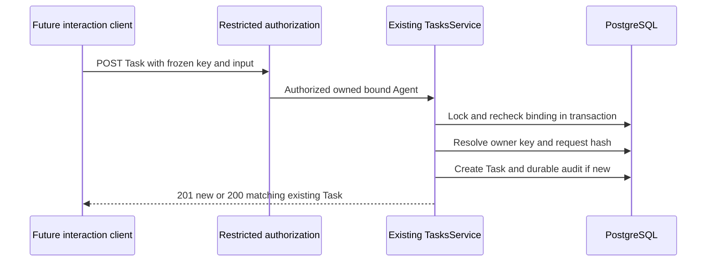
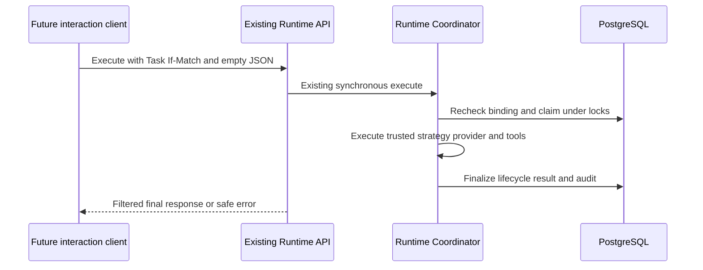
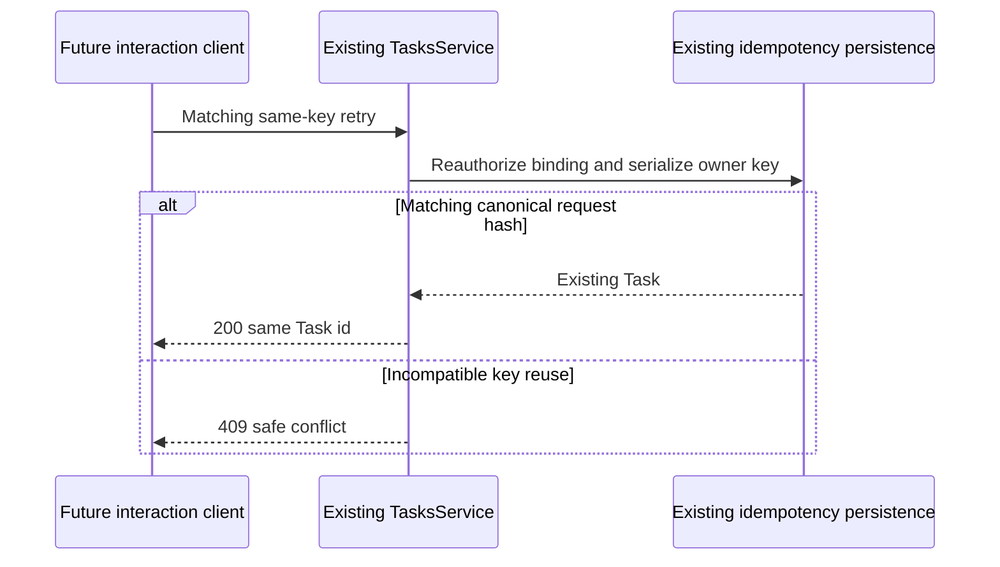
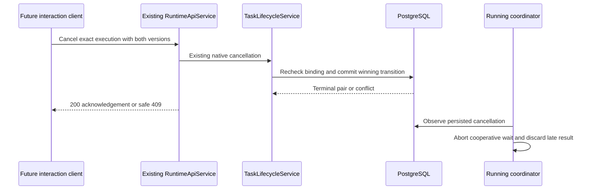
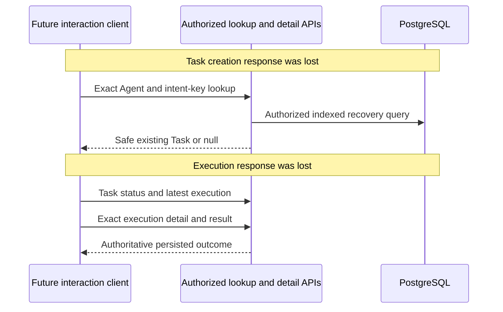

# Phase 4 T02 - Implemented interaction contracts

Date: 2026-10-25, Asia/Bangkok. This is the actual backend contract and supersedes T01's proposed API details where explicitly noted. **No frontend client or controls are implemented by T02.** Local development/test only; this is not production person/tenant authentication.

## Audit and capability matrix

The existing NestJS backend, Drizzle/PostgreSQL schema, Agent/NPC persistence, Task creation idempotency, RuntimeCoordinator, lifecycle services, results, durable audit and guarded operator/city APIs were inspected before modification. Phase 3 T10 remains accepted with local-development limitations. No applicable AGENTS.md exists in the workspace/accessible ancestor locations; Git status/diff fail because Git metadata is absent. A maintained-file hash inventory was taken before edits.

| Capability | Initial classification | Actual route/service/contract and resolution |
| --- | --- | --- |
| NPC-to-Agent resolution | REUSE AS-IS | Existing city-read GET `/api/v1/cities/elyqreth/agents` and `/:agentId/activity`, ActivityProjection and binding catalog. No new mapping writes. Every interaction independently checks persisted enabled PASSIVE binding and known NPC slot. |
| Agent eligibility | MINIMAL EXTENSION | GET `/api/v1/agents/:id`, existing Agent DTO plus interaction-only `actionEligibility`; Task/Execution detail receives appropriate hints. |
| Task submission | MINIMAL EXTENSION | POST `/api/v1/tasks`, TasksService/CreateTaskDto; restricted audience requires body idempotencyKey. Existing persistence/audit reused. |
| Execution start | MINIMAL EXTENSION | POST `/api/v1/tasks/:taskId/execute`, existing RuntimeApiService/RuntimeCoordinator, empty JSON and Task If-Match. New audience; execution remains synchronous. |
| Execution details | MINIMAL EXTENSION | GET `/api/v1/tasks/:taskId/executions/:executionId`, existing safe serializer plus action hints. |
| Cancellation | MINIMAL EXTENSION | POST `/api/v1/tasks/:taskId/executions/:executionId/cancel`, existing cancellation DTO/lifecycle transaction, both versions. No second cancellation mechanism. |
| Results | MINIMAL EXTENSION | Existing result GET and execute response; server-side interaction disclosure filter, unchanged canonical persisted result/operator contract. |
| Agent history | MISSING -> IMPLEMENTED | New GET `/api/v1/agents/:agentId/executions`, bounded keyset history via InteractionService and safe Execution DTOs. |
| Task idempotency | REUSE AS-IS | Existing owner/key/hash serialization and unique constraint, no new key store or cleanup. HTTP duplicate 200, first creation 201, different payload 409. |
| Ambiguous creation recovery | MISSING -> IMPLEMENTED | New GET `/api/v1/tasks/lookup?agentId=UUID&idempotencyKey=KEY`, exact scoped existing index lookup returning `{task:TaskView|null}`. |
| Public production access | BLOCKED | Existing loopback/fixed-owner development boundary retained; no new multi-user/tenant identity claim. |

## Authorization and configuration

Configure the existing database/registry and exact allowed frontend Origin on a loopback-bound development/test API. Add the following only in ignored local configuration:

```dotenv
CITY_INTERACTION_ENABLED=true
CITY_INTERACTION_TOKEN=replace_with_a_third_strong_random_credential
CITY_INTERACTION_AGENT_IDS=["11111111-1111-4111-8111-111111111111"]
CITY_INTERACTION_TEXT_AGENT_IDS=[]
```

The token must be 32-128 hex/base64url-compatible characters and distinct from **both** registry/operator and city-read tokens. Agent list: nonempty JSON array of at most 20 distinct UUIDs, canonicalized lowercase. Text disclosure list: optional empty-by-default subset of that list. Invalid enabled configuration fails startup, including production/non-loopback enablement or credential audience collisions. Existing registry provisioning and trusted runtime bindings remain separate requirements; a binding or token alone grants no provider/tool configuration permission.

The audience is a delegated local operator capability for the configured owner, not a new human account. It includes permitted historical Tasks of an authorized Agent, not personal per-user Task ownership. Foreign-owner, non-allowlisted, missing, unbound, unsupported-slot or non-PASSIVE binding resources are unavailable. Reads require current scope authorization at request time; already authorized in-flight reads may complete during a concurrent change. Mutations recheck and lock binding permission inside the existing transaction, including idempotent creation replay, execution admission and cancellation. Existing owner/city binding advisory-lock ordering is reused; finalization is deliberately not permission-gated, so revocation cannot strand already admitted work by preventing terminal persistence.

The global interaction guard admits only the following exact operations for a matching interaction credential, after existing loopback peer/bind/Host/Origin checks:

| Audience | Permissions |
| --- | --- |
| Interaction | Exact authorized Agent GET, Task POST/GET/status/lookup, existing per-Task execution list/detail/result, execute/cancel and new Agent history |
| Operator | Existing administrative/runtime access unchanged; new lookup/history are also owner-scoped operator reads and do not require interaction enabled |
| City-read | Existing city observation only; never accepted for mutations, results or operator routes |
| Anonymous/wrong credential | Existing guards deny protected routes |

Interaction denies Agent enumeration/registration/edit/activate/archive, unscoped Task enumeration, audit routes, binding writes and city-read routes. Keep using the distinct city-read credential for observation. No broad operator token belongs in a browser. Private request-scoped delegation is associated with the existing AsyncLocalStorage context through a WeakMap; neither request JSON nor log context can mint/carry it. No global mutable current-user or token is stored in DTOs/logs.

## Request and response reference

All existing DTO validation and 64 KiB HTTP body limits remain. Instruction and optional context are strings of at most 16,000 JS units each, instruction must contain non-whitespace, input JSON at most 32,768 UTF-8 bytes, common credential/control-character patterns rejected. Unknown fields including ownerId, tenantId, provider/model/tool/strategy/deadline overrides are rejected. No input or request hash is echoed in safe Task DTOs.

Interaction Task submission:

```json
{
  "agentId": "11111111-1111-4111-8111-111111111111",
  "input": {"instruction": "Count these words."},
  "idempotencyKey": "city.intent.random-unique-value"
}
```

`idempotencyKey` is required for interaction creation, optional for the existing operator contract. It is a 1-128 character **body field**, `[A-Za-z0-9._:-]`, scoped to configured owner and Task creation. Same canonical Agent/input request returns the same Task with 200; new intent returns 201; incompatible reuse returns 409. UUID case does not create a new semantic request. Existing keys persist for the Task lifetime; no expiration or automatic purge is introduced.

Task safe fields remain `id,agentId,orchestratorId,status,version,createdAt,updatedAt,completedAt`. Agent safe identity retains the existing serializer. Interaction-only Agent/Task/Execution reads add:

```json
{
  "actionEligibility": {
    "canCreateTask": true,
    "canRequestStart": false,
    "canRequestCancel": false,
    "reason": null
  }
}
```

Hints reflect supported Agent type, ACTIVE status, enabled route, reviewed runtime configuration, native Agent blockers/quarantine and actual Task/Execution states. A queued attempt must have a valid matching trusted snapshot to suggest Start. Cancel requires a valid native snapshot/current eligible pair, but disabling an Agent alone does not fabricate a cancellation prohibition. Reason is null or NOT_SUPPORTED/UNAVAILABLE/INVALID_STATE. Hints do **not** reserve coordinator capacity or replace mutation validation. One active execution per coordinator remains unchanged.

Start: POST `/api/v1/tasks/:taskId/execute`, `Content-Type: application/json`, body `{}`, header `If-Match: "TASK_VERSION"`. Successful synchronous response retains `{kind:'finished',task,execution,correlationId,result}`. The server's 30-second HTTP budget, trusted execution deadline, caller disconnect behavior and runtime concurrency fences remain. Do not apply Phase 3's five-second activity-read timeout to this operation; T03 should use the documented 35-second bounded client wait. No 202/background/durable continuation guarantee is introduced.

Detail: GET `/api/v1/tasks/:taskId/executions/:executionId`. Existing safe Execution DTO plus actionEligibility: IDs, attempt/status/version, timestamps, durationMs, safe fixed error code/message, resultAvailability, strategyId/correlationId. No lease, runtime snapshot, raw provider error or tool arguments. History uses this same existing summary **without per-row hint queries**.

Cancel: POST `/api/v1/tasks/:taskId/executions/:executionId/cancel`, body `{taskVersion:3}`, quoted Execution version in If-Match. Existing TaskLifecycleService commits the terminal pair and audit; the coordinator observes committed cancellation via its heartbeat/finalization checks. Ack 200 means the returned transition committed. Duplicate/late/stale cancellation can return 409 under existing lifecycle policy; it never rewrites terminal success or duplicates audit. Refresh authoritative state rather than guessing race outcomes. A CREATED Task without an execution has no invented cancel endpoint. Running cancellation can remain quarantined and block new native work; revocation does not forcibly stop remote computation/billing.

Result: GET `/api/v1/tasks/:taskId/executions/:executionId/result` retains `{execution,availability,result}`. PENDING and UNAVAILABLE stay explicit. Statistics output is `{schemaVersion:1,executionId,output:{type:'text.statistics.v1',data:{codePointCount,wordCount,nonemptyLineCount}}}`. Reviewed text output is `{output:{type:'text',text:'...'}}`. Treat it as plain untrusted text; no HTML/Markdown promise.

LLM text is denied by default for the interaction audience, including the **synchronous execute response**. Denied display returns `result:null,displayReason:'DISCLOSURE_RESTRICTED'`; result GET additionally reports display `availability:'UNAVAILABLE'`. Nested `execution.resultAvailability` and canonical DB/operator result remain unchanged. Explicit text-Agent allowlist enables display; internal provider profile metadata is always omitted from interaction results, while validated usage/tool invocation counts may remain. This is an explicit disclosure policy, not arbitrary model-content DLP. Existing validated result/persistence byte bounds remain; no new output modality/streaming exists.

Typed contracts are in `apps/api/src/interaction/interaction.contract.ts`, composed from existing Task/Execution/Runtime DTO types. No ORM entity or new generator/OpenAPI system is exposed. Markdown remains the repository's documentation convention.

## Recovery and history

GET `/api/v1/tasks/lookup?agentId=UUID&idempotencyKey=KEY` returns only `{task:TaskView|null}` after current Agent authorization, before the dynamic Task-ID route. Unsupported parameters/bodies fail validation. A key belonging to another Agent produces null, not that Task or its input. No unbounded history search or re-execution is needed. IDs/key are private recovery locators, not permission claims. Query values are never logged by the existing template-only HTTP logger.

After lost Create response, query the exact intent or explicitly replay only the unchanged same-key payload. After lost Start response, Task ID is already known: GET Task status/latestExecutionId then exact execution/detail/result. Never automatically replay execute/cancel POSTs. After API restart, configured authorization must still be valid; idempotency and results survive via PostgreSQL. Browser reload/user session handling belongs to T03/T07, not this backend task.

GET `/api/v1/agents/:agentId/executions?limit=10&before=CURSOR` returns:

```json
{"items": [], "pagination": {"limit": 10, "nextCursor": null}}
```

Default 10/max20; no unbounded limit/offset or unsupported status filter. Newest-first `(created_at DESC NULLS LAST,id DESC NULLS LAST)` keyset; cursor is canonical bounded `v1.` base64url tuple of Agent UUID, exact six-digit PostgreSQL UTC timestamp and execution UUID. Invalid/calendar/scope-mismatched cursors yield 400. Cursor is a locator, never authorization; every page independently checks owner/Agent scope. Concurrent new insertions do not shift older pages; they appear after refreshing newest page. No cross-page snapshot/replay guarantee. Safe per-Task ascending/offset APIs remain unchanged.

Migration `0004_agent_execution_history.sql` adds only `executions_owner_agent_history_idx(owner_id,agent_id,created_at DESC NULLS LAST,id DESC NULLS LAST)`. Existing indexes lacked this history ordering prefix. The bounded query joins existing Tasks for relationship integrity; no per-Task HTTP fan-out or per-item DB loop. Integration verification includes timestamp ties and a real EXPLAIN index access check. No new idempotency/Task/result table or destructive change. Apply existing migrations normally; on approved rollback, only this new index may be dropped (do not reset tables/data or edit applied migration history). Standard Drizzle migration tooling is forward-only; no automatic down/reset script is added.

## Errors, audit and limitations

Existing safe error envelope remains `{statusCode,message,requestId}`; authenticated interaction HTTP errors additionally receive stable INVALID_INPUT/FORBIDDEN/NOT_FOUND/CONFLICT/PAYLOAD_TOO_LARGE/UNSUPPORTED_MEDIA/RATE_LIMITED/UNAVAILABLE/INTERNAL_ERROR categories. Existing runtime errors retain their closed runtime codes/statuses. Pre-guard authentication/parser failures retain original status-based envelopes. Duplicate Create is 200, not an error; incompatible key/version/cancellation conflicts remain generic 409 without protected existence details. No raw SQL/provider/stack diagnostics.

Task creation, lifecycle, result and audit transactions are reused. Delegated creation/cancellation command audit labels use `local-city-interaction`; native transitions retain `native-runtime`. Existing operator audit labels remain. Operational `interaction.authorized`/`interaction.denied` logs contain audience/action category only; an authorization log is not proof of a committed transition. No duplicate lifecycle events or separate audit store. Correlation/request IDs remain existing trusted boundaries.

There is no HTTP rate-limit framework in this repository; this change does not claim or introduce one. Loopback authentication, bounded requests/history/allowlists and existing runtime concurrency remain the implemented limits. Production identity/tenant isolation, quotas, remote deployment/session expiry, forced cancellation, quarantine recovery and detached execution remain unimplemented. No NPC/rendering/frontend synchronization changes are made.

## T03 integration requirements

Use a separate limited interaction credential/client, never the operator token or upgrades to the fixed city-read client. Validate action hints and exact returned Agent/Task/Execution relationships, unknown data non-actionable, responses bounded, versions quoted. Generate an opaque durable intent key per frozen user submission; do not regenerate it on network errors. Preserve Start across ordinary NPC/panel changes, reconcile uncertain outcomes via GET, and reuse the existing activity poller rather than polling per NPC. Display-only result restriction must not be labelled runtime failure. No frontend code is delivered in T02.

## Sequences











## Verification record

**T02 COMPLETE for the approved local-development backend scope.** No T03-T10 frontend feature is claimed complete. The continuation retained the implemented services/contracts rather than replacing them. Before resumption, six focused unit cases and eight real PostgreSQL/HTTP interaction cases had passed; the aggregate regression had stopped at four old migration-count assertions, and browser checks/documentation were unfinished.

| Recovered requirement | At continuation start | Final evidence/status |
| --- | --- | --- |
| Capability matrix and typed contracts | COMPLETE for implemented contracts; roadmap pending | COMPLETE: matrix/reference above and `interaction.contract.ts` |
| NPC binding/owner authorization and eligibility | COMPLETE in focused tests | COMPLETE: independent persisted-binding authorization, ACTIVE/DISABLED/ARCHIVED checks, scoped request isolation and transaction revocation barrier |
| Task input/submission, idempotency and recovery | COMPLETE in focused tests | COMPLETE: six concurrent same-key HTTP requests, canonical UUID-case retry, payload conflict, exact lookup and new-instance persistence |
| Runtime start/cancellation/details/results | COMPLETE in focused tests | COMPLETE: genuine coordinator/strategy execution, queued/running cancellation, late candidates, canonical persistence and both LLM display paths |
| Bounded history and cursor validation | COMPLETE in focused tests | COMPLETE: newest-first bounded pages, exact timestamp ties, scope rejection and actual index access |
| Safe errors, audit, logging and ownership | COMPLETE in focused/unit tests | COMPLETE: closed envelopes, foreign-owner denial, admin/city-read audience isolation, preserved terminal events and safe DTOs |
| Migration compatibility | PARTIAL: four tests expected four journal entries | COMPLETE: journal-derived counts plus retained hash/data assertions; clean/reapplied/restarted/populated-schema upgrades pass |
| Unit/API regression | COMPLETE unit/frontend; PARTIAL full SQL | COMPLETE: retained 198 backend and 125 frontend tests; final 112 PostgreSQL/HTTP tests |
| Phase 3 browser compatibility | MISSING after aggregate halted | COMPLETE: existing Chrome smoke and real browser/API/PostgreSQL workflow both pass |
| Documentation/roadmap | PARTIAL | COMPLETE: actual contracts, evidence, limitations, migration notes and T03 handoff updated |

Focused backend unit tests and real PostgreSQL/HTTP tests cover configuration/audience isolation, private async request context, validation, native queued/running cancellation, immutable terminal states, concurrent same-key creation/hash conflict, restart recovery, real rule-based and fake-provider LLM execution, both result disclosure paths, binding revocation between HTTP guard and transaction, foreign-owner denial and exact history ties/index access. No live paid provider is required.

| Actual command | Outcome |
| --- | --- |
| `npm.cmd run check:api` | PASS during implementation: backend TypeScript no-emit |
| `npm.cmd run test:api` | PASS: 198 tests, including six new interaction unit tests |
| `npm.cmd run db:generate --workspace @elyqreth/api -- --name agent_execution_history` | PASS after sandbox escalation for a Windows user-lookup failure; generated only the new index migration/metadata |
| `npm.cmd run db:check` | PASS: existing migration metadata validation |
| `npm.cmd run verify:phase1` | Initial aggregate FAILED at SQL regression: four fixed-count migration assertions expected 4 rather than 5. Its preceding lint/type checks, backend/frontend builds, metadata check, 125 frontend tests and 198 backend tests passed and were retained. |
| `npm.cmd run test:db` | Final continuation PASS: **112 tests**, including eight interaction cases, all Phase 1-3 SQL/runtime/HTTP regressions, populated-schema upgrades and real PostgreSQL restart. One earlier continuation attempt could not reach a stopped Docker engine; the installed engine was started before this passing run. |
| `npm.cmd run test:browser` | PASS: actual Chrome 155, **zero exceptions**, existing city/NPC/inspection/synchronization/camera/environment/mobile smoke. Runtime updates in this smoke use controlled transport. |
| `npm.cmd run test:city:e2e` | PASS: actual Chrome/API/PostgreSQL Phase 3 compatibility test, **five genuine executions**, cancellation/failure/deadline/reconnect/restart/reload/revocation/unbinding. This is regression compatibility, not a Phase 4 UI test. |

The aggregate itself was not rerun after test-only migration assertion fixes. The failed stage and previously skipped browser stages were independently rerun successfully; unchanged successful build/unit/static evidence remains valid. The old fixed counts were replaced by the full source journal length, not by suppressing assertions or removing data/hash preservation checks. No unresolved failing test remains in the required executed suites.

Retained sanitized evidence: [commands, counts and source preservation](verification-evidence/t02-verification.json), [actual browser compatibility reports](verification-evidence/t02-browser-compatibility.json). Raw logs remain in the local temporary directory; repository evidence includes hashes rather than private configuration. No fresh live Ollama/OpenAI, Docker deployment smoke, production account/tenant session tests or Phase 4 UI were run. Existing mocked adapter/tool/runtime regression suites did run. There is no separate ESLint/formatter/OpenAPI generation script; `lint` is the actual syntax/typecheck aggregate.

## Files changed

Created:

- `apps/api/src/interaction/interaction.configuration.ts`, `interaction.context.ts`, `interaction.authorization.ts`.
- `apps/api/src/interaction/interaction.contract.ts`, `interaction.service.ts`, `interaction.guard.ts`.
- `apps/api/src/interaction/interaction.controller.ts`, `interaction.interceptor.ts`, `interaction.module.ts`.
- `apps/api/test/interaction.test.cjs`, `apps/api/test/interaction.integration.cjs`.
- `apps/api/migrations/0004_agent_execution_history.sql`, `apps/api/migrations/meta/0004_snapshot.json`.
- This API reference and the two JSON evidence files linked above.

Modified:

- `apps/api/src/app.module.ts`, `apps/api/src/config/configuration.ts`, `apps/api/.env.example` - module/optional configuration.
- `apps/api/src/common/local-access.guard.ts`, `http-foundation.ts`, `persistence.ts` - audience delegation, safe error codes and accepted-command attribution.
- `apps/api/src/tasks/tasks.service.ts`, `runtime/runtime-persistence.service.ts`, `lifecycle/task-lifecycle.service.ts` - transaction-boundary binding rechecks, without new lifecycle transitions or finalization policy.
- `apps/api/src/database/schema.ts`, `apps/api/migrations/meta/_journal.json` - one index and journal registration.
- `apps/api/test/database.integration.cjs` - interaction suite registration and current journal count.
- `apps/api/test/tasks.integration.cjs`, `apps/api/test/events.integration.cjs` - populated upgrade expectations derived from the full journal while preserving rows/hash assertions.
- Root `README.md`, platform documentation index and Phase 4 overview/roadmap/ADR/plan status notes - current verified scope and links.

Continuation edits completed the three migration test files, added disabled/archived eligibility assertions to the existing HTTP case, recorded evidence and finalized documentation. Existing backend interaction implementation was preserved. Frontend source/assets, earlier migrations, dependency/lockfiles, CI and historical Phase 1-3 documentation remain unchanged. Git metadata is absent, so source preservation uses the pre-task hash inventory rather than a Git cleanliness claim.
