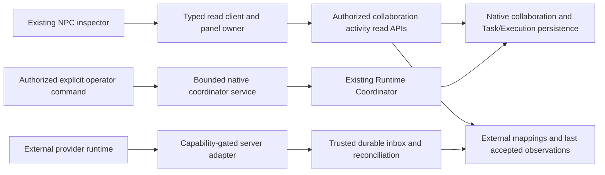

# Phase 5 final acceptance - Multi-Agent Collaboration & Orchestrator Integration

Review date: 2026-10-29, Asia/Bangkok. **Decision: ACCEPTED for the approved trusted fixed-owner loopback development/test scope.** This report is the canonical current Phase 5 scope and acceptance record. Task-date planning/proposals and earlier test counts remain historical evidence; they do not describe additional implemented features. Final command outcomes, file inventory and preservation hashes are in [T12 verification](verification-evidence/t12-verification.json).

## Scope and acceptance boundary

Phase 5 delivers bounded explicit native collaboration and a provider-neutral external observation path, unified read APIs and inspection inside the existing city. Acceptance applies only to trusted fixed-owner loopback development/test. It does not accept public production deployment, establish tenant identity, enable external dispatch, promise autonomous crash repair or start Phase 6.

The audit inspected the README/platform index/roadmap, T01 decisions and actual T02-T11 modules, migrations, guards, transport, projections, UI, tests and CI. No applicable AGENTS.md or Git metadata was supplied; status/staged/untracked inspection cannot be established with Git. A 543-file pre-edit SHA256 baseline preserves existing work. There is no separate backend or frontend README: root README, platform index and existing implementation/runbooks are the maintained entry points.

## Final acceptance matrix

PASS refers to implemented approved scope supported by source review and executed evidence, not merely a file's existence. The full database suite includes the named test modules; focused live and browser acceptance tiers are recorded separately. [T11 threat/reliability evidence](security-e2e-verification.md) is retained, with fresh T12 checks in the linked verification record.

| Task / requirement | Implementation evidence | Test evidence | Documentation / limits | Status |
| --- | --- | --- | --- | --- |
| T01 architecture and plan | Native/external ownership boundaries verified in actual modules; P5-ADR-001 through 008 and explicit task refinements | Conformance review plus native isolation, provider isolation and v1 compatibility regressions | [ADRs](decisions.md), [architecture](architecture.md); staged A-to-B-to-A proposal intentionally narrowed to terminal source plus bounded child/result reference | PASS |
| T02 durable collaboration domain | collaboration.domain.ts, collaboration.repository.ts, schema.ts; migrations 0005 and later constraints | collaboration.integration.cjs: owner FKs, unique membership/idempotency, cycles, optimistic updates, rollback and populated upgrade | [Persistence](persistence.md); no duplicate Task/Execution model | PASS |
| T03 delegation contracts/auth | collaboration.controller.ts, collaboration-api.service.ts, DTO/policy and current-source checks | collaboration-api.integration.cjs: real HTTP guard/owner/parent/member/Agent denials, no execution on request, replay and concurrency | [Native API](native-delegation-api.md); local operator, not production tenant authorization | PASS |
| T04 native coordination | native-coordination.service.ts and existing runtime admission boundary | native-coordination.integration.cjs: genuine rule-based child/result, one child/attempt, concurrent activation and failure cuts | [Coordination](native-coordination.md); no parent resume, second scheduler or fanout engine | PASS |
| T05 lifecycle/recovery | collaboration-recovery.service.ts, aggregation/control and existing TaskLifecycleService/RuntimeCoordinator | collaboration-recovery.integration.cjs: terminal outcomes, cancellation/timeout races, three-attempt cap, restart, independent recovery and real process kill | [Recovery](lifecycle-recovery.md); admitted unknown work stays WAITING/quarantined | PASS |
| T06 provider-neutral foundation | adapter.contract.ts, adapter-registry.ts, external-adapter.service.ts, configuration and pinned transport | external-adapter/transport/di tests: capability/mode/owner checks, SSRF/DNS/peer/TLS/redirect/size/deadline/redaction | [Adapter foundation](adapter-foundation.md); controlled dispatch remains disabled | PASS |
| T07 identities and ingestion | ingestion-authority.ts, external-ingestion.service.ts, source/mapping/inbox schema | external-ingestion.integration.cjs: source-scoped collisions, forged grants, same-owner correlation, duplicates/order/rollback/replay and migration compatibility | [Ingestion](external-ingestion.md); trusted internal boundary, no generic webhook | PASS |
| T08 one reference provider | compiled langgraph.v1 adapter, observation service and reviewed transport client | Documented-response fixtures plus freshly executed real pinned local provider discovery/run/result/restart isolation case | [Reference provider](reference-integration.md); observation-only, hosted auth NOT VERIFIED | PASS |
| T09 collaboration read model/API | collaboration-activity controller/service/contracts compose Phase 3 SQL/mapper | collaboration-activity.integration.cjs: genuine child, mixed authority, ownership, consistent snapshot, cursor/history/index bounds, null progress | [Activity API](collaboration-activity.md); native invalidation cursor, external snapshot refresh | PASS |
| T10 frontend inspection | collaboration client/validation/owner, collaboration-panel.js and existing app/Task panel integration | collaboration.test.js; actual Nest/PG/browser plus deterministic DOM/AX/keyboard/contrast/motion/mobile checks | [Frontend](frontend-collaboration.md); directed list replaces optional overlay, no renderer change | PASS |
| T11 hardening/E2E | Two narrowly fixed frontend defects, bounded resource profile, mixed/crash tests and existing CI artifacts | Reproduced pagination/action races now regressions; native/external/mixed/fault tests, real provider, actual city/Task crash checks | [Security/reliability](security-e2e-verification.md); no unresolved critical local defect identified | PASS |
| T12 final reconciliation | This canonical report, current entry points, roadmap, historical archive and preservation review | Fresh lint/types/units/database/native/external/mixed/browser/build checks; exact outcomes in T12 evidence | Phase 6 prerequisites below; no release/deployment/version change | PASS |

## Delivered architecture and conformance

Native Task/Execution status remains authoritative in existing runtime/lifecycle persistence. External runs remain authoritative in their provider; their observations occupy separate tables and never become native coordinator Executions. The frontend and T09 are read/presentation boundaries, not lifecycle writers. NPC identity uses the existing stable Agent binding; no automatic NPC spawning or external identity-to-native privilege inheritance occurs.

The documented refinements are intentional, not hidden missing functionality: source A must complete before explicit child B admission; child output returns as an authorized persisted reference rather than automatic parent LLM continuation. The first native recipe has two participating Agents, depth two/three work Tasks and no fanout. Delegation is canonical ancestry; existing Task/Execution state and results are reused. The frontend uses a compact directed relationship list rather than the optional renderer overlay. Existing Phase 3 v1 projection/scheduler remains intact; v2 reads are opt-in with a separate local read audience.

## Native collaboration, integrity and recovery

Creation/request validates the authenticated owner, current source/target eligibility and enabled native route, eligible participant roles, terminal successful source Task/Execution and bounded parent context. Source and target must differ. Request acceptance itself does not run work; explicit activation revalidates current state and safely prepares/correlates one child. Durable scoped keys/hashes, owner transaction fences, versions and constraints prevent duplicate or conflicting activation. No runtime/provider call is held inside a long-lived persistence transaction.

Collaboration CREATED/ACTIVE/WAITING/COMPLETED/FAILED/CANCELLED and delegation REQUESTED/ACCEPTED/EXECUTING/AWAITING_RETURN/terminal states are distinct from Task/Execution status. Required child completion/failure/cancellation is reconciled from exact persisted native evidence, never event arrival order alone. Zero work is not success. Terminal states are not reopened by stale observations. Cancellation records durable intent and targets eligible child work; it does not cancel or restart the already completed source parent. Timeout/cancellation uncertainty does not prove side effects stopped.

Never-admitted prepared children support explicit bounded recovery using the existing runtime (maximum three recovery-dispatch commands). Existing admitted work is never replayed automatically after a crash or ambiguous acknowledgement. Real backend process-kill tests verify committed identity and one retained Execution, with WAITING/OUTCOME_UNCERTAIN rather than fabricated success or duplicate execution. No Elyqreth worker, Redis, broker, outbox publisher or automatic repair daemon exists; worker restart/scaling cannot be claimed as implemented.

## External provider and integration capability acceptance

Exactly one real provider adapter implementation is registered: LangGraph Agent Server, pinned local API 0.16.8 / graph 1.2.18. It observes configured assistants/workflows, not inferred individual Agents. Provider selection, reviewed API references, authentication and versioned response fixtures are recorded in the [reference guide](reference-integration.md). Ordinary CI needs no live provider or paid model; the live tier creates/deletes only its disposable provider thread.

| Capability | Accepted adapter behavior |
| --- | --- |
| Configuration/health | Explicit trusted endpoint/pins and bounded GET /info |
| Workflow discovery | Bounded documented assistant search |
| Execution status | Explicit known thread/run UUID pair, raw and normalized status |
| Results | Restricted successful latest-run checkpoint/provenance/hash reference; no general raw/historical result API |
| Polling | One selected mapped run per explicit bounded call; no background source scheduler |
| Global execution discovery | Unsupported |
| Controlled dispatch and cancellation | Unsupported by this adapter; provider APIs existing does not grant local permission |
| Streaming, subscription, public webhooks | Unsupported |
| Hosted authentication | X-Api-Key implementation and failure/redaction fixtures verified; live hosted deployment NOT VERIFIED |

T06 capability-intersection contracts distinguish OBSERVATION_ONLY and CONTROLLED_DISPATCH, but actual external mutations remain OPERATION_DISABLED even if requested. Unknown/duplicate adapter registrations and unsupported methods fail closed. Connection configuration and credential references are server-owned, not browser-supplied dynamic plugins. Native and external execution ownership are never inferred from ID format.

External identities are scoped to owner/connection/namespace/source generation. Approved internal EXTERNAL Agent links are optional and explicit, with no automatic registry record or NPC creation. Durable inbox identity/hash, source grants, validated bounded envelopes, reviewed sequence domains and transactional application provide deduplication, conservative ordering and bounded replay. Unknown/unordered/conflicting evidence remains representable or deferred. External collaboration correlation must be explicitly valid; an external observation cannot complete a native collaboration or rewrite native status.

## Current APIs, presentation and synchronization

Use [actual native contracts](native-delegation-api.md), [activation](native-coordination.md) and [recovery/cancel contracts](lifecycle-recovery.md) for implemented commands; historical T01 route proposals are not extra endpoints. Collaboration activity schemaVersion 2 exposes authorized GET list, Agent view, snapshot, timeline and native event hints under /api/v1/collaboration-activity. Snapshots provide summaries, participants, directed delegation and native child references, and explicit external observations. Progress is null when not measured; UNKNOWN source/health remains distinct from lifecycle failure.

Reads are repeatable-read/read-only, owner-filtered before bounded pagination, deterministically ordered and indexed; snapshots do not call external providers or load large result payloads. Native owner-stream positions are invalidation cursors. Timeline cursors browse persisted facts and are not synchronization checkpoints. External commit-order continuity is not promised: externalSnapshotRequired is true, and last accepted observations carry backend freshness/retirement labels. Source disconnection never invents a failed external Execution.

From an Agent-linked NPC, expand Collaborations, connect the distinct collaboration-read audience, choose an actual membership, inspect participants and source-to-target relationships, then inspect delegation Task/Execution metadata through separately authorized interaction access. History is bounded and separate from live NPC state. Shared Phase 3 completed REST sweeps drive refresh; there is no per-NPC transport or per-frame request. Generation/abort fences, cursor reset, bounded retry/read backoff, reconnect snapshots and logout clearing are verified. Pending/unresolved Create fences lifecycle actions so an older projected Task is not accidentally started.

Keyboard/AX/focus/contrast/reduced-motion/responsive and malicious-text rendering checks pass within the automated tier. Manual screen-reader certification, full pixel-diff and sustained browser load/FPS are not claimed. Existing Canvas/camera/zoom/NPC animation/movement/environment/Task/results behavior and Icy White theme remain protected by regression checks and source hashes.

## Security and operational risk disposition

| Risk / limitation | Severity and acceptance disposition | Mitigation / follow-up |
| --- | --- | --- |
| Fixed-owner local capability authentication is not production user/tenant identity | High for public deployment; public deployment BLOCKED, not part of accepted local Phase 5 | Exact loopback/Host/Origin guards, distinct audiences, owner-scoped SQL/constraints; Phase 6 principal/RBAC/tenant and ingress design |
| Admitted native work may remain uncertain after crash | Medium operational constraint, non-blocking for approved explicit workflow | Durable exact correlation/quarantine/attention, no blind replay; operator diagnosis and separately designed fencing/recovery policy |
| Hosted provider auth, other server versions and production licensing/dependencies unverified | Medium for hosted use, not accepted by local provider result | Pinned local live evidence and documented-response/auth fixtures; separately verify hosted deployment/version/terms before enabling |
| No generic webhook, external dispatch/cancel or automatic polling scheduler | Intentional unsupported capability | Explicit capability/mode denial; no API or UI advertises control |
| Manual AT, Python advisory scan, long-duration browser capacity and remote CI unverified | Documented evidence limits, not local critical defects | Automated AX/security/bounds tests, npm audit/T11 evidence and preserved logs; Phase 6 acceptance plan must define additional gates |

Security review verifies backend authentication/object-level ownership, forged Task/Agent/delegation/connection denials, capability enforcement, provider-secret isolation, SSRF/DNS/peer/TLS/redirect protection, trusted event grants, replay/idempotency guards, cursor validation, resource limits and text-only provider rendering. Cross-owner tests are actual isolation evidence; absent tenant infrastructure is not claimed tested tenant enforcement. T11's two confirmed frontend defects remain fixed and covered. No unresolved critical defect is accepted inside the stated local scope.

## Database, configuration and local operations

Ten ordered migrations (0000-0009) retain existing Task/Execution data. Collaboration foundation, guarded ownership/correlation, recovery indexes, external source/mapping/inbox and read-history indexes are additive in their approved tasks. Fresh/legacy-populated upgrade, FK/uniqueness, rollback/idempotency/concurrency and bounded indexed reads are covered by the existing database suite. T12 adds or rewrites no migration and never resets a developer database.

Use Node 24 and existing installed npm workspace dependencies. The city alone runs with npm run dev:web. The backend interaction path requires migrated PostgreSQL and explicitly enabled loopback registry/runtime/city/interaction configuration; use the [local operations runbook](../phase-4/operations.md), API .env.example and implemented Phase 5 guides. Registry/operator, city-read, interaction and collaboration-read credentials are separate, randomly provisioned and never interchangeable. Provider secrets use server-side credential references. Browser audience credentials remain volatile authentication state; operator/provider secrets are excluded from browser configuration/storage/logs.

Docker Compose preserves the standalone city/PostgreSQL/API services with capability integrations disabled by default; its container API bind is not permission to expose local operator features. Do not bypass loopback guards to make Compose interactive. There is no worker startup command. Optional [pinned LangGraph local setup](../../../tools/langgraph-reference/README.md) is independent; ordinary app boot/CI requires no external connection or credentials. Do not bind the reference publicly or use production workloads in acceptance tests.

Reproduce local verification with npm run lint, npm test, npm run test:api, npm run test:db, npm run build, npm run build:web, npm run db:check, the existing browser/city/interaction acceptance scripts, and the optional live reference tier. Exact PowerShell commands/exits/counts appear in T12 evidence. test:db owns labelled disposable PostgreSQL resources; build:web bundles into a temporary directory because root dist/ is maintained source. Existing CI discovers deterministic tests and uploads sanitized artifacts; remote CI has not been inspected or claimed green.

T11 measured ten 2,007-byte snapshots at 13/16/26 ms minimum/median/maximum service duration. Resource profiling covers 1/5/20 Agent selection sets, bounded request counts, duplicate-sweep coalescing, zero outstanding request timers and zero post-disposal notifications. These are representative fixture measurements, not production throughput, a complete leak proof or an FPS capacity guarantee. Current limits remain two native edges/three work Tasks, no fanout, three explicit recovery dispatches, read/replay pages up to 20, adapter 5-second request/1-second connection/64 KiB response/concurrency four, and bounded UI cursor/history windows.

## Phase 6 readiness assessment - planning only

The Registry, native runtime admission/lifecycle, scoped Task/Execution contracts, stable Agent/NPC identity, external capability/mapping/inbox boundary and explicit read model provide a usable foundation for production design. Local acceptance is not operational production readiness. Phase 6 T01 should decide the deployment/trust architecture before changing these boundaries.

| Prerequisite | Required Phase 6 design/verification |
| --- | --- |
| Deployment/environment separation | Topology, private/public ingress, service ownership, staging vs production, TLS/network egress and explicit migration ownership |
| Identity and permissions | Real principals, tenant/workspace model, RBAC/object authorization, session expiry/rotation, rate limits and administrative integration approval |
| Secrets | Production secret storage/rotation/revocation and per-connection least privilege; no browser provider keys |
| Database operations | Backups/PITR and tested restore, retention, migration rollout/rollback/locking, connection budgets and disaster recovery objectives |
| Runtime scaling/recovery | Decide whether a worker/queue is needed, durable dispatch/fencing, admission limits, shutdown and uncertain-side-effect reconciliation before scaling |
| External integrations | Supported hosted versions/licensing/auth, bounded observation scheduling/resilience, credential rotation, monitoring and explicit capability review before any mutation |
| Observability/operations | SLOs, bounded/redacted logs, audit retention, traces/metrics, alerts, quarantine diagnostics, recovery and incident runbooks |
| Delivery/release | Reviewed CI/CD, environment approvals, artifact provenance, vulnerability checks, rollback/canary strategy, release/version management and documented acceptance gates |
| Performance/accessibility | Representative sustained-load capacity, browser/assistive-technology review and infrastructure failure testing appropriate to the selected production topology |

No Phase 6 code, deployment, CI/CD redesign, provider/strategy expansion or release action is part of T12. Next recommended task: **Elyqreth Phase 6 T01 - Production Architecture & Deployment Plan**, separately authorized.

## Final executed verification and closure

Fresh T12 checks passed with exit 0: lint (maintained frontend syntax plus strict frontend/backend typechecks), frontend units 226/226, backend units 271/271, PostgreSQL/security/native/external/mixed/browser suite 209/209, focused live LangGraph case 1/1, actual Task reliability/crash browser case 1/1, actual city acceptance case 1/1, browser hardening/component checks, both production builds, migration metadata check, resource profile and npm audit (zero advisories). Final tests had no failures or skips. Counts overlap; optional focused tiers are not additional copies of the full suite.

The first database command failed before infrastructure setup because Docker Desktop was stopped. The service was started and the complete suite rerun successfully. This environment failure is recorded separately; it is not reported as a passing attempt. No product defects or source changes were required during T12.

Fresh mixed-read measurements were ten 2,007-byte snapshots at 9/10/10 ms minimum/median/maximum service duration. Earlier T11's 13/16/26 ms remains its own historical run, not a conflicting benchmark. Fresh owner/client profiling remains fixture-bound and does not claim production throughput or browser capacity. See [fresh T12 evidence](verification-evidence/t12-verification.json) for captured measurements and exact commands.

The pinned local reference was started only for disposable live verification, its test thread was deleted by the fixture, and the verified workspace-owned server was stopped. Test-labelled database resources are verified absent after cleanup. Source/assets/migrations/dependencies/CI are preserved by the final hash review; only documentation/evidence changes are part of T12. Git diff/status/diff --check remain unavailable without supplied Git metadata, so preservation, whitespace/secret/link checks are reported separately rather than claiming Git is clean.

**Phase 5 is COMPLETE and ACCEPTED within the approved local scope. T01-T12 are complete. Phase 6 is PLANNED and has not begun.** There is no unresolved acceptance-blocking defect inside this scope. Public production exposure remains blocked by the explicitly recorded identity/deployment/operations prerequisites. No commit, push, tag, version bump, release or deployment was performed.
