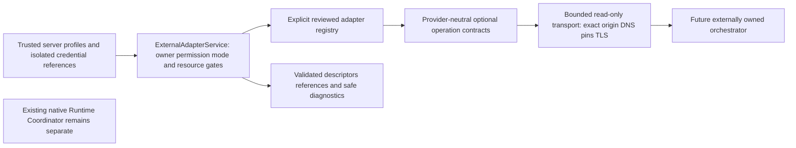

# T06 - External orchestrator adapter foundation

**Final Phase 5 status (2026-10-29): ACCEPTED for the approved local scope; T01-T12 complete.** See [canonical acceptance, current contracts and limitations](acceptance.md). Task-date proposals, checkpoints, counts and future-task statements below are historical, not additional implemented capabilities or current roadmap status.

**T07 checkpoint (2026-10-28):** [External mappings and ingestion](external-ingestion.md) implement durable source incarnations, explicit identity approval, authenticated internal receipt, conservative ordered observation and bounded replay. External data never mutates native work. Real providers/public webhooks/polling and activity/UI integration remain deferred. Earlier task/planning snapshots below are historical.

Reviewed 2026-10-28, Asia/Bangkok. **T06 COMPLETE for the approved foundation scope.** This is a provider-neutral backend foundation, not a real external integration. Final commands, outcomes and file preservation are recorded in [T06 verification evidence](verification-evidence/t06-verification.json). T07-T12 remain planned.

## Repository audit and architectural decisions

T01 architecture/ADRs and T02-T05 code/evidence were reviewed. Native Tasks, Executions, strategies, cancellation and collaboration recovery remain owned by existing services. The backend already has NestJS DI, opt-in environment configuration, isolated provider credentials, an exact IP endpoint policy and bounded Node HTTP/TLS transports. T06 reuses those conventions and the existing endpoint validator; it does not relax the official OpenAI endpoint restriction or change either LLM transport.

The [T01 domain plan](domain-model.md#persistence-and-rollback-gates) explicitly assigns contracts only to T06 and external mapping/inbox/observations to T07. Consequently there is no connection table, migration, public management controller, background health monitor or event consumer. A connection profile uses an administratively assigned orchestrator UUID as its stable identity; it is not a new Agent Registry record. Durable registration/FK/type/mapping validation must be completed by T07 before persisting external observations. Static configuration alone does not prove that a database registration exists or grant native runtime authority.

Git metadata is absent from this workspace, so status, staged/untracked inspection and diffs cannot be established through Git. Applicable AGENTS.md searches found none. A pre-edit maintained-file SHA-256 baseline protects existing work. Existing Phase 4 acceptance remains trusted local development/test only; no production principal or tenant support is added.

## Ownership and module boundaries

`ExternalOrchestratorsModule` is installed in the application with an empty `EXTERNAL_ADAPTERS` registration array. Merely importing or booting it performs no DNS, health or provider request. Registry entries are compiled, reviewed backend implementations injected through Nest; no module path, executable code or dynamic import is accepted from configuration. Unknown/duplicate adapter types and capability/method mismatches fail closed. Configured connections receive synchronous pure configuration validation at startup. No production adapter ships in T06, so naming a fixture type in an environment profile cannot silently enable a mock integration.

The module reuses the existing ApiLogger exported by DatabaseModule instead of introducing a competing logger binding. Database configuration is still optional at boot. The adapter service never injects RuntimeCoordinator, native lifecycle services or collaboration repositories and writes no native or external rows. External source status cannot mutate a native Execution. There is no frontend connection, credential store or orchestrator proxy.

## Contracts and capabilities

`OrchestratorAdapter` requires type, declared capabilities, pure validateConfiguration, describe and bounded health. Optional methods are discoverAgents, discoverExecutions, getExecution, getResult, pollEvents, subscribeEvents, dispatch, cancel and lookupSubmission. Methods are bound and capability declarations captured immutably at registry construction.

Capability names are `health`, `agents`, `executions`, `status`, `result`, `events.poll`, `events.subscribe`, `events.webhook`, `dispatch`, `cancel`, `dispatch.idempotent` and `submission.lookup`. A webhook flag is a declaration only; there is no webhook receiver. Subscription has a future AsyncIterable contract, but no subscriber is started. Event polling returns a validated bounded envelope page only; it does not ingest or store those events.

Before every operation, the service checks owner, connection, explicit operation permission, enabled state, local capability policy, adapter implementation and a freshly described source snapshot. Effective support is the intersection of implementation, source deployment/credential declaration and local policy, further restricted by mode. Snapshots include connection/namespace/generation, source revision and a canonical UTC expiration no more than five minutes ahead. Expired/mismatched snapshots disable operations; there is no stale capability cache. A capability claim is not proof of external authorization; the actual operation can still fail authentication/authorization.

OBSERVATION_ONLY denies dispatch/cancel before invoking any adapter mutation. CONTROLLED_DISPATCH additionally requires explicit server-derived operation permission, current capability support, declared idempotent dispatch and submission lookup. Even then T06 returns OPERATION_DISABLED: no adapter dispatch/cancel method is called. Support does not mean an enabled action. A later reviewed durable command-intent, remote dedupe/recovery and ambiguous-response protocol is required before enabling real external commands. No new outbox consumer is implied.

All application calls must go through ExternalAdapterService; the registry and implementations are trusted internal code, not an executable-code security sandbox. Future application services must derive ExternalAccess from authenticated backend policy. Passing owner/operation values in a browser body must never construct that authority. Cross-owner connection lookup returns NOT_FOUND; invalid scopes or insufficient operations are denied. The current environment gate permits only the configured local registry owner, not arbitrary tenant IDs.

## Trusted configuration and credentials

`EXTERNAL_ORCHESTRATORS_ENABLED=false` is the default in the backend environment example. Opt-in uses a bounded `EXTERNAL_ORCHESTRATORS` JSON array (maximum 16 profiles / 32 KiB), with these fields:

| Field | Contract |
| --- | --- |
| id / ownerId | Stable UUIDs; id references the administratively provisioned orchestrator identity, owner must match the local registry scope |
| adapterType / name | Reviewed registry token and bounded safe display name, not a module/package path |
| namespace / generation | Installation namespace and positive configuration generation, maximum 1,000,000 |
| mode / enabled | Explicit OBSERVATION_ONLY or CONTROLLED_DISPATCH; boolean enabled |
| endpoint | Exact origin, public/local network policy and 1-16 administratively approved IP pins |
| credentialRef | Optional backend environment name matching EXTERNAL_SECRET_*; never a raw bearer value |
| capabilities | Explicit local allowlist from the closed capability vocabulary |

Production opt-in, absent registry scope, wrong owner, duplicate identities, unknown fields, invalid profiles and missing/unsafe referenced credentials fail configuration safely. Main startup reports field names or a generic startup failure, not raw values. A profile with an unregistered adapter fails initialization. Profiles are server configuration, not publicly mutable records; there is no new management API. No live connection is required to boot the default application.

Credential values are read from the existing backend environment/file mechanism and captured in a private, inspection/JSON-redacted ExternalCredentials map. Values never enter adapter contexts, ordinary connection views, descriptor responses, audit fields or error messages. The bound HTTP get closure resolves the credential internally and adds a Bearer header only at the approved origin. Safe connection views omit owner, endpoint and credential reference. Known credential values, including JSON-escaped forms, are rejected if reflected by normalized responses. Existing safe-text checks reject common credential patterns too; this is defense in depth, not a general DLP guarantee.

Rotation is a trusted configuration reload/restart with an appropriately bumped generation; T06 adds no live rotation API or vault. Keep ignored .env files/process environment access restricted. Secret references are not frontend credentials. Reviewed backend code remains privileged and must not deliberately read/exfiltrate secrets.

## Endpoint, TLS and SSRF controls

The shared `providerEndpoint` policy validates exact origins, no embedded credentials/query/fragment, and explicit IP pins. Public endpoints require HTTPS and public routable addresses; private, loopback, link-local, metadata, mapped IPv6, NAT64 and other reserved-address bypasses are rejected by the existing policy. An explicit trusted `network: local` profile may approve supported private/loopback pins for local development; it is not a user-supplied URL exception. Link-local metadata endpoints remain disallowed by that policy. T06 adds no API through which a user can set these profiles.

Every request resolves DNS again, checks all answers against approved addresses/families, pins the actual socket IP and verifies the connected peer matches. Late DNS after abort cannot open a socket. TLS retains certificate verification, original-host SNI and hostname checks even though connection uses a pinned IP. TLS overrides are not accepted. Redirects are rejected entirely, never followed with authorization. Cross-origin/absolute/protocol-relative paths, backslashes and control characters are rejected. Requests are GET-only to the configured origin; there is no generic proxy or external dispatch transport.

The transport uses the same Node built-ins and defensive framing pattern as existing provider transports, keeping the original native transports unchanged. It rejects unsupported content type/compression, malformed UTF-8/JSON, oversized headers and responses. Source error bodies are never copied into public errors/logs. No retry is performed, including after timeout or authentication/rate failure. DNS/egress administrative policy must still be reviewed for a real deployment; pinned allowlists intentionally require explicit updates when source addresses change.

## Descriptor and event validation

All normalized data carries connectionId, namespace and generation. External IDs remain opaque, case-preserved and connection-scoped, never treated as globally unique or as internal Agent IDs. Descriptors do not register Agents, spawn residents, create Tasks/Executions or imply authorization. Unknown fields, getters, custom prototypes and oversized strings/pages are rejected; normalized output is copied and frozen.

- Agent: externalId, safe name and optional bounded description. No arbitrary provider metadata or secret payload.
- Execution: externalId, externalAgentId, original sourceStatus, separate presentationStatus including UNKNOWN, optional actual start/finish timestamps and opaque resultReference. Unsupported source states are preserved, not forced into native enums. Missing timestamps are not fabricated and reversed timestamp order is rejected.
- Result: Execution identity, AVAILABLE/PENDING/UNAVAILABLE and an opaque reference only when available. No large result payload duplication or automatic URL loading.
- Event: provider eventId, declared kind, relevant external IDs, source status, optional occurredAt, receivedAt, optional correlation, optional sequence domain plus decimal string value, and optional payloadReference. Sequence strings preserve values beyond JavaScript safe integers. They do not establish global ordering. Received time/source claims alone do not authorize persistence.

T07 must authenticate source provenance, assign trusted receipt metadata, validate existing owner/orchestrator registration, implement scoped mapping, inbox dedupe/hash conflict checks, ordering/checkpoint policy and retention before applying anything. T06 offers no event ingestion or native status patch route. A validated event is still only data. Result references are opaque and must not be interpreted as trusted navigation URLs or HTML.

## Health, errors and resource bounds

Health is separate from execution: UNKNOWN, HEALTHY, DEGRADED, UNAVAILABLE and locally derived DISABLED. Disabled health requires authorization but performs no IO. Probe failure returns a safe UNAVAILABLE observation with a classified error code. It never cancels native work or changes Agent state. Health freshness does not grant capabilities; capabilities are freshly negotiated separately.

Operations share a five-second total deadline, including describe/DNS; connection establishment has a one-second limit. AbortSignal distinguishes cancellation from timeout. Responses are at most 65,536 bytes, headers at most 8,192 bytes, pages at most 20 items. Maximum four service operations and independently four outbound calls are permitted per instance. An adapter cannot bypass the transport cap with HTTP fanout. A callback or DNS resolver that ignores abort retains its slot until actual settlement, failing closed against unbounded orphan calls. Timers/listeners/sockets are cleaned up, late rejections consumed, and no background retry or per-Agent polling is introduced. Reviewed code must remain cooperative; these are not an OS sandbox for arbitrary code.

AdapterError uses closed codes for invalid input/configuration, unknown adapter, unsupported capability, denied/disabled operation, authentication/authorization failure, unavailable connection, timeout, abort, rate limit, invalid response, missing execution, transient/permanent failure, capacity and response limits. Unknown exceptions become safe TRANSIENT_FAILURE without source messages/stacks. `retryable` is advisory for future read policy, never permission to blindly retry a mutation. Structured ApiLogger events contain connection/type, operation/mode, request correlation, duration, outcome and safe code only. No URL, auth header, source body or Task instruction is logged. There is no durable command audit because no external commands or connection mutations are accepted in T06; later dispatch must add that through existing audit conventions.

## Tests and remaining gates

The fixture adapter exists only under apps/api/test and is never registered by the production module. Contract tests cover registry/DI, capability changes, optional methods, ownership, mode gates, descriptors/events, secret redaction, health, deadlines and resource cleanup. Transport tests use controlled native HTTPS seams plus an explicitly pinned real local HTTP server, never public DNS, production credentials or paid providers. Existing full database/native/browser regressions verify default module integration with Phases 1-5.

Use root scripts `npm.cmd run lint`, `npm.cmd run build`, `npm.cmd run test:api` and `npm.cmd run test:db`. Adapter contract/security/Nest DI cases are included in test:api and the existing CI verification path. Docker owns the isolated PostgreSQL regression environment. Exact outcomes, initial corrections, file hashes and cleanup are in the evidence JSON; hosted CI and live provider compatibility are not claimed.

T07 owns durable identity/mapping/inbox/event application. T08 still requires a real reviewed accessible source, pinned version/authentication and compatibility evidence. No Hermes/LangGraph/CrewAI adapter, source ingestion, external dispatch/cancellation, collaboration projection or frontend visualization is implemented by this task.

## Final verification checkpoint

Backend lint/typecheck and production build passed. Final backend unit/contract/security/DI suite passed 248/248, including 31 new T06 cases. The existing isolated PostgreSQL/native/browser regression suite passed 174/174; it tests the installed empty adapter module alongside Phases 1-5. No tests were skipped. The later transport-only fanout limit and its additional tests are covered by the final unit/contract run; they do not change the unconfigured native/database paths exercised by the regression suite. One initial unit failure exposed synchronous caller validation in Promise-based read methods; methods were made consistently asynchronous and invalid caller pagination now uses INVALID_INPUT. Original bad-provider-output assertions were retained. No assertion was weakened, provider selected or production service contacted.
