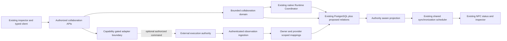
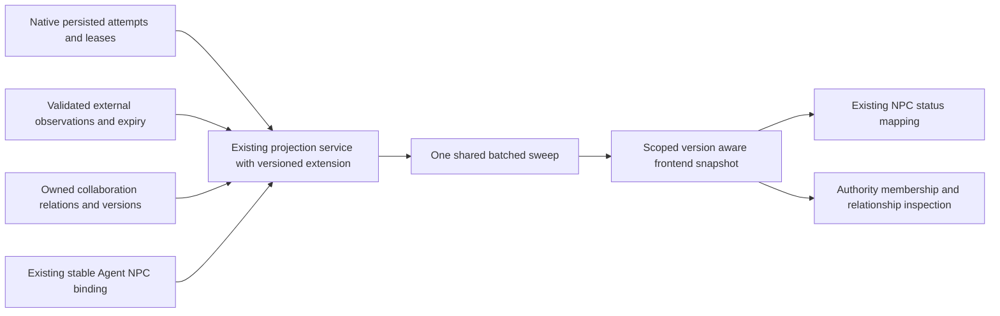

# Proposed Phase 5 architecture

**Final Phase 5 status (2026-10-29): ACCEPTED for the approved local scope; T01-T12 complete.** See [canonical acceptance, current contracts and limitations](acceptance.md). Task-date proposals, checkpoints, counts and future-task statements below are historical, not additional implemented capabilities or current roadmap status.

**T10 checkpoint (2026-10-29):** Frontend collaboration inspection and the distinct local collaboration-read audience are implemented; see [actual architecture, contracts, security and test evidence](frontend-collaboration.md). Historical proposed contracts below are task-date planning, not additional implemented endpoints. T11/T12 remain planned.

**T09 checkpoint (2026-10-28):** [Collaboration activity projection](collaboration-activity.md) provides operator-authorized version-2 snapshots, bounded relationships/history, explicit native/external provenance and native event cursor hints. It composes existing Phase 3 SQL/mapper and T07 observations without provider calls or lifecycle writes. V1 city routes remain unchanged; T10-T12 remain planned. Earlier snapshots below are historical.

**T08 checkpoint (2026-10-28):** [LangGraph reference integration](reference-integration.md) adds one observation-only compiled adapter, explicit discovery/approval/poll/result commands, real pinned-server verification and T07 inbox reconciliation. No external dispatch/cancel, public webhook, scheduler, activity API or city/UI change. Earlier task snapshots below are historical.

**T07 checkpoint (2026-10-28):** [External mappings and ingestion](external-ingestion.md) implement durable source incarnations, explicit identity approval, authenticated internal receipt, conservative ordered observation and bounded replay. External data never mutates native work. Real providers/public webhooks/polling and activity/UI integration remain deferred. Earlier task/planning snapshots below are historical.

**T06 checkpoint (2026-10-28):** [External adapter foundation](adapter-foundation.md) implements provider-neutral contracts, capability/ownership gates, trusted configuration and bounded transport with an empty production registry. No real provider, external persistence/ingestion or dispatch is implemented. Earlier planning/task snapshots below are historical.

**T05 checkpoint (2026-10-27):** [Lifecycle and recovery](lifecycle-recovery.md) adds bounded operator reconciliation, durable cancellation intents, conservative aggregate state and explicit recovery of never-admitted children. Native uncertain outcomes remain quarantined; no worker, scheduler, terminal reset or external integration is introduced. Earlier task checkpoints below are historical.

**T04 checkpoint (2026-10-27):** [Native coordination](native-coordination.md) implements explicit operator activation, one correlated child through the existing Runtime Coordinator, canonical result-reference return and conservative interruption safety. No parent continuation, scheduler, external integration or collaboration UI is added. Earlier task-scoped planning statements below are historical.

**T03 checkpoint (2026-10-27):** [Native delegation request/read APIs](native-delegation-api.md) are implemented for the existing local operator. Broader planning and T01/T02 records below are historical/task-scoped; acceptance, child execution, external integrations and collaboration UI remain deferred.

**T02 checkpoint (2026-10-27):** Internal collaboration domain/persistence is implemented and verified in [the persistence reference](persistence.md). The T01 design/audit below is retained as its planning-date record; APIs, runtime delegation and external integration remain unimplemented.

**PROPOSED, not implemented.** See [audit](current-system-audit.md), [domain](domain-model.md) and [ADRs](decisions.md). Deployment remains trusted local by default; this plan is not production authorization approval.

## Scope and incremental ownership

Mandatory native MVP: owner-scoped collaboration session, explicit participants, bounded parent/child delegation and handoff records, correlated existing Tasks/Executions, fail-closed admission, status/history, cancellation intent/reconciliation and inspection. Limit first recipe to a linear A-to-B-to-A continuation with at most three work Tasks and depth two, no fanout/cycles or automatic retries. Proposed limits require T03 validation; they are not current product restrictions. A handoff is explicit and operator-approved, not model text granting authority.

Mandatory external MVP: generic capability-aware observation adapter boundary, provisioned orchestrator identity, namespaced external mapping, authenticated bounded ingestion/reconciliation, health/freshness and one real verified reference endpoint in T08. A deterministic mock validates early contracts but cannot satisfy real integration acceptance. Choosing that endpoint is a T08 gate.

Mandatory city slice: existing inspector adds authority, membership, relationships and bounded handoff history; same resident bindings/sprites/camera, restrained Icy White #F2F9FF styling, keyboard access and stale/unknown labels. No network-dependent movement or animation.

Optional/gated: external controlled dispatch/cancel/result retrieval only when individually proven; signed webhook ingestion only after a suitable authenticated deployment boundary exists. Defer autonomous planning, arbitrary DAG scheduling, durable detached native execution, cross-owner delegation, graph editors, graph-wide effects, Agent memory/RAG/new tools/providers and city redesign.

| Component | Ownership and responsibility |
| --- | --- |
| Agent Registry | Owned internal identity, lifecycle/capabilities and route; external Agent becomes an explicitly mapped EXTERNAL identity, not a native strategy |
| Runtime Coordinator | Sole native execution admission/run/finalization, existing rules unchanged; never invokes external workflows as native attempts |
| Collaboration domain service | Session membership, explicit handoff intent, Task relationships, authorized bounded sequencing and aggregate status; no second strategy engine |
| Adapter registry/service | Server-side configuration reference, capability negotiation, connection generation, optional remote commands; remote scheduler owns external work |
| External mapping/ingestion | Namespace resolution, validated durable observations, dedupe/order/reconciliation, authority-specific persistence; no native transition privilege |
| Activity projection | Compose owned native observations and separate external observations, collaboration references and connection freshness |
| API layer | Explicit audiences, same-owner validation, versions, limits, disclosure and command audit |
| Frontend / NPC system | Existing typed reads/actions, explicit operator intent and accessible relationships; no scheduler or orchestrator credentials |

## Ownership matrix

| Mode | Execution authority | Commands | Terminal truth |
| --- | --- | --- | --- |
| Native | Existing Elyqreth coordinator | Explicit bounded collaboration step through native admission | Existing native lifecycle/result transaction |
| External observation-only | Configured external system | None, even if a remote SDK has mutation methods | Validated external evidence; unsupported status remains UNKNOWN |
| External controlled dispatch | Configured external system | Separately allowed capability + local authorization + durable intent | Same external authority; local command acknowledgement is not completion |

The `orchestrators` table is the provider registration foundation; do not create a duplicate ExternalOrchestrator registry. Adapter type/version lives in a typed validated descriptor, not client-supplied arbitrary code/configuration. Connection health is independent of registration and work status.

Approach A gives direct owned persistence and predictable admission, but risks building a scheduler. Approach B preserves remote workflow ownership, but introduces mapping, untrusted events and partial capabilities. Recommendation: support both through shared identity/correlation/projection contracts, with separate native command and external observation application paths. Never translate external events into native control commands.

## Projection compatibility

Leave existing city schemaVersion 1 payload and Phase 4 consumers unchanged initially. T09 introduces an explicitly versioned collaboration/activity extension through the existing city-read controller/service and shared scheduler. Do not attach unrecognized fields to strict v1 clients. Opt-in v2 negotiation and strict client support land together in T09/T10; v1 remains available for native Agents. Until then EXTERNAL activity remains conservative, not fabricated live status.

Versioned rows add `executionAuthority`, `sourceOrchestratorId`, source observation/version/expiry, connection state, and a bounded collaboration summary (`sessionId`, membership role, status, selected delegation reference). Never infer authority from Agent name. Exactly one mapped authority supplies an Agent's live activity; conflicted or unmapped sources become UNKNOWN. Membership may list multiple sessions with bounded pagination; one selected historical collaboration never replaces Agent-wide current work.

No per-NPC requests or second external poller in the browser. Backend adapter polling is per configured provider with bounded pages/backoff; this is remote ingestion, not a replacement for city synchronization. T09/T10 choose compatible batching so collaboration references do not cause result/history fanout.
