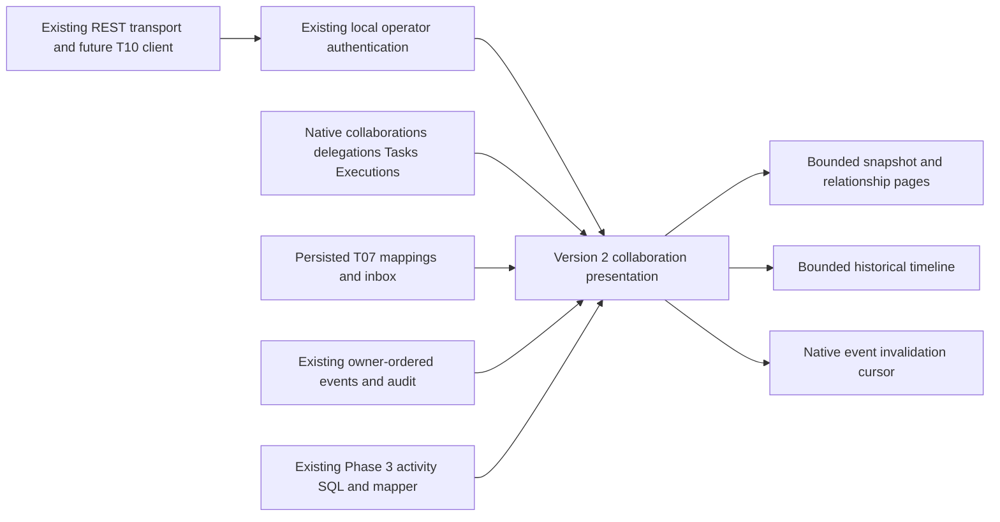

# T09 - Collaboration activity projection and APIs

**Final Phase 5 status (2026-10-29): ACCEPTED for the approved local scope; T01-T12 complete.** See [canonical acceptance, current contracts and limitations](acceptance.md). Task-date proposals, checkpoints, counts and future-task statements below are historical, not additional implemented capabilities or current roadmap status.

Reviewed 2026-10-28, Asia/Bangkok. **T09 COMPLETE for the approved local operator read-model scope.** Final status and reproducible checks are recorded in [T09 evidence](verification-evidence/t09-verification.json). T10-T12 remain planned. This is a backend read model, not a new scheduler or authority and not a production security approval.

## Audit and ownership

T01 architecture/ADRs, actual T02-T08 persistence, lifecycle, adapter and ingestion code/evidence were reviewed. Phase 3 uses shared bounded REST polling with strict version-1 responses, stable Agent/NPC bindings, request cancellation and reconnect. There is no SSE/WebSocket transport, worker, broker or background provider sweep to extend. The existing provider source remains LangGraph observation-only; T08 did not enable optional dispatch/cancellation.

The repository has no Git metadata; status, diff and staged inspection cannot establish version-control state. Applicable AGENTS.md searches found none. A maintained-file SHA-256 baseline preserves prior work. The fixed-owner loopback development/test boundary remains in force; production tenant/principal authorization is not implemented or simulated.

| Source | Authority and use |
| --- | --- |
| Native Execution/Task persistence | Existing Runtime Coordinator owns lifecycle/results; projection selects safe references and actual statuses |
| Collaboration/delegation persistence | T02-T05 own transitions, returns and aggregate status; counts never replace their policy |
| External mapping/inbox | T07 stores accepted provider observations; external provider remains execution authority |
| Connection configuration/registration | Used only to identify retired/disabled incarnations; no provider health inference |
| Phase 3 Agent projection | Existing activitySql and mapAgentActivity reused within the read transaction; v1 routes/semantics unchanged |
| NPC/frontend | Presentation remains separate; no browser, binding, movement or rendering changes |

No read calls Runtime Coordinator, native reconciliation, external adapters, providers or ingestion. Transactions are explicitly READ ONLY and REPEATABLE READ. Reads append no lifecycle facts, audit rows or inbox state. Native lifecycle and external source status are never merged into a persistence enum.

## Architecture and response model

The new controller/service/contract live alongside the existing city activity projection and are registered through CityModule. The existing Phase 3 SQL builder and mapper are composed for the Agent view; there is no second native activity state machine or persisted projection cache.

Every new response has schemaVersion 2 and a server observedAt timestamp. Existing /cities/elyqreth/agents and /agents/:id/activity responses remain schemaVersion 1. The new path avoids breaking strict existing clients or silently expanding the city-read token's data access. T10 must add explicit v2 validation and use the established shared polling scheduler/authorized transport; it must not pass these objects to a v1 parser.

Core provider-neutral types are in collaboration-activity.contract.ts. Activity identity uses delegation:UUID or external:mappingUUID. A native Execution reference explicitly carries authority NATIVE, native executionId, taskId, agentId and current persisted status/version where applicable. External references explicitly carry authority EXTERNAL, mappingId, sourceId, connectionId, namespace/generation, provider Agent/Execution IDs, raw sourceStatus and normalized status. No external ID is accepted as a native Execution identity. Timeline references are identity/provenance only, not historical copies of current Execution state.

A snapshot contains:

- Authoritative collaboration ID, authority, status, version, optional root Task and actual creation/update/terminal timestamps.
- Active participant count and exact delegation counts: total, active (ACCEPTED/EXECUTING/AWAITING_RETURN), completed, failed (FAILED/REJECTED/EXPIRED), cancelled. REQUESTED contributes to total, not active. Counts do not infer completion, retryability or parent success.
- Paginated participant memberships with stable IDs, Agent UUID, role, join and optional leave times. Historical left memberships remain identifiable.
- Paginated directed delegations with source/target Agent IDs, parent/child Tasks, source attempt reference, persisted delegation status/version/times and exact native child Execution reference where supported.
- Paginated explicitly correlated external observations, independently scoped to the source incarnation. No fabricated Task, participant, delegation or internal Agent is added.
- progress:null. There are no measured percentages in the source contracts.

Agent views contain unchanged baseActivity from Phase 3, a bounded collaboration membership page, and a separate external observation page. External rows are last accepted observations, not an implicit current active Execution. Their UUID ordering does not mean most recent or active. Historical selection must not drive live NPC state. Standalone native work remains represented by baseActivity; a delegation snapshot provides its explicit relationship.

No instructions, request hashes, idempotency credentials, raw provider metadata, native result payloads, provider result contents, private errors or stack traces are selected. External resultAvailability is NOT_PROJECTED and operations is empty; the presence of an observed completed state grants no result/dispatch/cancellation permission.

## HTTP contracts

All endpoints are GET under /api/v1/collaboration-activity, use the existing local operator bearer credential, reject nonempty bodies and unknown/duplicate/non-scalar query fields, and return existing safe correlated error responses. City-read and interaction credentials are not substitutes. Read APIs do not grant T03/T04 mutation rights.

| Route suffix | Query | Response |
| --- | --- | --- |
| / | limit, after, authority, status, agentId | Authorized collaboration summaries |
| /:sessionId/snapshot | limit, participantsAfter, delegationsAfter, externalAfter | Coherent collaboration snapshot with independent nested pages |
| /agents/:agentId | limit, after, externalAfter | Phase 3 base activity, membership page and external observation page |
| /:sessionId/timeline | limit, cursor | Verifiable persisted historical activity |
| /:sessionId/events | limit, afterPosition | Native commit-ordered event invalidations, not a universal external stream |

Default page size is 10, maximum 20. UUID pages order by stable row/session UUID, select limit+1 and return nextCursor or null. UUIDs must validate; authority is NATIVE or EXTERNAL, status is an actual collaboration lifecycle value. Agent membership/authority/status predicates apply before pagination. No unbounded time-range, arbitrary field filter or global event feed is offered. Every query filters the fixed authenticated owner; inaccessible collaboration/Agent IDs produce the same safe 404 as missing ones.

A snapshot's sections are individually pageable. Each response uses one repeatable-read snapshot across its count/relationship/source queries. Multiple page requests are separate current snapshots, not an exported PostgreSQL snapshot session. Clients should refresh/reset accumulated pages if membership/lifecycle versions change, and always reinitialize on owner/session changes. No transaction remains open across HTTP requests.

## Timeline, incremental polling and reconnect

The timeline merges only verifiable source records:

- Existing collaboration/delegation events and exactly associated native child Execution events.
- Existing cancellation requests and actual recovery dispatch/blocked audit records, without duplicating the ordinary event-backed audit records.
- Durable external Execution receipts explicitly matching the owned collaboration/mapping/source. Their processingStatus distinguishes accepted/applied/stale/deferred evidence; a received provider claim is not presented as confirmed native success.

Timeline identity is source-prefixed event/audit/inbox UUID. Duplicate provider delivery has one durable inbox identity. Ordering is receipt/database creation time descending, then source-prefixed ID; sourceOccurredAt is separate when supported. The browsing cursor preserves PostgreSQL microseconds and owner/session context. Each source applies the cursor and limit+1 before the final bounded merge. A cursor is not a signed authorization token or an incremental feed position; ownership checks always run. Malformed/context-mismatched cursors produce 409 and require snapshot/history refresh. Retained records are not silently deleted or expired by this task.

The events endpoint reuses native owner_streams and agent_events.stream_position. The existing trigger serializes owner positions through commit, preventing unsafe serial-ID commit gaps. A snapshot returns nativeAfterPosition from the same MVCC snapshot. Poll afterPosition, process/dedupe events by UUID, then use nextPosition; hasMore requests another bounded page. A current empty page advances to the owner high-water mark. Positions are decimal strings within signed PostgreSQL bigint range, owner-wide and filtered to the selected collaboration/explicit child attempt. A future position returns 409; malformed positions return 400.

Native events are invalidation hints: refetch snapshots for current state rather than building another client lifecycle machine. Historical relationships associated after their original events also require snapshot refresh. Existing append-only history permits replay of old valid positions; there is no invented cursor-expiry interval. Cache keys must include authenticated identity and collaboration.

External inbox receipt UUID/time cannot safely promise a commit-ordered incremental change log. Every snapshot/events response therefore explicitly sets externalSnapshotRequired:true. Reconnect restores a snapshot and resumes native hints where useful; external state is refreshed by bounded snapshot polling. No second real-time transport, per-Agent connection, scheduler or provider request is introduced. Frontend network failure is separate from provider staleness.

## Freshness and unavailable sources

External sourceOccurredAt, last accepted observedAt and mapping updatedAt remain distinct. The read model never treats browser receipt time as provider ordering. RECENT_OBSERVATION means the last accepted evidence is at most 30 seconds old, not verified connectivity or runnable eligibility. STALE means older evidence; UNKNOWN means no accepted observation. RETIRED means mapping/registration/current configured incarnation is absent, disabled or superseded. This is a read-model labeling threshold, not a runtime timeout or failure policy.

ConnectionHealth is UNKNOWN because T06/T08 do not persist a current health record for these reads. No health check is performed on a frontend request. An unreachable/disabled provider never turns RUNNING into FAILED. Raw unknown states remain available with normalized UNKNOWN; older retained source incarnations remain distinguishable. T08's partial-order/deferred-state limitations still apply. Nothing claims real-time liveness or external collaboration completion.

## Query bounds, migrations and diagnostics

Reads select safe columns, not full Tasks, Executions or result blobs. There is no application N+1 result/provider fanout. Snapshot queries have a fixed number of calls independent of page row count. Event/timeline authorization uses a cheap owner/session existence lookup rather than recomputing summary counts on each poll. Exact summary counts scan only the selected owned collaboration's indexed relationships; they are not a universal full-database aggregate.

Migration 0009_zippy_lockheed.sql is additive: owner/collaboration/createdAt/id event-history index and owner/source/externalExecutionId/createdAt/id partial inbox index. Existing membership, delegation, external-map, audit-resource and native owner-position indexes are reused. Fresh and populated prior-schema migration coverage runs through the established database harness. Historical migrations and rows are not rewritten; no reset or new database engine is introduced. Apply through existing db:migrate in an authorized maintenance window; CREATE INDEX is not advertised as lock-free on a large deployment.

Integration tests check the indexes and use EXPLAIN with sequential scans disabled to establish native owner/collaboration index support. This is not a scaled production load benchmark or a claim that every small fixture plan selects an index by default. Each timeline branch and response page is bounded; the response cap is 64 KiB and existing query/pool timeouts apply. Large histories still depend on database plan/cardinality and should be profiled before production use.

Existing ApiLogger records projection operation, duration and response bytes, using request correlation context; safe failure codes omit provider/Task payloads. Existing guards/filters handle unauthorized access and sanitized errors. There is no high-cardinality metrics registry, new monitoring platform, persistent read cache or background subscription to leak.

## Verification and T10 prerequisites

Use root npm.cmd run lint, npm.cmd run build, npm.cmd run test:api, npm.cmd run test:db and npm.cmd run db:check. Focused projection verification uses the existing real PostgreSQL harness with a test-name pattern recorded in the evidence. New tests cover strict filters/cursors/freshness, actual native child runtime execution, external mapping/ingestion, mixed authority summaries, dedupe/timeline pages, reconnect cursor replay, unauthorized/missing/cross-owner access, bounded pages, disabled sources, SQL index support and concurrent membership changes inside a coherent snapshot. Read-only transactions and unchanged command-audit/native state are explicitly verified.

T08 captured provider fixtures and existing integration tests remain active, but this task does not rerun a live provider or introduce an adapter. Full existing native/backend/browser regressions verify Phase 1-5 and Phase 3/4 compatibility. Hosted CI is not claimed executed. T10 must implement v2 validation, accessible inspection, explicit operator authorization/session isolation, shared scheduler/reconnect integration and current-versus-historical presentation. It must preserve v1 and must not render results or execution controls merely because an external observation exists.

## Remaining risks

| Risk | Severity / scope | Mitigation / follow-up |
| --- | --- | --- |
| No production principal/tenant security | High; blocks public exposure, outside approved local acceptance | Fixed-owner loopback authentication and all SQL owner filters; separate deployment/security work required |
| External incremental continuity unsupported | Medium; explicit limitation | externalSnapshotRequired and bounded snapshot polling; no false commit-order claim |
| External liveness/health unknown | Medium | Age/provenance/retired indicators, no fabricated failure; future health persistence needs separate review |
| Independently requested pages can change | Low | Per-response MVCC coherence, stable cursors, version-aware refresh and reconnect snapshot |
| Scaled production query behavior unmeasured | Medium | New targeted indexes, page/byte/time limits and actual fixture plans; profile representative data before production |

No frontend or city rendering implementation belongs to T09. T10-T12 remain planned.

## Final verification checkpoint

Build, lint and standalone backend no-emit typecheck pass. Full backend suite: 269 passed, zero failed/skipped. Full PostgreSQL/Nest/native/browser suite: 205 passed, zero failed/skipped, including nine T09 API/projection/security/consistency cases. After the final recovery-audit whitelist correction, all nine projection cases were rerun and passed. Drizzle migration generation and metadata checks pass. The final timeline source limits, canonical dates and read-only snapshot behavior are covered by PostgreSQL tests. No live provider or hosted CI execution is claimed; T08 source files remain unchanged. Owned Docker test containers/volumes were absent after cleanup.

## Continuation recovery verification

[Recovery review, 2026-10-29](t09-continuation.md): saved implementation and original log hashes confirmed; no code changes required. Fresh lint, backend typecheck/build, migration check, 269 backend tests and 205 PostgreSQL/API/browser regressions passed without skips. The initial stopped-Docker prerequisite was restored before the successful rerun. T10-T12 remain planned.

## T10 browser read audience

The existing operator credential remains supported. T10 additionally permits a separately configured `COLLABORATION_READ_TOKEN` only on this GET controller when `COLLABORATION_READ_ENABLED=true`. It retains the fixed-owner/exact-origin/loopback development boundary and does not authorize native payload reads or any collaboration mutation. Existing city and interaction tokens do not gain implicit access. See [frontend inspection and setup](frontend-collaboration.md). Version-2 DTOs, read transactions and native/external lifecycle ownership are unchanged.
