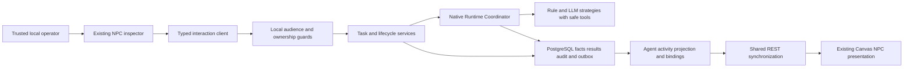

# Current architecture audit

**Final Phase 5 status (2026-10-29): ACCEPTED for the approved local scope; T01-T12 complete.** See [canonical acceptance, current contracts and limitations](acceptance.md). Task-date proposals, checkpoints, counts and future-task statements below are historical, not additional implemented capabilities or current roadmap status.

**T09 checkpoint (2026-10-28):** [Collaboration activity projection](collaboration-activity.md) provides operator-authorized version-2 snapshots, bounded relationships/history, explicit native/external provenance and native event cursor hints. It composes existing Phase 3 SQL/mapper and T07 observations without provider calls or lifecycle writes. V1 city routes remain unchanged; T10-T12 remain planned. Earlier snapshots below are historical.

**T08 checkpoint (2026-10-28):** [LangGraph reference integration](reference-integration.md) adds one observation-only compiled adapter, explicit discovery/approval/poll/result commands, real pinned-server verification and T07 inbox reconciliation. No external dispatch/cancel, public webhook, scheduler, activity API or city/UI change. Earlier task snapshots below are historical.

**T07 checkpoint (2026-10-28):** [External mappings and ingestion](external-ingestion.md) implement durable source incarnations, explicit identity approval, authenticated internal receipt, conservative ordered observation and bounded replay. External data never mutates native work. Real providers/public webhooks/polling and activity/UI integration remain deferred. Earlier task/planning snapshots below are historical.

**T06 checkpoint (2026-10-28):** [External adapter foundation](adapter-foundation.md) implements provider-neutral contracts, capability/ownership gates, trusted configuration and bounded transport with an empty production registry. No real provider, external persistence/ingestion or dispatch is implemented. Earlier planning/task snapshots below are historical.

**T04 checkpoint (2026-10-27):** [Native coordination](native-coordination.md) implements explicit operator activation, one correlated child through the existing Runtime Coordinator, canonical result-reference return and conservative interruption safety. No parent continuation, scheduler, external integration or collaboration UI is added. Earlier task-scoped planning statements below are historical.

**T03 checkpoint (2026-10-27):** [Native delegation request/read APIs](native-delegation-api.md) are implemented for the existing local operator. Broader planning and T01/T02 records below are historical/task-scoped; acceptance, child execution, external integrations and collaboration UI remain deferred.

**T02 checkpoint (2026-10-27):** Internal collaboration domain/persistence is implemented and verified in [the persistence reference](persistence.md). The T01 design/audit below is retained as its planning-date record; APIs, runtime delegation and external integration remain unimplemented.

Date: 2026-10-27. Repository code is the source of truth. All paths below are relative to the workspace root; they describe IMPLEMENTED foundations, not Phase 5 features.

## Repository and preservation

Root/accessible ancestor and maintained-source searches found no applicable AGENTS.md. `git status --short` failed (128); `git diff --stat` failed (129): no Git metadata is supplied. Branch, untracked classification and a Git diff cannot be verified. A pre-edit SHA-256 baseline covers 415 maintained files, including existing uncommitted-looking Phase 4 reports; final preservation is recorded in [verification](verification.md). No worktree reset or Git mutation is performed.

`dist/` is hand-maintained vanilla JavaScript/Canvas source, not disposable build output. There is no React, new query library or worker platform to adopt implicitly. Root README, platform index, Phase 1-4 architecture/acceptance, Phase 4 ADRs, CI and local Compose were reviewed. Earlier architecture proposals in [orchestration contracts](../orchestration-contracts.md) are not implemented external APIs.

## Implemented architecture and confirmed gaps

| Area / inspected source | Reusable behavior | Confirmed gap / consequence |
| --- | --- | --- |
| `apps/api/src/database/schema.ts`, migrations | PostgreSQL/Drizzle owners, orchestrators, Agents, Tasks, Executions, results, events/outbox, command audit and city bindings; same-owner composite FKs/versioning | No collaboration, delegation, participant, external Agent mapping or inbox tables; no parent Task link |
| `agents/agents.service.ts`, `agents/dto/` | Stable owned IDs, safe DTO, ACTIVE/DISABLED/ARCHIVED, RULE_BASED/LLM/EXTERNAL | EXTERNAL type is a schema capability, not a working remote integration; no adapter registration service |
| `tasks/tasks.service.ts`, `lifecycle/`, `executions/` | Owner-scoped Task idempotency, locked lifecycle, attempt identity, safe results, versions | No authorized Agent-to-Agent delegation command or automatic retry scheduler |
| `runtime/runtime-coordinator.ts`, `runtime-persistence.service.ts` | Native admission, deadline/cancel/heartbeat, persisted result/finalization; one active call per coordinator and DB native-running fence per Agent | Recursive parent-to-child calls on the same active coordinator fail capacity admission. No durable worker resumes a crashed run |
| `runtime/contracts/agent-strategy.contract.ts`, `strategy-registry.ts` | Explicit `text.stats.v1` and `llm.text.v1` strategies, typed request/context/result | No delegation tool or general orchestration engine. Do not add arbitrary model-selected tools or agents |
| `runtime/http/`, `interaction/`, Task/Execution controllers | Save then synchronous Start, versioned Cancel, details/results, bounded Agent history, exact-key recovery | HTTP Start is bounded to 30s and tied to request lifetime; not detached dispatch. Browser client wait is distinct from cancellation |
| `common/local-access.guard.ts`, `interaction/` guards | Separate local operator/read/interaction capabilities, current binding/Agent admission, fixed persisted owner | No production human login/tenants or service-to-service external ingestion audience. New routes are not automatically authorized |
| `events/events.service.ts`, `common/persistence.ts` | Transactional facts/audit, owner stream order, source event identity, trigger-created outbox | Outbox persistence exists; publisher/consumer does not. Event aggregate checks/contract allow-lists currently exclude collaboration; cannot append arbitrary new facts unchanged |
| `city/activity.*`, `binding.*` | Stable persisted Agent-to-NPC mapping, deterministic activity projection, IDLE/QUEUED/RUNNING/UNKNOWN and separate outcome | External liveness is conservatively unverified. An adapter observation cannot silently override the native lease interpretation |
| `dist/js/runtime/{sync-controller,runtime-store,npc-runtime-binding}.js` | One shared batched REST sweep, normal 2s interval, stale 6s/unknown 30s, max 20/page and 100/sweep | No external transport or collaboration subscription. Keep shared scheduling; do not add per-NPC polling |
| `runtime/interaction/session.js`, submission/lifecycle/results owners, panel | Stable scope/generation/version guards, bounded results/history and identifier-only reload recovery | No collaboration UI or external action eligibility. Read/interaction backend origins are manually configured, not identity-pinned |
| `docker-compose.yml`, Dockerfile, `.github/workflows/verify.yml` | Local web/API/PostgreSQL; owned isolated PG tests and Chrome E2E | No broker/Redis/worker. Protected APIs remain disabled in bridged Compose; no remote webhook exposure supported |

Existing Execution fields already include `authority: NATIVE|EXTERNAL`, `externalExecutionId`, `adapterKey`, `configVersion`, `submissionKey`, lease fields and unique external identity `(orchestratorId, externalExecutionId)`. Reuse these deliberately; their existence proves neither event ingestion nor safe external lifecycle application. Existing durable source-event keys similarly do not implement an inbox.

## Phase 4 readiness

**READY within its approved trusted, single-backend loopback development/test scope**, supported by [final acceptance](../phase-4/acceptance.md) and [recorded commands](../phase-4/verification-evidence/t10-verification.json): 209 frontend/198 backend units in the successful rollup prefix, 122 real PG/API cases, 18 affected cases rerun, native interaction/city E2E and Chrome hardening. The initial wrapper exited 1 when Docker was stopped; later component passes are individually recorded. This audit verifies retained artifacts and code alignment, not a fresh runtime test execution or hosted CI result.

Public deployment remains NOT READY: production identity/tenancy, quotas and operational recovery prerequisites are unresolved. Hard crashes may leave RUNNING persisted with UNKNOWN liveness and quarantine. Those limitations become explicit Phase 5 gates; T01 does not repair Phase 4.

