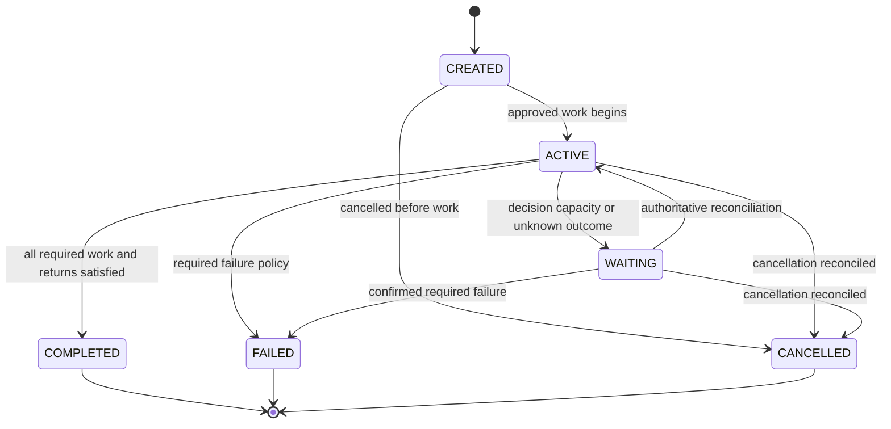

# Phase 5 architecture decision register

**Final Phase 5 status (2026-10-29): ACCEPTED for the approved local scope; T01-T12 complete.** See [canonical acceptance, current contracts and limitations](acceptance.md). Task-date proposals, checkpoints, counts and future-task statements below are historical, not additional implemented capabilities or current roadmap status.

**T09 checkpoint (2026-10-28):** [Collaboration activity projection](collaboration-activity.md) provides operator-authorized version-2 snapshots, bounded relationships/history, explicit native/external provenance and native event cursor hints. It composes existing Phase 3 SQL/mapper and T07 observations without provider calls or lifecycle writes. V1 city routes remain unchanged; T10-T12 remain planned. Earlier snapshots below are historical.

**T08 checkpoint (2026-10-28):** [LangGraph reference integration](reference-integration.md) adds one observation-only compiled adapter, explicit discovery/approval/poll/result commands, real pinned-server verification and T07 inbox reconciliation. No external dispatch/cancel, public webhook, scheduler, activity API or city/UI change. Earlier task snapshots below are historical.

**T07 checkpoint (2026-10-28):** [External mappings and ingestion](external-ingestion.md) implement durable source incarnations, explicit identity approval, authenticated internal receipt, conservative ordered observation and bounded replay. External data never mutates native work. Real providers/public webhooks/polling and activity/UI integration remain deferred. Earlier task/planning snapshots below are historical.

**T06 checkpoint (2026-10-28):** [External adapter foundation](adapter-foundation.md) implements provider-neutral contracts, capability/ownership gates, trusted configuration and bounded transport with an empty production registry. No real provider, external persistence/ingestion or dispatch is implemented. Earlier planning/task snapshots below are historical.

**T05 checkpoint (2026-10-27):** [Lifecycle and recovery](lifecycle-recovery.md) adds bounded operator reconciliation, durable cancellation intents, conservative aggregate state and explicit recovery of never-admitted children. Native uncertain outcomes remain quarantined; no worker, scheduler, terminal reset or external integration is introduced. Earlier task checkpoints below are historical.

**T04 checkpoint (2026-10-27):** [Native coordination](native-coordination.md) implements explicit operator activation, one correlated child through the existing Runtime Coordinator, canonical result-reference return and conservative interruption safety. No parent continuation, scheduler, external integration or collaboration UI is added. Earlier task-scoped planning statements below are historical.

**T03 checkpoint (2026-10-27):** [Native delegation request/read APIs](native-delegation-api.md) are implemented for the existing local operator. Broader planning and T01/T02 records below are historical/task-scoped; acceptance, child execution, external integrations and collaboration UI remain deferred.

**T02 checkpoint (2026-10-27):** Internal collaboration domain/persistence is implemented and verified in [the persistence reference](persistence.md). The T01 design/audit below is retained as its planning-date record; APIs, runtime delegation and external integration remain unimplemented.

Date: 2026-10-27. **Architecture decisions accepted for planning; implementations PLANNED.** Phase-local numbering follows P4-ADR conventions without renumbering historical decisions. Refines [existing orchestration contracts](../orchestration-contracts.md) rather than asserting a new engine is needed.

## P5-ADR-001 - Separate native coordination and external execution ownership

Context: existing coordinator owns native leases/admission; external workflows have their own scheduling. Decision: limited explicit staged native handoffs and a separate capability-gated external observation/command path. Alternatives: universal replacement scheduler or all work represented as native; rejected because authority/cancel/recovery semantics differ. Consequence: shared correlation/projection, separate writers. T04/T06/T07 must prove no dual dispatch. Observation-only never implies remote control.

## P5-ADR-002 - Minimal relational collaboration persistence

Context: Task input is not an integrity boundary; existing event/outbox/owner schema is useful. Decision: additive Session/Participant/Delegation relations, handoff facts through existing event/audit infrastructure; no separate handoff/event database. Alternatives: arbitrary JSON relationships or duplicate Task model; rejected for FK/idempotency and history ambiguity. Consequence: T02 evolves event aggregate checks/contracts explicitly and proves migration compatibility; external inbox belongs to T07.

## P5-ADR-003 - Parent/child correlation without suspended native attempts

Context: one active coordinator call, terminal native Task transitions immutable. Decision: delegation is canonical Task ancestry, exact attempt references and new continuation Task after safe result return. Terminal A precedes B admission; no recursive A waiting on B. Alternative: new Task WAITING enum or nested coordinator instance per child; rejected as lifecycle/scheduling redesign. Consequence: operator-driven bounded sequence, not autonomous resumption; T03/T04 finalize limits and real execution evidence.

## P5-ADR-004 - Capability-intersection adapters, observation first

Context: library, deployed server and credential capabilities differ. Decision: only describe/health required; optional discovery/status/event/result/dispatch/cancel via explicit effective intersection. Start with generic read-only reference; no production provider selection in T01. Alternatives: require every adapter to implement all commands or assume OpenAI-compatible means orchestration; rejected. Consequence: unsupported controls hidden/denied, unknown dispatch blocked without remote recovery evidence. T06/T08 own proof.

## P5-ADR-005 - Owner/provider/namespace/incarnation identity

Context: external IDs collide and may be reused. Decision: map external identities through configured orchestrator/namespace/source generation to an approved EXTERNAL internal Agent; reuse persisted NPC binding. Alternatives: names/global source IDs or automatic NPC spawning; rejected. Consequence: tombstones/versioned remap, no re-registration takeover; T07 resolves existing external Execution uniqueness compatibility before writes.

## P5-ADR-006 - Transactional inbox and conservative external ordering

Context: existing outbox has no publisher and source stream may be unordered. Decision: durable inbox/checkpoint/application transaction; compare only valid source aggregate versions; otherwise snapshot reconcile and preserve UNKNOWN/gaps. Reuse outbox for facts; add a delivery consumer only if separately required. Alternatives: client-receive-time ordering or exactly-once claim; rejected. Consequence: explicit at-least-once handling, no native lifecycle mutation from external events; T07 tests duplicates/restarts.

## P5-ADR-007 - Versioned projection through existing city synchronization

Context: strict v1 clients and separate native lease/external freshness semantics. Decision: opt-in versioned projection extension, same service/scheduler and stable binding; collaboration/history stays distinct from live Agent activity. Alternatives: per-NPC external polling or replacing rendering/store; rejected. Consequence: T09/T10 preserve v1 and add authority/staleness/capability context without sprite/movement redesign; no claims that unsupported external liveness is confirmed.

## P5-ADR-008 - Explicit delegation and integration trust boundaries

Context: local capability auth is not production principal delegation; model/source content is untrusted. Decision: same-owner approved source/target membership, separately scoped integration auth, server-only secrets, minimal result disclosure and no inherited native admin/tool privilege. Public ingress/tenants BLOCKED pending separate approval. Alternatives: model-selected targets or trusting callback owner fields; rejected. Consequence: T03/T06/T07/T11 actual object-level/source security tests, no production-readiness claim inherited from Phase 4.

## Proposed collaboration lifecycle diagram

These are collaboration states only; native Task/Execution enums are unchanged. Pending cancellation is a separate intent; UNKNOWN/disconnected is an observation quality, not fabricated completion/failure. Allowed transitions must be implemented/tested in T05 before any UI treats this proposal as a live contract.

## T07 implementation refinements of P5-ADR-005/006/008

Identity approval may retain an unlinked external Agent mapping; without an existing approved EXTERNAL registry reference it cannot correlate internal collaboration membership or drive an NPC. Source namespace/generation isolates reused IDs; tombstones prevent silent reactivation.

Receipt commitment and application commitment are separate bounded transactions. A durable PENDING acknowledgement is distinct from APPLIED: only the latter commits external projection, inbox processing outcome and audit atomically. This makes the required receipt-before-process interruption replayable without a new worker. No external checkpoint/poll consumer is introduced.

Trusted internal source sessions require existing local operator approval and a reviewed sequence domain, rather than a speculative universal webhook signature. Unknown or unordered source evidence remains deferred. Real provider authentication and authoritative snapshots remain T08 gates; no public production identity or ingress approval is inherited from local acceptance.

## T08 refinement of P5-ADR-004/006/008

Choose LangGraph Agent Server 0.16.8 as the first real observation-only reference. The local Python development deployment supplies actual assistants/runs without paid model calls; hosted and production licensing/authentication remain distinct. Register exactly one compiled adapter. Extend the existing transport only with a bounded assistant-search POST and provider-specific X-Api-Key header selection; no general POST/dispatch seam is exposed.

Trust reviewed monotone per-run lifecycle phases, not receive time or an invented provider revision. Raw provider status and validated normalizedStatus are separate inbox facts. Unknown/resumable interruptions and terminal conflicts remain conservative. Result metadata requires exact completed checkpoint/run provenance and a stable matching output hash; general historical/raw results are not promised. T07 receipt/application transactions, local authority and replay are reused unchanged in ownership. T09 owns subsequent projection, not this adapter.

## T09 refinement of P5-ADR-006/007/008

Compose the existing activitySql/mapAgentActivity in READ ONLY repeatable-read projection transactions. Keep strict v1 city payloads and their limited authentication audience unchanged. The separately versioned /api/v1/collaboration-activity read API requires the existing operator credential; T10 must deliberately validate v2 and cannot silently reuse a city-read token. No broader frontend access is granted.

Reuse native owner-stream positions as invalidation cursors. External receipt UUIDs/timestamps cannot supply equivalent commit-order continuity, so the API explicitly requires external snapshot refresh. Timeline cursors browse retained facts and preserve microsecond ordering; they are not synchronization checkpoints. Age/retired labels describe last accepted observations, not provider health. No new stream transport, scheduler, projection store or lifecycle mutation is introduced.

## T10 refinement of P5-ADR-007/008

T09 operator reads remain valid for backend tools. Frontend inspection adds a distinct optional collaboration-read audience on the same v2 GET controller, under existing exact-origin/loopback/fixed-owner guards. It cannot authorize registry/native payload reads or mutations. Browser credentials are volatile; existing city/interaction credentials do not silently gain T09 access. No provider key or operator token enters the UI.

Compose a panel-scoped CollaborationOwner with existing Phase 3 completed sweeps. Native events invalidate snapshots; external last-known observations require snapshots. Use a bounded directed relationship list instead of the optional city overlay to preserve renderer/camera/NPC behavior. Task/Execution metadata reads reuse separately authorized interaction access without changing lifecycle targets. See [implemented T10 architecture](frontend-collaboration.md). This is a read/presentation boundary, not a new runtime or source of lifecycle truth.
