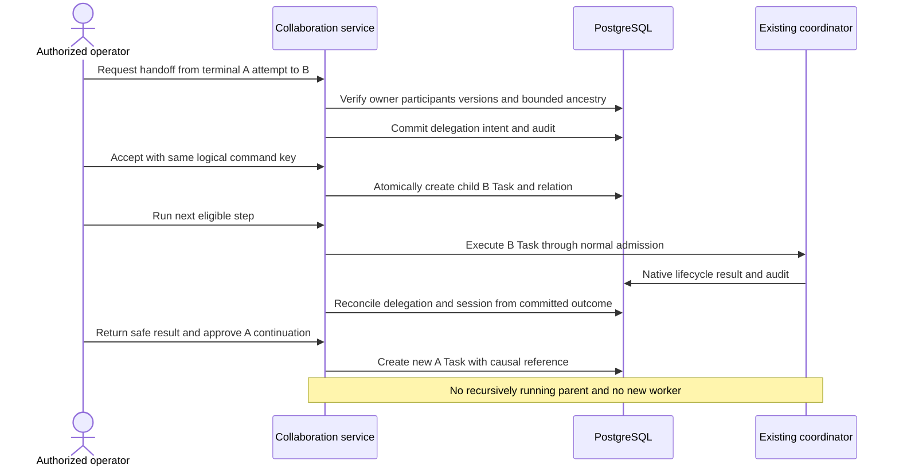

# Proposed delegation and collaboration lifecycle

**Final Phase 5 status (2026-10-29): ACCEPTED for the approved local scope; T01-T12 complete.** See [canonical acceptance, current contracts and limitations](acceptance.md). Task-date proposals, checkpoints, counts and future-task statements below are historical, not additional implemented capabilities or current roadmap status.

**T05 checkpoint (2026-10-27):** [Lifecycle and recovery](lifecycle-recovery.md) adds bounded operator reconciliation, durable cancellation intents, conservative aggregate state and explicit recovery of never-admitted children. Native uncertain outcomes remain quarantined; no worker, scheduler, terminal reset or external integration is introduced. Earlier task checkpoints below are historical.

**T04 checkpoint (2026-10-27):** [Native coordination](native-coordination.md) implements explicit operator activation, one correlated child through the existing Runtime Coordinator, canonical result-reference return and conservative interruption safety. No parent continuation, scheduler, external integration or collaboration UI is added. Earlier task-scoped planning statements below are historical.

**T03 checkpoint (2026-10-27):** [Native delegation request/read APIs](native-delegation-api.md) are implemented for the existing local operator. Broader planning and T01/T02 records below are historical/task-scoped; acceptance, child execution, external integrations and collaboration UI remain deferred.

**PROPOSED for T03-T05; none of these commands/states exist yet.** Native Task CREATED/QUEUED/RUNNING/COMPLETED/FAILED/CANCELLED and Execution PENDING/RUNNING/SUCCEEDED/FAILED/CANCELLED/TIMED_OUT remain unchanged.

## Bounded native workflow

An Agent may suggest a handoff in an allow-listed response contract in a future task, but generated text is untrusted data, not a command. The first MVP uses explicit authenticated operator approval of source/target and minimal disclosed input. No new delegation tool or arbitrary strategy loading is required. Source Execution must be terminal and owned; participants/routes are revalidated at acceptance and child start. An active parent must finish or be explicitly cancelled and finalized before the shared coordinator runs a child.

1. Create a session with approved A/B participants and existing root Task A.
2. Execute A through the existing coordinator. Record its actual outcome.
3. Request a delegation referencing A's Task and exact terminal source Execution. Same-owner authorized operator accepts/rejects the handoff; no authority is inferred from input.
4. Acceptance atomically creates/reuses exactly one child Task for B through existing Task persistence, attaches it to the delegation, and writes facts/audit. It does not start the child inside the transaction.
5. An explicit run-next command starts that eligible child through the coordinator, respecting one-active-call/per-Agent fencing. Busy returns a conflict without a phantom Execution. No parent call holds capacity while awaiting B.
6. Child completion records result availability; authorized return-result links the safe result reference. Failed/unavailable output never counts as success.
7. An explicit continuation may create a new A Task with a disclosed bounded subset of B's output and causal relation. A's earlier terminal Task/Execution is immutable. No automatic parent resumption, prompt concatenation, retry or provider/tool privilege inheritance.

This is limited command-driven collaboration, not autonomous delegation or a durable workflow scheduler. Closing the browser does not implicitly cancel a session, but existing synchronous native execution/request cancellation semantics still apply. Progress is backed by persisted work/relations, never invented percentages.

## Distinct lifecycle owners

| Proposed aggregate | Allowed transitions and terminal behavior |
| --- | --- |
| CollaborationSession | CREATED -> ACTIVE or CANCELLED; ACTIVE -> WAITING/COMPLETED/FAILED/CANCELLED; WAITING -> ACTIVE/FAILED/CANCELLED. Terminal states immutable. COMPLETED requires all required handoffs/continuations terminal-success and result-return obligations satisfied; no open intent/unknown child |
| Delegation | REQUESTED -> ACCEPTED/REJECTED/CANCELLED/EXPIRED; ACCEPTED -> EXECUTING/CANCELLED/FAILED; EXECUTING -> AWAITING_RETURN/FAILED/CANCELLED; AWAITING_RETURN -> COMPLETED/FAILED/CANCELLED. REJECTED/EXPIRED/COMPLETED/FAILED/CANCELLED terminal. Operational UNKNOWN is freshness/attention, not terminal failure |
| Child Task / Execution | Existing native lifecycle alone determines work state. Collaboration WAITING never writes a native WAITING state |
| External session/handoff | Remote ownership; preserve original status and normalize only proven mappings. Never enable local acceptance/start/cancel merely because an observed handoff has the same label |

WAITING means a required decision, capacity, return, retry approval or unresolved observation is outstanding; include a safe reason. A cancellation intent/timestamp is separate from status. Mark session CANCELLED only after no required native child can still run and required supported cancellations are acknowledged terminal. If completion wins, preserve the real child success and record cancellation-too-late; the session decision follows its locked completion/cancel policy, not HTTP receive order. External unsupported cancellation remains WAITING/requiresAttention, not a fabricated CANCELLED state.

MVP failure policy is stop admission of later steps and expose the actual failed/rejected/expired child. Optional participants do not implicitly become required. A retry is an explicitly authorized new linked work Task/attempt allowed by native lifecycle semantics; a terminal Task is never reset. No recursive retry, automatic backtracking, compensation or exactly-once remote effect guarantee.

## Command contracts

Common proposed envelope: `commandId` UUID, `sessionId`, expected session/delegation version, opaque idempotency key (1-128 chars), correlationId UUID, optional causationId and operation-specific references. Caller/owner comes from trusted principal, never body. Persist caller/operation/key and canonical payload hash under a unique constraint; compatible replay returns the original reference, incompatible reuse returns conflict. Idempotency acceptance must revalidate current access. A key is not an authorization credential.

| Operation | Specific input / verified behavior | Deadline, failure and audit |
| --- | --- | --- |
| Request | source Task/Execution, target Agent, proposed parent relation, required flag and bounded instruction | Reject foreign/ineligible Agent, active source, cycle/depth/count breach. Request expiry stored. `delegation.requested` |
| Accept / reject | delegationId, expected version, safe decision reason | Atomically adopt one child Task or persist rejection; one decision wins. `delegation.accepted/rejected` |
| Start delegated work | exact accepted delegation/child Task version | Existing coordinator admission; no child POST retry on unknown outcome. `delegation.started` plus existing lifecycle facts, no duplicate Execution events |
| Report progress | source-authenticated bounded observation with version; native progress only from actual native evidence | No model percentage or privilege update. Audit material milestone only, not per-frame heartbeat |
| Complete / fail | Native internal reconciliation reads terminal attempt; external authenticated adapter supplies source evidence | General browser cannot PATCH a completion. `delegation.work_completed/failed` with safe references |
| Return result | exact child result/Execution reference and approved disclosure subset | Same-owner result authorization and size/privacy checks; result unavailable != success. `delegation.result_returned` |
| Cancel | target delegation/session, versions, optional bounded reason | Record intent first; existing exact-target cancel and reconciliation. `delegation.cancel_requested` and outcome |

Safe proposed error codes include `INVALID_INPUT`, `ACCESS_DENIED`, `NOT_FOUND`, `VERSION_CONFLICT`, `IDEMPOTENCY_CONFLICT`, `CAPACITY_EXCEEDED`, `INVALID_RELATION`, `UNSUPPORTED_CAPABILITY`, `OUTCOME_UNCERTAIN` and `SOURCE_UNAVAILABLE`. T03 reconciles codes with existing HTTP conventions, not a platform-wide error rewrite.

## Recovery and propagation

Task creation and relation/event writes must share a transaction; a lost acceptance response resolves by exact command key. Start intent commits before execution; crash between intent and admission is unresolved until authoritative lookup proves whether a child attempt exists. No automatic redispatch after restart. Run-next remains fenced until explicit reconciliation; a timed-out HTTP response is not evidence of non-execution.

Delegation deadline is distinct from an Execution deadline: before admission, expiry can reject pending work; during execution use the existing deadline/cancel path and wait for persisted outcome. Failed required child prevents session completion; unknown lease blocks progression and propagates attention, not false failure/success. Cancellation admission checks stop unscheduled children; already-running children use existing commands and may complete first. Remote children are cancelled only when supported and authorized, with separate acknowledgement and final evidence.
