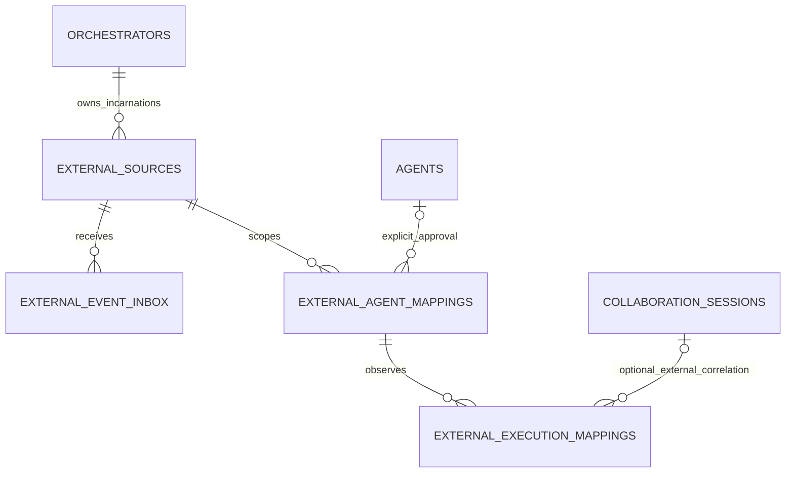

# T07 - External identity mapping and event ingestion

**Final Phase 5 status (2026-10-29): ACCEPTED for the approved local scope; T01-T12 complete.** See [canonical acceptance, current contracts and limitations](acceptance.md). Task-date proposals, checkpoints, counts and future-task statements below are historical, not additional implemented capabilities or current roadmap status.

Later T08 refinement: [LangGraph reference integration](reference-integration.md) supplies a reviewed lifecycle phase domain and optional normalizedStatus through a forward-only evidence-guard migration. The original T07 canonical-only behavior and evidence below remain its historical checkpoint.

Reviewed 2026-10-28, Asia/Bangkok. **T07 COMPLETE for the approved foundation scope.** This is a durable internal external-observation boundary, not a real provider integration or public webhook. Final verification is recorded in [T07 evidence](verification-evidence/t07-verification.json). T08-T12 remain planned.

## Audit and ownership decisions

T01 architecture/ADRs, T02-T05 native collaboration and T06 contracts/evidence were inspected against source. T06 supplies validated connection/namespace/generation descriptors, optional capabilities and a production registry with no adapters. Existing PostgreSQL/Drizzle, owner-scoped repositories, immutable audit and migration tooling are reused. The outbound event_outbox has no publisher and is not an inbound inbox. There is no worker, message broker or scheduled recovery service to extend.

External observations are stored in their own mapping/read-model tables. The existing Runtime Coordinator and native Task/Execution services are not invoked. T07 does not allocate Tasks, internal Executions, Agents or NPCs from provider data. It does not alter native lifecycle enums, indexes, cancellation, results or collaboration completion. The existing external Execution index lacks namespace; this task avoids that collision by not reusing canonical Execution rows at all. Any future real correlated EXTERNAL attempt needs a separately reviewed authorized Task relationship, not a fabricated placeholder.

Git metadata is absent, so Git status/diff/staged/untracked inspection cannot be established through Git. Applicable AGENTS.md searches found none. A pre-edit SHA-256 inventory preserves maintained files and prior work. Public production identity/tenancy remains outside the approved fixed-owner loopback development/test scope.

## Identity model and persistence



Migration `0007_volatile_bloodstorm.sql` adds four tables:

| Table | Identity and integrity |
| --- | --- |
| external_sources | UUID plus owner, existing orchestrator/connection UUID, namespace, generation, adapter type and approved ordering domain. Unique owner/connection/namespace/generation; same-owner orchestrator FK; immutable incarnation |
| external_agent_mappings | UUID, source, case-preserved opaque external ID, optional explicitly approved internal Agent reference, ACTIVE/TOMBSTONED, version/timestamps. Source-scoped uniqueness and same-owner FKs; one active mapping per internal Agent |
| external_execution_mappings | UUID, source-scoped opaque run ID, exact Agent mapping, optional external collaboration/delegation references, last accepted source/normalized status, sequence domain/value, event identity and observation times. This row is an external read model, not a native Execution |
| external_event_inbox | UUID, source-scoped event ID, canonical content hash, bounded normalized envelope, processing status, receipt/processing times and local correlation. Durable uniqueness and owner/source history/recovery indexes |

An internal Agent reference must already exist, be EXTERNAL, belong to the owner and use the same orchestrator route. Disabled Agents may be observed but are never activated by mapping; archived/tombstoned mappings cannot accept new observations. An optional unlinked mapping records an approved external identity without creating or pretending to have an internal Agent. Names and coordinates are never identity keys.

Agent mapping identity and internal reference are immutable. Repeating the same active mapping is idempotent; conflicting reuse fails. Tombstoning requires operator approval and the expected version, cannot reactivate or silently rebind the old row, and preserves history. A new namespace/generation produces distinct identities. Reusing an internal Agent requires explicit retirement of its old active mapping first. An operator for the current owned connection may retire an older incarnation of that same connection; that does not authorize stale event ingestion.

Execution mapping explicitly selects an existing approved external Agent mapping. Optional correlation requires an owned EXTERNAL collaboration, active membership of the mapped internal Agent and, if a delegation is supplied, that exact collaboration/delegation and target Agent. Native collaboration references, foreign ownership and inconsistent targets are rejected. Correlation never updates collaboration/delegation or parent/child Task state. Aggregate external collaboration projection remains T09.

All new FKs restrict deletion/reassignment. Database guards enforce EXTERNAL identity/authority, write-once correlation, monotonic projection evidence and terminal preservation. Projection updates must reference a matching inbox event and approved sequence domain. Existing record-touch triggers maintain versions/timestamps. Source and mapping history is retained; processed receipts cannot be rewritten or deleted. No historical migration is rewritten.

## Trusted ingestion authentication

There is no generic HTTP ingestion, mapping controller, webhook, provider signature implementation or background polling endpoint. The approved boundary is an explicitly operator-authorized internal source session. IngestionAuthority validates the existing local operator credential using a constant-time digest comparison, fixed owner and trusted development/test loopback configuration. It binds approval to one enabled configured connection, namespace, generation, correlation and optional reviewed ordering domain.

The resulting five-minute opaque object is recognized only by its issuing authority's private WeakMap. Forged/copied objects, another process's grants and stale credentials are rejected. Every use rechecks expiry, current operator credential, enabled profile, owner, adapter type and incarnation; dropping source-event capability revokes ingestion grants. Ingestion sessions can receive events but cannot create mappings or perform operator replay/history commands. Operator sessions approve mappings/recovery but cannot masquerade as source delivery. No credential is stored in the grant's serializable shape.

This is internal operator approval, not proof that a remote provider sent a webhook. T08 must obtain source data through the reviewed authenticated T06 adapter/capability boundary or implement its own reviewed signature protocol before external ingress. Provider egress credentials and city/read credentials do not grant inbound ingestion authority. No frontend-supplied owner or connection field creates a principal.

Before each persistence operation, the service also checks the real owned orchestrator row: ENABLED, non-native and matching the configured adapter type. Source configuration is not a substitute for durable registration. The approved ordering domain is stored immutably in the source incarnation; changing it requires a new generation, not an event-supplied permission upgrade.

## Event validation and receipt

T06's closed ExternalEventEnvelope validator is reused. Connection ID, namespace and generation inside the body must match the trusted session. Unknown keys, kinds, unsafe strings, prototype/getter structures, unbounded metadata and malformed IDs/timestamps are rejected. There is no arbitrary payload field. Strings and sequence domains/values retain T06 bounds; envelopes are limited to 12,000 encoded bytes with a defensive 16 KiB JSONB storage constraint.

The server replaces receivedAt and persists its PostgreSQL receipt time separately; provider occurredAt remains source evidence. Content hashing excludes receive time so ordinary redelivery after a network failure remains compatible. It includes other normalized source fields, so incompatible event-ID reuse is rejected. Known configured provider credentials, the local operator credential and common credential-like strings are rejected rather than persisted as source data. Logs contain safe codes, internal source/receipt references and local correlation, not raw payloads or credentials.

Event identity is scoped to owner/connection/namespace/generation through sourceId. Different providers/incarnations can reuse the same opaque IDs safely. A lost acknowledgement is recovered by redelivering the same event ID/content; no process-local dedupe cache is relied on. Concurrent receipts serialize under the existing owner-style PostgreSQL advisory lock, and durable uniqueness remains the final fence.

```mermaid
sequenceDiagram
  participant A as Trusted internal source session
  participant S as Ingestion service
  participant DB as PostgreSQL
  A->>S: Validated normalized source event
  S->>DB: Authorize registered incarnation and commit PENDING receipt plus audit
  DB-->>S: Stable receipt or compatible duplicate
  S->>DB: Resolve approved mappings and canonical ordering evidence
  S->>DB: Atomically update external projection plus receipt outcome plus audit
  DB-->>S: APPLIED, STALE, OBSERVED or deferred reason
  Note over S,DB: Interruption after receipt is replayable; no native dispatch
```

Receipt persistence and application intentionally use separate short transactions. A process cut after the first commit leaves durable PENDING work. Projection failure rolls back projection, processing outcome and its audit together, retaining the committed receipt. If receipt persistence itself fails, no accepted acknowledgement is returned.

## Ordering and external lifecycle

Normalized observation categories use T06's UNKNOWN, QUEUED, RUNNING, COMPLETED, FAILED and CANCELLED. Only those exact canonical source spellings are interpreted; unsupported source states, including provider-specific aliases, remain UNKNOWN while the original sourceStatus is retained. This is not a claim that all providers use the same lifecycle. T08 must review any richer provider mapping instead of guessing from names or casting native enums.

Sequences are arbitrary-precision decimal strings, compared only within the operator-approved per-execution source domain/incarnation. Presence of a sequence field does not make it trustworthy. Missing/unapproved/changing domains are deferred. Without an approved ordered contract, events remain durable hints for later authoritative reconciliation; T07 does not invent a provider snapshot API or poll the source.

- Lower sequence: STALE; the projection is unchanged.
- Equal sequence under a different event identity: DEFERRED_CONFLICT; no last-writer-wins overwrite.
- Newer compatible known observation: APPLIED with exact source event/time and sequence correlation.
- Terminal-to-progress or conflicting terminal outcome: DEFERRED_CONFLICT, preserving the terminal projection.
- RUNNING-to-QUEUED or newer unknown state replacing known evidence: deferred rather than regress the last accepted state.

UNKNOWN observations may be stored initially when ordered source evidence is available; unknown source status is preserved. Current read-model status always means last accepted external observation, not a promise of current liveness. Deferred inbox statuses signal missing mapping, ordering or correlation for operator investigation. Historical source evidence never drives native Agent activity or NPC status.

Connection/Agent observations are recorded as OBSERVED once their required mapping is valid; they do not activate registry records or infer Execution outcomes. Received/occurred times alone never establish ordering. Completed/failed/cancelled external observations do not complete native Tasks, delegations or collaborations, and result references do not create persisted native results.

## Application services, replay and outcomes

ExternalIngestionService exposes internal methods only:

| Method | Authorized behavior |
| --- | --- |
| mapAgent / mapExecution | Operator-approved, source-scoped immutable identity/correlation creation; compatible retry returns the existing mapping |
| tombstone | Operator, expected version, irreversible retirement including owned older incarnations of the same connection |
| resolveAgent / resolveExecution | Exact current-source identity lookup; never infer from names or fabricate records |
| receive | Ingestion grant only; validate and commit one PENDING receipt |
| ingest | Receive then attempt transactional application; returns stable receipt and duplicate/accepted/deferred outcome |
| process | Reconcile one exact authorized receipt with current mappings and persisted evidence |
| replay | Operator-only cursor page of PENDING/deferred receipts; default 10, max 20, stable UUID order |
| history | Operator-only bounded receipt diagnostics, same cursor convention, no unrestricted raw envelope output |

Accepted/duplicate identity and processing outcome are separate fields. A duplicate deferred receipt may become applicable after approved mappings are created; final APPLIED/STALE/OBSERVED receipts are effective no-ops on replay. Repeated unchanged deferred processing does not write duplicate audit transitions. Conflicting payload reuse throws IDEMPOTENCY_CONFLICT without replacing the accepted receipt.

Safe codes cover ACCESS_DENIED, NOT_FOUND, INVALID_INPUT, INVALID_CORRELATION, MAPPING_CONFLICT, IDEMPOTENCY_CONFLICT, CONFLICT and PERSISTENCE_UNAVAILABLE. Database/driver messages are not forwarded. Projection persistence failure can return DEFERRED with the durable PENDING receipt; a caller may retry/replay under current authorization. Unknown mappings defer instead of automatically registering identities. Missing notifications require no consumer repair: replay reads the durable inbox and existing projection.

Recovery is explicit and bounded. The repository has no worker/broker to restart or periodic sweep to extend; no per-connection timer or second queue is added. A restarted backend reauthorizes a fresh source/operator session and replays the same owned incarnation. Credential/configuration rotation never silently applies old-generation receipts to new identities. Deferred ordering/correlation may require operator review or T08 source-specific snapshot evidence; repeated replay cannot invent certainty.

## Audit, security and migration operations

Existing immutable command_audit records mapping approval, event acceptance and effective processing transitions with internal IDs and request/receipt correlation. Compatible duplicates do not append another accepted audit record or projection event. Rejection, duplicate and projection-failure diagnostics use the existing structured logger without payloads. The new inbox is the dedupe/recovery authority; existing outbox infrastructure is neither repurposed as a runner nor falsely described as a publisher.

All connections, mappings, correlations, receipts and projection operations are owner-scoped. Tenant identity is not implemented by the repository and is not simulated. External observations cannot modify native tables: the service injects no Runtime Coordinator/lifecycle service, no native Execution is allocated, and database guards reject native Agent/collaboration takeover. T06's endpoint/credential/mode restrictions remain unchanged. No provider-specific or generic unauthenticated webhook is exposed.

Apply migrations through the existing db:migrate tooling against an authorized database. Tests cover fresh schema and a separate isolated populated pre-0007 database, preserving legacy Agent/Task identity and data. Rollback means disable source writes/replay and retain inbox/mapping history first; do not reset production data, delete dedupe receipts or reinterpret canonical Executions. No automatic retention cleanup is provided: deleting inbox/source history would destroy dedupe/provenance guarantees and is blocked by the history guards.

## Verification and T08 prerequisites

Use root scripts npm.cmd run lint, npm.cmd run build, npm.cmd run test:api, npm.cmd run db:check and npm.cmd run test:db. New cases use actual Nest services/authentication, isolated PostgreSQL constraints/transactions and deterministic trusted-source delivery. They cover identity uniqueness, scopes, namespace/generation retirement, approved collaboration/delegation correlation, duplicate/concurrent delivery, ordering, unknown status, restart replay, rollback and populated-schema upgrade. The existing harness also runs native Phase 1-5 and browser regressions; no live external orchestrator or paid provider is needed.

Restart evidence uses controlled receipt-before-process cuts and fresh Nest contexts, not an OS hard-kill or nonexistent worker/broker test. No hosted CI or real provider compatibility is asserted. T08 must select a reviewable source, verify actual adapter authentication/capability/namespace/status/ordering contracts and provide authoritative reconciliation for unsequenced sources. External dispatch/cancellation, Agent-to-NPC binding, collaboration activity APIs and frontend visualization remain excluded.

## Final verification checkpoint

Backend build and lint/typechecks pass. Final unit/contract/security suite: 255 passed, zero failed/skipped. Final real PostgreSQL/Nest/native/browser suite: 189 passed, zero failed/skipped, including all fifteen T07 integration cases and populated-schema upgrade. Drizzle metadata check passed. Test-owned containers/volumes were absent after cleanup. The final grant checker returns only frozen, non-sensitive metadata; role escalation and fingerprint/expiry exposure are regression-tested. No source/test/migration changes followed final verification, only documentation/evidence. Hosted CI, real provider signatures/traffic and worker recovery are not claimed.
